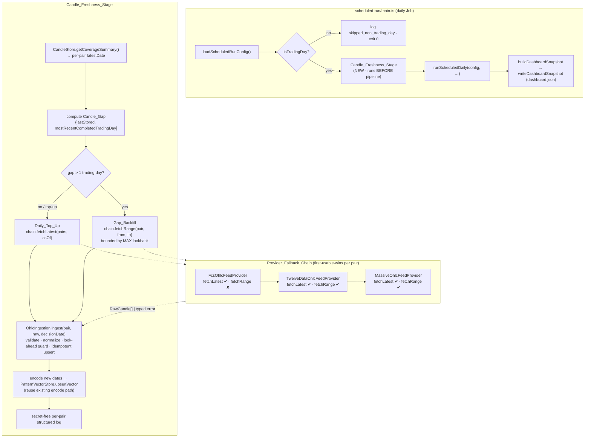

# Design Document

## Overview

This design turns the twelve requirements of `daily-candle-freshness-and-cleanup`
into a concrete plan. It has two parts that share one spec but almost no code:

1. **The feature — Candle freshness.** A new **Candle_Freshness_Stage** runs at
   the very start of the daily Cloud Run Job, *before* the deterministic pipeline
   reads candle history. For each of the five pairs it computes the gap between
   the last stored candle and the most recent Completed_Trading_Day, fetches the
   missing daily candles through an ordered **Provider_Fallback_Chain**
   (FCS → Twelve Data → Massive), and ingests them idempotently through the
   existing `OhlcIngestion` so look-ahead safety and OHLC validity are enforced
   unchanged. A one-off operator backfill closes the current 2026-09-15 → today
   hole.
2. **The chores — follow-up cleanup.** Resolve the trailing items from
   `simplify-to-cloud-minimal`: the Vertex AI 403, the ~50 MB DB dump in git, the
   Dependabot backlog, the plaintext live secrets in `.env`, and the stale
   cross-spec checkpoints.

This is **not** a greenfield build. It is a thin addition on top of a
feature-complete system. Two orderings and two invariants bound the whole design.

### Load-bearing orderings

1. **Freshen before you compute.** The Candle_Freshness_Stage must run before
   `runScheduledDaily` reads history (R2.1). The daily entry
   (`src/scheduled-run/main.ts`) today does: `loadScheduledRunConfig()` →
   `isTradingDay` gate → `buildDisplayDeps(config)` → `runScheduledDaily(config, …)`.
   The deterministic pipeline reads candles *inside* `runScheduledDaily`
   (via `makePipelineLoader(buildSupabaseStores(supabase))`), so the new stage is
   inserted after the weekday gate and before `runScheduledDaily`.
2. **Keep the loop green at every step.** Every code change keeps `make check`
   (lint + typecheck + vitest) and the web build green, with new behaviour
   covered by tests that inject `fetch` (no live network) (R12.3).

### Load-bearing invariants (carried over from the parent specs)

- **Research-integrity stays intact.** Candle ingestion remains Look_Ahead_Safe
  (no candle dated at/after a Decision_Date enters a decision), preserves
  idempotent `(asset, date)` upserts, and reuses `OhlcIngestion`
  (`src/ingestion/ohlcIngestion.ts`) rather than re-implementing OHLC handling.
  Nothing here touches the Measurement_Engine, baseline, shrinkage, or the
  AI-never-scores guard.
- **Fail-safe, data-first.** A candle-fetch failure degrades safely: the stage
  logs a secret-free warning and proceeds on the best available history rather
  than crashing or writing corrupt rows. API keys are referenced by name only,
  never logged.

### Investigation findings that drive the design

Confirmed by reading the code; these resolve the design's two hardest questions.

- **FCS `/forex/latest` is latest-only, not a date-range endpoint.**
  `src/external-signal/fcsProvider.ts` batches all five pairs into one
  `/forex/latest?symbol=…&period=1d&access_key=…` call that returns only the
  *latest* candle plus the daily change percent (`chp`). On the FCS free plan
  there is no historical date-range series. Consequence: **FCS can serve the
  Daily_Top_Up but cannot serve a multi-day Gap_Backfill.** Twelve Data
  (`TWELVE_DATA_API_KEY`) and Massive (`MASSIVE_API_KEY`) do expose daily
  time-series/history endpoints suitable for a date range. The provider port
  below therefore makes a **capability distinction explicit**: a provider
  advertises whether it supports a date-range history fetch (`fetchRange`) or
  only the latest candle (`fetchLatest`).
- **`OhlcIngestion.ingest(pair, raw, decisionDate?)` already does everything.**
  It validates OHLC validity (`validateCandle`), normalizes NY-close session
  boundaries (`normalizeSessionBoundary`), applies the look-ahead guard when a
  `decisionDate` is passed (rejects candles dated at/after it, throwing a
  `LookAheadViolation`), and idempotently upserts keyed by `(asset, date)` via
  `CandleStore.upsertCandles`. The freshness stage calls this verbatim and
  re-implements none of it.
- **Candles become pattern vectors through an existing encode path.**
  `src/staged-runner/stagedRunner.ts` `backfill()` shows the canonical
  candle → `encodePatternVector(window, decisionDate)` → `vectorStore.upsertVector`
  flow (trailing window strictly before the decision date, look-ahead safe). The
  freshness stage stores *candles*; a newly-stored candle date becomes a pattern
  vector by reusing that same encode path, so retrieval/firing see fresh data —
  no new encoder is written.
- **The config reader pattern exists.** `externalSignalConfigFromEnv`
  (`src/external-signal/types.ts`) reads provider/apiKey/baseUrl/timeout from an
  injected env map and returns `null` when unset. The OHLC-feed config reader
  mirrors this exactly.
- **The ops entry pattern exists.** `src/ops/evaluation-run/main.ts` is a
  run-to-completion operator entry with injectable deps (so it is unit-testable
  with no network) and a `invokedDirectly()` guard; the one-off backfill entry is
  modelled on it.
- **The runtime SA already (claims) `roles/aiplatform.user`.**
  `ops/required-resources.manifest.json` lists `job-runtime@` with
  `roles/aiplatform.user` and a `rolesNote` to "confirm it is granted". The 403
  (`aiplatform.endpoints.predict denied`) means the effective grant is missing or
  insufficient on the configured publisher model — R7 reconciles the live grant
  to the manifest.

## Architecture

The Candle_Freshness_Stage is a new, self-contained stage wired into the existing
daily entry. It depends only on the `CandleStore` port, the `OhlcIngestion`
service, the pattern-vector encode path, and the new OHLC_Feed_Provider chain.
It never reaches into the Measurement_Engine.



New / touched modules:

| Module | Status | Role |
| --- | --- | --- |
| `src/ingestion/ohlcFeed/types.ts` | new | `OhlcFeedProvider` port, capability flags, `RawCandle`-returning `Result`/typed error, `ohlcFeedConfigFromEnv`. |
| `src/ingestion/ohlcFeed/fcsOhlcProvider.ts` | new | FCS adapter (latest-only; `fetchRange` → `range_unsupported`). |
| `src/ingestion/ohlcFeed/twelveDataOhlcProvider.ts` | new | Twelve Data adapter (latest + range). |
| `src/ingestion/ohlcFeed/massiveOhlcProvider.ts` | new | Massive adapter (latest + range). |
| `src/ingestion/ohlcFeed/providerChain.ts` | new | Chain resolver: fixed order, first-usable-wins per pair, advance on unconfigured/failure/empty. |
| `src/scheduled-run/candleFreshness.ts` | new | The stage: gap compute, top-up/backfill, ingest, encode, log. |
| `src/scheduled-run/completedTradingDay.ts` | new | Most-recent-Completed_Trading_Day computation. |
| `src/scheduled-run/main.ts` | edit | Insert the stage call after the weekday gate, before `runScheduledDaily`. |
| `src/ops/candle-backfill/main.ts` | new | One-off bounded Gap_Backfill operator entry (R5). |
| `ops/required-resources.manifest.json` | edit | Record the corrected Vertex grant (R7). |
| `.gitignore` | edit | Ignore `ops/backups/` (R8). |

## Components and Interfaces

### Component 1 — OHLC_Feed_Provider port and capability model (R1, R4)

A thin, swappable port mirroring the external-signal `ExternalSignalProvider`
style: zero-SDK `fetch`, a `Result<RawCandle[], OhlcFeedError>` return (never a
throw), and per-pair fail-safety. The port exposes **two capabilities** so the
chain can route a request to a provider that actually supports it.

```ts
// src/ingestion/ohlcFeed/types.ts  (shapes shown for design intent)
import type { Result, TradingDate } from "../../guard/types.js";
import type { Pair, RawCandle } from "../types.js";

export const OHLC_FEED_FAILURE_MODES = [
  "unconfigured",      // provider has no API key
  "unavailable",       // network / non-200
  "invalid",           // malformed or non-JSON body
  "empty",             // 200 but no usable candle for the pair/range
  "range_unsupported", // provider cannot serve a date range (FCS free plan)
  "timeout",
] as const;
export type OhlcFeedFailureMode = (typeof OHLC_FEED_FAILURE_MODES)[number];

export interface OhlcFeedError {
  readonly reason: "ohlc_feed_error";
  readonly mode: OhlcFeedFailureMode;
  readonly provider: string; // provenance tag, never a secret
  readonly pair: Pair;
  readonly message: string;  // secret-free
}

export interface OhlcFeedProvider {
  /** Provenance tag stamped onto RawCandle.source and logs. */
  readonly name: string;
  /** Capability flags the chain reads to route a request. */
  readonly supportsLatest: boolean;
  readonly supportsRange: boolean;

  /** Daily_Top_Up: the most recent completed candle(s) for the pairs. */
  fetchLatest(
    pairs: readonly Pair[],
    asOf: TradingDate,
  ): Promise<ReadonlyMap<Pair, Result<readonly RawCandle[], OhlcFeedError>>>;

  /** Gap_Backfill: the daily series for one pair in [fromDate, toDate]. */
  fetchRange(
    pair: Pair,
    fromDate: TradingDate,
    toDate: TradingDate,
  ): Promise<Result<readonly RawCandle[], OhlcFeedError>>;
}
```

Three adapters implement this port over the built-in `fetch` (constructor takes
an injectable `fetchImpl: typeof fetch = fetch`, exactly like
`FcsExternalSignalProvider`, so tests inject a stub):

- **`FcsOhlcFeedProvider`** — `supportsLatest = true`, `supportsRange = false`.
  Reuses the proven `/forex/latest?symbol=…&period=1d&access_key=…` batch call
  pattern from `fcsProvider.ts` for `fetchLatest`, mapping the `active` OHLC
  fields of each row to `RawCandle`. `fetchRange` returns
  `err({ mode: "range_unsupported", … })` immediately so the chain advances —
  this is the explicit capability distinction (the key investigation finding).
- **`TwelveDataOhlcFeedProvider`** — `supportsLatest = true`,
  `supportsRange = true`. Calls Twelve Data's daily `time_series`
  (`interval=1day`, `symbol=EUR/USD`, `start_date`/`end_date`, `apikey=…`) for
  `fetchRange`; `fetchLatest` requests `outputsize=1`.
- **`MassiveOhlcFeedProvider`** — `supportsLatest = true`,
  `supportsRange = true`. Calls Massive's daily history endpoint for the range.

Each adapter **normalizes its native JSON to `RawCandle`** (R1.6): differing
field names, numeric-string units, and date formats are coerced to the single
`RawCandle` shape, and `source` is stamped with the provider `name`. All numeric
coercion is defensive (`Number`, `Number.isFinite`); a row that cannot be coerced
is dropped, not stored — the ultimate OHLC-validity decision still belongs to
`OhlcIngestion.validateCandle`.

**Config reader** `ohlcFeedConfigFromEnv(env = process.env)` mirrors
`externalSignalConfigFromEnv`: it reads, by name only,
`EXTERNAL_SIGNAL_API_KEY` (FCS, reusing the existing key), `TWELVE_DATA_API_KEY`,
`MASSIVE_API_KEY`, and the base URLs (FCS default `https://api-v4.fcsapi.com`;
Twelve Data and Massive base URLs from env — never hardcoded). A provider whose
key is absent yields no adapter and is simply skipped by the chain. No key value
is ever placed in a log line or an error message.

### Component 2 — Provider_Fallback_Chain resolver (R1.1, R1.3, R4.1)

`providerChain.ts` builds the ordered provider list **FCS → Twelve Data → Massive**
from the resolved config (an unconfigured provider is omitted) and exposes two
chain operations that are **first-usable-wins per pair**:

```ts
resolveLatest(pairs, asOf): Promise<ReadonlyMap<Pair, { candles: RawCandle[]; provider: string } | OhlcFeedError>>
resolveRange(pair, fromDate, toDate): Promise<{ candles: RawCandle[]; provider: string } | OhlcFeedError>
```

Resolution rules:

- For `resolveLatest`, start with the full pair set. Call the first provider's
  `fetchLatest`; any pair it returns usable candles for is *won* and removed from
  the outstanding set. Advance to the next provider for the **still-outstanding**
  pairs only. A provider that is unconfigured, errors, returns `empty`, or lacks
  `supportsLatest` contributes nothing and the pair stays outstanding (R1.3).
- For `resolveRange`, skip providers whose `supportsRange` is false (FCS →
  immediate advance), then first-usable-wins the same way.
- A pair/range that no provider could satisfy resolves to the **last** typed
  `OhlcFeedError` (secret-free) — the stage logs it and proceeds.
- Later providers never overwrite candles already won from an earlier one in the
  same run (R1.3) — won pairs are removed from the outstanding set before the
  next provider is tried.

### Component 3 — Completed_Trading_Day computation (R2, R3)

`completedTradingDay.ts` exports a pure function
`mostRecentCompletedTradingDay(decisionDate): TradingDate`. The daily candle is
defined on the 17:00 America/New_York (NY close) session boundary (see
`src/ingestion/sessionBoundary.ts` and `src/guard/tradingDate.ts`), and the look-
ahead rule requires candles strictly *before* the Decision_Date. The most recent
Completed_Trading_Day is therefore **the latest weekday strictly before
`decisionDate`**, computed by `addTradingDays(decisionDate, -1)` (which skips
weekends via `isTradingDay`). This reuses the existing trading-date helpers and
re-implements no calendar math.

**Weekends** are handled by `isTradingDay` / `addTradingDays` (Sat/Sun are never
Completed_Trading_Days). **Holidays** are a documented limitation: the project has
no holiday calendar, so a market holiday is treated as a trading day for gap
purposes. The consequence is bounded and benign — a provider simply returns no
candle for a holiday (an `empty`/missing row), the stage logs a residual gap, and
proceeds. Introducing a holiday calendar is explicitly out of scope.

### Component 4 — Candle_Freshness_Stage (R2, R3)

`candleFreshness.ts` exports `runCandleFreshnessStage(deps)` where `deps` carries
the injectable collaborators (so it is unit-testable with no network):

```ts
interface CandleFreshnessDeps {
  readonly decisionDate: TradingDate;
  readonly ingestion: OhlcIngestion;                 // built on the Supabase CandleStore
  readonly candleStore: CandleStore;                 // for coverage/getCandles
  readonly vectorStore: PatternVectorStore;          // for the encode step
  readonly chain: ProviderChain;                     // Component 2
  readonly maxLookbackTradingDays: number;           // Gap_Backfill bound (Component 5)
  readonly logger?: (event: object) => void;         // defaults to console.log(JSON.stringify(…))
}
```

Per pair, the stage:

1. Reads the last stored date from `candleStore.getCoverageSummary()`
   (`PerPairCoverage.latestDate`).
2. Computes `target = mostRecentCompletedTradingDay(decisionDate)` and the
   Candle_Gap `(latestDate, target]`.
3. If `latestDate === target` → **no fetch** beyond the top-up check (R3.4). If
   the gap is a single trading day (or `latestDate` is already `target`) → a
   **Daily_Top_Up** via `chain.resolveLatest`. If the gap spans more than one
   trading day → a **Gap_Backfill** via `chain.resolveRange(pair, from, target)`
   with `from` bounded by `maxLookbackTradingDays` (Component 5).
4. Ingests the fetched `RawCandle[]` through
   `ingestion.ingest(pair, raw, decisionDate)` — this is the single ingestion
   path (R1.4): it validates, normalizes NY-close boundaries, applies the
   look-ahead guard (so any candle dated at/after `decisionDate` is rejected,
   R2.2), and idempotently upserts (R2.3).
5. **Encodes new candle dates into pattern vectors** by reusing the
   `backfill()` encode path: for each newly covered date, read the trailing
   window from `candleStore.getCandles(pair)` and call
   `encodePatternVector(window, date)` → `vectorStore.upsertVector(pair, date, v)`.
   This is the exact look-ahead-safe window logic from `stagedRunner.ts`
   (window = candles strictly before the date); it is factored into a small
   shared helper rather than copied, so retrieval/firing downstream see fresh
   data without a new encoder.
6. Emits a **secret-free per-pair structured log** (R2.4): candles fetched,
   accepted, rejected, winning provider, resulting latest stored date, residual
   gap.

The stage returns a per-pair summary the caller may log at the stage level. It
never throws for a provider failure — the chain already returns typed errors, and
an unexpected throw inside the stage is caught at the `main.ts` call site
(Component 6) so the pipeline still runs on existing history.

### Component 5 — Gap detection and bounded backfill (R3)

The Candle_Gap for a pair is the completed trading days in `(latestDate, target]`
with no stored candle. The backfill is **bounded by a configured maximum
lookback** so an ancient (or null) `latestDate` cannot trigger an unbounded
request (R3.2):

- `maxLookbackTradingDays` is read from env
  (`CANDLE_FRESHNESS_MAX_LOOKBACK_DAYS`, non-secret) with a sensible default of
  **90 trading days** (~18 weeks — comfortably more than the current ~3-week hole,
  far short of the 2010-onwards history).
- The effective range start is
  `from = max(addTradingDays(latestDate, +1), addTradingDays(target, -maxLookbackTradingDays))`.
  When `latestDate` is `null` (a pair with no history) the window is simply the
  last `maxLookbackTradingDays` ending at `target`.
- **Partial catch-up** (R3.3): if the chain returns fewer candles than the gap
  (provider range limit, holiday, partial data), the stage ingests what it got,
  logs the residual gap per pair (secret-free), and proceeds — a partial
  catch-up is better than none and never blocks the run.

### Component 6 — Daily entry wiring (R2.1)

In `src/scheduled-run/main.ts`, after the `isTradingDay(config.decisionDate)`
gate and before `runScheduledDaily`, insert:

```ts
// Candle_Freshness_Stage (R2.1): bring candles up to the most recent
// Completed_Trading_Day BEFORE the deterministic pipeline reads history.
try {
  const stores = buildSupabaseStores(config.supabase);
  const chainConfig = ohlcFeedConfigFromEnv(process.env);
  if (chainConfig !== null) {
    await runCandleFreshnessStage({
      decisionDate: config.decisionDate,
      ingestion: new OhlcIngestion(stores.candleStore),
      candleStore: stores.candleStore,
      vectorStore: stores.vectorStore,
      chain: buildProviderChain(chainConfig),
      maxLookbackTradingDays: resolveMaxLookback(process.env),
    });
  } else {
    logStartupWarning("candle_freshness", new Error("no OHLC feed provider configured"));
  }
} catch (err) {
  // Fail-safe (R4.1): a stage error never crashes the Job; proceed on
  // existing history with a secret-free warning.
  logStartupWarning("candle_freshness", err);
}
```

The stage reuses the existing `logStartupWarning(collaborator, err)` helper
(already secret-free: it logs only `err.message`) and
`buildSupabaseStores(config.supabase)` (the same store builder
`evaluation-run`/`scheduled-run` use). When **every** provider is unconfigured,
`ohlcFeedConfigFromEnv` still returns a non-null config only if at least one key
is present; if none are present the stage is skipped with a secret-free log and
the run proceeds (R1.5).

### Component 7 — One-off backfill entry (R5)

`src/ops/candle-backfill/main.ts` is a run-to-completion operator entry modelled
on `src/ops/evaluation-run/main.ts`: injectable deps for unit testing with no
network, an `invokedDirectly()` guard, and secret-free structured logs. It runs a
**bounded Gap_Backfill** for all five pairs from each pair's last stored candle up
to `mostRecentCompletedTradingDay(decisionDate)`, ingesting through the same
`OhlcIngestion.ingest(pair, raw, decisionDate)` path (R5.2 — idempotent, safe to
re-run) and then encoding the new dates. On completion it reports, per pair, the
**new latest stored date and any residual gap** (names/dates only, no secrets)
(R5.3). Because FCS cannot serve the range, this entry drives the chain's
`resolveRange`, which skips FCS and reaches Twelve Data / Massive.

Executing it against the hosted DB is a **live write** (a ☁️ action) run under the
operational-safety protocol — reconcile target, show the exact command, operator
approval — and is never performed autonomously (R5.4, R12.4).

### Component 8 — Freshness verification (R6)

Verification is **read-only** and changes no decision path (R6.3):

- A read-only check that, per pair, the hosted `candles` table's latest stored
  date equals `mostRecentCompletedTradingDay(decisionDate)` modulo provider
  availability (R6.2), via `candleStore.getCoverageSummary()` /
  `getCandles(pair, …)`.
- A check that the published `dashboard.json` snapshot's `decisionDate` reflects
  a run computed over history that includes the most recent Completed_Trading_Day
  (R6.1). The snapshot is produced by `buildDashboardSnapshot` /
  `writeDashboardSnapshot` at the end of `main.ts`; verification only reads it.
- No change to the recorded Evaluation_Report path or the Measurement_Engine
  (R6.3) — the stage only ensures those paths read current data.

### Cleanup components (R7–R11)

These are discrete, mostly operational items; each is scoped tightly.

**R7 — Vertex AI 403.** The runtime SA `job-runtime@` needs the
`aiplatform.endpoints.predict` permission on the configured Vertex publisher
model to serve the display-only Gemini rationale. The fix is least-privilege:
confirm/grant the minimal binding (the `roles/aiplatform.user` already recorded in
`ops/required-resources.manifest.json`, verified effective on the publisher-model
resource) and update the manifest's `rolesNote` to record the corrected,
verified grant. A subsequent daily run must populate the AI rationale for at least
one firing pair (verified in logs/snapshot). The AI/Deterministic boundary is
untouched — the rationale stays display-only (R7.4). Grant and verification are
operator-gated live actions.

**R8 — Remove the large backup from git.** Add `ops/backups/` to `.gitignore`
(so no dump is committed in future), remove the tracked
`ops/backups/hosted-5.3-*.sql` (~50 MB) from the working tree, and confirm no
`*.sql` production dump remains tracked. Removing the blob from *history* is a
destructive, coordinated history rewrite — documented as an operator-approved
step, not run autonomously (R8.2).

**R9 — Dependabot triage.** Triage the reported findings (recorded as 20: 4
critical / 2 high / 12 moderate / 2 low) into three buckets: (a) **fixable by a
compatible bump** — apply with an **exact pinned version** honouring the no-ranges
policy and keep `make check` + web build green; (b) **requires a breaking change**
— record the decision and a migration note rather than silently bumping; (c)
**not applicable** — dev-only or unreachable at runtime — record the rationale.
The triage table lives in `PROJECT-STATE.md` / `RESEARCH-LOG.md` so no finding is
silently dropped.

**R10 — Rotate and untrack `.env` secrets.** Confirm `.env` is gitignored and
verify no secret value was ever committed (if any was, its history removal is a
documented operator-approved step). Rotate the live secrets currently in `.env`
(the Supabase keys/JWT/DB password and the FCS/Twelve Data/Massive provider API
keys — **by name only**), update the authoritative Secret_Manager versions to the
rotated values, verify the deployed Job still runs on the rotated versions by one
run, then disable/destroy the old versions. All steps are operator-approved live
actions; no secret value appears in the repo, logs, or this spec (R10.4).

**R11 — Reconcile trailing cross-spec checkpoints.** Reconcile to a single
consistent state: `dashboard-data-activation` Task 16 vs `dashboard-ui` Task 17
(one marks the other's smoke done while the other is unticked); complete or
explicitly defer `operational-wiring` Task 13 and tick Task 12's parent if its
subtasks are all done; complete or explicitly defer `dashboard-ui` Tasks 17/18
(post-deploy read-only smoke + final checkpoint). Then update `PROJECT-STATE.md`
§4 to reflect the corrected statuses (R11.4).

**R12 — Living docs and verification.** `PROJECT-STATE.md` records the
Candle_Freshness_Stage (stack/code-map/decisions) and moves the candle gap from an
open risk to resolved once closed; each actioned follow-up moves out of the
Obstacles / Immediate-next-steps lists; all code keeps `make check` and the web
build green; the new behaviour (OHLC_Feed_Provider adapters, chain resolver, gap
detection, fail-safe degradation) is covered by unit/property tests with injected
`fetch`; live-cloud actions run under the operational-safety protocol and are
recorded by non-secret reference only.

## Data Models

The feature introduces **no new persisted schema**. It reuses the existing
`candles` store and the pattern-vector store.

- **`RawCandle`** (`src/ingestion/types.ts`) — the single internal input shape all
  three providers normalize to: optional `asset`/`pair`/`date`/`timestamp`,
  numeric `open`/`high`/`low`/`close`, optional `source` (stamped with the winning
  provider name).
- **`Candle`** (`src/guard/types.ts`) — the stored, validated, session-normalized
  candle keyed by `(asset, date)`.
- **`OhlcFeedError`** (new, Component 1) — the typed, secret-free fail-safe error,
  mirroring `ExternalSignalError`.
- **`PerPairCoverage`** (`src/ingestion/types.ts`) — `{ pair, count, earliestDate,
  latestDate }`, read to compute the per-pair gap.
- **New env config (non-secret unless noted):** `EXTERNAL_SIGNAL_API_KEY`
  (secret, FCS, reused), `TWELVE_DATA_API_KEY` (secret), `MASSIVE_API_KEY`
  (secret), the Twelve Data / Massive base URLs,
  `CANDLE_FRESHNESS_MAX_LOOKBACK_DAYS` (non-secret, default 90). Secret keys are
  referenced by name only and never logged.

## Data Flow

Normal daily run (happy path):

1. `main()` resolves config, passes the weekday gate.
2. Candle_Freshness_Stage reads per-pair `latestDate`, computes the gap to
   `mostRecentCompletedTradingDay(decisionDate)`.
3. For a one-day gap: `chain.resolveLatest` → FCS wins (its `/forex/latest`
   batch serves the most recent completed candle). For a multi-day gap:
   `chain.resolveRange` → FCS skipped (`range_unsupported`) → Twelve Data serves
   the range.
4. Fetched `RawCandle[]` → `OhlcIngestion.ingest(pair, raw, decisionDate)`:
   validate → normalize NY-close → look-ahead guard → idempotent upsert.
5. New dates → `encodePatternVector` → `vectorStore.upsertVector`.
6. Secret-free per-pair log emitted.
7. `runScheduledDaily` reads the now-fresh history and produces the firing view;
   `dashboard.json` is published.

Degraded paths: a provider failure advances the chain (R4.1); all providers
failing → secret-free warning + proceed on existing history (R1.5); an invalid
candle is rejected by `OhlcIngestion` and recorded in the ingest report, never
stored (R4.2); a partial range ingests what it got and logs the residual (R3.3).

## Error Handling

- **Provider failure is data, not an exception.** Every adapter returns
  `Result<RawCandle[], OhlcFeedError>`; the chain turns a failure/empty/
  unconfigured/`range_unsupported` into "advance to the next provider". Only when
  the whole chain is exhausted does a pair resolve to a typed error, which the
  stage logs (secret-free) before proceeding (R4.1).
- **Non-corrupting ingestion.** Storage mutations are only `(asset, date)`
  upserts via `CandleStore.upsertCandles`; the stage never deletes history (R4.3).
  Existing candles are preserved; a re-run is a no-op on storage (idempotent,
  R2.3).
- **Look-ahead safety is enforced at ingestion.** Passing `decisionDate` to
  `ingest` makes the `lookAheadGuard.assertPastOnly` reject any candle dated
  at/after it (a `LookAheadViolation`), so no future candle can enter a decision
  (R2.2). A provider that returns an at/after-dated row has that row rejected, not
  stored.
- **Bounded work keeps within the Job timeout.** The chain batches the top-up
  into as few requests as each provider allows (FCS: one batched call for all
  five pairs; respecting its free-plan ~3 req/min limit), the Gap_Backfill is one
  bounded request per pair, and the lookback cap bounds the range — so the stage's
  request count and payload are bounded under normal conditions (R4.4).
- **Secret confidentiality.** No API key or secret value is logged or placed in an
  error message anywhere in the stage, adapters, chain, or ops entry (R1.7).

## Correctness Properties

*A property is a characteristic or behavior that should hold true across all
valid executions of a system — essentially, a formal statement about what the
system should do. Properties serve as the bridge between human-readable
specifications and machine-verifiable correctness guarantees.*

The following prework analysis classified each testable acceptance criterion, then
properties were formulated from the testable ones.

### Property 1: Idempotent ingestion

*For any* sequence of fetched candle batches for a pair and Decision_Date,
ingesting a batch once and then ingesting the same batch again (or any batch whose
candles share the same `(asset, date)` keys and values) SHALL leave the stored
candle set unchanged after the second ingest — no duplicate rows and no mutated
values.

**Validates: Requirements 2.3, 4.3, 5.2**

### Property 2: Look-ahead safety of ingested candles

*For any* set of `RawCandle`s and any Decision_Date, after ingestion through
`OhlcIngestion.ingest(pair, raw, decisionDate)` no stored candle for that pair
SHALL have a date on or after the Decision_Date; every candle dated at/after it is
rejected rather than stored.

**Validates: Requirements 2.2, 4.2**

### Property 3: Fallback-chain first-usable-wins per pair

*For any* ordered chain of providers and any per-pair outcome assignment (each
provider either returns usable candles, errors, returns empty, is unconfigured,
or lacks the needed capability), the chain's resolved result for each pair SHALL
be the candles from the **earliest** provider in the order that returns usable
candles for that pair, and a later provider SHALL NOT overwrite a pair already won
by an earlier one.

**Validates: Requirements 1.3, 4.1**

### Property 4: Bounded backfill lookback

*For any* last-stored date (including `null`) and any Decision_Date, the
Gap_Backfill range start SHALL be no earlier than
`addTradingDays(mostRecentCompletedTradingDay(decisionDate), -maxLookbackTradingDays)`,
so the requested range never exceeds the configured maximum lookback regardless of
how old (or absent) the last-stored date is.

**Validates: Requirements 3.2, 4.4**

### Property 5: Normalization to RawCandle preserves OHLC values verbatim

*For any* provider-native daily row with coercible finite numeric OHLC fields, the
adapter's normalization to `RawCandle` SHALL preserve the open/high/low/close
values exactly (modulo the provider's documented unit scaling) and SHALL stamp
`source` with that provider's name, so OHLC-validity and session-boundary rules
apply identically no matter which provider supplied the candle.

**Validates: Requirements 1.4, 1.6**

### Property 6: All-fail degradation is non-destructive

*For any* run in which every provider in the chain is unconfigured or fails for a
pair, the stage SHALL make no deletion and no non-upsert mutation to that pair's
stored candles, leaving the pre-run stored set exactly intact while a secret-free
warning is logged.

**Validates: Requirements 1.5, 4.1, 4.3**

### Property 7: No gap ⇒ no range fetch

*For any* pair whose last stored candle date already equals the most recent
Completed_Trading_Day for the Decision_Date, the stage SHALL perform no
Gap_Backfill range request for that pair.

**Validates: Requirements 3.4**

## Testing Strategy

**Dual approach.** Property-based tests cover the universal invariants above;
example-based unit tests and lightweight integration-style tests cover specific
scenarios, edge cases, and wiring. All tests inject `fetch` (or inject the
provider chain / in-memory `CandleStore`) so **no live network** is touched
(R12.3). PBT applies here because the core logic — chain resolution, gap
computation, normalization, idempotent/look-ahead ingestion — is pure, input-
driven, and has a large input space; the live-cloud and config-wiring pieces (the
one-off backfill against the hosted DB, the Vertex grant, the SA/IAM, snapshot
publication) are **not** PBT targets and are verified by example/smoke/integration
checks or operator-gated runs.

**Property-based tests** (minimum 100 iterations each; a library such as
`fast-check`, consistent with the existing `*.property.test.ts` suites in
`src/csv-loader`, `src/baseline`, `src/confidence`). Each is tagged
**Feature: daily-candle-freshness-and-cleanup, Property {n}: {property text}** and
references its design property:

- Property 1 — generate random candle batches, ingest twice through an in-memory
  `CandleStore`, assert the store is byte-identical after the second ingest.
- Property 2 — generate `RawCandle`s with dates straddling a random Decision_Date,
  assert no stored date ≥ Decision_Date.
- Property 3 — generate random per-provider per-pair outcome assignments, assert
  the resolved winner per pair is the earliest usable provider and no overwrite
  occurs.
- Property 4 — generate random (possibly ancient / null) last-stored dates and
  Decision_Dates, assert the computed range start respects the lookback bound.
- Property 5 — generate random provider-native rows, assert normalized `RawCandle`
  OHLC values and `source` are preserved.
- Property 6 — generate runs where all providers fail, assert the pre-run stored
  set is unchanged (no delete, no spurious mutation).
- Property 7 — generate pairs already at the most recent Completed_Trading_Day,
  assert no range request is issued.

**Unit / example tests:**

- `ohlcFeedConfigFromEnv` returns the right adapters for present/absent keys and
  never surfaces a key value.
- Each adapter maps a representative native success body and each failure mode
  (non-200, non-JSON, empty, FCS `fetchRange` → `range_unsupported`) to the right
  `Result`.
- `mostRecentCompletedTradingDay` for Monday/weekend/mid-week Decision_Dates
  (weekend-skip behaviour; holiday limitation noted, not tested).
- The stage emits a secret-free per-pair log and continues on an injected stage
  error (fail-safe wiring).
- The one-off backfill entry (`src/ops/candle-backfill/main.ts`) runs end-to-end
  against injected in-memory stores and a stub chain, reporting per-pair new latest
  date + residual gap; the live run is operator-gated.

**Secret-free assertion.** A shared test asserts that no log line or error message
emitted by the adapters, chain, stage, or ops entry contains any configured key
value (R1.7, R12.4).
