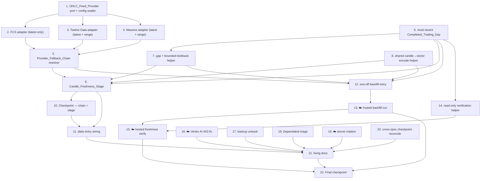

# Implementation Plan: Daily Candle Freshness and Cleanup

## Overview

This plan turns the design into incremental, test-driven coding tasks. It is a
thin addition on top of a feature-complete system, not a greenfield build. Every
task leaves `make check` (lint + typecheck + vitest) and the web build green,
with new behaviour covered by tests that inject `fetch` (or an in-memory
`CandleStore` / stub chain) so **no live network** is touched in tests (R12.3).

The feature is built bottom-up along the design's components:

- **Phase 1** — the `OHLC_Feed_Provider` port + three adapters + the
  `Provider_Fallback_Chain` resolver (design Components 1–2; R1, R4).
- **Phase 2** — `Completed_Trading_Day` computation, bounded gap detection, and
  the `Candle_Freshness_Stage` itself, reusing `OhlcIngestion` and the existing
  pattern-vector encode path (Components 3–5; R2, R3, R4).
- **Phase 3** — wiring the stage into the daily entry, fail-safe (Component 6; R2.1, R4.1).
- **Phase 4** — the one-off operator backfill entry + its live run (Component 7; R5).
- **Phase 5** — read-only freshness verification (Component 8; R6).
- **Phase 6** — the follow-up cleanup chores, each discrete (R7–R11).
- **Phase 7** — living docs + a final checkpoint (R12).

The feature (Phases 1–5) is ordered before most cleanup. R9 (deps) and R8
(backup untrack) are independent and may be done at any time.

## Task Dependency Graph

The feature chain runs bottom-up from the provider port; the cleanup chores
(16–20) are largely independent of that chain and may run at any time (17 and
18 are explicitly independent). Living docs (21) depend on the feature landing
plus the chores they document, and the final checkpoint (22) depends on
everything. ☁️ marks the operator-gated live-cloud tasks.

```json
{
  "waves": [
    { "id": 0, "tasks": ["1"] },
    { "id": 1, "tasks": ["1.1", "2", "3", "4", "6", "8"] },
    { "id": 2, "tasks": ["2.1", "3.1", "4.1", "4.2", "5", "6.1", "7"] },
    { "id": 3, "tasks": ["5.1", "5.2", "7.1", "9"] },
    { "id": 4, "tasks": ["9.1", "9.2", "9.3", "9.4", "9.5", "10", "12"] },
    { "id": 5, "tasks": ["11", "12.1", "14"] },
    { "id": 6, "tasks": ["11.1", "13", "14.1"] },
    { "id": 7, "tasks": ["15"] },
    { "id": 8, "tasks": ["16", "17", "18", "19", "20"] },
    { "id": 9, "tasks": ["21"] },
    { "id": 10, "tasks": ["22"] }
  ]
}
```



> **Live-cloud tasks are marked ☁️.** They run under the operational-safety
> protocol — reconcile the target (project/account/DB), show the exact command,
> execute only on operator approval — and are **never run autonomously** (R5.4,
> R12.4). Secrets are referenced by name only, never a value in the repo, logs,
> or this spec.

Test sub-tasks are marked optional with `*`. Core implementation tasks and
live-cloud tasks are never optional. Each `fast-check` property test runs a
minimum of 100 iterations, is tagged `// Feature: daily-candle-freshness-and-cleanup,
Property N: ...` in the repo convention (consistent with the existing
`*.property.test.ts` suites in `src/csv-loader`, `src/baseline`, `src/confidence`),
and carries a `**Validates: Requirements X.Y**` line matching the design.

## Tasks

### Phase 1 — Provider port + fallback chain (design Components 1–2; R1, R4)

- [x] 1. Define the OHLC_Feed_Provider port, typed error, and config reader
  - Create `src/ingestion/ohlcFeed/types.ts` (Component 1): the
    `OhlcFeedProvider` port (`name`, `supportsLatest`, `supportsRange`,
    `fetchLatest`, `fetchRange`), the `OHLC_FEED_FAILURE_MODES` tuple +
    `OhlcFeedFailureMode`, the secret-free `OhlcFeedError`
    (`reason: "ohlc_feed_error"`, `mode`, `provider`, `pair`, `message`), and
    the `Result<readonly RawCandle[], OhlcFeedError>` return shape. Methods
    return a `Result`, never throw.
  - Implement `ohlcFeedConfigFromEnv(env = process.env)` mirroring
    `externalSignalConfigFromEnv`: read `EXTERNAL_SIGNAL_API_KEY` (FCS, reused),
    `TWELVE_DATA_API_KEY`, `MASSIVE_API_KEY`, and the FCS / Twelve Data / Massive
    base URLs **by name only** (FCS default `https://api-v4.fcsapi.com`; other
    base URLs from env, never hardcoded); return `null` when no provider key is
    present. No key value is ever placed in a log line or an error message.
  - _Requirements: 1.1, 1.5, 1.7_

  - [x] 1.1 Write unit tests for `ohlcFeedConfigFromEnv`
    - Assert it returns a config carrying only the providers whose keys are
      present, returns `null` when all keys are absent, and never surfaces a key
      value in its output or in a thrown/logged message (keys referenced by name
      only).
    - _Requirements: 1.1, 1.5, 1.7_

- [x] 2. Implement the FCS OHLC adapter (latest-only)
  - Create `src/ingestion/ohlcFeed/fcsOhlcProvider.ts` (Component 1):
    `FcsOhlcFeedProvider` with `supportsLatest = true`, `supportsRange = false`,
    constructor taking an injectable `fetchImpl: typeof fetch = fetch` (exactly
    like `FcsExternalSignalProvider`). `fetchLatest` reuses the proven
    `/forex/latest?symbol=…&period=1d&access_key=…` batch call pattern from
    `src/external-signal/fcsProvider.ts`, mapping each row's OHLC fields to
    `RawCandle` and stamping `source` with the provider `name`. `fetchRange`
    returns `err({ mode: "range_unsupported", … })` immediately so the chain
    advances. Defensive numeric coercion (`Number`, `Number.isFinite`); an
    uncoercible row is dropped, not stored.
  - _Requirements: 1.2, 1.3, 1.6, 1.7, 4.1_

  - [x] 2.1 Write unit tests for the FCS adapter with injected `fetch`
    - `fetchLatest` maps a representative success body to `RawCandle[]`;
      `fetchRange` returns `range_unsupported`; fail-safe mapping for network
      error (`unavailable`), non-200 (`unavailable`), non-JSON body (`invalid`),
      and no usable row (`empty`); assert no secret/API-key value appears in any
      returned error message.
    - _Requirements: 1.2, 1.3, 1.6, 1.7, 4.1_

- [x] 3. Implement the Twelve Data OHLC adapter (latest + range)
  - Create `src/ingestion/ohlcFeed/twelveDataOhlcProvider.ts` (Component 1):
    `TwelveDataOhlcFeedProvider` with `supportsLatest = true`,
    `supportsRange = true`, injectable `fetchImpl`. `fetchRange` calls the daily
    `time_series` endpoint (`interval=1day`, `symbol=EUR/USD`,
    `start_date`/`end_date`, `apikey=…`); `fetchLatest` requests
    `outputsize=1`. Normalize the native JSON (field names, numeric-string
    units, date formats) to `RawCandle`, stamping `source` with `name`.
  - _Requirements: 1.2, 1.3, 1.6_

  - [x] 3.1 Write unit tests for the Twelve Data adapter with injected `fetch`
    - `fetchLatest` and `fetchRange` map representative success bodies to
      `RawCandle[]` with preserved OHLC values; each failure mode (non-200,
      non-JSON, empty) maps to the right `Result`; no secret logged.
    - _Requirements: 1.2, 1.3, 1.6_

- [x] 4. Implement the Massive OHLC adapter (latest + range)
  - Create `src/ingestion/ohlcFeed/massiveOhlcProvider.ts` (Component 1):
    `MassiveOhlcFeedProvider` with `supportsLatest = true`,
    `supportsRange = true`, injectable `fetchImpl`. `fetchRange` calls Massive's
    daily history endpoint for the range; `fetchLatest` requests the most recent
    daily candle. Normalize the native JSON to `RawCandle`, stamping `source`
    with `name`.
  - _Requirements: 1.2, 1.3, 1.6_

  - [x] 4.1 Write unit tests for the Massive adapter with injected `fetch`
    - `fetchLatest` and `fetchRange` map representative success bodies to
      `RawCandle[]`; failure modes map correctly; no secret logged.
    - _Requirements: 1.2, 1.3, 1.6_

- [x] 4.2 Write property test — normalization to RawCandle preserves OHLC verbatim
  - **Property 5: Normalization to RawCandle preserves OHLC values verbatim**
  - `// Feature: daily-candle-freshness-and-cleanup, Property 5: normalization to RawCandle preserves OHLC values verbatim`
  - Generate random provider-native daily rows with coercible finite OHLC
    fields; assert each adapter's normalization preserves open/high/low/close
    exactly (modulo documented unit scaling) and stamps `source` with the
    provider name.
  - **Validates: Requirements 1.4, 1.6**

- [x] 5. Implement the Provider_Fallback_Chain resolver
  - Create `src/ingestion/ohlcFeed/providerChain.ts` (Component 2):
    `buildProviderChain(config)` assembles the ordered list **FCS → Twelve Data
    → Massive** from the resolved config (an unconfigured provider is omitted),
    exposing `resolveLatest(pairs, asOf)` and `resolveRange(pair, fromDate,
    toDate)`. Rules: first-usable-wins per pair; a won pair is removed from the
    outstanding set before the next provider is tried (later providers never
    overwrite); advance past a provider that is unconfigured, errors, returns
    `empty`, or lacks the needed capability (`supportsRange` false → skip for a
    range); a pair/range no provider could satisfy resolves to the last typed
    secret-free `OhlcFeedError`.
  - _Requirements: 1.1, 1.3, 4.1_

  - [x] 5.1 Write unit tests for the chain resolver
    - FCS wins the top-up; FCS skipped on a range (`range_unsupported`) so Twelve
      Data serves it; an unconfigured/empty/erroring provider is advanced past;
      all-providers-fail resolves to a typed secret-free error.
    - _Requirements: 1.1, 1.3, 4.1_

  - [x] 5.2 Write property test — fallback-chain first-usable-wins per pair
    - **Property 3: Fallback-chain first-usable-wins per pair**
    - `// Feature: daily-candle-freshness-and-cleanup, Property 3: fallback-chain first-usable-wins per pair`
    - Generate random per-provider per-pair outcome assignments (usable / error /
      empty / unconfigured / missing-capability); assert the resolved winner per
      pair is the earliest usable provider in the order and no later provider
      overwrites a pair already won.
    - **Validates: Requirements 1.3, 4.1**

### Phase 2 — Completed_Trading_Day + freshness stage (Components 3–5; R2, R3, R4)

- [x] 6. Implement most-recent-Completed_Trading_Day computation
  - Create `src/scheduled-run/completedTradingDay.ts` (Component 3): a pure
    `mostRecentCompletedTradingDay(decisionDate): TradingDate` returning the
    latest weekday strictly before `decisionDate` via
    `addTradingDays(decisionDate, -1)`, reusing `isTradingDay` / `addTradingDays`
    (no new calendar math). Holidays are a documented limitation (no holiday
    calendar), handled benignly downstream.
  - _Requirements: 2.2, 3.1_

  - [x] 6.1 Write property test — look-ahead safety of Completed_Trading_Day
    - **Property 2: Look-ahead safety of ingested candles** (the
      Completed_Trading_Day half: the stage only ever targets dates strictly
      before the Decision_Date)
    - `// Feature: daily-candle-freshness-and-cleanup, Property 2: look-ahead safety — most-recent completed trading day is strictly before the decision date`
    - Generate random Decision_Dates (incl. Mondays / weekends / mid-week);
      assert `mostRecentCompletedTradingDay(d)` is a weekday, is strictly before
      `d`, and that no weekend date is ever returned.
    - **Validates: Requirements 2.2, 3.1**

- [x] 7. Implement gap computation and the bounded-lookback helper
  - Add gap detection (Component 5) alongside the stage: compute the Candle_Gap
    as the completed trading days in `(latestDate, target]` with no stored
    candle, and a bounded range-start helper `from = max(addTradingDays(latestDate,
    +1), addTradingDays(target, -maxLookbackTradingDays))`, with `latestDate ===
    null` yielding the last `maxLookbackTradingDays` ending at `target`. Read
    `maxLookbackTradingDays` from env (`CANDLE_FRESHNESS_MAX_LOOKBACK_DAYS`,
    non-secret, default **90**) via a `resolveMaxLookback(env)` reader.
  - _Requirements: 3.1, 3.2_

  - [x] 7.1 Write property test — bounded backfill lookback
    - **Property 4: Bounded backfill lookback**
    - `// Feature: daily-candle-freshness-and-cleanup, Property 4: bounded backfill lookback`
    - Generate random (possibly ancient or `null`) last-stored dates and
      Decision_Dates; assert the computed range start is never earlier than
      `addTradingDays(mostRecentCompletedTradingDay(decisionDate), -maxLookbackTradingDays)`.
    - **Validates: Requirements 3.2, 4.4**

- [x] 8. Factor the shared candle→vector encode helper out of the staged runner
  - Extract the `backfill()` candle → `encodePatternVector(window, decisionDate)`
    → `vectorStore.upsertVector` flow from `src/staged-runner/stagedRunner.ts`
    into a small shared, look-ahead-safe encode helper (trailing window strictly
    before the date), so the freshness stage and the staged-runner backfill share
    one encode path rather than copying it. Keep existing staged-runner tests
    green.
  - _Requirements: 2.1, 6.3_

- [x] 9. Implement the Candle_Freshness_Stage
  - Create `src/scheduled-run/candleFreshness.ts` (Component 4):
    `runCandleFreshnessStage(deps)` where `deps` carries the injectable
    collaborators (`decisionDate`, `ingestion`, `candleStore`, `vectorStore`,
    `chain`, `maxLookbackTradingDays`, optional `logger`) so it is unit-testable
    with no network. Per pair: read `latestDate` from
    `candleStore.getCoverageSummary()`; compute `target` and the gap; choose a
    **Daily_Top_Up** (`chain.resolveLatest`) for a one-day/no gap or a bounded
    **Gap_Backfill** (`chain.resolveRange`) for a multi-day gap; ingest the
    fetched `RawCandle[]` through `ingestion.ingest(pair, raw, decisionDate)`
    (validate / normalize NY-close / look-ahead guard / idempotent upsert);
    encode newly covered dates via the shared encode helper (task 8) →
    `vectorStore.upsertVector`; emit a secret-free per-pair structured log
    (fetched / accepted / rejected / winning provider / resulting latest date /
    residual gap). The stage never throws for a provider failure.
  - _Requirements: 2.1, 2.2, 2.3, 2.4, 3.1, 3.2, 3.3, 3.4, 4.1, 4.2, 4.3, 4.4_

  - [x] 9.1 Write unit tests for the stage with injected chain + in-memory stores
    - No network: a single-day top-up ingests the latest candle; a multi-day
      backfill ingests the range; a no-gap pair triggers no range fetch; a
      partial catch-up ingests what it got and logs the residual; an invalid
      candle is rejected (not stored); a re-run is a storage no-op; all-providers-
      fail logs a secret-free warning and proceeds; the per-pair log carries no
      secret.
    - _Requirements: 2.1, 2.3, 2.4, 3.1, 3.3, 3.4, 4.1, 4.2, 4.3_

  - [x] 9.2 Write property test — idempotent ingestion
    - **Property 1: Idempotent ingestion**
    - `// Feature: daily-candle-freshness-and-cleanup, Property 1: idempotent ingestion`
    - Generate random candle batches; ingest once then again through an in-memory
      `CandleStore`; assert the stored set is unchanged after the second ingest
      (no duplicate rows, no mutated values).
    - **Validates: Requirements 2.3, 4.3, 5.2**

  - [x] 9.3 Write property test — look-ahead safety of ingested candles
    - **Property 2: Look-ahead safety of ingested candles**
    - `// Feature: daily-candle-freshness-and-cleanup, Property 2: look-ahead safety of ingested candles`
    - Generate `RawCandle`s with dates straddling a random Decision_Date; after
      ingestion through `ingest(pair, raw, decisionDate)` assert no stored candle
      is dated on/after the Decision_Date (at/after rows rejected, not stored).
    - **Validates: Requirements 2.2, 4.2**

  - [x] 9.4 Write property test — all-fail degradation is non-destructive
    - **Property 6: All-fail degradation is non-destructive**
    - `// Feature: daily-candle-freshness-and-cleanup, Property 6: all-fail degradation is non-destructive`
    - Generate runs where every provider fails/unconfigured for a pair; assert the
      pre-run stored set is exactly intact (no delete, no non-upsert mutation)
      while a secret-free warning is logged.
    - **Validates: Requirements 1.5, 4.1, 4.3**

  - [x] 9.5 Write property test — no gap ⇒ no range fetch
    - **Property 7: No gap ⇒ no range fetch**
    - `// Feature: daily-candle-freshness-and-cleanup, Property 7: no gap means no range fetch`
    - Generate pairs whose last stored date already equals the most recent
      Completed_Trading_Day; assert no `resolveRange` request is issued for that
      pair.
    - **Validates: Requirements 3.4**

- [x] 10. Checkpoint — provider chain + freshness stage
  - Ensure all tests pass, ask the user if questions arise.

### Phase 3 — Daily entry wiring (Component 6; R2.1, R4.1)

- [x] 11. Wire the Candle_Freshness_Stage into the daily entry
  - In `src/scheduled-run/main.ts` (Component 6), after the
    `isTradingDay(config.decisionDate)` gate and before `runScheduledDaily`,
    insert the stage call inside a `try/catch`: build stores with
    `buildSupabaseStores(config.supabase)`, resolve `ohlcFeedConfigFromEnv(process.env)`,
    and when non-null call `runCandleFreshnessStage({ ... chain:
    buildProviderChain(chainConfig), maxLookbackTradingDays:
    resolveMaxLookback(process.env), ... })`; when the config is `null` skip with
    `logStartupWarning("candle_freshness", …)`. The `catch` routes any stage
    error through the existing secret-free `logStartupWarning` so a stage error
    never crashes the Job (fail-safe) and the pipeline proceeds on existing
    history.
  - _Requirements: 2.1, 1.4, 1.5, 4.1_

  - [x] 11.1 Write unit/integration test for the wiring with injected deps
    - The stage runs after the weekday gate and before `runScheduledDaily`; a
      thrown stage error is caught and the run still proceeds (fail-safe); a
      `null` provider config skips the stage with a secret-free log.
    - _Requirements: 2.1, 1.4, 1.5, 4.1_

### Phase 4 — One-off backfill entry (Component 7; R5)

- [x] 12. Implement the one-off backfill operator entry
  - Create `src/ops/candle-backfill/main.ts` (Component 7), modelled on
    `src/ops/evaluation-run/main.ts`: injectable deps for unit testing with no
    network, an `invokedDirectly()` guard, and secret-free structured logs. It
    runs a bounded Gap_Backfill for all five pairs from each pair's last stored
    candle up to `mostRecentCompletedTradingDay(decisionDate)`, driving
    `chain.resolveRange` (skips FCS → reaches Twelve Data / Massive), ingesting
    through `ingestion.ingest(pair, raw, decisionDate)` (idempotent, safe to
    re-run) and encoding the new dates. On completion it reports per pair the new
    latest stored date and any residual gap (names/dates only, no secrets).
  - _Requirements: 5.1, 5.2, 5.3_

  - [x] 12.1 Write unit tests for the one-off backfill entry (no network)
    - Against injected in-memory stores and a stub chain: runs end-to-end for the
      five pairs, is idempotent on a second run, and reports per-pair new latest
      date + residual gap with no secret in the output.
    - _Requirements: 5.1, 5.2, 5.3_

- [x] 13. ☁️ Operator-approved one-off backfill run against hosted
  - **Live write — run under the operational-safety protocol, NOT autonomously.**
    Reconcile the hosted target, show the exact command for approval, then run
    `src/ops/candle-backfill/main.ts` against the hosted DB to close the current
    2026-09-15 → today hole for all five pairs. Confirm per-pair the new latest
    stored date and residual gap (names/dates only, no secrets).
  - _Requirements: 5.4, 5.3_

### Phase 5 — Freshness verification (Component 8; R6)

- [ ] 14. Implement the read-only freshness verification check
  - Add a read-only verification helper (Component 8) that, per pair, compares the
    latest stored candle date (via `candleStore.getCoverageSummary()` /
    `getCandles`) against `mostRecentCompletedTradingDay(decisionDate)` (modulo
    provider availability), and confirms the published `dashboard.json` snapshot's
    `decisionDate` reflects a run computed over history including the most recent
    Completed_Trading_Day. The check only reads — it changes no decision path and
    does not touch the recorded Evaluation_Report path or the Measurement_Engine.
  - _Requirements: 6.1, 6.2, 6.3_

  - [ ] 14.1 Write unit tests for the verification check (read-only)
    - With injected stores + a sample snapshot: a fresh pair verifies equal;
      a stale pair reports the residual gap; the check performs no write and
      leaves stored candles untouched.
    - _Requirements: 6.2, 6.3_

- [ ] 15. ☁️ Operator-approved post-run freshness verification against hosted
  - **Live read-only check under the operational-safety protocol.** After a daily
    run, verify against hosted that per-pair latest stored date equals the most
    recent Completed_Trading_Day and that `dashboard.json`'s Decision_Date
    reflects fresh history. Record non-secret references only.
  - _Requirements: 6.1, 6.2_

### Phase 6 — Follow-up cleanup (R7–R11)

- [ ] 16. ☁️ Resolve the Vertex AI 403 (least-privilege predict permission)
  - **Live operator-approved IAM change under the operational-safety protocol.**
    Confirm/grant the minimal `aiplatform.endpoints.predict` permission for
    `job-runtime@` on the configured Vertex publisher model (reconcile the
    recorded `roles/aiplatform.user` to the effective grant); update
    `ops/required-resources.manifest.json`'s `rolesNote` to record the corrected,
    verified grant; verify a subsequent daily run populates the AI rationale for
    at least one firing pair (logs/snapshot). The rationale stays display-only —
    the AI/Deterministic boundary is untouched.
  - _Requirements: 7.1, 7.2, 7.3, 7.4_

- [ ] 17. Remove the large DB backup from version control
  - Add `ops/backups/` to `.gitignore` so no dump is committed in future; remove
    the tracked `ops/backups/hosted-5.3-*.sql` (~50 MB) from the working tree;
    confirm no `*.sql` production dump remains tracked. Removing the ~50 MB blob
    from git *history* is a destructive, coordinated history rewrite — documented
    as an operator-approved step, not run autonomously.
  - _Requirements: 8.1, 8.2, 8.3_

- [ ] 18. Triage and apply the Dependabot findings
  - Triage the reported findings (recorded as 20: 4 critical / 2 high / 12
    moderate / 2 low) into three buckets: (a) fixable by a compatible bump — apply
    with an **exact pinned version** (no ranges) keeping `make check` + the web
    build green; (b) requires a breaking change — record the decision and a
    migration note; (c) not applicable (dev-only / unreachable) — record the
    rationale. The triage table lives in `PROJECT-STATE.md` / `RESEARCH-LOG.md`
    so no finding is silently dropped.
  - _Requirements: 9.1, 9.2, 9.3_

- [ ] 19. ☁️ Rotate and untrack the live `.env` secrets
  - **Live operator-approved rotation under the operational-safety protocol.**
    Confirm `.env` is gitignored and no secret value was ever committed (history
    removal, if needed, is a documented operator-approved step). Rotate the live
    secrets currently in `.env` (Supabase keys/JWT/DB password; FCS / Twelve Data
    / Massive provider keys — **by name only**); update the authoritative
    Secret_Manager versions to the rotated values; verify one deployed run on the
    rotated versions; then disable/destroy the old versions. No secret value
    appears in the repo, logs, or this spec.
  - _Requirements: 10.1, 10.2, 10.3, 10.4_

- [ ] 20. Reconcile the trailing cross-spec checkpoints
  - Reconcile to a single consistent state: `dashboard-data-activation` Task 16 vs
    `dashboard-ui` Task 17 (one marks the other's smoke done while the other is
    unticked); complete or explicitly defer `operational-wiring` Task 13 and tick
    Task 12's parent if its subtasks are all done; complete or explicitly defer
    `dashboard-ui` Tasks 17/18 (post-deploy read-only smoke + final checkpoint).
    Update `PROJECT-STATE.md` §4 to reflect the corrected statuses.
  - _Requirements: 11.1, 11.2, 11.3, 11.4_

### Phase 7 — Living docs + final checkpoint (R12)

- [ ] 21. Update the living documents
  - Update `PROJECT-STATE.md` to record the Candle_Freshness_Stage
    (stack / code-map / decisions) and move the candle-gap risk from open to
    resolved once closed; move each actioned follow-up out of the Obstacles /
    Immediate-next-steps lists.
  - _Requirements: 12.1, 12.2_

- [ ] 22. Final checkpoint — green loop and verified behaviour
  - Confirm `make check` (lint + typecheck + vitest) and the web build are green,
    with the new behaviour (OHLC_Feed_Provider adapters, chain resolver, gap
    detection, fail-safe degradation) covered by unit/property tests with
    injected `fetch`; confirm live-cloud actions are recorded by non-secret
    reference only. Ensure all tests pass, ask the user if questions arise.
  - _Requirements: 12.3, 12.4_

## Notes

- Tasks marked with `*` are optional (unit / property / integration tests) and
  can be skipped for a faster MVP; core implementation and live-cloud tasks are
  never optional.
- ☁️ tasks are live-cloud actions (one-off backfill run, Vertex grant, secret
  rotation, hosted verification). They are operator-gated: reconcile the target,
  show the exact command, act only on approval. They are never run autonomously.
- Each property test implements exactly one design property, tagged
  `// Feature: daily-candle-freshness-and-cleanup, Property N: ...`, runs ≥ 100
  iterations, and cites the requirements clause it validates.
- Every code change keeps `make check` and the web build green; new behaviour is
  covered by tests that inject `fetch` (or in-memory stores / a stub chain) — no
  live network in tests (R12.3).
- The feature (Phases 1–5) is ordered before most cleanup. R8 (task 17) and R9
  (task 18) are independent and may be done at any time.
