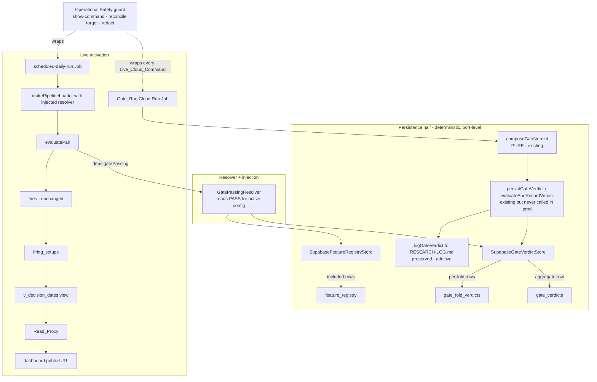
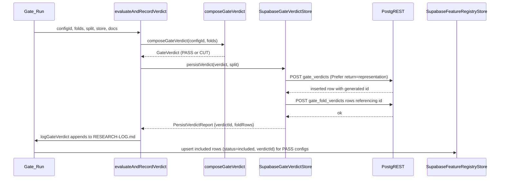
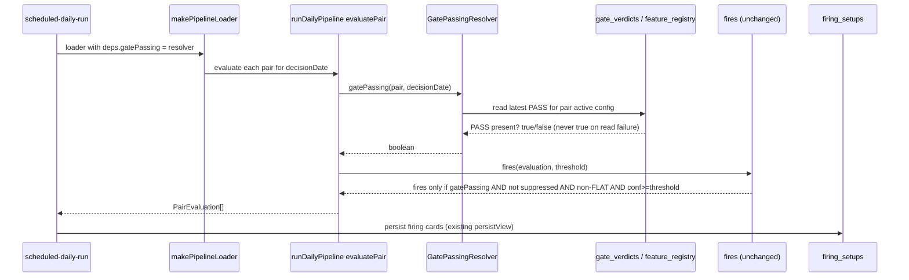

# Design Document

## Overview

This spec is **wiring, integration, and operational/security hardening only**. The FX Daily Pattern Trading Assistant's deterministic core — ingestion, encoder, retrieval + forward-outcome resolver, the confidence/horizon selector, the two-stage kill-gate (`composeGateVerdict`, `evaluateGate1`, `evaluateGate2`), the Feature Registry, the end-to-end daily pipeline (`src/pipeline/dailyPipeline.ts`), the scheduled-run entry (`src/scheduled-run/main.ts`), and the `dashboard-ui` serving stack (Read_Proxy, Firebase Hosting, the `/api` rewrite) — is complete and deployed. The hosted history is seeded (≈20,916 `pattern_vectors`, ≈62,733 matured `analogue_outcomes`). The single remaining gap is structural, not a data gap: no pair can fire because no PASS Gate_Verdict has ever been persisted and no `GatePassingResolver` has ever been written or injected, so `evaluatePair` always resolves `gatePassing` through `resolveGatePassingDefault = () => false`.

This design closes that chain end-to-end: it persists verdicts the kill-gate already composes, reads them back, injects the resolver into the production wiring, runs the existing gate + daily paths against hosted infrastructure, and hardens the surrounding operational posture.

The governing principle is one sentence: **every new component connects to an existing module by its real signature, and owns none of that module's responsibilities.** Concretely:

- The **Supabase GateVerdictStore / FeatureRegistryStore adapters** are the concrete implementations of the two existing storage PORTs (`GateVerdictStore` in `src/kill-gate/types.ts`, `FeatureRegistryStore` in `src/feature-registry/types.ts`). They map records ↔ rows against the real `gate_verdicts` / `gate_fold_verdicts` / `feature_registry` schema and reach storage only through the shared `SupabaseRestClient`. They own **no** gate math or feature-admission logic.
- The **gate-verdict persistence wiring** calls the already-defined-but-never-invoked `persistGateVerdict` / `evaluateAndRecordVerdict` (`src/kill-gate/verdict.ts`) through the new adapter, in addition to the existing `logGateVerdict` append. It does not re-derive a verdict — `composeGateVerdict` stays the sole producer.
- The **GatePassingResolver** implements the existing `GatePassingResolver` type (`src/pipeline/types.ts`) by *reading* recorded PASS verdicts. It never re-runs the walk-forward backtest, re-evaluates Gate 1 / Gate 2, or touches `fires()`.
- The **resolver injection** replaces exactly the `deps.gatePassing` slot that `src/scheduled-run/main.ts` currently leaves unset; the pipeline, `runDailyPipeline`, `runScheduledDaily`, and `fires()` are untouched.
- The **Hosted Gate_Run + daily re-run**, **Seed_Job timeout change**, **Diagnostic_Read_Path**, **invoker review**, and **Deployment_Record commit** are operational acts over existing modules and infrastructure, each wrapped by the **Operational Safety** protocol.

### Design Goals

- **No re-implementation** (parent Req 3.1; spec Req 1.8, 2.2, 3.3, 10.5): wiring calls existing public functions by their confirmed signatures. `composeGateVerdict` and `fires()` are the only producers of verdicts and firing decisions respectively.
- **Determinism preserved** (parent Req 3.1, 16.7; spec Req 3.7): with identical stored inputs, identical recorded verdicts, and the same Decision_Date, the production pipeline yields an identical per-pair evaluation set. The resolver is a pure read over recorded rows.
- **Append-only research history** (spec Req 2.3): `gate_verdicts` / `gate_fold_verdicts` are append-only; re-running the Gate_Run creates new rows. The resolver selects the governing PASS, it does not mutate history.
- **Secret confidentiality** (spec Req 9.2, 9.3): no `Secret_Key`, Scoped_Write_Credential, or Service_Role_Key value is ever committed, echoed, logged, or passed as a command argument. Adapter errors are secret-free (spec Req 1.9).
- **Operator control of live cost/permission changes** (spec Req 9.1, 9.5): every Live_Cloud_Command is shown and approved before it runs; destructive/permission-reducing changes carry a distinguishable warning.
- **No new runtime dependency in core `src/`** (parent Req 18): the adapters reuse the existing `SupabaseRestClient` (Node 22 built-in `fetch`); no new package is added. The one property-based dependency, `fast-check`, is already pinned in the repo.
- **Compute/storage/serving separation preserved** (parent Req 17.1): the new adapters implement the existing PORTs only; the deterministic core keeps depending on the port interfaces.

### Confirmed Existing Interfaces (design targets)

These signatures were verified against the current source; every new component below is designed to call *these*, not reinvent them.

| Module | File | Signature the wiring depends on |
| --- | --- | --- |
| Gate verdict PORT | `src/kill-gate/types.ts` | `interface GateVerdictStore { persistVerdict(verdict: GateVerdict, split: GateVerdictSplit): Promise<PersistVerdictReport>; getVerdict(verdictId: string): Promise<PersistedGateVerdict \| null> }` |
| Verdict shapes | `src/kill-gate/types.ts` | `GateVerdict { configId; foldVerdicts; gate1; gate2; sampleSize; verdict: "PASS"\|"CUT"; metrics }`; `FoldVerdict { foldIndex; sampleSize; skipped; gate1; gate2; verdict }`; `GateVerdictSplit { trainEnd; testStart; testEnd; selectedHorizon?: 1\|2\|3 }`; `PersistVerdictReport { verdictId; foldRows }`; `PersistedGateVerdict { verdictId; verdict; split }` |
| In-memory reference | `src/kill-gate/types.ts` | `InMemoryGateVerdictStore` (mints `verdict-<seq>` ids; `foldRows = foldVerdicts.length`) |
| Feature registry PORT | `src/feature-registry/types.ts` | `interface FeatureRegistryStore { upsert(row: FeatureRegistryRow): Promise<void>; get(featureId: FeatureId): Promise<FeatureRegistryRow\|null>; all(): Promise<readonly FeatureRegistryRow[]> }` |
| Registry shapes | `src/feature-registry/types.ts` | `FeatureRegistryRow { featureId: FeatureId; status: "candidate"\|"included"\|"cut"; verdictId: string\|null }`; `FEATURE_CEILING = 12`; `InMemoryFeatureRegistryStore` (upsert keyed by `feature_id`) |
| Verdict compose/persist/log | `src/kill-gate/verdict.ts` | `composeGateVerdict(configId, folds): GateVerdict` (PURE); `persistGateVerdict(store, verdict, split): Promise<PersistVerdictReport>`; `logGateVerdict(docs, verdict): Promise<void>` (RESEARCH-LOG only); `evaluateAndRecordVerdict({ configId, folds, split, store, docs }): Promise<{verdict, persisted}>` |
| Kill-gate surface | `src/kill-gate/index.ts` | re-exports `walkForwardFolds`, `dataSplit` helpers, `composeGateVerdict`, `evaluateAndRecordVerdict`, gate1/gate2 |
| Pipeline resolver type | `src/pipeline/types.ts` | `type GatePassingResolver = (pair, decisionDate) => Promise<boolean>\|boolean`; `interface PipelineDeps extends PipelineStores { gatePassing?; news?; narrative?; config? }` |
| Pipeline default | `src/pipeline/dailyPipeline.ts` | `resolveGatePassingDefault = () => false`; `evaluatePair` uses `deps.gatePassing ?? resolveGatePassingDefault` |
| Pipeline loader | `src/pipeline/pipelineLoader.ts` | `makePipelineLoader(deps: PipelineDeps): PairEvaluationLoader` → `(decisionDate) => runDailyPipeline(decisionDate, deps)` |
| Firing predicate | `src/dashboard/dashboard.ts` | `fires()` = `gatePassing && !newsSuppressed && direction !== "FLAT" && earnedConfidence >= confidenceThreshold` — **MUST NOT be modified** |
| Scheduled run | `src/scheduled-run/scheduledRun.ts` | `runScheduledDaily(config, deps): Promise<ScheduledRunResult>`; `PairEvaluationLoader`, `DashboardViewPersister` |
| Production wiring (seam) | `src/scheduled-run/main.ts` | `loadEvaluations = (decisionDate, supabase) => makePipelineLoader(buildSupabaseStores(supabase))(decisionDate, supabase)` — injects **no** `gatePassing` (the injection seam) |
| Supabase builder | `src/storage/supabase/index.ts` | `buildSupabaseStores(supabase, fetchImpl?): PipelineStores` builds one shared `SupabaseRestClient` + the three stores |
| REST transport | `src/storage/supabase/client.ts` | `SupabaseRestClient.upsert(table, rows, onConflict?)` (Prefer: resolution=merge-duplicates), paginated `select(table, query)` (Range/Content-Range, ~1000-row pages), `eq()` helper |
| Adapter idiom | `src/storage/supabase/analogueStore.ts`, `patternVectorStore.ts` | row↔record `toRow` / `fromRow` mapping; upsert `onConflict` = PK columns |
| Seed Job | `src/ops/seed-run/main.ts` | one-shot Cloud_Run_Job: `runHostedBackfill` → `resolveHistoricalOutcomes` over hosted stores |

## Architecture

The spec has a **persistence/storage half** (a strict chain: adapters → persistence wiring → resolver + injection), a **live-activation half** that depends on it and the already-seeded data, and an **operational/security hardening** set that proceeds in parallel. The one coupling: the two new adapters, once built, are shared by the persistence wiring, the resolver, and the Gate_Run.



The hard ordering (spec Req 4): a PASS must be **recorded** in `gate_verdicts` before the resolver can return `true` for any pair, and the resolver must be **injected** before a daily re-run can fire anything. So the chain is: adapters exist → Gate_Run persists a PASS → resolver injected → daily re-run fills `firing_setups` → `v_decision_dates` returns a date → Task 17 can run.

### Persistence sequence (Gate_Run → recorded PASS)



### Daily read path (resolver → fires → dashboard)



## Components and Interfaces

All new code is TypeScript (parent Req 3.3), placed under `src/` alongside the modules it wires, with matching module conventions (a `types.ts` where needed, colocated `*.test.ts` / `*.property.test.ts`). No new package is added — the adapters reuse `SupabaseRestClient`.

### 1. Supabase GateVerdictStore adapter — `src/storage/supabase/gateVerdictStore.ts`

Implements the `GateVerdictStore` PORT verbatim, mapping to the real `gate_verdicts` / `gate_fold_verdicts` columns, reached only through the shared `SupabaseRestClient` (spec Req 1.1, 1.2).

```typescript
// src/storage/supabase/gateVerdictStore.ts
const GATE_VERDICTS = "gate_verdicts";
const GATE_FOLD_VERDICTS = "gate_fold_verdicts";

/** gate_verdicts row shape (matches the SQL columns exactly). */
interface GateVerdictRow {
  readonly id?: string;                 // DB-generated uuid; present on read / return=representation
  readonly config_id: string;
  readonly sample_size: number;
  readonly gate1_model_acc: number;
  readonly gate1_baseline_acc: number;
  readonly gate1_delta_pp: number;
  readonly gate1_passed: boolean;
  readonly gate2_model_ra: number | null;
  readonly gate2_baseline_ra: number | null;
  readonly gate2_margin: number | null;
  readonly gate2_passed: boolean | null;
  readonly verdict: "PASS" | "CUT";
  readonly selected_horizon: 1 | 2 | 3 | null;
  readonly split_train_end: string;
  readonly split_test_start: string;
  readonly split_test_end: string;
}

/** gate_fold_verdicts row shape. metrics jsonb carries the per-fold gate1/gate2 detail. */
interface GateFoldVerdictRow {
  readonly verdict_id: string;
  readonly fold_index: number;
  readonly sample_size: number;
  readonly skipped: boolean;
  readonly gate1_passed: boolean | null;
  readonly gate2_passed: boolean | null;
  readonly verdict: "PASS" | "CUT" | null;
  readonly metrics: Record<string, unknown>;  // full Gate1Result / Gate2Result reconstructable
}

export class SupabaseGateVerdictStore implements GateVerdictStore {
  constructor(private readonly client: SupabaseRestClient) {}

  /**
   * Persist one aggregate row then its per-fold rows. Because gate_verdicts.id is
   * DB-generated (gen_random_uuid()), the aggregate POST uses PostgREST
   * `Prefer: return=representation` so the generated id is read back, THEN the fold
   * rows are inserted referencing that id. Returns { verdictId: <generated id>,
   * foldRows: verdict.foldVerdicts.length } — matching InMemoryGateVerdictStore's
   * foldRows semantics (spec Req 1.3).
   */
  persistVerdict(verdict: GateVerdict, split: GateVerdictSplit): Promise<PersistVerdictReport>;

  /**
   * Read the aggregate by id, then its fold rows (paginated), and reconstruct the
   * GateVerdict + GateVerdictSplit. Returns null when no row with that id exists
   * (spec Req 1.4).
   */
  getVerdict(verdictId: string): Promise<PersistedGateVerdict | null>;
}
```

Design decisions and why:

- **Generated-id read-back (spec Req 1.3).** `SupabaseRestClient.upsert` today sends `Prefer: resolution=merge-duplicates,return=minimal`, which returns no body. To obtain the `gen_random_uuid()` id this adapter issues the aggregate insert with `Prefer: return=representation` (a small, additive request mode on the existing client — either a new `insertReturning(table, rows)` method on `SupabaseRestClient` or an `onConflict`/prefer parameter; both reuse the same headers/transport, no new dependency). The response body carries the inserted row including `id`; the adapter reads `id`, inserts the fold rows with `verdict_id = id`, and returns it as `PersistVerdictReport.verdictId`.
- **Ordering / atomicity.** The aggregate row is written **before** the fold rows because `gate_fold_verdicts.verdict_id` is an FK to `gate_verdicts(id)` (`on delete cascade`). PostgREST has no cross-request transaction, so the design treats the aggregate insert as the commit point and the fold insert as a dependent follow-up: if the fold insert fails, the adapter surfaces the error identifying the config (spec Req 2.6) and the orphan aggregate row is a tolerable append-only artifact (verdicts are research history, not a uniqueness-constrained resource). An optional hardening is a single Postgres RPC/function that inserts both in one transaction; the design records this as the preferred future form but does not require a new runtime dependency.
- **Idempotence / append-only (spec Req 2.3).** `gate_verdicts` has no natural unique key beyond the generated `id`, so every `persistVerdict` is an append — re-running the Gate_Run creates a new verdict row with a new id. This matches `InMemoryGateVerdictStore` (fresh `verdict-<seq>` per call) and the Research_Log semantics.
- **Fold-row mapping.** `FoldVerdict.gate1` / `gate2` are richer than the three boolean/text fold columns; the full `Gate1Result` / `Gate2Result` are stored in the `metrics jsonb` column (default `'{}'`) so `getVerdict` can reconstruct the `GateVerdict` faithfully for the round-trip property. `fold_index`, `sample_size`, `skipped`, `verdict`, and the two `*_passed` flags map to their named columns.
- **Paginated reads (spec Req 1.7).** `getVerdict` reads fold rows via `client.select(GATE_FOLD_VERDICTS, "verdict_id=eq.<id>&order=fold_index.asc")`, which pages via Range/Content-Range, so a verdict with many folds is never truncated at ~1000.
- **Secret-free errors (spec Req 1.9).** All failures propagate as the existing `SupabaseRestError { message, status, table }`, which already excludes the key; the adapter adds the `config_id` to the message for diagnosis, never the key.

### 2. Supabase FeatureRegistryStore adapter — `src/storage/supabase/featureRegistryStore.ts`

Implements the `FeatureRegistryStore` PORT, mapping to the real `feature_registry` columns.

```typescript
// src/storage/supabase/featureRegistryStore.ts
const FEATURE_REGISTRY = "feature_registry";

interface FeatureRegistryDbRow {
  readonly feature_id: string;
  readonly status: "candidate" | "included" | "cut";
  readonly verdict_id: string | null;
}

export class SupabaseFeatureRegistryStore implements FeatureRegistryStore {
  constructor(private readonly client: SupabaseRestClient) {}

  /**
   * Idempotent upsert keyed on feature_id (the table PK). Uses the client's
   * merge-duplicates upsert with onConflict="feature_id", so re-upserting the
   * same feature_id REPLACES that row rather than inserting a duplicate — matching
   * InMemoryFeatureRegistryStore (spec Req 1.5). status is persisted as exactly one
   * of candidate|included|cut; verdict_id is the gate_verdicts id or null (spec Req 1.6).
   */
  upsert(row: FeatureRegistryRow): Promise<void>;

  /** Read one row by feature_id, or null when absent (paginated select, limit=1). */
  get(featureId: FeatureId): Promise<FeatureRegistryRow | null>;

  /** Read all rows via the paginated select (spec Req 1.7). */
  all(): Promise<readonly FeatureRegistryRow[]>;
}
```

- The `toRow` / `fromRow` idiom mirrors `SupabaseAnalogueStore`; `verdict_id` passes through as `string | null`.
- `upsert` reuses `client.upsert(FEATURE_REGISTRY, [toRow(row)], "feature_id")` — the same merge-on-PK path the pattern-vector adapter uses, giving idempotence for free.
- The adapter does not validate the ≤12 `FEATURE_CEILING` or decide admission — that is the Feature Registry orchestration's job (spec Req 1.8). It only persists/reads the row it is given.

### 3. Shared construction — extend `buildSupabaseStores` / add a builder

`buildSupabaseStores(supabase, fetchImpl?)` currently returns `{ candleStore, vectorStore, analogueStore }`. The two new adapters are constructed from the **same shared `SupabaseRestClient`** (spec Req 1.2). To avoid widening `PipelineStores` (which the pipeline depends on and must stay a candle/vector/analogue triple), the design adds a sibling builder:

```typescript
// src/storage/supabase/index.ts (additive)
export function buildSupabaseGateStores(
  supabase: SupabaseConfig,
  fetchImpl?: typeof fetch,
): { gateVerdictStore: GateVerdictStore; featureRegistryStore: FeatureRegistryStore };
```

It builds one `SupabaseRestClient` (or accepts an existing one so the Gate_Run can share the client with `buildSupabaseStores`) and returns the two adapters. This keeps the pipeline's `PipelineStores` shape unchanged while giving the Gate_Run and the resolver a single construction point.

### 4. Gate-verdict persistence wiring — `src/staged-runner/stagedRunner.ts` (Backtest_Stage) + Gate_Run

Today `backtest()` ends with `composeGateVerdict(...)` → `logGateVerdict(...)` and **never persists**. The wiring adds persistence through the Component 1 adapter, keeping the log append (spec Req 2.1, 2.5):

```typescript
// Backtest_Stage, after composing the verdict:
const verdict = composeGateVerdict(deps.configId, foldInputs);
const persisted = await persistGateVerdict(deps.gateVerdictStore, verdict, split); // NEW (spec Req 2.1, 2.2)
await logGateVerdict(deps.docs, verdict);                                          // preserved (spec Req 2.5)
// For a PASS, record the admitted features (spec Req 2.4):
if (verdict.verdict === "PASS") {
  for (const featureId of admittedFeatures) {
    await deps.featureRegistryStore.upsert({ featureId, status: "included", verdictId: persisted.verdictId });
  }
}
```

- The preferred form is to call the already-tested `evaluateAndRecordVerdict({ configId, folds, split, store, docs })`, which composes → persists → logs in one call. Where the stage keeps `composeGateVerdict` + `logGateVerdict` separate for its own reasons, it inserts `persistGateVerdict` between them. Either way **no verdict composition is re-implemented** (spec Req 2.2).
- `StagedRunnerDeps` gains `gateVerdictStore: GateVerdictStore` and `featureRegistryStore: FeatureRegistryStore` (both default to the in-memory references in tests, the Supabase adapters in the Gate_Run). The `split: GateVerdictSplit` is derived from the walk-forward fold bounds already available in the stage (`testStart`/`testEnd` from the first/last fold, `trainEnd` from the split, optional `selectedHorizon`).
- **Research_Log preserved (spec Req 2.5):** `logGateVerdict` still appends the aggregate + per-fold verdicts and the accuracy-vs-baseline / risk-adjusted-vs-baseline metrics; persistence is additive.
- **Failure surfacing (spec Req 2.6):** a `persistGateVerdict` rejection propagates with the affected `configId`; the stage does not swallow it or proceed as though recorded.

### 5. GatePassingResolver implementation + injection — `src/pipeline/gatePassingResolver.ts`

A pure read-only resolver satisfying `GatePassingResolver = (pair, decisionDate) => Promise<boolean> | boolean` (spec Req 3.1), reading recorded verdicts through the Component 1/2 adapters.

```typescript
// src/pipeline/gatePassingResolver.ts
export interface GatePassingResolverDeps {
  readonly gateVerdictStore: GateVerdictStore;
  readonly featureRegistryStore: FeatureRegistryStore;
  /** Maps a Pair to its active gate config_id. See "active configuration" below. */
  readonly activeConfigFor: (pair: Pair) => string;
  /** Reads the latest PASS gate_verdicts row for a config_id (adapter-provided). */
  readonly latestPassVerdict: (configId: string) => Promise<{ verdictId: string } | null>;
}

/**
 * Returns true ONLY when a recorded PASS Gate_Verdict backs the pair's active
 * configuration (spec Req 3.2, 3.6). Consumes recorded outcomes only; never
 * re-runs the walk-forward backtest or re-evaluates Gate 1/Gate 2 (spec Req 3.3).
 * On a read failure it REJECTS (surfaces the error); it never returns true on
 * failure (spec Req 3.8).
 */
export function makeGatePassingResolver(deps: GatePassingResolverDeps): GatePassingResolver;
```

**Mapping "the pair's active configuration" to a verdict (open design decision, spec Req 3.2).** The code does not carry an explicit `Pair → config_id` map; `GateVerdict.configId` is an opaque config identifier set by the Gate_Run. The design flags this as an **open decision** and adopts a recommended default:

- **Recommended default:** the Gate_Run names each pair's governing config deterministically as `configId = "<PAIR>-active"` (e.g. `"EURUSD-active"`), and `activeConfigFor(pair)` returns that same string. The resolver then selects the **latest `created_at` PASS** `gate_verdicts` row for that `config_id` as the governing verdict (append-only history means the newest PASS wins). This is a convention the Gate_Run and resolver share; it requires no schema change (`config_id` already exists) and keeps the mapping explicit and testable.
- **Feature_Registry cross-check (optional, consistent with parent Req 13):** where the active config corresponds to admitted features, the resolver may additionally require that the justifying `verdict_id` on the relevant `feature_registry` `included` rows resolves to a PASS. For the activation goal (one firing Decision_Date), the latest-PASS-by-config_id rule is sufficient; the feature-registry cross-check is recorded as a tightening option.
- The `latestPassVerdict` read is implemented as a `client.select(GATE_VERDICTS, "config_id=eq.<id>&verdict=eq.PASS&order=created_at.desc&limit=1")` on the gate-verdict adapter (a small read helper added alongside `getVerdict`), reusing the paginated `select`.

**Injection (spec Req 3.4).** `src/scheduled-run/main.ts` changes exactly one place — the `loadEvaluations` seam — to build the resolver and pass it as `deps.gatePassing`:

```typescript
// src/scheduled-run/main.ts (the ONLY change to the entry point)
const loadEvaluations: PairEvaluationLoader = (decisionDate, supabase) => {
  const stores = buildSupabaseStores(supabase);
  const { gateVerdictStore, featureRegistryStore } = buildSupabaseGateStores(supabase);
  const gatePassing = makeGatePassingResolver({
    gateVerdictStore,
    featureRegistryStore,
    activeConfigFor: (pair) => `${pair}-active`,
    latestPassVerdict: /* bound to gateVerdictStore */,
  });
  return makePipelineLoader({ ...stores, gatePassing })(decisionDate, supabase);
};
```

- `makePipelineLoader(deps: PipelineDeps)` already accepts `gatePassing` (it is an optional field on `PipelineDeps`); passing `{ ...stores, gatePassing }` sets it, so `evaluatePair` uses the injected resolver through `deps.gatePassing ?? resolveGatePassingDefault` instead of the `() => false` fallback (spec Req 3.4).
- **`fires()` untouched (spec Req 3.5):** the firing precondition stays `gatePassing && !newsSuppressed && direction !== "FLAT" && earnedConfidence >= confidenceThreshold`. Setting `gatePassing` to a real value is the only change; the predicate is not relaxed.
- **Un-passed pairs stay silent (spec Req 3.6):** with no PASS for a pair's active config, the resolver returns `false`, so `fires()` is false and the pair is never surfaced (parent Req 16.5).
- **Determinism (spec Req 3.7):** the resolver is a pure function of the recorded rows and the Decision_Date; identical inputs + verdicts + date ⇒ identical evaluations. The latest-PASS selection is deterministic given a fixed verdict history.
- **No silent coercion (spec Req 3.8):** a store/read failure rejects the resolver promise, which surfaces up through `evaluatePair` / `runDailyPipeline`; it never resolves `true`.

### 6. Hosted Gate_Run + daily re-run — `src/ops/gate-run/main.ts`

A one-shot live operation analogous to `src/ops/seed-run/main.ts`: a Cloud_Run_Job entry that evaluates the existing kill-gate over the seeded hosted walk-forward folds and persists the verdicts, then triggers the daily re-run. It introduces **no** gate math — it is the Backtest_Stage (Component 4) wired to the hosted stores plus a confirmation step.

```typescript
// src/ops/gate-run/main.ts (shape mirrors seed-run/main.ts)
// 1. loadScheduledRunConfig() → resolve hosted target
// 2. buildSupabaseStores(config.supabase) + buildSupabaseGateStores(config.supabase)  // shared client
// 3. run the Backtest_Stage over the hosted history → composeGateVerdict per config
//    → persistGateVerdict via SupabaseGateVerdictStore (spec Req 4.2) + logGateVerdict
//    → upsert feature_registry included rows for PASS
// 4. confirm >= 1 PASS recorded in hosted gate_verdicts for an active pair config (spec Req 4.4)
// 5. trigger the deployed scheduled-daily-run Job for the current/most-recent matured
//    Decision_Date, with the Req-3 resolver injected (spec Req 4.5)
// 6. confirm firing_setups has rows and v_decision_dates returns a date (spec Req 4.6)
```

- Runs under the **Live Cloud Execution Protocol** (Component 8): reconcile `SUPABASE_TARGET=hosted` + active gcloud project/account against `GCP_PROJECT_ID` first; abort on mismatch (spec Req 4.1, 9.4, 9.6). Each `gcloud run jobs execute` command is shown and approved; secrets come from Secret_Manager/stdin and are never echoed (spec Req 4.3, 9.1–9.3).
- Evaluates over the **already-seeded** hosted `pattern_vectors` + matured `analogue_outcomes` (spec Req 4.2) — it does not re-seed.
- **Zero-firing diagnosis (spec Req 4.7):** if the re-run yields no firing setups, the Job reports which cause applies — no recorded PASS, FLAT direction, news suppression, or Earned_Confidence below threshold — read from the recorded evaluation, and **does not** alter `fires()` or the gate math to force a firing.
- On a firing Decision_Date in `v_decision_dates`, the end state leaves `dashboard-ui` Task 17 able to run (spec Req 4.8, Req 10).

### 7. Operational hardening components

These are operational/infrastructure acts over existing resources, each wrapped by Component 8.

- **Seed_Job timeout change (Req 5).** Raise the `dashboard-seed-run` Cloud_Run_Job `--task-timeout` from 3600s to a value in **5400–7200s**, expressed as a **version-controlled** change (a committed deploy/ops config artifact or a documented committed command) so it is reproducible (spec Req 5.1, 5.2). The change command is shown and approved (spec Req 5.5). A re-run then reports SUCCESS (spec Req 5.3), relying on the Seed_Job's existing idempotent `(Asset, Date)` upserts so no duplicate rows result (spec Req 5.4). The candidate home is `ops/scheduler-job.config.json` / `ops.config.json` or the deploy workflow, alongside the existing ops artifacts.
- **Diagnostic_Read_Path (Req 6).** Establish a durable least-privilege read-only path for exact hosted row counts — the recommended form is a **read-only diagnostic Postgres role** (SELECT-only on the tables whose counts matter) reached via a scoped read JWT, or a **counts endpoint on the Read_Proxy** that runs a fixed allowlisted `count` query. It is documented as a version-controlled policy recording which credential/endpoint is used and why the publishable (anon) key (RLS-limited to 0 rows) and the scoped read key (401 on raw PostgREST) are insufficient for raw counts (spec Req 6.2). Routine verification uses this path, never the Service_Role_Key (spec Req 6.3); the role is granted only read access, no write and no RLS-bypass (spec Req 6.5). Any Service_Role_Key one-off is read-only, operator-approved, and never echoed/logged/committed (spec Req 6.4).
- **allUsers invoker review (Req 7).** Evaluate the `roles/run.invoker` grant to `allUsers` on `dashboard-read-proxy` (granted in `dashboard-ui` Task 16 so the Firebase_Hosting `/api` rewrite could reach the authenticated-only service). Where a least-privilege Invoker_Identity is preferred, replace `allUsers` with a named service account granted **only** `roles/run.invoker` on the service and no broader role (spec Req 7.2). App-level protections — the read-only select-only Allowlist, the rate limit, the CSP/security headers — are preserved regardless of invoker posture (spec Req 7.3). The decision (retain with justification, or replace) is recorded in the Req 8 Deployment_Record (spec Req 7.4). An IAM change is a **permission-reducing** operation: it is shown with a distinguishable warning and approved before execution, and after the change the public `/api` path is confirmed to still return a successful response (spec Req 7.5, 9.5); if a change would break the rewrite path, a working invoker configuration is retained (spec Req 7.6).
- **Deployment_Record commit (Req 8).** Commit the dashboard Deployment_Record (currently the uncommitted `web/README.md` Task 16 edit) so the live state is reproducible from version control (spec Req 8.1). It identifies the live public URLs — the Firebase_Hosting default URL and the custom domain `app.teamhandso.me` — the deployed `dashboard-read-proxy` revision, and the invoker posture from Req 7 (spec Req 8.2), recording only non-secret references (spec Req 8.3) and reflecting the current live state (spec Req 8.4).

### 8. Operational Safety guard — Live Cloud Execution Protocol (Req 9)

The cross-cutting protocol every Live_Cloud_Command in Req 4–7 passes through, mirroring `operational-wiring` Requirement 6:

- **Show-before-run (spec Req 9.1):** present the exact command; do not execute until the operator approves. This covers the Gate_Run, the daily re-run, the Seed_Job timeout change, diagnostic-path provisioning, and any IAM change.
- **Target reconciliation (spec Req 9.4, 9.6):** reconcile active gcloud project + account against `GCP_PROJECT_ID` and the resolved Supabase target against the hosted backend before any command; abort and surface the mismatch otherwise.
- **Destructive/permission-reducing warning (spec Req 9.5):** a command that deletes, overwrites, or reduces permissions (e.g. changing the `dashboard-read-proxy` invoker grant) carries a distinguishable warning naming the affected resource and effect, and requires explicit approval.
- **Secret confidentiality (spec Req 9.2, 9.3):** no `Secret_Key` / Scoped_Write_Credential / Service_Role_Key value is committed, echoed, or logged; secrets are referenced by name and sourced from Secret_Manager or stdin (`--data-file=-`), never as command arguments.
- **Non-secret records only (spec Req 9.7):** only verdict counts, firing-setup counts, Decision_Dates, revisions, and URLs are recorded.

## Data Models

No schema change is required for the core path — all three target tables already exist with the exact columns below. The adapters map to these.

**`gate_verdicts`** (aggregate; `id` is DB-generated):

| Column | Type | Mapped from `GateVerdict` / `GateVerdictSplit` |
| --- | --- | --- |
| `id` | uuid pk default `gen_random_uuid()` | generated on insert; read back via `return=representation` → `PersistVerdictReport.verdictId` |
| `config_id` | text | `verdict.configId` |
| `sample_size` | int | `verdict.sampleSize` |
| `gate1_model_acc` / `gate1_baseline_acc` / `gate1_delta_pp` / `gate1_passed` | double / double / double / bool | `verdict.gate1.{modelAccuracy, baselineAccuracy, deltaPp, passed}` |
| `gate2_model_ra` / `gate2_baseline_ra` / `gate2_margin` / `gate2_passed` | double? / double? / double? / bool? | `verdict.gate2.{modelRiskAdj, baselineRiskAdj, margin, passed}` (nullable — Gate 2 may be not-evaluated) |
| `verdict` | text check PASS\|CUT | `verdict.verdict` |
| `selected_horizon` | smallint? check 1\|2\|3 | `split.selectedHorizon ?? null` |
| `split_train_end` / `split_test_start` / `split_test_end` | date | `split.trainEnd` / `split.testStart` / `split.testEnd` |
| `created_at` | timestamptz default now() | server-set; the resolver's latest-PASS ordering key |

**`gate_fold_verdicts`** (per-fold; pk `(verdict_id, fold_index)`): `verdict_id` ← generated aggregate id; `fold_index`, `sample_size`, `skipped`, `verdict` ← `FoldVerdict`; `gate1_passed` ← `fold.gate1.passed`, `gate2_passed` ← `fold.gate2.passed`; `metrics` jsonb ← full `Gate1Result` + `Gate2Result` so `getVerdict` reconstructs the fold faithfully.

**`feature_registry`** (pk `feature_id`): `feature_id` ← `row.featureId`; `status` ← `row.status` (candidate\|included\|cut); `verdict_id` ← `row.verdictId` (uuid FK → `gate_verdicts(id)`, or null); `updated_at` server-set.

### RLS / write-path design risk (ASSUMPTION TO CONFIRM)

The deployed path writes hosted tables through PostgREST under the **pipeline_writer** role (the Scoped_Write_Credential), governed by RLS migration `20260916000002_rls_pipeline_writer_scoped_write.sql`. That migration enables RLS and grants `select, insert, update` + a permissive policy to `pipeline_writer` on exactly five tables: `candles`, `pattern_vectors`, `analogue_outcomes`, `firing_setups`, `realized_outcomes`.

**It does NOT cover `gate_verdicts`, `gate_fold_verdicts`, or `feature_registry`.** Those three tables have **no RLS enabled and no `pipeline_writer` grant** in the current migrations. This is a real, grounded design risk, flagged rather than asserted either way:

- As-is, those tables are not RLS-protected, so writes may or may not succeed depending on default grants to the role PostgREST assumes for the Gate_Run's credential. **This must be confirmed against the live project before the Gate_Run.**
- **Recommended resolution:** run the Gate_Run's writes under a credential explicitly authorized for the three tables. Preferred form is a new idempotent migration that (a) grants `select, insert, update` on `gate_verdicts`, `gate_fold_verdicts`, `feature_registry` to `pipeline_writer`, and (b) if RLS is enabled on them, adds a `pipeline_writer`-scoped policy — mirroring the existing migration's pattern. Alternatively, the Gate_Run is an operator-run one-off that may use a higher-privilege credential under the Component 8 protocol (shown, approved, never logged), since it is research-history provisioning, not the daily deployed path.
- The design states explicitly: **which credential writes `gate_verdicts` / `gate_fold_verdicts` / `feature_registry` must be covered by the relevant grants/RLS, and the current `pipeline_writer` migration does not cover them.** Confirm the live grant posture (or add the migration) before executing the Gate_Run. Do not assume the existing RLS migration already permits these writes — it does not.

## Error Handling

- **Adapter PostgREST failures (spec Req 1.9, 2.6):** surfaced as `SupabaseRestError { message, status, table }` — secret-free by construction. The gate-verdict adapter augments the message with `config_id`; the registry adapter with `feature_id`. No key is ever included.
- **Partial persist (aggregate written, fold insert fails):** the error propagates identifying the config; the orphan aggregate row is tolerable (append-only history), and the Gate_Run reports the failure rather than claiming success (spec Req 2.6). The optional single-transaction RPC removes even this partial state.
- **Resolver read failure (spec Req 3.8):** the resolver promise rejects; `evaluatePair` / `runDailyPipeline` propagate it; `gatePassing` is never coerced to `true`. A pair with no PASS resolves `false` (not an error) and simply stays silent (spec Req 3.6).
- **Live command target mismatch (spec Req 9.6):** the Operational Safety guard aborts before executing against an unintended project, identity, or backend.
- **Zero-firing re-run (spec Req 4.7):** reported with the specific cause (no PASS / FLAT / suppression / below-threshold); never resolved by weakening the predicate.

## Correctness Properties

*A property is a characteristic or behavior that should hold true across all valid executions of a system — essentially, a formal statement about what the system should do. Properties serve as the bridge between human-readable specifications and machine-verifiable correctness guarantees.*

These properties cover the **deterministic/pure** parts this spec adds — the two Supabase adapters (Components 1, 2) and the gate-passing resolver (Component 5). They are implemented with `fast-check` (already a pinned repo dependency), minimum 100 iterations each, each tagged `// Feature: dashboard-data-activation, Property N: <text>`, and run against a no-network stub `fetch` modelling PostgREST (the same stub idiom the existing adapter property tests use) and the in-memory reference stores — never against live infrastructure.

### Property 1: GateVerdictStore persist/read round-trip

*For any* `GateVerdict` and `GateVerdictSplit`, calling `persistVerdict(verdict, split)` on `SupabaseGateVerdictStore` and then `getVerdict(verdictId)` with the returned id yields a `PersistedGateVerdict` whose verdict and split are equivalent to the inputs, and the returned `PersistVerdictReport.foldRows` equals `verdict.foldVerdicts.length`.

Covers: Component 1 (`SupabaseGateVerdictStore`).

**Validates: Requirements 1.3, 1.4**

### Property 2: FeatureRegistryStore upsert is idempotent

*For any* sequence of `FeatureRegistryRow` upserts through `SupabaseFeatureRegistryStore`, re-upserting a row with an already-seen `feature_id` replaces that row rather than inserting a duplicate (the row set stays keyed one-per-`feature_id`), and the final `status` and `verdictId` for each `feature_id` round-trip exactly through `get` / `all`.

Covers: Component 2 (`SupabaseFeatureRegistryStore`).

**Validates: Requirements 1.5, 1.6**

### Property 3: Paginated reads return the complete set

*For any* row count that spans more than one PostgREST page (> 1000 rows) — fold rows for a verdict, or registry rows for `all()` — the adapter returns every row with no truncation, exercising the Range/Content-Range paging against the stub.

Covers: Components 1, 2.

**Validates: Requirements 1.7**

### Property 4: Resolver reflects recorded PASS / no-PASS exactly

*For any* pair and Decision_Date, `makeGatePassingResolver` resolves `true` when a PASS `gate_verdicts` row exists for that pair's active config and `false` when no PASS exists for it — never surfacing an un-passed pair.

Covers: Component 5 (`makeGatePassingResolver`).

**Validates: Requirements 3.2, 3.6**

### Property 5: Resolver never coerces `true` on read failure

*For any* induced store/read failure, the resolver promise rejects (the error surfaces up through `evaluatePair` / `runDailyPipeline`) and the resolver never resolves `true`.

Covers: Component 5 (`makeGatePassingResolver`).

**Validates: Requirements 3.8**

### Property 6: Resolver is deterministic over a fixed history

*For any* fixed recorded-verdict history and Decision_Date, repeated invocations of the resolver yield identical results, consistent with the deterministic-computation and equivalent-unattended-run guarantees (parent Requirements 3.1, 16.7).

Covers: Component 5 (`makeGatePassingResolver`).

**Validates: Requirements 3.7**

The **live hosted operations** — the Gate_Run producing a recorded PASS, the daily re-run filling `firing_setups` / `v_decision_dates`, the Seed_Job SUCCESS re-run, the invoker-change `/api` success check, and the Task 17 read-only smoke — are **operator-run verifications, not property tests**: they exercise external infrastructure whose behavior does not vary meaningfully with generated input, consistent with the Testing Strategy below.

## Testing Strategy

**Dual approach.** Property/unit tests cover the deterministic adapters and resolver (the logic this spec adds); the live hosted steps (Gate_Run, daily re-run, Task 17 smoke) are **operator-run verifications**, not automated property tests, because they exercise external infrastructure whose behavior does not vary meaningfully with generated input.

**Property-based tests** (reuse the repo's existing `fast-check`, ≥100 iterations, tagged `Feature: dashboard-data-activation, Property N: ...`):

- *GateVerdictStore round-trip (Req 1.3, 1.4):* for any `GateVerdict` + `GateVerdictSplit`, `persistVerdict` then `getVerdict(verdictId)` returns an equivalent verdict and split, and `foldRows === foldVerdicts.length`. Exercised against a stub `fetch` modelling `gate_verdicts` / `gate_fold_verdicts` with a generated id on `return=representation` — the same no-network stub idiom the existing adapter property tests use.
- *FeatureRegistryStore idempotent upsert (Req 1.5, 1.6):* for any sequence of upserts, re-upserting the same `feature_id` replaces rather than duplicates, and `status` / `verdictId` round-trip exactly.
- *Pagination (Req 1.7):* for any fold count (or registry size) spanning multiple pages, the adapter returns the complete set (no ~1000-row truncation) — generate >1000 rows and assert full retrieval against the Range/Content-Range stub.
- *Resolver semantics (Req 3.2, 3.6, 3.8):* for any pair/date, a recorded PASS for the active config ⇒ `true`; no PASS ⇒ `false`; a read failure ⇒ the resolver surfaces (rejects), never `true`.
- *Determinism (Req 3.7):* for any fixed verdict history + Decision_Date, repeated resolver invocations yield identical results.

**Example / unit tests:** the `main.ts` injection sets `deps.gatePassing` (the loader passes it through, `fires()` is unchanged); the Backtest_Stage calls `persistGateVerdict` in addition to `logGateVerdict`; a PASS triggers a `feature_registry` `included` upsert with the justifying `verdictId`.

**Not property tests (operator-run live verification):** the hosted Gate_Run producing ≥1 PASS (Req 4.4), the daily re-run filling `firing_setups` and `v_decision_dates` (Req 4.6), the Seed_Job SUCCESS re-run (Req 5.3), the invoker-change `/api` success check (Req 7.5), and the Task 17 read-only smoke — public URL serves a real Decision_Date, Read_Proxy rejects a write with 405, rejects a disallowed query with 400/404 (Req 10.1–10.4). These are confirmed under the Component 8 protocol with non-secret records only.

## Requirements Mapping

| Requirement | Design piece |
| --- | --- |
| 1 — Supabase gate-verdict + feature-registry adapters | Components 1, 2, 3 (adapters over `SupabaseRestClient`, record↔row mapping, generated-id read-back, idempotent feature upsert, paginated reads, secret-free errors) |
| 2 — Gate-verdict persistence to hosted | Component 4 (Backtest_Stage / Gate_Run wires `persistGateVerdict` / `evaluateAndRecordVerdict` beside `logGateVerdict`; PASS → `feature_registry` included; failure surfaced) |
| 3 — Gate-passing resolver + injection | Component 5 (`makeGatePassingResolver` reads latest PASS by active `config_id`; injected as `deps.gatePassing` in `main.ts`; `fires()` untouched; determinism; no coercion on read failure) |
| 4 — Hosted Gate_Run + daily re-run | Component 6 (Cloud_Run_Job over seeded hosted folds → persist verdicts → re-run scheduled-daily-run → confirm firing + `v_decision_dates`; zero-firing diagnosis) |
| 5 — Seed_Job timeout hardening | Component 7 (raise `--task-timeout` to 5400–7200s, version-controlled, operator-approved, idempotent re-run) |
| 6 — Service-role-key diagnostic policy | Component 7 (Diagnostic_Read_Path: read-only role / counts endpoint, documented, no Service_Role_Key for routine use) |
| 7 — allUsers invoker review | Component 7 (evaluate/replace `allUsers` with least-privilege invoker; preserve Allowlist/rate-limit/CSP; record decision; permission-reducing warning + post-change `/api` check) |
| 8 — Deployment_Record provenance | Component 7 (commit `web/README.md` record: URLs incl. `app.teamhandso.me`, proxy revision, invoker posture; non-secret only) |
| 9 — Operational Safety | Component 8 (Live Cloud Execution Protocol wrapping Req 4–7: show-before-run, target reconciliation, destructive warning, secret confidentiality, non-secret records) |
| 10 — End-to-end success / Task 17 smoke | Component 6 end state + Testing Strategy live verification (real Decision_Date served; 405 on write; 400/404 on disallowed query; `fires()` / gate math unmodified) |
| Parent 3.1 / 16.7 (determinism, equivalent-unattended-run) | Component 5 (pure read resolver; identical inputs ⇒ identical evaluations) |
| Parent 17.1 (compute/storage separation) | Components 1–3 (adapters implement existing PORTs only) |
| Parent 18 (no new runtime dependency) | Components 1–3 (reuse `SupabaseRestClient` / Node `fetch`; `fast-check` already pinned) |
| RLS write-path risk | Data Models → RLS design risk (pipeline_writer migration does NOT cover `gate_verdicts` / `gate_fold_verdicts` / `feature_registry`; confirm/extend before Gate_Run) |
