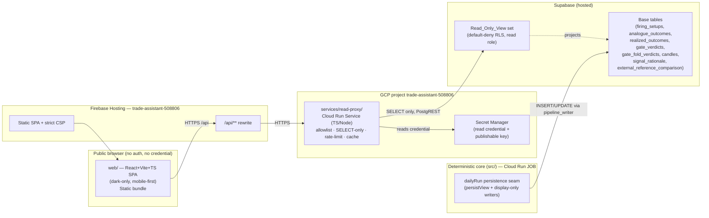
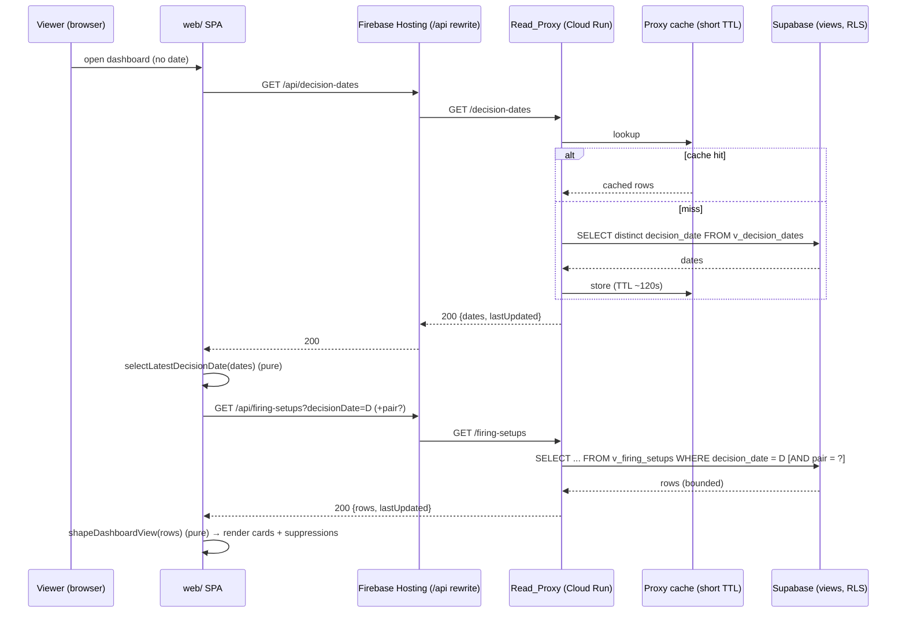
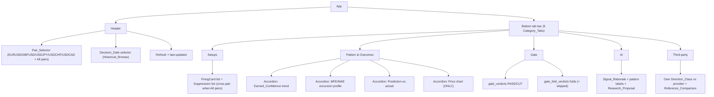
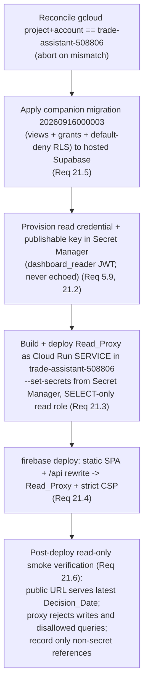
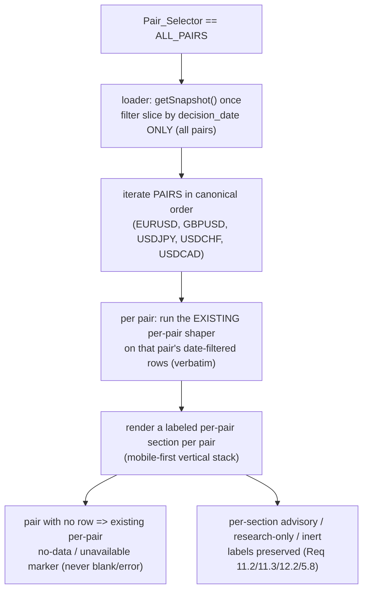

# Design Document

## Overview

The Dashboard_UI is a mobile-first, dark-only, read-only web dashboard that renders the FX
pattern assistant's persisted results. It is a deliberate pivot away from the earlier
"local plain-HTTP, latest-date-only" dashboard and introduces a reserved **read-only
serving layer** split across two new, standalone deployables that both live OUTSIDE the
deterministic core under `src/`:

1. **`web/`** — a React + Vite + TypeScript single-page application, deployed to
   Firebase Hosting. It holds no database credential and reads data only through the
   Read_Proxy via the Firebase Hosting `/api` rewrite (Req 1, 2, 3.1–3.2).
2. **`services/read-proxy/`** — a TypeScript/Node Cloud Run service in the same GCP
   project (`trade-assistant-508806`). It holds the Supabase read credential in Secret
   Manager, is the only component that talks to Supabase, exposes a fixed allowlist of
   read-only endpoints, and issues only SELECT reads against curated `Read_Only_View`s
   protected by `Default_Deny_RLS` (Req 3, 4, 5).

Supabase changes are delivered as a single **companion migration**
(`20260916000003_dashboard_read_views_rls.sql`) that creates the view set, a separate
read-only role, grants, and default-deny RLS — applied identically local + hosted
(Req 4.3, 4.7, 21.5). A **core-side change** adds two display-only tables
(`signal_rationale`, `external_reference_comparison`) and wires the pipeline to write
them at the existing `dailyRun` persistence seam (Req 11, 12, 16/20.3), keeping the
AI/Deterministic boundary intact.

The design keeps every rendered value traceable to a persisted row: the SPA recomputes
nothing (Req 9.10, 10.4, 20.1). It separates **pure data-shaping / selection** modules
(date selection, row→view-model shaping, chart-series shaping) from **impure fetch /
render** code so correctness is property-testable without a browser or network (Req 19).

### Grounding in the real repository

This design is grounded in the actual code and schema, not invented:

- **Schema.** `firing_setups` is the authoritative `20260916000001` shape — composite PK
  `(decision_date, pair, strategy_id)`, `strategy_id text default 'system'`,
  `competing_pairs text[]`, and `suppression_reason in
  ('news','currency_concentration','below_floor','not_fired','too_choppy')`.
  `realized_outcomes`, `analogue_outcomes`, `gate_verdicts`, `gate_fold_verdicts`, and
  `candles` are read verbatim from `20260916000000`/`20260916000001`.
- **RLS + roles.** `20260916000002` already enables RLS on the five compute-written
  tables and defines the write-only `pipeline_writer` role reached by the
  Scoped_Write_Credential. The dashboard read role is **new and separate**; the write
  role is left unchanged (Req 4.6).
- **REST transport.** The Read_Proxy reuses the `SupabaseRestClient` pattern from
  `src/storage/supabase/client.ts` (Node built-in `fetch`, `apikey` + `Authorization:
  Bearer` header split, secret never logged), reimplemented inside
  `services/read-proxy/` so it does not import from `src/`.
- **Config.** Credential selection mirrors `src/storage/supabaseConfig.ts`
  (`SUPABASE_TARGET`, verbatim env reads, no fabricated secrets).
- **Display-only sources.** `src/rationale` (`SignalRationaleText = LlmTagged<string>`,
  `AnalogueLabels = LlmTagged<readonly string[]>`), `src/research-assistant`
  (`ResearchProposal.proposalText: LlmTagged<string>`), and `src/external-signal`
  (`ExternalReferenceSignal`, `ReferenceComparison = 'agree'|'diverge'|'neutral'|
  'unavailable'` from `compareToOwn`) define the shapes the new display-only tables
  persist.
- **Persistence seam.** The pipeline persists via the `DashboardViewPersister`
  (`persistView`) seam in `src/scheduled-run/main.ts` →
  `makeSupabaseViewPersister` (`src/storage/supabase/viewPersister.ts`). The new
  display-only writers attach at the SAME seam.
- **Serving guard.** `src/architecture/servingLayerGuard.test.ts` forbids serving/HTTP
  frameworks and a `web` directory *inside* `src/`. Both new deployables sit outside
  `src/`, so the guard's core invariants hold; the guard and the parent 17.3/17.4 posture
  are reconciled to recognize `web/` + the proxy as the reserved read-only serving layer
  (Req 20.5, 20.6).
- **Deploy pattern.** The existing `.github/workflows/deploy.yml` Cloud Run **Job** deploy
  (keyless WIF, SHA-pinned image, `--set-secrets` from Secret Manager) is the template for
  the Read_Proxy Cloud Run **Service** deploy; deployment runs under the Live Cloud
  Execution Protocol (operational-wiring Task 12 / Component 9).

## Architecture

### System context



The browser never reaches Supabase. The Read_Proxy is the single Supabase-touching
component on the serving side (Req 3.3). The pipeline (write side) and the proxy (read
side) use **separate roles and separate credentials** (Req 4.6).

### Trust / credential boundary

| Component | Reaches Supabase? | Credential | Role | Operations |
|---|---|---|---|---|
| `web/` SPA (browser) | No | none | none | — |
| Read_Proxy | Yes | read credential (Secret Manager) | `dashboard_reader` (new) | SELECT on views only |
| Pipeline Job | Yes | Scoped_Write_Credential (Secret Manager) | `pipeline_writer` (unchanged) | SELECT/INSERT/UPDATE on base tables |

### Request sequence (landing + browse)



The refresh control adds a cache-busting query parameter so the proxy bypasses its cache
and re-queries (Req 17.2); see Error Handling / Security.

### Module layout

```
web/                                 # standalone SPA (NOT a root workspace, Req 1.2)
  package.json  vite.config.ts  tsconfig.json  firebase.json  .firebaserc
  index.html
  src/
    main.tsx  App.tsx                # impure bootstrap + router
    theme/darkTheme.ts               # single dark theme tokens (Req 15)
    api/client.ts                    # impure fetch wrapper to /api/*
    api/endpoints.ts                 # typed endpoint map (mirrors proxy allowlist)
    state/selection.ts               # Pair + Decision_Date selection store (persists across tabs)
    pure/                            # PURE, property-testable (Req 19)
      selectDates.ts                 #   selectLatestDecisionDate / selectBrowseDate
      shapeDashboard.ts              #   rows -> cards/suppressions view model
      shapeCharts.ts                 #   rows -> Recharts series + a11y table model
      shapePredictionActual.ts       #   realized_outcomes -> pred-vs-actual model
      shapeAi.ts  shapeExternal.ts   #   display-only AI / third-party view models
      format.ts                      #   pip / confidence / direction formatting
    components/                      # impure render (Recharts, tabs, accordions, cards)
    tabs/                            # Setups, PatternOutcomes, Gate, Ai, ThirdParty
  test/                             # vitest + fast-check (web/ own toolchain)

services/read-proxy/                 # standalone Cloud Run service (TS/Node)
  package.json  tsconfig.json  Dockerfile
  src/
    main.ts                          # HTTP listener (the only one in the repo serving side)
    app.ts                           # route table bound to the endpoint allowlist
    allowlist.ts                     # endpoint -> view + param schema + caps (pure)
    supabaseReadClient.ts            # SELECT-only PostgREST client (SupabaseRestClient pattern)
    config.ts                        # read-credential resolution (Secret Manager env)
    rateLimit.ts  cache.ts           # pure limiter/cache policy + impure stores
    security.ts                      # CSP + security headers
  test/

supabase/migrations/
  20260916000003_dashboard_read_views_rls.sql   # companion migration (views + grants + RLS)

src/                                 # DETERMINISTIC CORE — unchanged boundary
  storage/supabase/
    displayDataPersister.ts          # NEW: writes signal_rationale + external_reference_comparison
  rationale/ research-assistant/ external-signal/   # display-only producers (existing)
```

## Components and Interfaces

### 1. `web/` SPA — component tree and information architecture

The SPA renders five top-level `Category_Tab`s via a mobile-native bottom tab bar, with
`Accordion_Section`s inside each tab for secondary detail (Req 16.1–16.3). Two persistent
selectors — `Pair_Selector` and the `Decision_Date` selector — sit above the tab content
and persist across tab navigation (Req 8.6, 16.4).



**Category_Tab mapping (confirmed from Req 16.2):**

| Tab | Content | Scope | Source views |
|---|---|---|---|
| Setups | firing cards + suppressions | cross-pair when "All pairs"; filtered when a pair is selected (suppressions stay cross-pair, Req 8.5) | `v_firing_setups` |
| Pattern & Outcomes | confidence trend, MFE/MAE profile, prediction-vs-actual, price chart | per-pair detail (Req 8.2) | `v_firing_setups`, `v_analogue_outcomes`, `v_realized_outcomes`, `v_candles` |
| Gate | model-vs-baseline verdict, walk-forward folds | cross-config | `v_gate_verdicts`, `v_gate_fold_verdicts` |
| AI | rationale, pattern labels, research proposals | per-pair (Req 8.2) | `v_signal_rationale` |
| Third-party | own vs provider + comparison | per-pair (Req 8.2) | `v_external_reference_comparison` |

**Selectors and persistence.** `Pair_Selector` is a segmented control on wide viewports
and a dropdown on narrow ones; it offers the five `PAIRS` plus "All pairs", defaulting to
"All pairs" (Req 8.1, 8.4). Both selectors live in a single `selection` store (plain
React context + URL query sync for SPA deep-linking, Req 1.6). The store is the single
source of truth so both selections survive tab switches (Req 8.6, 16.4). When "All pairs"
is active, per-pair tabs prompt the viewer to pick a pair rather than guessing.

**Pure vs impure separation (Req 19).** Everything under `web/src/pure/` is a pure
function of its inputs — no `fetch`, no DOM, no `Date.now()` passed implicitly (clock is
injected). Components call pure shapers with fetched rows and render the result. This is
what makes Req 19.3/19.4 property-testable in `web/`'s own vitest + fast-check toolchain.

Representative pure signatures:

```typescript
// web/src/pure/selectDates.ts
export function selectLatestDecisionDate(dates: readonly string[]): string | null;
export function selectBrowseDate(dates: readonly string[], requested: string | null): string | null;

// web/src/pure/shapeDashboard.ts
export interface SetupsViewModel {
  readonly decisionDate: string;
  readonly cards: readonly CardVM[];          // surfaced rows
  readonly suppressions: readonly SuppressionVM[]; // includes competing_pairs
  readonly isSilent: boolean;                  // rows present, no surfaced cards (Req 13.1)
  readonly hasRows: boolean;                   // false => "no data for this date" (Req 7.4)
}
export function shapeDashboardView(
  rows: readonly FiringSetupRow[],
  pair: Pair | "ALL",
): SetupsViewModel;

// web/src/pure/shapeCharts.ts  — every series also yields an a11y table (Req 18.4)
export function shapeConfidenceTrend(rows: readonly FiringSetupRow[], pair: Pair): TrendSeries;
export function shapeExcursionProfile(rows: readonly AnalogueOutcomeRow[]): ExcursionSeries;
export function shapePriceSeries(rows: readonly CandleRow[]): CandleSeries;

// web/src/pure/shapePredictionActual.ts
export function shapePredictionActual(rows: readonly RealizedOutcomeRow[]): PredictionActualVM; // most-recent matured (Req 10.3); pending when !matured (Req 10.2)
```

### 2. Read_Proxy — Cloud Run service

A small TypeScript/Node HTTP service (Node 22 built-in `http` + a thin hand-written
router, OR a pinned minimal framework scoped to `services/read-proxy/` only — see the
new-decision note). It is the only serving-side component that touches Supabase.

**Endpoint allowlist (fixed; rejects anything else — Req 5.5).** Each endpoint maps to
exactly one `Read_Only_View`, a validated parameter schema, and bounded size caps.

| Endpoint | View | Accepted params | Caps |
|---|---|---|---|
| `GET /decision-dates` | `v_decision_dates` | — | ≤ 1000 dates |
| `GET /firing-setups` | `v_firing_setups` | `decisionDate` (required, ISO date), `pair?` (one of PAIRS) | ≤ 5 rows (5 pairs) |
| `GET /confidence-trend` | `v_firing_setups` | `pair` (required) | ≤ 500 rows, `limit`≤500 default 180 |
| `GET /analogue-outcomes` | `v_analogue_outcomes` | `pair` (required), `decisionDate?` | ≤ 300 rows |
| `GET /realized-outcomes` | `v_realized_outcomes` | `pair` (required), `decisionDate?` | ≤ 300 rows |
| `GET /gate-verdicts` | `v_gate_verdicts` | `limit?`≤50 | ≤ 50 rows |
| `GET /gate-fold-verdicts` | `v_gate_fold_verdicts` | `verdictId` (required, uuid) | ≤ 50 rows |
| `GET /candles` | `v_candles` | `pair` (required), `from?`, `to?` dates | ≤ 400 rows, window-capped |
| `GET /ai-rationale` | `v_signal_rationale` | `decisionDate` (required), `pair` (required) | ≤ 10 rows |
| `GET /external-comparison` | `v_external_reference_comparison` | `decisionDate` (required), `pair` (required) | ≤ 10 rows |

Every param is validated against a schema (ISO date regex, `isPair`, uuid, bounded int)
before any query is built. A request with an unknown path, unknown param, or an
out-of-range value is rejected `400`/`404` and never reaches Supabase (Req 5.4, 5.5).

**SELECT-only guarantee (Req 3.4, 3.5).** `supabaseReadClient.ts` exposes exactly one
method — `select(view, query)` — and no `upsert`/`insert`/`update`/`delete`. The HTTP
server registers only `GET` handlers; any other method returns `405`. The read client
sends the read credential as `Authorization: Bearer` and the publishable key as `apikey`
(mirroring `SupabaseRestClient`), and the credential never appears in a response or log
(Req 3.6, 3.7, 5.9). Because the role is `dashboard_reader` with SELECT-only grants and
default-deny RLS, even a hypothetical write attempt is rejected at the database (defense
in depth).

```typescript
// services/read-proxy/src/supabaseReadClient.ts (SELECT-only)
export class SupabaseReadClient {
  constructor(config: ReadProxyConfig, fetchImpl?: typeof fetch);
  select<T>(view: string, query: string): Promise<T[]>; // GET only; no write methods exist
}

// services/read-proxy/src/allowlist.ts (pure)
export interface EndpointSpec {
  readonly path: string;
  readonly view: string;
  readonly params: ParamSchema;      // required/optional, validators
  readonly maxRows: number;          // response-size cap (Req 5.4)
  readonly cacheTtlMs: number;       // short TTL (Req 5.2)
}
export const ENDPOINTS: readonly EndpointSpec[];
export function buildQuery(spec: EndpointSpec, raw: RawParams): // pure
  | { readonly ok: true; readonly view: string; readonly query: string }
  | { readonly ok: false; readonly status: 400 | 404; readonly message: string };
```

### 3. Display-only persistence writer (core-side change, `src/`)

A new `src/storage/supabase/displayDataPersister.ts` attaches at the SAME `persistView`
seam used by `makeSupabaseViewPersister`. It upserts the two new display-only tables using
the existing `SupabaseRestClient` under the `pipeline_writer` write path (so the write
role must be granted INSERT/UPDATE on the two new tables in the companion migration).
It consumes the already-produced LlmTagged / external-signal values, unwrapping provenance
at the write boundary exactly as the FiringCard render boundary does — the values never
re-enter scoring (Req 20.3, 20.4).

```typescript
// src/storage/supabase/displayDataPersister.ts
export function makeDisplayDataPersister(
  supabase: SupabaseConfig,
  fetchImpl?: typeof fetch,
): (data: DisplayOnlyWrite) => Promise<void>;

export interface DisplayOnlyWrite {
  readonly decisionDate: TradingDate;
  readonly rationale: readonly SignalRationaleWrite[];   // from src/rationale
  readonly comparisons: readonly ReferenceComparisonWrite[]; // from src/external-signal
}
```

The scheduled-run `main.ts` composition grows one optional step beside `persistView`; the
`dailyRun` firing logic is untouched (compute/storage separation preserved, Req 20.1–20.2).

## Data Models

### New display-only base tables (companion migration adds; pipeline writes)

Two dedicated tables keep the AI/Deterministic boundary clean (new decision #2 — separate
tables, not columns on `firing_setups`). Both carry explicit `provenance` and
`is_display_only` markers so their LlmTagged / display-only nature is visible in storage
(Req 20.3). Keys align to `(decision_date, pair[, strategy_id])`.

```sql
-- signal_rationale: LlmTagged rationale + pattern-description labels + optional proposals
create table if not exists signal_rationale (
  decision_date   date not null,
  pair            text not null,
  strategy_id     text not null default 'system',
  rationale_text  text not null,                 -- unwrapped LlmTagged<string> (display-only)
  analogue_labels text[] not null default '{}',  -- unwrapped LlmTagged<string[]>
  proposals       jsonb not null default '[]'::jsonb, -- [{proposalId, kind, proposalText}]
  provenance      text not null default 'llm',   -- provenance marker (Req 20.3)
  is_display_only boolean not null default true, -- hard display-only flag (Req 20.3/20.4)
  recorded_at     timestamptz not null default now(),
  primary key (decision_date, pair, strategy_id)
);

-- external_reference_comparison: own direction vs provider reference + comparison
create table if not exists external_reference_comparison (
  decision_date   date not null,
  pair            text not null,
  own_direction   text check (own_direction in ('UP','DOWN','FLAT')), -- may be null
  reference_direction text check (reference_direction in ('BUY','SELL','HOLD')), -- null when unavailable
  reference_score double precision,              -- provider's own score (optional)
  provider        text,                          -- provenance tag (null when unavailable)
  comparison      text not null check (comparison in ('agree','diverge','neutral','unavailable')),
  provenance      text not null default 'external_provider',
  is_display_only boolean not null default true,
  fetched_at      timestamptz,                   -- display/audit provenance
  recorded_at     timestamptz not null default now(),
  primary key (decision_date, pair)
);
```

These tables are **read-only for the dashboard** (reached only via views + the read role),
**written only by the pipeline** (`pipeline_writer`), and **never a scoring/gate input**
(Req 2.6 / 15.4 / 23.2–23.3 lineage; Req 20.4). They are delivered in the companion
migration together with their `pipeline_writer` INSERT/UPDATE grants and default-deny RLS.

### Read_Only_View set (new decision #1 — one view per dashboard data need)

Each view projects ONLY the columns the corresponding card/chart renders (derived from
Reqs 6–12); no speculative columns (Req 4.2). RLS stays enabled on base tables; the views
are owned by a role whose grants expose exactly these projections to `dashboard_reader`.

| View | Source table(s) | Exposed columns | Serves (Req) |
|---|---|---|---|
| `v_decision_dates` | `firing_setups` | `decision_date` (distinct) | Latest + Historical_Browse (6, 7) |
| `v_firing_setups` | `firing_setups` | `decision_date, pair, strategy_id, direction, horizon, earned_confidence, stop_loss_pips, take_profit_pips, surfaced, suppression_reason, competing_pairs` | cards + suppressions + confidence trend (6, 7, 8.5, 9.1–9.5, 13) |
| `v_analogue_outcomes` | `analogue_outcomes` | `asset, decision_date, horizon, direction, mfe_pips, mae_pips, matured` | excursion profile (9.6, 10.4) |
| `v_realized_outcomes` | `realized_outcomes` | `strategy_id, pair, decision_date, predicted_direction, horizon, earned_confidence, stop_loss_pips, take_profit_pips, realized_direction, realized_mfe_pips, realized_mae_pips, matured` | prediction-vs-actual (10) |
| `v_gate_verdicts` | `gate_verdicts` | `id, config_id, sample_size, gate1_model_acc, gate1_baseline_acc, gate1_delta_pp, gate1_passed, gate2_model_ra, gate2_baseline_ra, gate2_margin, gate2_passed, verdict, selected_horizon, split_test_start, split_test_end, created_at` | gate verdict visual (9.7) |
| `v_gate_fold_verdicts` | `gate_fold_verdicts` | `verdict_id, fold_index, sample_size, skipped, gate1_passed, gate2_passed, verdict` | walk-forward folds (9.8) |
| `v_candles` | `candles` | `asset, date, open, high, low, close` | price chart OHLC (9.9) |
| `v_signal_rationale` | `signal_rationale` | `decision_date, pair, strategy_id, rationale_text, analogue_labels, proposals, provenance, is_display_only` | AI tab (11) |
| `v_external_reference_comparison` | `external_reference_comparison` | `decision_date, pair, own_direction, reference_direction, reference_score, provider, comparison, provenance, is_display_only, fetched_at` | Third-party tab (12) |

Views that must stay scoped to the five live pairs filter `asset`/`pair` to the known
`PAIRS` set so a stray base row can never widen the dashboard surface. Columns deliberately
excluded (never rendered): `candles.source/ingested_at`, `analogue_outcomes.atr14`, raw
`feature_registry`, `pattern_vectors`, `yields`, `calendar_events`, `news_risk_flags`.

### Companion migration (`20260916000003_dashboard_read_views_rls.sql`)

Idempotent, re-runnable, identical local + hosted (Req 4.3, 4.7, 21.5). Structure:

1. Create the two display-only base tables (above) if absent, and `enable row level
   security` on them (so RLS covers every relation in the read path — Req 4.3).
2. Grant `pipeline_writer` `select, insert, update` (no delete) on the two new tables, and
   add a `pipeline_writer_rw` policy on each (mirrors `20260916000002` exactly) so the
   pipeline write path reaches them (Req 20.3).
3. `create role dashboard_reader nologin` (guarded `DO` block), `grant dashboard_reader to
   authenticator` so PostgREST can `SET ROLE` into it.
4. `create or replace view v_*` for all nine views (`security_invoker = true` so RLS of
   the querying role applies).
5. `grant usage on schema public to dashboard_reader`; `grant select` to
   `dashboard_reader` on the nine views **only** — and no grant on any base table, so the
   reader cannot read base tables directly (Req 4.1, 4.4). Add a `dashboard_reader_select`
   RLS policy on each new display-only base table permitting SELECT for the reader *through
   the security-invoker view* while base-table direct SELECT remains ungranted.
6. Default-deny posture: because `dashboard_reader` is granted SELECT on views only and
   nothing else, any newly added table/column is invisible until a view + grant are added
   (Req 4.5).

The migration is **separate from** `20260916000002` (the write-role RLS) and leaves it
unchanged (Req 4.6).

### Wire-format row types (shared contract SPA ↔ proxy)

The proxy returns JSON row shapes matching the view columns; the SPA declares matching
read-only interfaces in `web/src/api/endpoints.ts` (independent copies — no import from
`src/`). Example:

```typescript
export interface FiringSetupRow {
  readonly decision_date: string; readonly pair: string; readonly strategy_id: string;
  readonly direction: "UP" | "DOWN" | "FLAT"; readonly horizon: 1 | 2 | 3;
  readonly earned_confidence: number;
  readonly stop_loss_pips: number | null; readonly take_profit_pips: number | null;
  readonly surfaced: boolean;
  readonly suppression_reason: "news" | "currency_concentration" | "below_floor" | "not_fired" | "too_choppy" | null;
  readonly competing_pairs: readonly string[] | null;
}
```

## Correctness Properties

*A property is a characteristic or behavior that should hold true across all valid
executions of a system — essentially, a formal statement about what the system should do.
Properties serve as the bridge between human-readable specifications and
machine-verifiable correctness guarantees.*

These properties apply to the **pure data-shaping / selection** logic (Req 19) and
to the proxy's **pure query-building / policy** guarantees. UI rendering, Supabase/
PostgREST behavior, Firebase Hosting config, Secret Manager, and live deployment are
verified by example, structural, or integration tests instead (see Testing Strategy).

After reflection, the overlapping "charts render persisted values, never recompute"
criteria (9.1, 9.5, 9.6, 9.9, 9.10, 10.1, 10.4, 20.1) are expressed as a small family of
per-shaper projection properties, each asserting its outputs are drawn verbatim from input
rows; the three `shapeDashboardView` criteria (6.2/7.2, 13.1, 13.3) are combined into one
completeness-and-silent property; the two suppression criteria (9.3, 9.4) are combined; and
the proxy guarantees are two distinct properties (SELECT-only; allowlist + caps).

### Property 1: Latest Decision_Date is the maximum present

*For any* set of Decision_Date strings, `selectLatestDecisionDate` returns the maximum
date when the set is non-empty and `null` when it is empty, independent of input order or
duplicates.

**Validates: Requirements 6.1, 19.3**

### Property 2: Historical browse selects a present date or a defined fallback

*For any* set of Decision_Dates and any requested date, `selectBrowseDate` returns the
requested date when it is present in the set, and otherwise returns the defined fallback
(the latest present date, or `null` for an empty set) — never a date absent from the set.

**Validates: Requirements 7.1**

### Property 3: Dashboard view model completeness, silent, and empty

*For any* set of persisted `firing_setups` rows for a Decision_Date, the view model
produced by `shapeDashboardView` contains exactly one card per surfaced row (every
surfaced row's pair appears, and no card exists without a corresponding surfaced row) and
one suppression entry per suppressed row (every suppressed row's pair and reason appear);
`isSilent` is true if and only if rows are present and no row is surfaced; and `hasRows` is
false if and only if the input is empty.

**Validates: Requirements 6.2, 7.2, 7.4, 8.7, 13.1, 13.3, 19.4**

### Property 4: Suppression shaping preserves pair, reason, and competing pairs

*For any* suppressed `firing_setups` row, the shaped suppression preserves the pair and the
`suppression_reason` verbatim across all five reasons
(`news`, `currency_concentration`, `below_floor`, `not_fired`, `too_choppy`), and when the
reason is `currency_concentration` it preserves the full `competing_pairs` array unchanged.

**Validates: Requirements 9.3, 9.4, 8.5**

### Property 5: Firing-card projection is verbatim with explicit null markers

*For any* surfaced `firing_setups` row, the shaped card's pair, direction, horizon, and
earned confidence equal the row's values exactly, and each of stop-loss / take-profit is
either the row's numeric value or, when the row value is null, an explicit
not-actionable marker — never a fabricated number.

**Validates: Requirements 9.1, 9.2, 9.10, 20.1**

### Property 6: Confidence-trend projection

*For any* set of `firing_setups` rows for a pair, `shapeConfidenceTrend` produces one point
per Decision_Date whose value equals that row's `earned_confidence` verbatim, ordered by
Decision_Date ascending, with no recomputed or interpolated value.

**Validates: Requirements 9.5, 9.10, 20.1**

### Property 7: Excursion-profile projection

*For any* set of `analogue_outcomes` rows, the shaped excursion profile's favorable and
adverse values equal the rows' `mfe_pips` and `mae_pips` verbatim, with no recomputation.

**Validates: Requirements 9.6, 10.4, 20.1**

### Property 8: Price-series projection

*For any* set of `candles` rows for a pair, `shapePriceSeries` produces one point per row
whose open/high/low/close equal the row's OHLC verbatim, ordered by date, with no
recomputed value.

**Validates: Requirements 9.9, 9.10, 20.1**

### Property 9: Prediction-versus-actual selection and projection

*For any* set of `realized_outcomes` rows for a pair, `shapePredictionActual` selects the
matured row with the maximum Decision_Date (when at least one is matured), copies its
predicted and realized fields verbatim, and renders a pending marker — never a fabricated
realized direction or excursion — for any row whose `matured` flag is false.

**Validates: Requirements 10.1, 10.2, 10.3, 10.4, 20.1**

### Property 10: External-comparison projection

*For any* persisted `external_reference_comparison` row, the shaped view preserves the own
direction, the provider reference direction, and the comparison verbatim; the comparison is
always one of `agree`, `diverge`, `neutral`, or `unavailable`; and an `unavailable`
comparison yields an explicit non-error "reference unavailable" marker rather than a
fabricated reference.

**Validates: Requirements 12.1, 12.3**

### Property 11: Read proxy issues SELECT-only queries

*For any* allowlisted endpoint and any accepted parameter map, the PostgREST query produced
by `buildQuery` is a read-only filter/order/limit expression and never contains an insert,
update, delete, upsert, or RPC verb; and the read client exposes no method capable of a
mutating request.

**Validates: Requirements 3.4, 3.5**

### Property 12: Allowlist rejects invalid requests and bounds response size

*For any* request path and raw parameter map, `buildQuery` returns a rejection (no query is
built) when the path is not in the allowlist, a required parameter is missing, a parameter
fails its validator, or a value exceeds its bound; and whenever it returns a query, that
query carries a `limit` no greater than the endpoint's configured maximum row cap.

**Validates: Requirements 5.4, 5.5**

### Property 13: Rate limiter never admits above the ceiling

*For any* sequence of request timestamps under a fixed limiter configuration, the limiter
admits no more than the configured per-window request count (and no more than the global
ceiling), rejecting the remainder.

**Validates: Requirements 5.1, 5.3**

### Property 14: Credential values never appear in responses or logs

*For any* proxy error arising from a failed Supabase read, the message surfaced in the
response and the log excludes the configured read credential value and the publishable key
value.

**Validates: Requirements 3.6, 3.7, 5.9, 14.2**

### Property 15: Refresh produces a distinct, cache-bypassing request

*For any* cached request, the refresh variant produced by the client's cache-bust transform
yields a cache key distinct from the cached key (or an explicit bypass flag), so the
proxy's cached response is not served.

**Validates: Requirements 17.1, 17.2**

## Error Handling

The dashboard distinguishes "no data yet" from "something broke", and never leaks secrets
or raw payloads (Req 14, 7.4, 8.7, 13, 17.5).

| Condition | Where handled | Behavior |
|---|---|---|
| No persisted rows for any date | SPA (empty `v_decision_dates`) | "No runs have been persisted yet" message (Req 14.1) |
| Selected date has no rows | SPA (`hasRows=false`) | "No data for this date" message (Req 7.4) |
| Selected pair has no rows for the date | SPA (pair-scoped empty) | "No data for this pair on this date" message (Req 8.7) |
| Date has rows but no surfaced cards | SPA (`isSilent`) | "No setups fired" message; suppressions still shown (Req 13.1, 13.2) |
| `realized_outcomes.matured=false` | SPA | pending marker, no fabricated outcome (Req 10.2) |
| `comparison=unavailable` | SPA | "reference unavailable" non-error marker (Req 12.3) |
| In-flight fetch | SPA | mobile-friendly loading state, never blank (Req 2.3, 14.3, 17.4) |
| Proxy request error | SPA | non-secret error message, no stack trace / raw payload (Req 14.2, 17.5) |
| Invalid/disallowed request | Proxy | `400`/`404`, no DB round-trip (Req 5.4, 5.5) |
| Non-GET method | Proxy | `405` (SELECT-only posture, Req 3.4) |
| Rate-limit / ceiling exceeded | Proxy | `429` with `Retry-After` (Req 5.1, 5.3) |
| Supabase read failure | Proxy | `502`/`503`; credential-free message; logs redact secrets (Req 3.6, 5.9) |

The proxy's `SupabaseRestError` analogue carries only status + view name + a redacted
detail (mirroring `src/storage/supabase/client.ts`), never the key.

## Security

Public, no-auth, read-only. The posture optimizes **platform integrity** (resisting abuse,
injection, firehose use), not confidentiality (data is non-sensitive by decision).

**Credential boundary (Req 3.2, 3.3, 5.9).** No Supabase/DB credential is ever shipped to
the browser, embedded in HTML, or returned in responses. The SPA holds none. The read
credential and the publishable key live only in Secret Manager and are injected into the
Cloud Run service at runtime via `--set-secrets` (the Cloud Run Job pattern in
`deploy.yml`). Every frontend build-time env value is treated as public (Req 5.9); the SPA
has no secret build-time value.

**Separate read role + read credential (Req 4.6).** The companion migration creates
`dashboard_reader`, distinct from `pipeline_writer`. The proxy authenticates with a read
credential (JWT whose `role` claim selects `dashboard_reader`) sent as `Authorization:
Bearer`, with the publishable key as `apikey` (same gateway-admission model as the write
path). The proxy MUST NEVER hold the Scoped_Write_Credential or service-role key (Req 3.5).

**SELECT-only + views only (Req 3.4, 4.1).** The read client has no write method; the
router is GET-only; `dashboard_reader` is granted SELECT on the nine views and nothing
else. Default-deny RLS makes any un-exposed table/column invisible (Req 4.3, 4.5).

**Public-API hardening (Req 5).** Concrete aggressive defaults for a single-user app whose
data changes at most once daily (new decision #3):

| Control | Default | Rationale |
|---|---|---|
| Per-IP rate limit | 5 req/sec, burst 10 | one human on one device; generous for a page load fan-out of ~10 endpoints |
| Global ceiling | 50 req/sec across all IPs | backstop against distributed abuse (Req 5.3) |
| Cache TTL | 120 s (2 min) | data changes ~once/day; 2 min absorbs reloads while staying fresh (Req 5.2) |
| `decision-dates` TTL | 300 s | changes only on a new run |
| Response-size cap | per-endpoint `maxRows` (see allowlist); hard ceiling 1000 rows | bounds every response (Req 5.4) |
| Pagination | `limit`/`offset`, `limit`≤endpoint cap | bounded; rejects over-cap `limit` |
| Allowlist | fixed endpoint + param schema | rejects ad-hoc queries (Req 5.5) |

**Refresh cache-bust (Req 17.2).** The refresh control calls the client with
`{ bustCache: true }`, which appends a `_r=<nonce>` query param and sends
`Cache-Control: no-cache`. The proxy's cache key includes the full query string, so the
nonce misses the cache and forces a fresh Supabase read; the proxy also honors
`Cache-Control: no-cache` as an explicit bypass.

**CSP + security headers (Req 5.6, 5.7).** The proxy sets, on every response:
`Content-Security-Policy: default-src 'none'; frame-ancestors 'none'`,
`X-Content-Type-Options: nosniff`, `Referrer-Policy: no-referrer`,
`X-Frame-Options: DENY`, `Cache-Control` per endpoint, and `Strict-Transport-Security`.
Firebase Hosting serves the SPA with a strict CSP (`firebase.json` `headers`):
`default-src 'self'; connect-src 'self'` (so the SPA may call `/api` same-origin),
`img-src 'self' data:`, `style-src 'self' 'unsafe-inline'` (Recharts inline styles),
`script-src 'self'`, `object-src 'none'`, `frame-ancestors 'none'`, `base-uri 'self'`.

**XSS inert rendering (Req 5.8).** LlmTagged AI text and third-party reference text are
rendered as React text children (auto-escaped) — never via `dangerouslySetInnerHTML` —
so advisory text is inert content, not executable markup. A lint rule in `web/` bans
`dangerouslySetInnerHTML`.

**Dependency hygiene (Req 5.10).** `web/` and `services/read-proxy/` pin dependencies
(exact versions) and run a dependency audit in their toolchains. The dashboard deploy
pipeline is separate from any pipeline holding a write credential.

## Serving-layer guard reconciliation (Req 20.5, 20.6)

Introducing a serving layer intentionally changes the parent posture
(fx-daily-pattern-assistant Req 17.3/17.4, "serving layer out of v1"). Reconciliation
keeps the guard's core invariants intact while recognizing the new deployables:

- **Core invariants preserved (Req 20.5).** `src/architecture/servingLayerGuard.test.ts`
  continues to assert that under `src/` there is no serving-framework dependency, no HTTP
  listener (`.listen`, `createServer`, route tables), and no `web`/`server`/`api`/etc.
  directory. Both new deployables live OUTSIDE `src/` (`web/`, `services/read-proxy/`), so
  these assertions still pass unchanged — the proxy's `.listen`/`createServer` lives in
  `services/read-proxy/`, which the guard does not scan.
- **Updates to the guard (Req 20.6).** The guard is extended with two new assertions:
  (1) no file under `src/` imports from `web/` or `services/read-proxy/` (the serving layer
  is a downstream consumer, never a core dependency — Req 20.2); (2) the guard's
  documentation reservation check is repointed/augmented to recognize `web/` + the proxy as
  the now-realized reserved read-only serving layer (reading storage only), rather than
  asserting the serving layer is absent. The parent design's 17.3/17.4 reservation text is
  updated to record that the reserved layer is now realized as these two read-only
  deployables, so the guard and the parent posture are no longer in contradiction.

## Testing Strategy

**Dual approach.** Property tests cover the pure data-shaping / selection logic and the
proxy's pure guarantees (Properties 1–15); example, structural, and integration tests cover
UI rendering, headers, architecture guards, and live behavior.

**Property-based tests.**
- Library: `fast-check` (already pinned in the repo; the `web/` and
  `services/read-proxy/` apps add it to their own pinned toolchains — permitted because the
  no-new-dependency rule is scoped to the core `src/`).
- Minimum 100 iterations per property.
- Each test is tagged with a comment referencing its design property, in the repo
  convention: `// Feature: dashboard-ui, Property N: <property text>`.
- Each correctness property is implemented by a SINGLE property-based test. Generators
  produce arbitrary view-column row shapes (incl. empty sets, duplicate dates, null
  SL/TP, `matured=false`, all five suppression reasons, `comparison=unavailable`,
  out-of-range params) so the edge cases classified in prework are exercised by the
  property generators rather than standalone tests.

**Unit / example tests.** Specific scenarios and edge cases: a PASS and a CUT
`gate_verdicts` render (9.7); a skipped vs non-skipped fold (9.8); AI section renders when
present and is omitted when absent with the advisory/non-scoring label (11.1–11.4); CSP +
security-header presence on proxy responses (5.6); Firebase CSP header config (5.7);
loading state renders during an in-flight fetch (2.3, 14.3).

**Accessibility tests.** Roles/labels for tabs, accordions, selectors, and the refresh
control; single top-level heading and labeled sections (18.1, 18.2, 16.5); Direction_Class
and surfaced-vs-suppressed conveyed by text/shape not color alone (18.3); each chart has a
text/table equivalent produced by the pure shapers and asserted present (18.4); tap-target
sizing (18.5). Run with vitest + Testing Library + `jest-axe`-style assertions in `web/`.

**Structural / guard tests.** The extended `servingLayerGuard.test.ts` (no `src/` import of
`web/`/`services/`; core still serving-free). A `web/` structural test asserts
`web/src/pure/**` imports no `fetch`/DOM/Recharts (purity, Req 19.1). A proxy structural
test asserts the read client has no write method and the router registers only GET
(SELECT-only posture, Property 11 companion).

**Integration tests.** The proxy's PostgREST access against a reachable LOCAL Supabase
(mirroring `supabaseStores.integration.test.ts` gating) with 1–3 representative requests
per endpoint: a valid read returns rows; a write attempt / disallowed query is rejected;
RLS denies base-table access. Not property-tested — this is external-service behavior that
does not vary meaningfully with input.

## Deployment

Deployment runs under the **Live Cloud Execution Protocol** (operational-wiring
Component 9 / Task 12): every live command is shown for operator approval, the active
`gcloud` project and account are reconciled against `trade-assistant-508806` first, secret
values are sourced from Secret Manager and never echoed/logged/committed, and each op's
effect is confirmed afterward recording only non-secret references (Req 21.1, 21.2).



**Read_Proxy Cloud Run Service deploy.** Follows the existing Cloud Run **Job** deploy
template (`.github/workflows/deploy.yml`): keyless Workload Identity Federation, a
SHA-pinned image built via Cloud Build and pushed to Artifact Registry, a dedicated
least-privilege runtime service account, non-secret config via `--set-env-vars`
(`SUPABASE_TARGET=hosted`, project/region), and the read credential + publishable key via
`--set-secrets` (`SUPABASE_HOSTED_URL`, a new `supabase-read-key` secret → the read
credential, `SUPABASE_PUBLISHABLE_KEY`). The service deploy uses `gcloud run deploy`
(service) rather than `gcloud run jobs deploy`. The dashboard deploy pipeline is separate
from the write-credential pipeline (Req 5.10).

**Firebase Hosting (`firebase.json`).** Static SPA from `web/dist`, a `rewrites` entry
sending `/api/**` to the Read_Proxy Cloud Run service, a catch-all SPA rewrite of `**` to
`/index.html` for client-side routing (Req 1.6), and the strict CSP + security headers
under `headers`.

```jsonc
{
  "hosting": {
    "public": "web/dist",
    "ignore": ["firebase.json", "**/.*", "**/node_modules/**"],
    "rewrites": [
      { "source": "/api/**", "run": { "serviceId": "dashboard-read-proxy", "region": "<region>" } },
      { "source": "**", "destination": "/index.html" }
    ],
    "headers": [
      { "source": "**", "headers": [
        { "key": "Content-Security-Policy", "value": "default-src 'self'; connect-src 'self'; img-src 'self' data:; style-src 'self' 'unsafe-inline'; script-src 'self'; object-src 'none'; frame-ancestors 'none'; base-uri 'self'" },
        { "key": "X-Content-Type-Options", "value": "nosniff" },
        { "key": "Referrer-Policy", "value": "no-referrer" },
        { "key": "X-Frame-Options", "value": "DENY" }
      ] }
    ]
  }
}
```

**Local dev + build flow (Req 1.4).** `web/`: `npm run dev` (Vite dev server, proxying
`/api` to a locally-run proxy or the deployed service) for development; `npm run build`
produces the static `web/dist` bundle (Req 1.5); `firebase deploy` publishes it.
`services/read-proxy/`: runs locally against a local Supabase for integration tests.

**Smoke verification (Req 21.6).** After deploy, a read-only check confirms the public URL
serves the latest Decision_Date, and that the proxy rejects a write attempt and a
disallowed query (expecting `405`/`400`), recording only non-secret references.
## Addendum: Cross-pair "All pairs" rendering for the per-pair tabs (Requirement 8 criterion 8)

> **Status: addendum.** This section is appended after the original design and does not
> replace anything above it. It designs ONLY the newly-added Requirement 8 criterion 8.

### Grounding note — the original design predates `simplify-to-cloud-minimal`

The body of this document above describes an earlier architecture — a `services/read-proxy/`
Cloud Run service, curated `Read_Only_View`s, a `dashboard_reader` role with
`Default_Deny_RLS`, a Firebase Hosting `/api/**` rewrite, and a ten-endpoint per-view fetch
allowlist. **That architecture no longer exists.** It was superseded by
`simplify-to-cloud-minimal`. This addendum does NOT re-document the whole system; it only
records the current reality it builds on:

- The SPA is **read-only** and holds no credential. It fetches **ONE static
  `dashboard.json` snapshot** cross-origin from a public-read GCS bucket via
  `web/src/api/snapshot.ts` → `loadSnapshot()`, shared through
  `web/src/api/snapshotCache.ts` → `getSnapshot()`. There is **no proxy** and **no
  per-endpoint fetch** — every tab reads slices of that one snapshot.
- The snapshot slices this addendum uses are already present and correct:
  `externalComparison` (one row per pair), `aiRationale`, and the Pattern/Outcomes inputs
  (`analogueOutcomes`, `realizedOutcomes`, `candles`, plus `firingSetups` for the
  confidence trend).
- Pair selection lives in `web/src/state/selection.ts`: `ALL_PAIRS` (the `"ALL"` sentinel),
  `useSelection()`, and `PairSelection = Pair | typeof ALL_PAIRS`. The canonical pair order
  is `PAIRS = ["EURUSD","GBPUSD","USDJPY","USDCHF","USDCAD"]` from `web/src/api/types.ts`.

Wherever the original text above references the proxy, `/api`, views, or RLS, read it
through this lens: the mechanism is now the single `getSnapshot()` read.

### What criterion 8 adds

Requirement 8 criterion 8: when the `Pair_Selector` is on **"All pairs"** (`ALL_PAIRS`),
the three per-pair tabs — **AI** (`web/src/tabs/Ai/AiTab.tsx`), **Third-party**
(`web/src/tabs/ThirdParty/ThirdPartyTab.tsx`), and **Pattern/Outcomes**
(`web/src/tabs/PatternOutcomes/PatternOutcomesTab.tsx`) — must render a **cross-pair view
over all five pairs** for the selected Decision_Date, instead of today's
"Select a specific currency pair…" prompt (`PickPairPrompt`). Selecting a specific pair is
**unchanged** (Req 8.2): each tab still narrows to that one pair.

Scope boundary (unchanged tabs): **Setups** already renders cross-pair on "All pairs" and
is not touched; **Gate** is not per-pair and is not touched. This is a **`web/`-only**
change: no change to the `dashboard.json` schema, the daily Cloud Run Job, or any `src/`
core module.

### Current shared shape of the three tabs (as-built)

All three tabs today share one structure, which this addendum extends at exactly one branch:

1. An **injected per-pair loader** (`defaultLoader` / `defaultLoaders`) that calls
   `getSnapshot(0, …)` once and filters the relevant slice by
   `decision_date === decisionDate && pair === activePair` (AI, Third-party) or the
   equivalent `asset`/`pair` + date filter (Pattern/Outcomes).
2. A **pure shaper** over the filtered rows: `shapeAi` (`web/src/pure/shapeAi.ts`),
   `shapeExternal` (`web/src/pure/shapeExternal.ts`), and the Pattern/Outcomes shapers
   (`shapeConfidenceTrend` / `shapeExcursionProfile` / `shapePriceSeries` in
   `web/src/pure/shapeCharts.ts`, `shapePredictionActual` in
   `web/src/pure/shapePredictionActual.ts`).
3. A small **load-state machine** (`idle | loading | error | loaded/ready`).
4. A `PickPairPrompt` rendered when `pair === ALL_PAIRS`.

Only item 4's `pair === ALL_PAIRS` branch changes — from a prompt to the cross-pair render.
The `loading`, `error`, and specific-pair branches are preserved verbatim.

### Design decisions

**D1 — Compose the existing per-pair shapers; invent no new shaper math.** For the
"All pairs" case each tab iterates the five pairs in canonical `PAIRS` order and runs the
**same per-pair shaper** it already uses, on that pair's rows (the snapshot slice filtered
to `decision_date === decisionDate && pair === p`). Each pair's shaper result is rendered as
a **compact per-pair section stacked vertically** (mobile-first). The per-pair shapers
remain the single source of truth; nothing is recomputed and no new projection logic is
introduced.

The grouping is a thin, pure, property-testable helper rather than ad-hoc tab code — but it
delegates entirely to the existing shapers:

```typescript
// web/src/pure/shapeAllPairs.ts  (PURE — no fetch, no DOM, no clock; imports nothing from src/)
//
// Groups already-fetched rows by pair, in canonical PAIRS order, and delegates each pair's
// slice to the caller's existing per-pair shaper. It copies/filters only — never recomputes.
export interface PairSection<VM> {
  readonly pair: Pair;            // the pair this section is for
  readonly view: VM;             // the EXISTING per-pair shaper's output for this pair
}

export function shapeAllPairs<Row, VM>(
  rows: readonly Row[],
  decisionDate: string,
  shaper: (pairRows: readonly Row[]) => VM,            // e.g. shapeAi / shapeExternal
  pairOf: (row: Row) => string,                        // r => r.pair  or  r => r.asset
  dateOf: (row: Row) => string,                        // r => r.decision_date / r.date
  pairs: readonly Pair[] = PAIRS,
): readonly PairSection<VM>[] {
  return pairs.map((pair) => ({
    pair,
    view: shaper(
      rows.filter((r) => dateOf(r) === decisionDate && pairOf(r) === pair),
    ),
  }));
}
```

If a tab's "All pairs" composition is simpler done inline in the tab/view layer (mapping
`PAIRS` and calling the existing shaper per pair), that is acceptable and preferred —
`shapeAllPairs` is specified as the thin, testable extraction when the same grouping repeats
across tabs. Either way the invariant is identical: **one section per pair, in `PAIRS`
order, each delegating to the existing per-pair shaper over the pair-and-date-filtered
rows.** The empty per-pair result naturally yields each shaper's existing absent state
(`present: false` for `shapeAi`/`shapeExternal`; empty series / `!hasData` for the
Pattern/Outcomes shapers), which the render layer turns into the per-pair no-data marker
(D3).

**D2 — One snapshot read, filtered by date only.** The data source stays the single
`getSnapshot()` read. For the all-pairs case the loader returns **all pairs' rows for the
Decision_Date in ONE snapshot read**, filtering the already-fetched slice by
`decision_date === decisionDate` **only** (not by pair) — there is never one `fetch` per
pair. Concretely, each tab's `defaultLoader` grows an all-pairs path that drops the
`&& pair === activePair` / `&& r.asset === pair` clause and keeps the date clause, returning
the full set of rows for the date; the cross-pair grouping (D1) then partitions those rows
by pair in memory. This preserves the existing "fetch once, every tab shares one read"
contract.

**D3 — Per-pair empty handling: explicit marker, never blank, never fabricated.** A pair
with no row for the Decision_Date renders an explicit per-pair "no data" / "unavailable"
marker, **reusing each tab's existing absent/unavailable rendering** — not a blank and not
an error:

- AI: the pair's `shapeAi` returns `present: false`, so that pair's section shows the
  existing "No AI rationale was persisted for {pair} on this date." text (the per-pair
  analogue of today's omit-when-absent branch, Req 11.4).
- Third-party: the pair's `shapeExternal` returns `present: false` → a per-pair
  "No third-party comparison was persisted for {pair} on this date." marker; and when a
  pair's comparison is `unavailable` the existing non-error "reference unavailable" marker
  (Req 12.3) is shown for that pair.
- Pattern/Outcomes: a pair whose four shapers all yield empty renders the existing
  "No data for {pair}…" marker for that pair's section.

No per-pair section is ever blank, and no content is fabricated for a missing pair.

**D4 — The AI/Deterministic boundary and read-only invariants hold per section.** Every
per-pair section is still drawn VERBATIM from the snapshot and recomputes nothing
(Req 9.10, 10.4, 20.1). The research-only / advisory / inert-rendering labels apply to
**every** per-pair section in the cross-pair view, exactly as they do today for a single
pair: the AI advisory / non-scoring banner and per-proposal advisory label (Req 11.2, 11.3),
the Third-party research-only / never-a-decision-input banner (Req 12.2), and inert
auto-escaped React-text rendering with no `dangerouslySetInnerHTML` (Req 5.8). The cross-pair
view is pure composition over persisted rows; the AI/Deterministic separation is unchanged.

**D5 — Accessibility and styling.** Each per-pair section is **labeled with its pair** — a
per-pair heading and/or `aria-label` (e.g. `aria-label={`AI rationale for ${pair}`}`),
consistent with the existing per-pair `aria-label` usage already in these tabs — and uses
the existing `theme` tokens (`web/src/theme/darkTheme.ts`). The layout is a **mobile-first
vertical stack** of the five sections. The tab's existing loading and error states are
preserved unchanged; only the `pair === ALL_PAIRS` branch changes from `PickPairPrompt` to
the cross-pair render.

**D6 — Scope boundary (restated).** ONLY the three per-pair tabs change. Setups
(cross-pair already) and Gate (not per-pair) are untouched. No change to the snapshot
schema (`web/src/api/snapshot.ts` / `src/scheduled-run/snapshot.ts`), the daily Job, or any
`src/` core module.

### Rendering flow (per tab, "All pairs" branch)



### Correctness property (addendum)

Grounded in the prework analysis for criterion 8, the data-shaping concern is a universal
property over the pure cross-pair grouping; the rendering concern (five sections vs prompt,
per-pair no-data marker, narrowing on specific-pair selection) is covered by example-based
DOM tests (see Testing approach below), not by a property.

### Property 16: Cross-pair "All pairs" view is the per-pair shapers, grouped in canonical order, verbatim

*For any* set of snapshot rows and any Decision_Date, the cross-pair "All pairs" result
contains exactly one section per pair in canonical `PAIRS` order (EURUSD, GBPUSD, USDJPY,
USDCHF, USDCAD), and each pair's section equals the existing per-pair shaper applied to the
rows filtered by `decision_date === decisionDate` **and** that pair — so the cross-pair view
introduces no new value, reorders no pair, and recomputes nothing; a pair with no matching
row yields that shaper's absent/empty result (which the UI renders as the per-pair no-data
marker).

**Validates: Requirements 8.8, 20.1**

### Testing approach (for the later tasks — do NOT implement here)

- **Property test (`fast-check`, ≥100 iterations)** for the cross-pair grouping helper
  (`shapeAllPairs`, or the equivalent in-tab composition if extraction is deferred): generate
  arbitrary snapshot slices — pairs present/absent, duplicate dates, empty sets, a pair with
  no row for the date — and assert Property 16 (one section per pair in `PAIRS` order; each
  section equals the existing per-pair shaper over the pair-and-date-filtered rows;
  verbatim, no recomputation). Tag:
  `// Feature: dashboard-ui, Property 16: Cross-pair "All pairs" view is the per-pair shapers, grouped in canonical order, verbatim`.
- **DOM example tests (injected loader, no live network)** per tab: on `ALL_PAIRS`, assert
  all five pairs' labeled sections render (including an explicit per-pair no-data /
  unavailable marker for a pair with no row) **instead of** the pick-a-pair prompt; and
  assert that selecting a specific pair still narrows the tab to that one pair (Req 8.2
  unchanged). Also assert the per-section advisory / research-only labels remain present in
  the cross-pair view (Req 11.2/11.3/12.2). These reuse the existing injected-loader test
  pattern already used by the three tabs — pure, no network.
