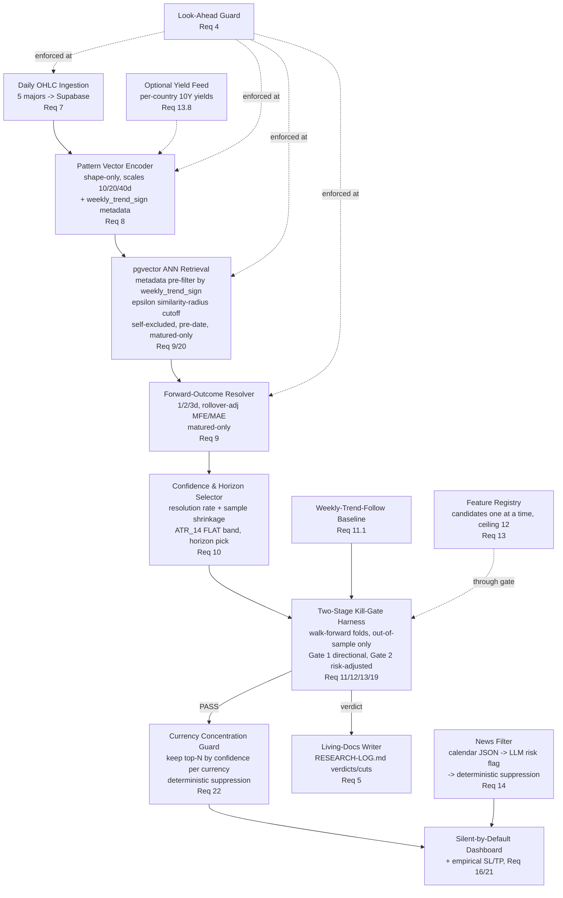
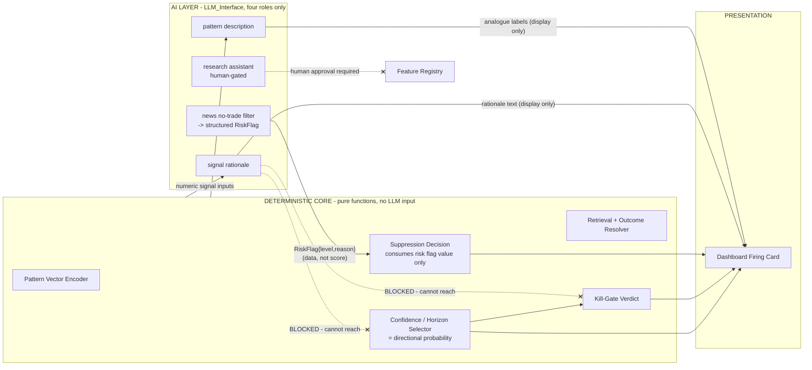
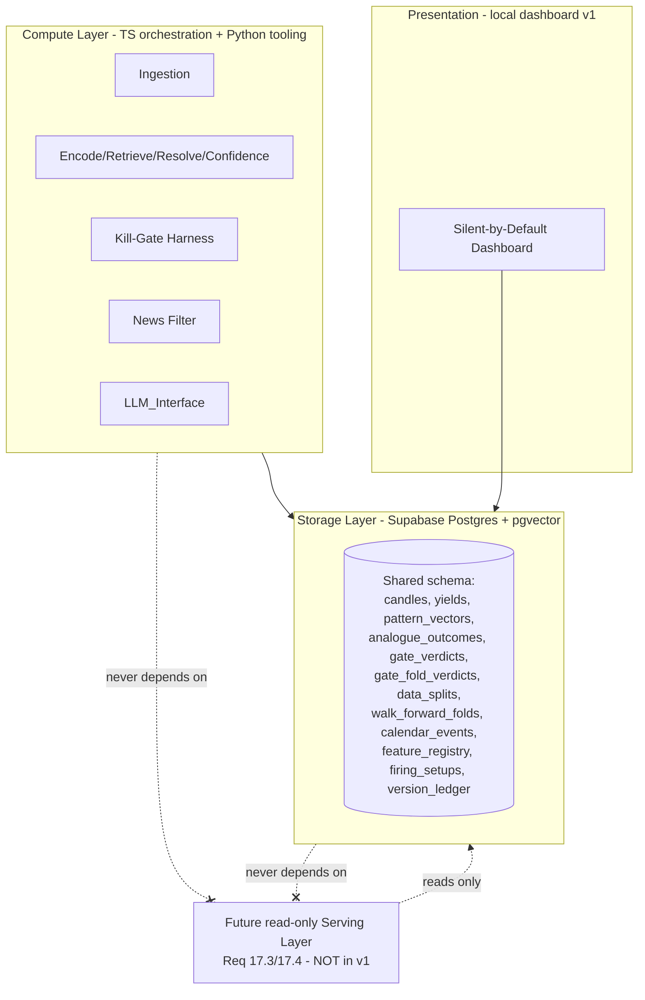

# Design Document

## Overview

The FX Daily Pattern Trading Assistant is a local-first, greenfield research and dashboard system for five major FX pairs (EURUSD, GBPUSD, USDJPY, USDCHF, USDCAD). Its purpose is to surface a small number of high-conviction, forward-looking daily directional setups ("over the next 1-3 days, direction X, with earned confidence C%") and to stay silent otherwise.

The design is shaped by one governing principle drawn directly from the failure of the prior system: **measure before believing, and keep the deciding math falsifiable.** This produces two structural commitments that every component below honors:

1. **AI explains and filters; deterministic code decides and scores.** (Requirements 2, 3, 15) The LLM may read news, write rationale, describe analogues, and help interpret results. It may never contribute to the directional probability or the kill-gate verdict. This is enforced by an architectural boundary, not merely by convention, and is proven by an automated guardrail test.
2. **Nothing reaches the dashboard until it passes a deterministic, out-of-sample kill-gate.** (Requirements 11, 12, 13, 16) The two-stage kill-gate is built *before* feature discovery, and candidate features are admitted one at a time only through a passing verdict.

The system deliberately inverts the prior project's failure mode. Where the predecessor used a 62-dimensional point-in-time snapshot to predict the noisiest 4-hour horizon and never measured its most promising idea, this system uses a low-dimensional shape-only pattern vector over multi-scale daily windows, evaluates 1/2/3-day horizons, enforces a hard feature ceiling of 12, and gates every inclusion against a weekly-trend-follow baseline on held-out data. Because the model is silent-by-default, Gate 1 is a *conditional* directional comparison: it measures the model's accuracy against the baseline's accuracy on the same matched subset of Decision_Dates where the model actually fires, never against the baseline's accuracy over all trading days.

The design also incorporates five robustness improvements that harden the system against fitting to a single recent period and against acting on weak precedent. The kill-gate validates features via **walk-forward cross-regime folds** — sequential, non-overlapping train/test windows that each represent a distinct market regime — rather than a single static 70/30 split, so a feature must prove itself across regimes to earn inclusion. Retrieval rejects low-quality matches via a **similarity-radius (epsilon) cutoff**, admitting an analogue only when its cosine distance to the query is within epsilon, so the system stays silent when it lacks genuine precedent. When a setup fires, it derives **empirical stop-loss/take-profit** boundaries directly from the analogue neighborhood's excursion distribution rather than from generic ATR multipliers. The dashboard applies a portfolio-level **currency-concentration guard** that de-duplicates simultaneous same-currency setups by conviction. Finally, a **10Y yield-spread candidate feature** (base-country 10Y minus quote-country 10Y) is added to the feature registry, gated like any other candidate under the feature ceiling. The empirical risk boundaries and the concentration guard are computed **deterministically with no LLM input**, consistent with the hard rule that AI explains and filters while deterministic code decides and scores.

### Design Goals

- **Determinism and reproducibility** (Requirement 3): all scoring, encoding, retrieval, confidence, and gate logic are pure functions; identical inputs always produce identical outputs.
- **Look-ahead safety** (Requirement 4): a single explicit guard function is enforced at every stage where a date boundary matters; only matured outcomes count in evaluation.
- **Clean AI boundary** (Requirement 2): the `LLM_Interface` is the only path to any model, restricted to four sanctioned roles, and its outputs are structurally excluded from scoring code paths.
- **Compute/storage/serving separation** (Requirement 17): compute never depends on a serving layer; the same schema runs local and hosted; a future read-only serving layer can be added without rearchitecting.
- **Latest-stable, low-debt toolchain** (Requirement 18): latest-stable TS/Python, Node Active LTS, pinned dependencies, no prereleases, no deprecated APIs, enforced by an automated version-policy check.

### Technology Choices (Requirements 3, 17, 18)

- **TypeScript (latest stable, on Node Active LTS)** for pipeline/orchestration, retrieval, confidence, kill-gate harness, LLM_Interface, news filter, dashboard, and living-docs writer. TypeScript is the default language for everything.
- **Python (latest stable)** only where statistical/backtest tooling genuinely benefits — e.g. calibration checks, distribution statistics, or heavier numerical validation of gate metrics. Python components are pure and invoked as isolated, deterministic steps; they never own the displayed decision path unless the decision math is more faithfully expressed there. Where both languages could compute a scoring value, the TypeScript implementation is authoritative and any Python is a cross-check.
- **Supabase Postgres + pgvector** for OHLC storage, pattern-vector rows, outcomes, verdicts, and calendar events. The same schema (migrations) runs against a local Supabase instance and the hosted project (Requirement 17.2).
- **GCP** for scheduled unattended daily runs once the model is validated (Requirement 16.7). Not required for the research phase.
- **LLM provider: Google Gemini Enterprise Agent Platform** (via the Google Gen AI SDK), accessed only behind the thin, swappable `LLM_Interface` (Requirement 2.4). Authenticated with Google Cloud IAM (Application Default Credentials or a service account) scoped to the project's `GCP_PROJECT_ID`/`GCP_REGION`; no standalone API key. The interface remains provider-agnostic so the backend can be swapped without touching the deterministic core.

## Architecture

### High-Level Data Flow

The pipeline follows the sequence established in the project plan, expanded to make the AI/deterministic boundary and the look-ahead guard explicit.



### The AI / Deterministic Boundary (Requirements 2, 15)

The most important architectural feature is a hard boundary that no LLM output can cross into scoring. This is expressed as two separated regions with a one-way, structurally enforced interface between them.



Key boundary rules:

- The **directional probability** (Earned_Confidence) and the **kill-gate verdict** are computed only inside the deterministic core, from typed numeric inputs. Their function signatures accept no LLM-derived type. (Requirements 2.1, 2.2)
- The **only** LLM output that flows *inward* is the news `RiskFlag`, and it flows into the *suppression* decision, not into probability or verdict. The suppression decision consumes only the structured `{level, reason}` and can never turn into a directional signal. (Requirements 14.2, 14.3, 14.5)
- **Rationale text** and **analogue labels** flow *outward only*, to the dashboard card. They are derived from the numeric signal and cannot alter it. (Requirements 15.1, 15.2, 15.4)
- The **research-assistant** role can only *propose*; proposals require recorded human approval before the feature set changes. (Requirement 2.8)
- The boundary is enforced by (a) type separation — scoring functions never import LLM types, (b) a runtime `ScoringInputGuard` that rejects any value tagged with an LLM provenance marker, and (c) an automated guardrail test (Requirement 2.7). Every LLM call is routed through `LLM_Interface`, which rejects any role outside the four sanctioned roles and records the rejection (Requirements 2.3, 2.4, 2.5).

### Layered / Deployment Architecture (Requirement 17)



- Compute reads/writes storage; the dashboard reads storage (and triggers a compute run). Neither compute nor storage depends on any serving layer (Requirement 17.1).
- The same migrations produce the same schema locally and hosted (Requirement 17.2).
- No public API or website is included in v1 (Requirement 17.3). A future serving layer would read storage only, requiring no change to compute or storage design (Requirement 17.4).

### Scheduling and Deployment (Requirement 16.7)

Once validated, a GCP Cloud Scheduler job triggers the same TypeScript daily-run entry point that the local dashboard uses. Because the entire compute path is deterministic and reads the same storage schema, a scheduled unattended run produces the same result as an equivalent local run.

**Deployment target.** The deterministic daily-run entry point is packaged as a container and deployed to Cloud Run. The v1 scheduled refresh runs as a **Cloud Run Job** (run-to-completion batch execution) rather than a request-driven Cloud Run service, because the daily refresh is an unattended batch run, not a web endpoint. Cloud Scheduler triggers the Cloud Run Job on the daily cadence (Requirement 16.7). A Cloud Run service with a scheduled HTTP trigger remains an acceptable alternative should a serving endpoint be needed later, consistent with the reserved future serving layer (Requirement 17.4) — but v1 uses a Job.

**Delivery pipeline.** Deployment is driven from the GitHub `main` branch through CI, never ad hoc from a developer machine. The flow:

- Feature/dev branch → pull request → review → merge to `main`.
- A GitHub Actions workflow on `main` runs the full quality gate (`npm run check` = lint + typecheck + the property/unit test suite) and only proceeds on green.
- The container is built (Cloud Build) and pushed to Artifact Registry, tagged with the commit SHA.
- That SHA-pinned image is deployed to the Cloud Run Job.

Pinning deployments to commit SHAs extends the project's determinism principle (Requirement 3.1) into operations and enables exact rollback.

**Authentication.** CI authenticates to Google Cloud using Workload Identity Federation (keyless OIDC from GitHub Actions) rather than long-lived service-account JSON keys. The Cloud Run Job runs as a dedicated least-privilege service account.

**Secrets and configuration.** Runtime secrets (Supabase URL/keys and any database connection string) are stored in Google Secret Manager and referenced by the Cloud Run Job at runtime; they are never committed to the repo or baked into the image. Non-secret config (project, region, target model) is provided via environment variables, consistent with the project's `.env` conventions.

**Supabase connectivity from Cloud Run.** The Supabase direct database host is IPv6-only, whereas Cloud Run egress is effectively IPv4 without additional VPC/IPv6 configuration. The scheduled run therefore connects to Supabase via the IPv4-reachable connection pooler (or the REST path), not the direct IPv6 database host. This preserves the compute/storage separation (Requirement 17) — the scheduled compute reads/writes the same storage schema as a local run.

## Components and Interfaces

Each component below is a module with a narrow, typed interface. Deterministic-core components are pure functions with no hidden mutable state (Requirement 3.2). TypeScript interface sketches are illustrative, not final.

### 1. Look-Ahead Guard (Requirement 4)

The single source of truth for date-boundary safety, imported by ingestion, encoder, retrieval, and resolver.

```typescript
// Pure. Throws/returns rejection if any candle violates the boundary for a decisionDate.
interface LookAheadGuard {
  // Rejects any candle dated >= decisionDate for feature/retrieval use. (Req 4.1, 4.4)
  assertPastOnly(candles: Candle[], decisionDate: TradingDate): Result<Candle[], LookAheadViolation>;
  // True only if the full horizon window has closed as of evalDate. (Req 4.2)
  isMatured(outcomeStart: TradingDate, horizonDays: 1 | 2 | 3, evalDate: TradingDate): boolean;
  // Filters an analogue set to matured, strictly-pre-date entries. (Req 9.3, 9.5)
  maturedPreDateOnly(analogues: Analogue[], decisionDate: TradingDate, evalDate: TradingDate): Analogue[];
}
```

Enforcement points: ingestion-adjacent processing (Requirement 7.5), feature computation (Requirement 4.1), retrieval pre-filter (Requirements 9.3, 9.5), and outcome resolution maturity (Requirement 4.2). Rejections are surfaced as typed errors, not silent drops (see Error Handling).

### 2. OHLC Ingestion (Requirement 7)

```typescript
interface OhlcIngestion {
  ingest(pair: Pair, rawCandles: RawCandle[]): Promise<IngestReport>; // normalizes to NY-close session boundary, then idempotent upsert by (asset,date) (Req 7.2, 7.4)
  validate(candle: RawCandle): Result<Candle, OhlcValidityError>;      // reject high<low or open/close outside [low,high] (Req 7.3)
  // Normalizes every feed to the 17:00 America/New_York (New York close) daily session boundary before storage; merges Sunday partials into Monday. (Req 7.2)
  normalizeSessionBoundary(rawCandles: RawCandle[]): Candle[];
  coverageSummary(): Promise<PerPairCoverage[]>;                       // (Req 7.6)
}
```

Ingestion validates OHLC invariants, upserts keyed by `(asset, date)` so re-runs never duplicate (Requirement 7.4), and runs the look-ahead guard on any adjacent windowing (Requirement 7.5).

**Session-boundary constraint.** Daily candles are defined on the **17:00 America/New_York close** (the "New York close"), i.e. 22:00 UTC during US Eastern Standard Time, producing standard Monday–Friday, 5-day-per-week daily candles. Sunday partial/short candles are **merged into the Monday candle (or excluded)** rather than stored as a separate short candle. Ingestion normalizes all feeds to this session boundary **before storage** (via `normalizeSessionBoundary`) so pattern shapes are consistent across data feeds regardless of the feed's native cut-off.

### 3. Pattern Vector Encoder (Requirement 8)

```typescript
interface PatternVectorEncoder {
  // Pure, shape-only encoding over fixed windows; per-scale independent normalization. (Req 8.1, 8.2, 8.5, 8.6)
  encode(window: Candle[], decisionDate: TradingDate): PatternVector;
  // Derives macro-regime metadata: the 5-trading-day rolling ROC sign. UP if Close_T - Close_{T-5} >= 0, else DOWN. (Req 8.3)
  weeklyTrendSign(window: Candle[], decisionDate: TradingDate): "UP" | "DOWN";
}

interface PatternVector {
  scale10: number[]; scale20: number[]; scale40: number[]; // per-scale normalized shape
  embedding: number[];       // concatenated fixed-dimension vector stored as pgvector (Req 8.4)
  weeklyTrendSign: "UP" | "DOWN";
  dim: number;               // fixed; dim = 70 (10 + 20 + 40 trading-day per-scale shape slices)
}
```

The encoder is shape-only — it captures the sequence/shape of the daily candles over 10/20/40-day windows, per-scale normalized so absolute price level cannot dominate (Requirement 8.2). Identical windows yield identical vectors (Requirement 8.5); degenerate windows (zero variance) return a defined, non-error result (Requirement 8.6), e.g. a zero-shape vector rather than a division-by-zero.

`Weekly_Trend_Sign` is defined strictly as the **5-trading-day rolling rate of change**: `UP` if `Close_T - Close_{T-5} >= 0`, else `DOWN`. This rolling definition removes any calendar-week ambiguity, so the macro-regime filter is uniform on any weekday rather than depending on where the Decision_Date falls within a calendar week.

### 4. pgvector Retrieval + Forward-Outcome Resolver (Requirement 9)

```typescript
interface AnalogueRetrieval {
  // Metadata pre-filter by weekly_trend_sign, then pgvector ANN; self-excluded, pre-date, matured-only,
  // and admitted only if cosine distance to the query <= configurable Similarity_Radius epsilon. (Req 9.1-9.5, 9.7, 9.8, 20)
  retrieve(query: PatternVector, decisionDate: TradingDate, evalDate: TradingDate, k: number, epsilon: number): Analogue[];
}

interface OutcomeResolver {
  // Terminal Direction_Class + MFE/MAE at each of 1/2/3-day horizons, forward candles only. (Req 9.6)
  resolve(analogueDate: TradingDate, pair: Pair, atr14: number): ForwardOutcome;
}

interface ForwardOutcome {
  perHorizon: Record<1 | 2 | 3, { direction: DirectionClass; mfePips: number; maePips: number }>;
}
```

Retrieval pre-filters on `weekly_trend_sign` metadata *before* the ANN search so the neighborhood shares the query's macro-regime (Requirement 9.2), then applies pgvector similarity (Requirement 9.1), excludes the query itself (Requirement 9.4), and restricts to strictly-pre-date (Requirement 9.3) matured analogues (Requirement 9.5). Identical inputs return identical analogue sets (Requirement 9.7) — the query uses a deterministic ANN configuration and a stable tie-break ordering (by similarity, then date, then asset).

**Similarity-radius (epsilon) cutoff.** After the pre-filters, retrieval admits an analogue to the `Analogue_Neighborhood` **only if its cosine distance to the query is `<= epsilon`**, where `epsilon` is a configurable `Similarity_Radius` (Requirements 9.8, 20.1, 20.2). This rejects low-quality matches in unprecedented conditions rather than padding the neighborhood with distant analogues. If **fewer than 30 analogues** fall within `epsilon` for a Decision_Date, the confidence for that Pair is shrunk toward neutral and **no setup is surfaced on similarity grounds alone** (Requirements 9.9, 20.3) — this reuses the same 30-analogue floor and shrinkage mechanism as the Confidence Selector. The epsilon cutoff is applied *in addition to* the weekly-trend-sign pre-filter, self-exclusion, strictly-pre-date, and matured-only constraints, all of which still hold (Requirement 20.4).

### 5. Confidence & Horizon Selector (Requirement 10)

This component computes the **directional probability** and therefore sits at the heart of the deterministic core. It takes no LLM input (Requirement 2.1).

```typescript
interface ConfidenceSelector {
  // Earned_Confidence = resolution rate of neighborhood, shrunk toward 0.5 by sample size. In [0,1]. (Req 10.1, 10.2, 10.3, 10.7)
  earnedConfidence(neighborhood: Analogue[], horizon: 1 | 2 | 3): Confidence; // Confidence is a branded number in [0,1]
  // ATR_14-scaled dead-band classification. (Req 10.4, 10.5)
  classify(netMovePips: number, atr14: number): DirectionClass;
  // Horizon with strongest historical resolution for this neighborhood. (Req 10.6)
  selectHorizon(neighborhood: Analogue[]): 1 | 2 | 3;
}
```

Sample-size shrinkage pulls confidence toward neutral (0.5) and is strongest below the 30-analogue floor; a neighborhood below the floor cannot be displayed as crossing the threshold on sample size alone (Requirement 10.3). To keep the TypeScript implementation (authoritative) and any Python cross-check from diverging, the shrinkage is defined by one concrete formula:

```
C_shrunk = (n / (n + k)) * C_raw + (k / (n + k)) * 0.5
```

where `n` is the analogue count in the neighborhood, `C_raw` is the raw historical resolution rate, and `k` is a fixed prior weight `k = 10`. The constant `0.5` is the neutral prior. Because the prior weight is fixed, a neighborhood below the 30-analogue floor cannot have its shrunk confidence cross the `Confidence_Threshold` on sample size alone. The FLAT dead-band is ATR_14-scaled, never a fixed pip count (Requirement 10.4); moves inside the band classify FLAT (Requirement 10.5). The chosen horizon is the one with the strongest resolution for the matched neighborhood (Requirement 10.6).

### 6. Weekly-Trend-Follow Baseline (Requirement 11.1)

```typescript
interface Baseline {
  predict(decisionDate: TradingDate, pair: Pair): DirectionClass; // = weeklyTrendSign, i.e. the 5-trading-day rolling ROC sign (Req 11.1)
}
```

The baseline predicts the same rolling-5-day sign as `Weekly_Trend_Sign`: `UP` if `Close_T - Close_{T-5} >= 0`, else `DOWN` — never a calendar-week trend.

### 7. Two-Stage Kill-Gate Harness (Requirements 11, 12, 13)

```typescript
interface KillGate {
  // Walk-forward folds: sequential, non-overlapping, chronologically ordered train/test windows
  // (default ~3y train / ~1y test, roll forward by the test period). Fixed & recorded; changes rejected. (Req 11.2, 11.4, 19.1, 19.2)
  walkForwardFolds(pair: Pair, history: TradingDate[]): WalkForwardFold[];
  // Full verdict across folds; the out-of-sample set is the union of test folds. (Req 11.3, 11.5-11.13, 19)
  evaluate(config: ModelConfig, folds: WalkForwardFold[]): GateVerdict;
}

interface WalkForwardFold {
  foldIndex: number;
  trainStart: TradingDate; trainEnd: TradingDate;
  testStart: TradingDate;  testEnd: TradingDate;   // train window strictly precedes test window
  frozen: boolean;                                  // boundaries fixed once recorded (Req 19.2)
}

interface FoldVerdict {
  foldIndex: number;
  sampleSize: number;                               // matched-firing-subset size on this fold's test window
  skipped: boolean;                                 // true if sampleSize < 30 (below floor); excluded from pass/fail (Req 19.5)
  gate1: { modelAccuracy: number; baselineAccuracy: number; deltaPp: number; passed: boolean };
  gate2: { modelRiskAdj: number; baselineRiskAdj: number; margin: number; passed: boolean };
  verdict: "PASS" | "CUT";
}

interface GateVerdict {
  configId: string;
  foldVerdicts: FoldVerdict[];  // per-fold verdicts/metrics (Req 11.13, 19.3, 19.4)
  gate1: { modelAccuracy: number; baselineAccuracy: number; deltaPp: number; passed: boolean }; // aggregate over union of qualifying test folds; baselineAccuracy is measured on the model's firing subset of Decision_Dates, not over all trading days (Req 11.6)
  gate2: { modelRiskAdj: number; baselineRiskAdj: number; margin: number; passed: boolean };     // >=0 after friction (Req 11.7, 11.8)
  sampleSize: number;        // matched-firing subset must be >=30 to evaluate a fold (Req 11.5)
  verdict: "PASS" | "CUT";   // PASS iff every qualifying fold passes both gates (Req 11.13, 19.3)
  metrics: GateMetrics;
}
```

Behavior:
- **Walk-forward folds** replace the single static split. `walkForwardFolds()` produces **sequential, non-overlapping, chronologically ordered** train/test folds (default ~3-year train / ~1-year test, rolling forward by the test period so each fold's test window represents a distinct market regime). Every train window strictly precedes its test window. Fold boundaries are **fixed and recorded** once computed, and any later attempt to change recorded fold dates is rejected (Requirements 11.2, 11.4, 19.1, 19.2). The **out-of-sample set is the union of all test folds** (Requirement 11.2).
- **All verdicts** are computed on the out-of-sample test folds only (Requirement 11.3).
- A configuration is evaluated on a fold only where its matched firing subset on that fold's test window has ≥30 analogues; **folds below the floor are skipped and recorded** as skipped, and are excluded from the pass/fail determination (Requirements 11.5, 19.5).
- **Gate 1** passes on a qualifying fold only where model directional accuracy exceeds baseline accuracy by ≥3pp (Requirement 11.6). Because the model is silent-by-default and fires on only a small subset of Decision_Dates, Gate 1 compares the model's directional accuracy against the `Weekly_Trend_Follow` baseline's accuracy computed on the **same subset of Decision_Dates where the model produces a firing setup** (a conditional / matched-sample comparison), **not** against the baseline's accuracy over all trading days. This matched firing subset must itself still satisfy the ≥30-sample floor before Gate 1 is evaluated.
- **Gate 2** is evaluated only after Gate 1 passes on that fold (Requirement 11.8). The `Friction_Penalty` (1.5 pips EURUSD/GBPUSD; 2.0 pips USDJPY/USDCHF/USDCAD) is deducted from the MFE/MAE excursions of **both** the model and the baseline (Requirement 11.7); Gate 2 passes where the model's excursion-weighted hit metric ≥ baseline's after that deduction (Requirement 11.8).
- **Verdict** is PASS **iff the config passes BOTH Gate 1 and Gate 2 on EVERY qualifying fold** (folds meeting the ≥30-sample floor); a single failing qualifying fold makes the verdict CUT. Per-fold verdicts and metrics, and the aggregate verdict, are appended to the Research_Log (Requirements 11.9, 11.10, 11.11, 11.13, 19.3, 19.4).
- The harness reproduces known metrics on a fixed fixture (Requirement 11.12).

Build-order discipline: the harness is delivered before any feature-discovery capability (Requirement 12.1); features are admitted only through a passing verdict (Requirement 12.2); nothing unpassed can drive a displayed signal (Requirement 12.3).

### 8. Feature Registry (Requirement 13)

```typescript
interface FeatureRegistry {
  candidates(): FeatureId[]; // %B, RSI, volumeProxyRegime, weeklyTrendContext, distanceToSma, structuralLiquiditySr, yieldSpread10y (Req 13.5, 13.8)
  evaluateOneAtATime(candidate: FeatureId, baseConfig: ModelConfig): GateVerdict; // (Req 13.1, 13.7)
  included(): FeatureId[];   // ceiling 12 (Req 13.4)
  structuralLiquidityDistance(decisionDate: TradingDate, pair: Pair): number; // nearest of PrevDay/PrevWeek/20-Day H/L (Req 13.6)
  // 10Y government-bond yield spread for the pair = base-country 10Y minus quote-country 10Y,
  // using only yield data dated strictly before the Decision_Date (look-ahead guard). (Req 13.8)
  yieldSpread10y(decisionDate: TradingDate, pair: Pair): number;
}
```

Candidates are evaluated one at a time by re-running the gate (Requirement 13.1); passers are retained (Requirement 13.2), failers are cut and logged with metric deltas (Requirement 13.3). The included count is capped at 12 (Requirement 13.4). Toggling a feature with otherwise-unchanged config reproduces the prior verdict (Requirement 13.7). The candidate set now includes `yieldSpread10y`, the 10-year government-bond yield differential for the pair (base-country 10Y minus quote-country 10Y, e.g. US10Y minus DE10Y for EURUSD). `yieldSpread10y()` computes the spread under the look-ahead guard — only yield rows dated strictly before the Decision_Date are used — and it passes through the same Kill_Gate as any other candidate, still subject to the ≤12 feature ceiling (Requirements 13.5, 13.8).

### 9. LLM_Interface (Requirements 2.3-2.5, 14, 15)

The single, thin, swappable gateway to any LLM. All calls pass through it (Requirement 2.4).

The v1 concrete implementation targets the Google Gemini Enterprise Agent Platform through the Google Gen AI SDK, authenticated via Google Cloud IAM / Application Default Credentials (no API key). Because every call passes through this thin gateway, the provider can be swapped without changing any caller. The specific Gemini model is configurable (env `GEMINI_MODEL`) and left unpinned pending a cost/availability decision.

```typescript
type SanctionedRole = "news_filter" | "signal_rationale" | "pattern_description" | "research_assistant";

interface LLM_Interface {
  // Rejects any role not in the sanctioned set, recording the rejected role. (Req 2.3, 2.5)
  invoke<R extends SanctionedRole>(role: R, input: RoleInput[R]): Promise<LlmTagged<RoleOutput[R]>>;
}
```

- `LlmTagged<T>` carries a provenance marker so the `ScoringInputGuard` can reject any LLM-originated value that reaches a scoring function (Requirement 2.6).
- **news_filter** returns a structured `RiskFlag { level, reason }` (Requirement 14.2).
- **signal_rationale** returns display text derived from numeric inputs (Requirement 15.1).
- **pattern_description** returns qualitative analogue labels (Requirement 15.3).
- **research_assistant** returns proposals only; the registry ignores them until human approval is recorded (Requirement 2.8).

### 10. News Filter (Requirement 14)

```typescript
interface NewsFilter {
  ingestCalendar(decisionDate: TradingDate): Result<CalendarEvent[], NewsFeedError>; // (Req 14.1, 14.6)
  riskFlag(events: CalendarEvent[], decisionDate: TradingDate): RiskFlag;             // via LLM_Interface (Req 14.2)
  // Deterministic suppression from the structured flag; never generates a signal. (Req 14.3, 14.4, 14.5)
  suppress(flag: RiskFlag, pair: Pair): SuppressionDecision;
}
```

Structured calendar JSON (ForexFactory / FMP) supplies `{name, currency, impact, timestamp}` (Requirement 14.1). The `LLM_Interface` emits a structured `RiskFlag {level, reason}` (Requirement 14.2); deterministic code consumes that flag to decide suppression (Requirement 14.3) and records the reason when it suppresses (Requirement 14.4). News is only a suppressor (Requirement 14.5). Fail-safe: if the feed is unavailable, times out, or fails validation, the filter flags the missing context, logs an ingestion error, and suppresses all cards for that Decision_Date (Requirement 14.6).

### 11. Silent-by-Default Dashboard (Requirement 16)

```typescript
interface Dashboard {
  dailyRun(decisionDate: TradingDate): DashboardView; // all 5 pairs (Req 16.1)
  // A pair renders only if gate-passing AND confidence>=threshold AND news permits. (Req 16.2, 16.3, 16.5, 16.6)
  // After per-pair firing decisions and before final render, the Currency Concentration Guard runs
  // as a dashboard-level suppression step. (Req 22)
}
interface FiringCard {
  pair: Pair; direction: DirectionClass; horizon: 1 | 2 | 3;
  earnedConfidence: number; excursionProfile: { favorablePips: number; adversePips: number };
  stopLoss: number;   // empirical Stop_Loss from Component 15 (Req 21.4)
  takeProfit: number; // empirical Take_Profit from Component 15 (Req 21.4)
  rationale: string; analogueLabels: string[];
}
```

Silent by default: empty when no pair crosses the configurable threshold with a gate-passing, news-permitted pattern (Requirement 16.2). A firing card shows pair, direction, selected horizon, earned confidence, favorable-vs-adverse excursion profile, the empirical `Stop_Loss` and `Take_Profit` derived by Component 15 (Requirement 21.4), and AI rationale (Requirement 16.3). The `Confidence_Threshold` is configurable and tunable against the backtest (Requirement 16.4). Nothing unpassed by the gate is displayed (Requirement 16.5); news suppression is respected (Requirement 16.6). Once validated, a GCP-scheduled refresh produces the same unattended result (Requirement 16.7).

The **Currency Concentration Guard** (Component 16) runs as a dashboard-level suppression step **after** each pair's per-pair firing decision (gate-passing, confidence, news) but **before** the final render, so aligned same-currency setups are de-duplicated by conviction before the user sees the view (Requirement 22).

### 12. Living-Docs Writer (Requirement 5)

```typescript
interface LivingDocs {
  appendVerdict(verdict: GateVerdict): void;   // RESEARCH-LOG.md (Req 5.2, 5.4)
  appendCut(verdict: GateVerdict): void;       // failures + metrics (Req 5.5)
  validateLogEntry(entry: string): boolean;    // structural check (Req 6.5)
  updateState(state: ProjectState): void;      // PROJECT-STATE.md (Req 5.1)
}
```

Maintains `PROJECT-STATE.md`, `RESEARCH-LOG.md`, and `LESSONS.md` (Requirements 5.1, 5.2, 5.3). Kill-gate verdicts and cuts are auto-appended (Requirements 5.4, 5.5).

### 13. Version-Policy Check (Requirement 18)

```typescript
interface VersionPolicyCheck {
  // Fails if any pinned dep/lang/runtime is prerelease or uses an open-ended range. (Req 18.4, 18.8)
  audit(): Result<VersionLedger, VersionPolicyViolation>;
  // Records selected version + verification date. (Req 18.6)
  record(entry: VersionLedgerEntry): void;
  // Surfaces available newer stable versions for human review. (Req 18.7)
  availableUpgrades(): Upgrade[];
}
```

Enforces latest-stable languages/runtimes (Requirement 18.1), Node Active LTS (Requirement 18.2), pinned exact versions (Requirement 18.3), no prereleases (Requirement 18.4), no deprecated APIs (Requirement 18.5, enforced via linting and the audit), a version ledger with verification dates (Requirement 18.6), upgrade surfacing (Requirement 18.7), and an automated failing check for violations (Requirement 18.8). Runs in CI alongside lint/type-check/tests (Requirements 6.1, 6.2).

### 14. Project Bootstrap & Quality Harness (Requirement 6)

CI runs lint, type-check, and tests, failing on any failure (Requirements 6.1, 6.2). Supabase config is environment-based supporting local and hosted targets (Requirement 6.3) with a round-trip write/read connectivity check (Requirement 6.4). A templated Research_Log entry is validated for structure (Requirement 6.5).

### 15. Empirical Risk Boundaries (Requirement 21)

A deterministic-core component that derives `Stop_Loss` and `Take_Profit` from the firing neighborhood's excursion distribution rather than from generic ATR multipliers. It takes no LLM input (Requirement 21.3).

```typescript
interface EmpiricalRiskBoundaries {
  // Pure, no LLM. Stop_Loss = configurable percentile (default 75th) of neighborhood MAE;
  // Take_Profit = configurable percentile (default 50th) of neighborhood MFE. (Req 21.1, 21.2, 21.3)
  derive(
    neighborhood: Analogue[],
    horizon: 1 | 2 | 3,
    config?: { stopLossPercentile?: number; takeProfitPercentile?: number } // defaults 75 / 50
  ): RiskBoundaries | null; // null (not actionable) when neighborhood has < 30 analogues (Req 21.5)
}

interface RiskBoundaries { stopLossPips: number; takeProfitPips: number; }
```

For a firing setup, `Stop_Loss` is the configured percentile (default 75th) of the neighborhood's MAE distribution and `Take_Profit` is the configured percentile (default 50th) of its MFE distribution, both computed deterministically from the matured analogue outcomes at the selected horizon with no LLM input (Requirements 21.1, 21.2, 21.3). Both percentiles are configurable. When the neighborhood is below the 30-analogue floor, the boundaries are **not surfaced as actionable** — `derive` returns `null` and the dashboard omits actionable SL/TP for that pair (Requirement 21.5). The derived values populate the `FiringCard.stopLoss`/`takeProfit` fields (Requirement 21.4).

### 16. Currency Concentration Guard (Requirement 22)

A deterministic-core component invoked as a dashboard-level suppression step. It limits simultaneous directional exposure to the same base or quote currency across the five pairs. It takes no LLM input (Requirement 22.4).

```typescript
interface CurrencyConcentrationGuard {
  // Pure, no LLM. When multiple pairs fire with directional alignment on the same base or quote
  // currency on a Decision_Date, keep only the top-N highest-Earned_Confidence aligned setups
  // (default N=2, configurable) and suppress the rest, recording the reason + competing pairs. (Req 22.1-22.5)
  apply(
    firing: FiringSetup[],
    decisionDate: TradingDate,
    config?: { maxConcurrentAligned?: number } // default 2
  ): { kept: FiringSetup[]; suppressed: SuppressedSetup[] };
}

interface SuppressedSetup {
  pair: Pair;
  reason: "currency_concentration";
  competingPairs: Pair[]; // the aligned same-currency pairs that outranked it (Req 22.3)
}
```

The guard groups same-day firing setups by shared base or quote currency **and** directional alignment (a directional bet on the same currency). Within each aligned group it retains only the `N` highest-`Earned_Confidence` setups (default `N = 2`, configurable via `maxConcurrentAligned`) and suppresses the rest, recording a `currency_concentration` reason and the competing pairs for each suppression (Requirements 22.1, 22.2, 22.3, 22.5). The computation is a pure function of the firing setups and their confidences, with no LLM input (Requirement 22.4).

## Data Models

All tables live in the shared Supabase schema (identical local and hosted, Requirement 17.2). `pgvector` is enabled for the pattern-vector embedding.

### `candles` (Requirement 7)

```sql
create table candles (
  asset       text not null,              -- one of the 5 pairs
  date        date not null,              -- NY-close trading date (session_close = 17:00 America/New_York; Sunday partials merged into Monday)
  open        double precision not null,
  high        double precision not null,
  low         double precision not null,
  close       double precision not null,
  source      text not null,
  ingested_at timestamptz not null default now(),
  primary key (asset, date),              -- keyed by (asset,date); idempotent upsert (Req 7.2, 7.4)
  constraint ohlc_valid check (high >= low and open between low and high and close between low and high) -- (Req 7.3)
);
```

### `yields` (Requirements 13.8)

Asset-agnostic per-country 10-year government-bond yields, keyed by `(country, date)`. The `yieldSpread10y` feature derives the base-country 10Y minus the quote-country 10Y for a pair; look-ahead safety is enforced by selecting only rows dated strictly before the Decision_Date.

```sql
create table yields (
  country     text not null,             -- e.g. 'US', 'DE', 'JP', 'CH', 'CA', 'GB' (10Y sovereign)
  date        date not null,             -- yield observation date (look-ahead: use rows < decision_date only)
  yield_10y   double precision not null, -- 10-year government bond yield (percent)
  source      text not null,
  ingested_at timestamptz not null default now(),
  primary key (country, date)            -- yield-spread = base-country 10Y minus quote-country 10Y (Req 13.8)
);
```

### `pattern_vectors` (Requirement 8)

```sql
create table pattern_vectors (
  asset             text not null,
  decision_date     date not null,
  embedding         vector(70) not null,  -- fixed dimension 70 = concatenation of the 10 + 20 + 40 trading-day per-scale shape slices (Req 8.4)
  weekly_trend_sign text not null check (weekly_trend_sign in ('UP','DOWN')), -- pre-filter metadata (Req 8.3, 9.2)
  scale_dims        jsonb not null,       -- per-scale slices for 10/20/40 for reproducibility/debug
  primary key (asset, decision_date)
);
-- ANN index for retrieval; metadata pre-filter uses weekly_trend_sign
create index on pattern_vectors using hnsw (embedding vector_cosine_ops);
create index on pattern_vectors (weekly_trend_sign, asset);
```

HNSW is used instead of IVFFlat because it supports dynamic inserts and metadata-filtered queries reliably on a small, growing dataset without requiring pre-computed centroid training.

### `analogue_outcomes` (Requirement 9)

```sql
create table analogue_outcomes (
  asset          text not null,
  decision_date  date not null,          -- analogue's own decision date
  horizon        smallint not null check (horizon in (1,2,3)),
  direction      text not null check (direction in ('UP','DOWN','FLAT')), -- terminal class (Req 9.6, 10.5)
  mfe_pips       double precision not null,  -- maximum favorable excursion
  mae_pips       double precision not null,  -- maximum adverse excursion
  atr14          double precision not null,  -- volatility scalar used for FLAT band (Req 10.4)
  matured        boolean not null,           -- full window closed (Req 4.2, 9.5)
  primary key (asset, decision_date, horizon)
);
```

### `data_splits` (Requirement 11)

Retained for reference and backward compatibility, but the **walk-forward folds are now the primary evaluation partition** for feature evaluation (see `walk_forward_folds` below). The single static most-recent test partition is no longer the basis for gate verdicts.

```sql
create table data_splits (
  asset       text not null,
  train_end   date not null,
  test_start  date not null,
  test_end    date not null,
  frozen      boolean not null default true, -- once recorded, changes rejected (Req 11.4)
  recorded_at timestamptz not null default now(),
  primary key (asset)
);
```

### `walk_forward_folds` (Requirements 11.2, 19)

The primary evaluation partition. Each row is one sequential, non-overlapping walk-forward fold (default ~3-year train / ~1-year test, rolling forward by the test period). The out-of-sample set for a config is the union of its qualifying test folds. Boundaries are frozen once recorded.

```sql
create table walk_forward_folds (
  asset       text not null,
  fold_index  integer not null,           -- sequential, chronological (Req 19.1)
  train_start date not null,
  train_end   date not null,
  test_start  date not null,              -- train window strictly precedes test window
  test_end    date not null,
  frozen      boolean not null default true, -- boundaries fixed once recorded; changes rejected (Req 19.2, 11.4)
  recorded_at timestamptz not null default now(),
  primary key (asset, fold_index)
);
```

### `gate_fold_verdicts` (Requirements 11.13, 19.4, 19.5)

Per-fold gate results for each config, complementing the aggregate `gate_verdicts` row. A config passes only if it passes both gates on every non-skipped (qualifying) fold.

```sql
create table gate_fold_verdicts (
  verdict_id   uuid not null references gate_verdicts(id),
  fold_index   integer not null,
  sample_size  integer not null,          -- matched-firing subset size on this fold (Req 11.5)
  skipped      boolean not null default false, -- true when sample_size < 30; excluded from pass/fail (Req 19.5)
  gate1_passed boolean,                    -- null when skipped
  gate2_passed boolean,                    -- null when skipped
  verdict      text check (verdict in ('PASS','CUT')), -- per-fold verdict; null when skipped (Req 11.13)
  metrics      jsonb not null default '{}'::jsonb,
  primary key (verdict_id, fold_index)
);
```

### `feature_registry` (Requirement 13)

```sql
create table feature_registry (
  feature_id  text primary key,          -- %B, RSI, volumeProxyRegime, weeklyTrendContext, distanceToSma, structuralLiquiditySr
  status      text not null check (status in ('candidate','included','cut')),
  verdict_id  uuid references gate_verdicts(id),
  updated_at  timestamptz not null default now()
);
-- included count enforced <=12 at application layer (Req 13.4)
```

### `gate_verdicts` (Requirements 5, 11, 13)

```sql
create table gate_verdicts (
  id                 uuid primary key default gen_random_uuid(),
  config_id          text not null,
  sample_size        integer not null,           -- (Req 11.5)
  gate1_model_acc    double precision not null,
  gate1_baseline_acc double precision not null,
  gate1_delta_pp     double precision not null,   -- (Req 11.6)
  gate1_passed       boolean not null,
  gate2_model_ra     double precision,            -- post-friction, both sides (Req 11.7)
  gate2_baseline_ra  double precision,
  gate2_margin       double precision,            -- (Req 11.8)
  gate2_passed       boolean,
  verdict            text not null check (verdict in ('PASS','CUT')), -- (Req 11.9, 11.10)
  selected_horizon   smallint check (selected_horizon in (1,2,3)),
  split_train_end    date not null,
  split_test_start   date not null,
  split_test_end     date not null,
  created_at         timestamptz not null default now()
);
```

### `calendar_events` (Requirement 14)

```sql
create table calendar_events (
  decision_date date not null,
  currency      text not null,
  event_name    text not null,
  impact        text not null,          -- impact rating from feed (Req 14.1)
  event_ts      timestamptz not null,
  source        text not null,          -- ForexFactory / FMP
  primary key (decision_date, currency, event_name, event_ts)
);

create table news_risk_flags (
  decision_date date not null,
  pair          text not null,
  level         text not null,          -- structured risk level from LLM_Interface (Req 14.2)
  reason        text not null,          -- stated reason (Req 14.4)
  feed_ok       boolean not null,       -- false triggers fail-safe suppression (Req 14.6)
  primary key (decision_date, pair)
);
```

### `firing_setups` (Requirements 21, 22)

Captures the per-pair firing decision as surfaced (or suppressed) on a Decision_Date, including the empirical risk boundaries from Component 15 and a suppression reason enum that includes `currency_concentration` (Component 16). This extends the in-memory `FiringCard` representation with the persisted fields needed for auditing suppression decisions.

```sql
create table firing_setups (
  decision_date     date not null,
  pair              text not null,
  direction         text not null check (direction in ('UP','DOWN','FLAT')),
  horizon           smallint not null check (horizon in (1,2,3)),
  earned_confidence double precision not null,
  stop_loss_pips    double precision,       -- empirical Stop_Loss (75th pct MAE); null if below floor (Req 21.2, 21.5)
  take_profit_pips  double precision,       -- empirical Take_Profit (50th pct MFE); null if below floor (Req 21.2, 21.5)
  surfaced          boolean not null,        -- false when suppressed
  suppression_reason text check (suppression_reason in ('news','currency_concentration','below_floor','not_fired')), -- (Req 22.3)
  competing_pairs   text[],                 -- aligned same-currency pairs that outranked it, when concentration-suppressed (Req 22.3)
  primary key (decision_date, pair)
);
```

### `version_ledger` (Requirement 18)

```sql
create table version_ledger (
  component      text primary key,       -- language/runtime/dependency
  version        text not null,          -- exact pinned version (Req 18.3)
  is_prerelease  boolean not null default false, -- must be false (Req 18.4)
  verified_at    date not null,          -- date verified latest-stable (Req 18.6)
  latest_known   text                    -- surfaced for upgrade review (Req 18.7)
);
```

### Domain Types (in-code, deterministic core)

- `Confidence`: branded number constrained to [0,1] (Requirement 10.2).
- `DirectionClass`: `'UP' | 'DOWN' | 'FLAT'` (Requirement 1.4).
- `PatternVector`: fixed-dimension embedding (dim = 70, the concatenation of the 10 + 20 + 40 trading-day per-scale shape slices) + per-scale slices + `weeklyTrendSign`.
- `LlmTagged<T>`: provenance-marked wrapper the `ScoringInputGuard` rejects on scoring paths (Requirement 2.6).

## Correctness Properties

*A property is a characteristic or behavior that should hold true across all valid executions of a system — essentially, a formal statement about what the system should do. Properties serve as the bridge between human-readable specifications and machine-verifiable correctness guarantees.*

This feature is highly amenable to property-based testing: the encoder, retrieval, outcome resolver, confidence/horizon selector, kill-gate, and suppression logic are pure functions with large input spaces and clear universal behaviors. The checks below were derived from the prework analysis and consolidated to remove redundancy.

### Property 1: Deterministic reproducibility

*For all* valid inputs to the pattern-vector encoder, retrieval, outcome resolver, confidence/horizon selector, kill-gate evaluation, and the dashboard view builder, invoking the function twice with identical inputs produces identical outputs. In particular, a fixed backtest fixture reproduces its known metrics, and a scheduled unattended run over fixed storage produces the same view as an equivalent local run.

**Validates: Requirements 3.1, 3.2, 8.5, 9.7, 10.7, 11.12, 13.7, 16.7**

### Property 2: Look-ahead guard excludes future candles and immature outcomes

*For all* candle sets and Decision_Dates, the guarded feature/retrieval input contains no candle dated at or after the Decision_Date, and *for all* forward outcomes and evaluation dates, an outcome is counted only when its full Horizon window has closed as of the evaluation date.

**Validates: Requirements 4.1, 4.2, 4.4, 4.5, 7.5**

### Property 3: Retrieval is self-excluded, strictly pre-date, and matured-only

*For all* queries and backing data, every analogue in the returned Analogue_Neighborhood is dated strictly before the query Decision_Date, is a Matured_Outcome, and is not the query pattern itself.

**Validates: Requirements 9.3, 9.4, 9.5**

### Property 4: AI-free scoring guardrail

*For all* LLM-tagged values, no such value reaches the directional-probability computation or the Kill_Gate verdict computation; any attempt to feed one is blocked and recorded, and the deterministic computations proceed unchanged on their deterministic inputs. Equivalently, *for all* signals, generating rationale text or analogue labels leaves the numeric directional probability and verdict identical.

**Validates: Requirements 2.1, 2.2, 2.6, 2.7, 15.2, 15.4**

### Property 5: LLM role gating

*For all* role identifiers passed to the LLM_Interface, the call is accepted if and only if the role is one of the four sanctioned roles (news filter, signal rationale, pattern description, research assistant); any other role is rejected before invocation and the rejected role is recorded.

**Validates: Requirements 2.3, 2.5**

### Property 6: Research proposals are human-gated

*For all* research-assistant proposals lacking a recorded human approval, the included feature set and recorded interpretations are identical before and after the proposal.

**Validates: Requirement 2.8**

### Property 7: Direction classification is total and exact

*For all* net forward moves and ATR_14 values, classification returns exactly one Direction_Class; the move classifies FLAT if and only if it lies within the ATR_14-scaled dead-band, and UP or DOWN by the sign of the move otherwise.

**Validates: Requirements 1.4, 10.5**

### Property 8: FLAT band scales with ATR_14

*For all* net moves and positive ATR_14 values, scaling ATR_14 by a positive factor scales the FLAT dead-band boundary by the same factor; the classification boundary is not a fixed pip constant.

**Validates: Requirement 10.4**

### Property 9: Pattern vector is shape-only and scale-invariant

*For all* input windows and positive price scalars, encoding the window and encoding the window with all prices multiplied by that scalar produce identical Pattern_Vectors, so absolute price level does not dominate the representation.

**Validates: Requirement 8.2**

### Property 10: Neighborhood shares the query weekly-trend regime

*For all* queries and backing data, every analogue in the returned neighborhood has the same Weekly_Trend_Sign as the query.

**Validates: Requirement 9.2**

### Property 11: Forward outcomes capture direction and excursions per horizon

*For all* resolved analogues, the forward outcome contains a terminal Direction_Class and MFE/MAE values for each of the 1-, 2-, and 3-day Horizons, computed only from candles dated after the analogue date.

**Validates: Requirement 9.6**

### Property 12: Earned confidence is bounded in [0,1]

*For all* Analogue_Neighborhoods and Horizons, the computed Earned_Confidence lies within the range [0,1].

**Validates: Requirement 10.2**

### Property 13: Sample-size shrinkage pulls thin neighborhoods toward neutral

*For all* neighborhoods, the Earned_Confidence equals `C_shrunk = (n / (n + k)) * C_raw + (k / (n + k)) * 0.5` with fixed prior weight `k = 10`, where `n` is the analogue count and `C_raw` is the raw historical resolution rate; consequently, *for all* pairs of neighborhoods with the same `C_raw` but differing analogue counts, the neighborhood with fewer analogues yields an Earned_Confidence no farther from 0.5 (neutral) than the larger one, and a neighborhood below the 30-analogue floor cannot be reported as crossing the Confidence_Threshold on sample size alone.

**Validates: Requirement 10.3**

### Property 14: Selected horizon maximizes historical resolution

*For all* Analogue_Neighborhoods, the resolution rate at the selected Horizon is greater than or equal to the resolution rate at every other candidate Horizon (1, 2, 3).

**Validates: Requirement 10.6**

### Property 15: Baseline equals the weekly trend sign

*For all* Decision_Dates and Pairs, the Weekly_Trend_Follow baseline's predicted direction equals the Weekly_Trend_Sign at that Decision_Date, defined as the 5-trading-day rolling rate of change: UP when `Close_T - Close_{T-5} >= 0`, otherwise DOWN.

**Validates: Requirement 11.1**

### Property 16: Chronological split respects the 70/30 (±2pp) partition

*For all* histories, the Data_Split assigns the earliest 70% (±2pp) to train/dev and the most recent 30% (±2pp) to the Out_Of_Sample_Test with no shuffling, and every train date precedes every test date.

**Validates: Requirement 11.2**

### Property 17: Recorded split dates are immutable

*For all* frozen Data_Splits, any attempt to change the recorded split dates is rejected and the originally recorded dates are retained.

**Validates: Requirement 11.4**

### Property 18: Verdicts are computed on out-of-sample data only

*For all* Kill_Gate verdicts, every date contributing to the scored metrics belongs to the Out_Of_Sample_Test partition.

**Validates: Requirement 11.3**

### Property 19: Sample-size floor gates evaluation

*For all* configurations whose matched Analogue_Neighborhood contains fewer than 30 analogues, the Kill_Gate withholds a pass/cut evaluation for that configuration.

**Validates: Requirement 11.5**

### Property 20: Gate 1 directional threshold

*For all* out-of-sample metrics, Gate_1 passes if and only if the pattern-model's directional accuracy exceeds the baseline's accuracy by at least 3 percentage points, where the baseline's accuracy is computed on the matched subset of Decision_Dates on which the model produces a firing setup (a conditional / matched-sample comparison), and that matched subset contains at least 30 samples.

**Validates: Requirement 11.6**

### Property 21: Friction penalty is applied symmetrically to model and baseline

*For all* excursion sets and Pairs, the pair-specific Friction_Penalty (1.5 pips for EURUSD/GBPUSD; 2.0 pips for USDJPY/USDCHF/USDCAD) is deducted from the MFE/MAE excursions of both the pattern-model outcomes and the baseline outcomes before comparison, so the same penalty applied to both sides never advantages one side over the other.

**Validates: Requirement 11.7**

### Property 22: Gate 2 sequencing and risk-adjusted threshold

*For all* configurations, Gate_2 is evaluated only after Gate_1 has passed, and Gate_2 passes if and only if the pattern-model's excursion-weighted hit metric over the selected Horizon is greater than or equal to the baseline's after Friction_Penalty deduction (margin ≥ 0).

**Validates: Requirement 11.8**

### Property 23: Verdict composition

*For all* configurations, the Kill_Gate verdict is PASS if and only if both Gate_1 and Gate_2 pass; otherwise it is CUT, and the corresponding verdict and metrics are logged.

**Validates: Requirements 11.9, 11.10**

### Property 24: Silent-by-default firing invariant

*For all* Pairs and Decision_Dates, a Pair is surfaced on the dashboard if and only if it has a Kill_Gate-passing pattern AND its Earned_Confidence crosses the configurable Confidence_Threshold AND the news filter permits trading; if no Pair satisfies all three, the dashboard is empty, and no feature or pattern that has not passed the Kill_Gate is ever displayed. In addition, the Currency_Concentration_Guard is applied as a further suppression step, so a Pair satisfying all three conditions may still be suppressed when it is an aligned same-currency setup outranked beyond the top-N by Earned_Confidence.

**Validates: Requirements 1.1, 1.2, 12.3, 16.2, 16.5, 16.6, 22.1**

### Property 25: Inclusion requires a passing verdict

*For all* candidate features, a feature is in the included set only if a PASS verdict exists for it; a feature without a PASS verdict is never included.

**Validates: Requirements 12.2, 13.2**

### Property 26: Feature ceiling is never exceeded

*For all* sequences of feature inclusions, the count of included features never exceeds 12.

**Validates: Requirement 13.4**

### Property 27: Structural liquidity distance is the nearest reference level

*For all* prices and reference-level sets, the Structural_Liquidity_SR feature equals the minimum absolute distance to the nearest of Previous Day High/Low, Previous Week High/Low, and 20-Day High/Low.

**Validates: Requirement 13.6**

### Property 28: News suppression is deterministic and never generates a signal

*For all* structured risk flags, the suppression decision is a pure function of the flag and produces only a suppress/permit outcome (with a reason), never a Direction_Class.

**Validates: Requirements 14.3, 14.5**

### Property 29: Elevated event risk suppresses otherwise-firing setups

*For all* Pairs and Decision_Dates where the news filter indicates elevated event risk, any otherwise-firing setup for that Pair is suppressed and the stated reason is recorded.

**Validates: Requirement 14.4**

### Property 30: News feed failure suppresses all cards fail-safe

*For all* feed-failure modes (unavailable, timeout, or failed validation) on a Decision_Date, the missing news context is flagged, an ingestion error is logged, and every one of the five Pairs is suppressed for that Decision_Date.

**Validates: Requirement 14.6**

### Property 31: Firing card contains all required fields

*For all* firing setups, the rendered card includes the Pair, Direction_Class, selected Horizon, Earned_Confidence, the favorable-versus-adverse excursion profile, the empirical Stop_Loss and Take_Profit, and the AI rationale.

**Validates: Requirements 1.3, 1.5, 16.3, 21.4**

### Property 32: OHLC validity rejection

*For all* candidate candles, ingestion accepts the candle if and only if its high is greater than or equal to its low and both open and close fall within the high-low range; otherwise it is rejected.

**Validates: Requirement 7.3**

### Property 33: Idempotent ingestion

*For all* source candle sets, ingesting the set once and ingesting it multiple times produce the same stored result with no duplicate (Asset, Date) rows.

**Validates: Requirement 7.4**

### Property 34: Version-policy enforcement

*For all* dependency/language/runtime specifications, the automated version-policy check fails if any specification is a prerelease build or uses an open-ended version range, and passes only when every specification is an exact, non-prerelease version.

**Validates: Requirements 18.3, 18.4, 18.8**

### Property 35: Similarity-radius admission

*For all* queries and analogues, an analogue is admitted to the Analogue_Neighborhood only if its cosine distance to the query is less than or equal to the configurable Similarity_Radius epsilon; and if fewer than 30 analogues fall within epsilon for a Decision_Date, no setup is surfaced for that Pair on similarity grounds alone.

**Validates: Requirements 9.8, 9.9, 20.2, 20.3**

### Property 36: Walk-forward fold construction

*For all* histories, the Walk_Forward_Window folds are sequential, non-overlapping, and chronologically ordered with every train window preceding its test window, and the out-of-sample set equals the union of the test folds.

**Validates: Requirements 11.2, 19.1**

### Property 37: Cross-regime inclusion

*For all* candidate configurations, a feature or configuration is admitted only if it passes both Gate_1 and Gate_2 on every qualifying walk-forward fold (folds meeting the >=30-sample floor); folds below the floor are skipped and recorded, and a single failing qualifying fold blocks inclusion.

**Validates: Requirements 11.13, 19.3, 19.5**

### Property 38: Empirical risk boundaries from the neighborhood distribution

*For all* firing neighborhoods with at least 30 analogues, the Stop_Loss equals the configured percentile (default 75th) of the neighborhood MAE distribution and the Take_Profit equals the configured percentile (default 50th) of the neighborhood MFE distribution, computed deterministically with no LLM input; for neighborhoods below the 30-analogue floor, the boundaries are not surfaced as actionable.

**Validates: Requirements 21.1, 21.2, 21.3, 21.5**

### Property 39: Currency-concentration guard keeps top-N by confidence

*For all* sets of same-day setups aligned on the same base or quote currency, the Currency_Concentration_Guard retains only the N highest-Earned_Confidence aligned setups (default N=2) and suppresses the rest with a recorded currency-concentration reason and the competing Pairs, computed deterministically with no LLM input.

**Validates: Requirements 22.1, 22.2, 22.3, 22.4**

### Property 40: Yield-spread feature definition

*For all* Pairs and Decision_Dates, the Yield_Spread feature equals the base-country 10Y yield minus the quote-country 10Y yield, using only yield data dated strictly before the Decision_Date.

**Validates: Requirement 13.8**

## Error Handling

Errors are surfaced as typed results, never silent drops, so that every rejection is observable and (where relevant) logged to the Research_Log or an ingestion error record.

### News feed fail-safe (Requirement 14.6)

If the economic calendar JSON feed is unavailable, times out, or fails schema validation for a Decision_Date, the `NewsFilter` returns a `NewsFeedError`, records a flagged "missing news context" state, logs an ingestion error, and the dashboard suppresses **all** setup cards for that Decision_Date. This is fail-closed: absence of news evidence suppresses trading rather than permitting it. (Property 30)

### OHLC validity rejection (Requirement 7.3)

Ingestion validates each candle against the invariant `high >= low AND open,close in [low,high]`. Invalid candles return an `OhlcValidityError` and are excluded from storage; the database `check` constraint is the second line of defense. Rejections are counted in the ingestion report. (Property 32)

### Look-ahead guard rejection (Requirement 4.4)

Any candle dated at or after a Decision_Date submitted to feature or retrieval computation is rejected by `LookAheadGuard.assertPastOnly`, which returns a `LookAheadViolation`. This is treated as a programming error in the pipeline (fail-loud in tests and CI) rather than a data condition to swallow. Immature outcomes are excluded from evaluation by `isMatured`. (Property 2)

### Thin-neighborhood shrinkage and sample floor (Requirements 10.3, 11.5)

Neighborhoods below the 30-analogue floor do not error; instead confidence is shrunk toward 0.5 and the Kill_Gate withholds a verdict for that configuration. The dashboard cannot surface such a neighborhood on sample size alone. (Properties 13, 19)

### Unprecedented conditions / empty similarity-radius neighborhood (Requirements 9.9, 20.3)

If fewer than 30 analogues fall within the `Similarity_Radius` epsilon for a Decision_Date (an unprecedented or weakly-precedented condition), retrieval does not error. The neighborhood is treated as sub-floor: `Earned_Confidence` is shrunk toward neutral (0.5) and **no setup is surfaced for that Pair on similarity grounds alone**, so the system stays silent when it lacks genuine precedent. This reuses the same fail-safe posture as the sample-size floor. (Property 35)

### Missing yield feed (Requirement 13.8)

If the yield feed is unavailable for a Decision_Date (no `yields` row dated strictly before the Decision_Date for a required country), the `yieldSpread10y` feature is treated as **unavailable** for that date rather than fabricated. A configuration that depends on the yield-spread feature **withholds** its firing decision for that Pair/date and records the missing-yield condition; it never substitutes a stale, interpolated, or future value. This keeps the feature fail-safe and look-ahead-safe.

### LLM boundary violations (Requirements 2.5, 2.6)

A request for a non-sanctioned role is rejected by the `LLM_Interface` before invocation, recording the rejected role. Any LLM-tagged value reaching a scoring function is rejected by the `ScoringInputGuard`, the blocked attempt is recorded, and the deterministic computation proceeds unchanged. (Properties 4, 5)

### Split immutability (Requirement 11.4)

Attempts to change a frozen `data_splits` record are rejected; the recorded dates are retained. (Property 17)

### Degenerate encoder input (Requirement 8.6)

Zero-variance windows return a defined, non-error Pattern_Vector (e.g. a zero-shape vector) rather than raising a division error. (covered by Property 1/9 generators)

### Version-policy violations (Requirement 18.8)

The version-policy check fails CI when any dependency/language/runtime is a prerelease or open-ended range; newer stable versions are surfaced for human review rather than auto-adopted. (Property 34)

## Testing Strategy

The system uses a dual approach: **property-based tests** for universal correctness (the deterministic core) and **example-based unit / integration / smoke tests** for specific scenarios, external services, configuration, and side effects.

### Property-Based Testing

- **Library**: `fast-check` for the TypeScript deterministic core (latest stable, pinned per Requirement 18). Where a property is validated more faithfully by Python statistical tooling (e.g. calibration distribution checks), `hypothesis` (latest stable) is used and the TypeScript implementation remains authoritative (Requirement 3.4).
- Each correctness property (Properties 1–40) is implemented by a **single** property-based test running a **minimum of 100 iterations**. Properties 35–40 cover the similarity-radius admission, walk-forward fold construction, cross-regime inclusion, empirical risk boundaries, the currency-concentration guard, and the yield-spread feature definition respectively.
- Each test is tagged with a comment referencing its design property, in the format:
  `// Feature: fx-daily-pattern-assistant, Property {number}: {property_text}`
- Generators deliberately include edge cases: zero-variance windows (Requirement 8.6), sub-floor neighborhoods (<30 analogues), boundary net moves at the ATR band edge, and equal model/baseline metrics at gate thresholds.

### Required Named Tests (from constraints)

- **Deterministic reproducibility** — Property 1; identical inputs across encoder/retrieval/confidence/gate/view yield identical outputs.
- **Look-ahead-guard test** — Property 2 (Requirement 4.5); proves no future candle contributes to a historical window and immature outcomes are excluded.
- **Kill-gate fixture reproducibility** — a fixed backtest fixture reproduces known metrics (Requirement 11.12), complementing Property 1.
- **Deliberately-null-feature-fails test** — a feature with no predictive signal must FAIL both gates (verifies Properties 20, 22, 23 discriminate real signal from noise).
- **AI-free-scoring guardrail test** — Property 4 (Requirement 2.7); asserts no LLM output reaches the probability or verdict paths and reports failing status if any is detected.
- **News fail-safe test** — Property 30 (Requirement 14.6); every feed-failure mode suppresses all five pairs and logs an ingestion error.
- **Symmetric-friction test** — Property 21; friction deducted from both model and baseline; an asymmetric application is caught.
- **Cross-regime inclusion test** — Property 37; a feature that passes on recent data but fails an earlier-regime walk-forward fold must **NOT** be included, proving that every qualifying fold must pass for admission.
- **Similarity-radius silence test** — Property 35; a query with fewer than 30 analogues within epsilon surfaces no setup on similarity grounds.
- **Currency-concentration guard test** — Property 39; aligned same-currency setups beyond the top-N by Earned_Confidence are suppressed with a recorded reason and competing pairs.
- **Empirical risk boundaries test** — Property 38; Stop_Loss/Take_Profit equal the configured MAE/MFE percentiles and are withheld below the 30-analogue floor.

### Unit Tests (example-based)

Specific behaviors and side effects: Research_Log append on verdict/cut (Requirements 5.4, 5.5, 11.11), log-entry template validation (Requirement 6.5), coverage summary (Requirement 7.6), news JSON parsing and field validation (Requirement 14.1), LLM structured `RiskFlag` shape (Requirement 14.2), rationale/label generation from numeric inputs (Requirements 15.1, 15.3), candidate feature membership (Requirement 13.5), single-candidate gate run (Requirement 13.1), cut logging with deltas (Requirement 13.3), threshold configurability (Requirement 16.4), and version-ledger recording/upgrade surfacing (Requirements 18.6, 18.7).

### Integration Tests

External-service behavior verified with 1–3 representative examples, not property tests: Supabase connectivity round-trip (Requirement 6.4), OHLC ingestion into Supabase (Requirement 7.1), pgvector persistence and ANN retrieval ordering (Requirements 8.4, 9.1), schema parity across local and hosted targets (Requirement 17.2), **yield feed ingestion** into the `yields` table with `(country, date)` keying and look-ahead-safe spread lookup (Requirement 13.8), and **walk-forward fold persistence** — folds written to `walk_forward_folds` are read back with identical, frozen boundaries and per-fold verdicts persist to `gate_fold_verdicts` (Requirements 11.2, 19.2, 19.4).

### Smoke / Structural Tests

Configuration and architecture constraints: TypeScript for pipeline/dashboard and Python only where needed (Requirements 3.3, 3.4), compute/storage/no-serving-layer dependency direction (Requirements 17.1, 17.3, 17.4), living-docs existence (Requirements 5.1, 5.3), CI runs and fails correctly on lint/type-check/test failures (Requirements 6.1, 6.2), env-based local/hosted config (Requirement 6.3), Node Active LTS and latest-stable selections (Requirements 18.1, 18.2), a static check that no module imports an LLM client except through `LLM_Interface` (Requirement 2.4), and a lint rule failing on deprecated APIs (Requirement 18.5).

### Why property-based testing applies here

The core is composed of pure functions over large, structured input spaces (candle windows, neighborhoods, excursions, metrics, risk flags) with clear universal invariants — determinism, look-ahead safety, bounded confidence, monotone shrinkage, threshold and composition behavior, symmetric friction, and the silent-by-default invariant. These are exactly the conditions where "for all inputs X, property P(X) holds" is meaningful and 100+ iterations find edge cases that hand-picked examples miss. External I/O (Supabase, pgvector ANN, the LLM provider, the calendar feed) is validated with integration/smoke tests instead, per the PBT applicability guidance.
