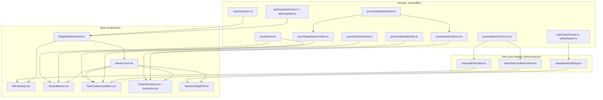
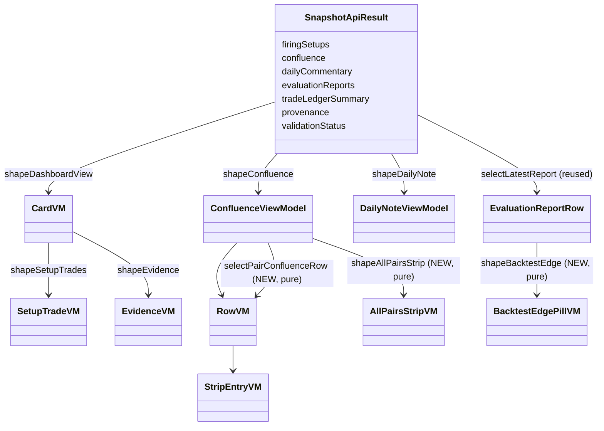

# Design Document

## Overview

This is a presentation-only refactor of the `web/` React dashboard. It replaces the current
five-tab, `BottomTabBar`-driven layout with one continuous `MasterCard` per currency pair,
preceded by a compact `AllPairsStrip`, inside a single always-mounted window.

No scoring, threshold, confidence, trade-parameter, AI-output, or third-party-output
computation changes. Every value the new components render is produced by one of the five
existing pure shapers that already exist in `web/src/pure/`:

- `shapeDashboardView` (`shapeDashboard.ts`) — surfaced/suppressed rows → `CardVM[]` / `SuppressionVM[]`
- `shapeConfluence` — the per-run Confluence_Matrix slice → `ConfluenceViewModel` (all pairs, `RowVM[]`)
- `shapeSetupTrades` — surfaced cards + evidence/ledger/provenance/validation → `SetupTradeVM[]` (FORECAST/TRADE, each field `MaybeValidated`)
- `shapeEvidence` — surfaced cards + analogue outcomes + ledger → `EvidenceVM[]`
- `shapeDailyNote` — the pair-independent daily commentary object → `DailyNoteViewModel`

None of these five files, nor `confluenceNav.ts`, nor `format.ts`, are modified. The new work
is: (a) a handful of small, new, additive pure helpers under `web/src/pure/` that **compose**
existing shaper output into single-pair or cross-pair display slices, and (b) new presentation
components under `web/src/components/` and a new `web/src/tabs/MasterCard/` (or
`web/src/dashboard-v2/`, naming decided at implementation) that lay those slices out in the four
zones. Routing, selection, and the fetch/loading/error state machine are reused from the
existing `state/selection.ts`, `routing/routes.ts`, and the `AppShell`/`SetupsTab` fetch-pattern,
not reinvented.

## Architecture



### Where this sits relative to the existing tree

- **Retired as top-level UI**: `components/BottomTabBar.tsx` is removed from the render tree
  (Req 1.1, 1.5). `components/TabRouter.tsx`'s 5-way switch is replaced by a direct render of
  the new single-window content; the Gate and Pattern & Outcomes tabs are no longer reachable
  as bottom-tab destinations (Req 8.3 — the separate evaluation/edge detail view is explicitly
  *not* inlined into the default path).
- **Reused unmodified as library code, not as routes**: `tabs/Setups/*` is not mounted as a
  route any more, but its pure shapers (`shapeSetupTrades`, `shapeEvidence`) and its marker
  pattern (`SetupTradeCard.tsx`'s `Marker`/`Field` un-validated convention) are the model the
  new `VerdictBanner` follows. `tabs/Gate/{format.ts,selectReport.ts}` is reused unmodified to
  source the `BacktestEdgePill` value; `GateTab.tsx` itself is retired as a route but remains
  reachable as a secondary "detail view" per Req 8.3 (exact entry point — e.g. an "Evaluation
  detail" link — is a UI affordance decision left to implementation, not a new requirement).
  `tabs/PatternOutcomes` and `tabs/ThirdParty` are retired as bottom-tab routes; nothing in
  requirements.md calls for their content inside the Master_Card, so they are out of scope for
  this refactor and are not wired into any zone.
- **Reused unmodified as-is**: `state/selection.ts` (pair + date, URL-synced), `pure/format.ts`,
  `pure/confluenceNav.ts`, all five named shapers, `api/snapshot.ts` / `api/snapshotCache.ts`,
  `components/PairSelector.tsx`, `components/DateSelector.tsx`, `components/RefreshControl.tsx`,
  `components/LoadingState.tsx`, `components/ErrorState.tsx`, `components/EmptyState.tsx`.

## Components and Interfaces

### New pure modules (`web/src/pure/`)

#### `shapeAllPairsStrip.ts`

Builds the All_Pairs_Strip (Req 4) from the **existing** `ConfluenceViewModel` the panel
already computes for all pairs — no new fetch, no new scoring.

```ts
export interface StripEntryVM {
  readonly pair: Pair;
  readonly hasData: boolean;          // false => render the explicit no-data marker (Req 4.8)
  readonly statusLabel: string;       // verbatim RowVM.statusLabel, or "" when !hasData
  readonly marker: RowVM["marker"] | "none";
  readonly scoreText: string;         // verbatim RowVM.scoreText, or "—" when !hasData
}

export interface AllPairsStripVM {
  readonly entries: readonly StripEntryVM[]; // exactly 5, PAIRS order
}

export function shapeAllPairsStrip(confluence: ConfluenceViewModel): AllPairsStripVM;
```

`shapeAllPairsStrip` walks the fixed `PAIRS` constant (imported from `api/types`, same constant
`shapeConfluence` already orders by) and looks up a matching `RowVM` in
`confluence.rows` by `pair`. A pair with no row (the slice has no data for it) yields
`hasData: false` with the explicit markers from Req 4.8 — it never fabricates a direction or
score. This function performs no `fetch`, no DOM access, no clock read, and imports nothing
from `src/`; it is a pure, total function of `ConfluenceViewModel` alone, satisfying Req 4.6
(every displayed value sourced verbatim from the existing shaper).

Direction-ish text: the strip uses `RowVM.statusLabel` (already text, already produced by
`shapeConfluence`), not a new direction field — Req 4.2's "Direction as a text label with a
non-colour cue" is satisfied by rendering `statusLabel` plus the existing `marker` class the
same way `ConfluencePanel` already renders it for a row (word + border/shape treatment, never
colour alone).

#### `selectPairConfluenceRow.ts`

A trivial, pure lookup — not a reshape — used by `PairConfluenceMatrix` to scope the existing
all-pairs `ConfluenceViewModel` down to one pair's `RowVM` (Req 5.8: "a single-pair slice of
the data the existing shapers produce for all Pairs").

```ts
export function selectPairConfluenceRow(
  viewModel: ConfluenceViewModel,
  pair: Pair,
): RowVM | null; // null when the slice has no row for this pair
```

It does not touch `CellVM`, `GaugeVM`, or any status/marker semantics — those are consumed
verbatim from the returned `RowVM`. The six-cell order comes from `shapeConfluence`'s own
`RowVM.cells`, which is already built by iterating the canonical `STRATEGY_IDS` constant, so
Req 5.1's "Trend, Breakout, Range, Reversal, Custom Pattern, Third Party" order needs no new
code.

#### `shapeBacktestEdge.ts`

A tiny, new, additive formatter over the **existing** `EvaluationReportRow` (`api/types.ts`),
the only edge-vs-baseline field in the codebase (`delta_vs_baseline`, already surfaced by the
Gate tab via `tabs/Gate/selectReport.ts#selectLatestReport` and formatted by
`tabs/Gate/format.ts#formatDeltaPp`). Req 8.5 requires the pill to show "the edge value
produced by the existing shapers, unmodified, formatted to a fixed number of decimal places" —
this is exactly `delta_vs_baseline` run through the existing `formatDeltaPp`.

```ts
export interface BacktestEdgePillVM {
  readonly available: boolean;        // false => Req 8.6 placeholder, never a stale number
  readonly edgeText: string;          // formatDeltaPp(report.delta_vs_baseline), or "" if !available
}

export function shapeBacktestEdge(
  report: EvaluationReportRow | null, // selectLatestReport(evaluationReports) — reused verbatim
): BacktestEdgePillVM;
```

This module imports `formatDeltaPp` from `tabs/Gate/format.ts` rather than duplicating it, so
there is exactly one implementation of "how a delta-vs-baseline number is displayed" in the
codebase. `report === null` (no evaluation report persisted) yields `available: false` — the
explicit placeholder of Req 8.6, never a fabricated or stale value.

### New presentation components

| Component | File | Zone / Req | Consumes |
|---|---|---|---|
| `SingleWindowShell` | `web/src/components/SingleWindowShell.tsx` | top-level layout (Req 1) | replaces `AppShell`'s `<main>` body; owns `ControlBar` + `AllPairsStrip` + `MasterCard` |
| `ControlBar` | `web/src/components/ControlBar.tsx` | Zone 1 (Req 2) | existing `PairSelector`, `DateSelector`, `RefreshControl` — composed, not rewritten |
| `AllPairsStrip` | `web/src/components/AllPairsStrip.tsx` | Req 4 | `shapeAllPairsStrip(confluence)` |
| `MasterCard` | `web/src/components/MasterCard.tsx` | Req 1.2 | composes `VerdictBanner`, `PairConfluenceMatrix`, `ContextDrawers` |
| `VerdictBanner` | `web/src/components/VerdictBanner.tsx` | Zone 2 (Req 3) | one `SetupTradeVM` (from `shapeSetupTrades`) for the selected pair |
| `PairConfluenceMatrix` | `web/src/components/PairConfluenceMatrix.tsx` | Zone 3 (Req 5, 6) | `selectPairConfluenceRow` result + `confluenceNav.nextCell` |
| `ContextDrawers` / `Accordion` | `web/src/components/ContextDrawers.tsx`, `web/src/components/Accordion.tsx` | Zone 4 (Req 7) | `DailyNoteViewModel`, one `EvidenceVM` |
| `BacktestEdgePill` | `web/src/components/BacktestEdgePill.tsx` | Req 8.4–8.6 | `shapeBacktestEdge` result |

All new components are purely presentational: they receive already-shaped view models as
props and render them; none of them call `fetch`, read `Date.now()`, or import from `src/`.
This mirrors the existing convention in `ConfluencePanel.tsx` / `FiringCard.tsx` /
`SetupTradeCard.tsx`, which already separate "pure shape" from "dumb render".

#### `SingleWindowShell`

Replaces the body of `AppShell.tsx` from `<main>` down. `AppShell` keeps its existing
`/decision-dates` fetch and its three gating states (loading / error / empty, Req 11.1–11.3)
unchanged — those already satisfy Req 11's loading/empty/error requirements structurally
identically to today. The only change inside `AppShell` is that `<BottomTabBar>` is removed
and `<TabRouter>` is replaced by `<SingleWindowShell>`, which itself performs the data fetch
previously split across `SetupsTab` (firing setups, confluence, evidence, daily commentary)
because the single window now needs all of those slices for the one visible pair simultaneously
plus the all-pairs confluence slice for the strip.

```ts
export interface SingleWindowShellProps {
  readonly refreshNonce: number;
  readonly decisionDate: string | null; // the effective date, resolved by AppShell exactly as today
  // loaders mirror SetupsTab's existing injected-loader pattern for testability
  readonly loadFiringSetups?: FiringSetupsLoader;
  readonly loadConfluence?: ConfluenceLoader;
  readonly loadEvidence?: SetupsEvidenceLoader;
  readonly loadDailyCommentary?: DailyCommentaryLoader;
  readonly loadEvaluationReports?: EvaluationReportsLoader; // reused from tabs/Gate
}
```

It owns one `LoadState` union (`loading | error | ready`) that mirrors `SetupsTab.tsx`'s
existing `LoadState` pattern verbatim — same shape, same `AbortController` + `mounted` ref
guard, same non-secret-message-on-error convention (Req 11.4, 11.5, satisfied by reusing
`ErrorState`). On `ready`, it:

1. Calls `shapeDashboardView(rows, pair)` → `cards`, then `shapeSetupTrades({ cards, ... })` →
   finds the one `SetupTradeVM` whose `pair === selectedPair` (there is at most one, since a
   specific pair is always selected in the single-window design — Req 2.6 preselects
   `EURUSD`) and passes it to `VerdictBanner`.
2. Calls `shapeConfluence(confluenceSlice)` once; passes the full `ConfluenceViewModel` to
   `AllPairsStrip` (via `shapeAllPairsStrip`) and the selected pair's row (via
   `selectPairConfluenceRow`) to `PairConfluenceMatrix`.
3. Calls `shapeEvidence({ cards, ... })`, finds the one `EvidenceVM` for the selected pair, and
   `shapeDailyNote(dailyCommentary)`; passes both to `ContextDrawers`.
4. Calls `selectLatestReport(evaluationReports)` then `shapeBacktestEdge(report)`; passes the
   result to `BacktestEdgePill` (rendered inside `MasterCard`, outside the drawers, per Req
   8.4).

No step recomputes a shaper's output — each call is a single pass-through of the shaper's
return value into the next, matching Req 9.1 and 9.5 (every value traceable to one shaper
output; nothing derived from any other source).

#### `VerdictBanner`

Renders Req 3's fields straight off the `SetupTradeVM` passed in:

- Direction (Req 3.1, 3.7): `formatDirection(vm.forecast.direction)` + the existing non-colour
  glyph convention from `FiringCard.tsx`'s `directionGlyph` (▲/▼/■) — reused as-is, not
  redefined, so a UP/DOWN/FLAT reads identically to the old Setups tab.
- Earned_Confidence (Req 3.2): `formatConfidence(vm.forecast.confidence.value)`.
- Entry / Stop_Loss / Take_Profit / Net_Expectancy (Req 3.3): `vm.trade.entryAssumption`,
  `vm.trade.stopLossPips`, `vm.trade.takeProfitPips`, `vm.trade.netExpectancyPips`, formatted
  with the existing `formatPips` (null → the existing `NOT_ACTIONABLE` marker, Req 3.6).
- Validation_Status badge (Req 3.4, 3.9): one badge driven by `vm.anyUnvalidated`
  (already computed by `shapeSetupTrades`), reusing the exact `Marker` presentation pattern
  from `SetupTradeCard.tsx` — text in parentheses, `theme.semantic.warning` colour, never
  colour-only. Req 3.9 ("badge rendered with visual prominence at least equal to the
  Stop_Loss/Take_Profit values") is satisfied by giving the badge the same font-size as the
  numeric `<dd>` values (15px, matching `SetupTradeCard`'s `Field`) rather than the smaller
  11px used for the inline per-field `Marker` — i.e. the banner's *top-level* badge is a
  peer-sized sibling of the numbers, distinct from (and in addition to) the smaller inline
  per-field markers already used for individual un-validated fields.
- Req 3.10 ("no affordance implying these are live, executable order levels"): the banner
  renders these as plain `<dt>/<dd>` text exactly like `SetupTradeCard` does today — no button,
  no "place order" affordance is introduced; this is a negative constraint satisfied by not
  adding such UI.
- Req 3.5 (absent value → not-available marker, independent of validation marker): a `null`
  Stop_Loss/Take_Profit already renders as `NOT_ACTIONABLE` (`"—"`) via `formatPips`, which is
  visually distinct from the un-validated `Marker`'s `"(un-validated)"` text — the two markers
  are never conflated, matching `SetupTradeCard`'s existing `pips()` + `Field validated=`
  composition.
- Req 3.8 (verbatim, no transformation beyond shaper output): every value above is the direct
  output of `shapeSetupTrades`, run only through the existing `format.ts` string formatters
  that already exist for exactly this purpose (no new rounding/derivation is introduced).

#### `PairConfluenceMatrix`

A single-row rendering of `ConfluencePanel.tsx`'s existing grid semantics, scoped to the
selected pair's `RowVM` (via `selectPairConfluenceRow`). It reuses, verbatim:

- `CellVM` / `RowVM` / `GaugeVM` types and `statusDisplay`/marker semantics from
  `shapeConfluence.ts` (import only, no redefinition).
- `nextCell` from `confluenceNav.ts` for keyboard movement (Req 6.8, 6.9, 6.10), called with
  `rowCount = 1` (since only one pair's cells are shown) and `colCount =
  row.cells.length` (6). `ArrowUp`/`ArrowDown` degrade to a no-op row clamp (there is only row
  0), which is exactly what `nextCell`'s existing `clamp` already does for a single-row grid —
  no change to `confluenceNav.ts` is needed.
- The roving-tabindex / `aria-pressed` / rationale-pin pattern from `ConfluencePanel.tsx`'s
  `GridCell` + `selected`/`focusPos` state, reduced to operate over one row's 6 cells instead
  of 5 rows × 6 cols. The "`Escape` → dismiss pinned rationale" behavior (Req 6.10) is
  `nextCell`'s existing `"dismiss"` return value, unchanged.
- Req 6.3/6.4 (reveal/hide the Rationale_Drawer verbatim detail) map directly onto
  `ConfluencePanel`'s existing `selectedCell`/`detailText` rendering — the drawer is the
  existing detail `<section role="region" aria-live="polite">` block, relocated under the
  single cell row instead of below the 5-row table.
- Req 5.9 (neutral-until-validated colour rule) reuses `ConfluencePanel`'s existing
  `viewModel.validated` branch (`markerColor` vs `NEUTRAL_MARKER_COLOR`) unchanged.
- Req 5.7 (Third_Party cell display-only marker): already present on `ColumnVM.displayOnly`
  (true when `weights.third_party === 0`) — rendered as the existing `"(display-only)"` header
  suffix `shapeConfluence.buildColumns` already produces; no new flag is introduced.

Because the matrix only ever shows one pair at a time (Req 5.8), `PairConfluenceMatrix` takes
`row: RowVM | null` and `columns: readonly ColumnVM[]` (from the same `ConfluenceViewModel`)
rather than the whole `rows` array `ConfluencePanel` takes — this is the "new, additive, pure
composition" Req 5.8 and the problem statement call for: no change to `shapeConfluence`, a
narrower prop surface on the new component.

#### `ContextDrawers` / `Accordion`

`Accordion` is a new, generic, reusable disclosure primitive (header button +
`aria-expanded` + collapsible panel with `hidden`/`display:none` when collapsed), following the
same accessible-control conventions already used by `ConfluencePanel`'s cell buttons
(`aria-pressed`, roving focus, visible `:focus-visible` outline via the same
`confluence-focusable` class/style-injection pattern in `ConfluencePanel.tsx`, reused by
reference rather than copy-pasted CSS where practical).

`ContextDrawers` renders exactly two `Accordion`s (Req 7.1):

- Daily_AI_Note accordion: body is `DailyNoteViewModel.text` when `status === "generated"`
  (Req 7.5), the existing placeholder convention from `tabs/Setups/DailyNote.tsx` when
  `"unavailable"`/`"absent"` (Req 7.7), and the "advisory and non-scoring" label (Req 7.9) —
  copied from the existing wording already used by the retired `DailyNote.tsx` component (the
  requirements call this out as presentation-only, no new copy is invented beyond what the
  current component already shows).
- Historical_Evidence accordion: body renders one `EvidenceVM` with the same fields
  `EvidencePanel.tsx` already renders (`analogueCount`, `targetOnly`/`stopOnly`/`ambiguous`/
  `neither`, `ledger`), reused verbatim; Req 7.8's "no evidence available" placeholder covers
  the `items.length === 0` case `EvidencePanel` currently handles by rendering `null` — the new
  accordion instead renders an explicit placeholder string so the Accordion itself always stays
  present and activatable (Req 7.8 forbids disappearing the header, which the old
  `EvidencePanel` did by returning `null`; this is the one place the new component's rendering
  *rule* differs from the old one, while the underlying data dependency, `shapeEvidence`, is
  unchanged).

Both accordions default to collapsed on mount (Req 7.2) and toggle independently (Req 7.3,
7.4) via local component state (`expanded: "note" | "evidence" | null` per drawer, or two
independent booleans — an implementation detail with no behavioral requirement forcing
mutual exclusivity, since Req 7.3 explicitly says toggling one leaves the other's state
unchanged).

#### `BacktestEdgePill`

A one-line badge: `edgeText` when `available`, else the Req 8.6 placeholder. Rendered directly
under `VerdictBanner` inside `MasterCard`'s default view (Req 8.4), never inside a drawer (Req
8.4 is explicit that it's a top-level pill, distinct from the Req 8.7 "raw sample-count detail"
which *does* belong inside a drawer — that raw detail is the existing `GateTab`/
`EvaluationReportCard`'s `sample_size`/`predictions_count` fields, which stay reachable only
through the retained separate detail view per Req 8.3, not duplicated into a drawer).

### Routing and selection changes

- `routing/routes.ts`: `TAB_IDS`/`TABS`/`TabId` and the hash-routing functions
  (`tabFromHash`/`hashForTab`) are no longer used by the default window (there is only one
  view now), but the module itself is left in place unmodified — the Gate detail view (Req
  8.3's "explicitly opened detail view") can still use a hash route (e.g. `#/evaluation`) to
  stay reachable without reintroducing a tab bar. No existing export is deleted, since
  `isTabId`/`tabFromHash` remain valid, pure, and testable; only `AppShell`'s use of
  `TabRouter`/`BottomTabBar` is replaced.
- `components/TabRouter.tsx` and `components/BottomTabBar.tsx`: retired from the default
  render tree. `BottomTabBar.tsx` is deleted outright (Req 1.5 forbids rendering it at any
  viewport width, and nothing else references it). `TabRouter.tsx` is deleted or reduced to
  routing only the still-reachable secondary detail view(s) (e.g. just `GateTab` behind the
  `#/evaluation` hash) — a final decision belongs to the tasks phase, not this design, since
  requirements.md does not mandate a specific mechanism for reaching the Req 8.3 detail view.
- `state/selection.ts`: reused unmodified. `pair`/`date` and their URL mirroring already
  satisfy Req 9.1–9.4 and Req 10.1–10.3 and 10.5 (preserve-the-other-selection, deep-link restore,
  defaulting of invalid fields, URL-sync within the existing `useEffect`-driven `writeSearch`).
  The one behavior Req 2.6 and Req 10.3 add — preselecting `EURUSD` rather than defaulting to
  the cross-pair `ALL_PAIRS` sentinel, and applying the default (`EURUSD` / Latest_Decision_Date)
  for an invalid field while retaining any valid field — is a hard requirement and is new
  **behavior** to implement in the provider/shell, not a new **module**:
  `parseSelectionFromSearch` already falls back to `ALL_PAIRS` for an absent/invalid pair, so
  `SingleWindowShell` (not `selection.ts`) is responsible for mapping an `ALL_PAIRS` or
  invalid-date selection state to "treat as EURUSD / latest", keeping `selection.ts`'s existing
  contract and tests untouched. Req 10.4 (a message that the requested selection was
  unavailable) is explicitly **best-effort**: it SHALL NOT require any change to `selection.ts`'s
  contract, and its absence is not a defect. Because `parseSelectionFromSearch` discards the
  rejected raw value, `SingleWindowShell` can satisfy 10.4 opportunistically (for example, by
  comparing the raw URL query string it reads itself against the resolved selection), but is not
  required to do so in every case.

## Data Models

No new wire types or snapshot fields. The "data models" this design introduces are the new
pure helpers' view-model interfaces, defined above:

- `StripEntryVM`, `AllPairsStripVM` (`shapeAllPairsStrip.ts`)
- `BacktestEdgePillVM` (`shapeBacktestEdge.ts`)
- (`selectPairConfluenceRow` introduces no new type — it returns the existing `RowVM | null`.)

Every field on every existing shaper's view model (`CardVM`, `SetupTradeVM`, `EvidenceVM`,
`DailyNoteViewModel`, `ConfluenceViewModel`/`RowVM`/`CellVM`/`ColumnVM`/`GaugeVM`,
`EvaluationReportRow`) is unchanged — this design adds no field to any of them and changes no
field's meaning.



## Correctness Properties

*A property is a characteristic or behavior that should hold true across all valid executions
of a system — essentially, a formal statement about what the system should do. Properties
serve as the bridge between human-readable specifications and machine-verifiable correctness
guarantees.*

### Prework overview

Most of this feature's acceptance criteria are UI layout/interaction rules (sticky
positioning, viewport widths, 200ms/1s/3s/10s timing budgets, ARIA roles) that are not
amenable to property-based testing — they are better covered by example-based render tests
(jsdom + Testing Library) matching the existing convention in `*.test.ts`/`*.test.tsx` files
under `web/src/tabs/` and `web/src/components/`. The acceptance criteria that genuinely state a
universal, input-varying relationship — Req 4.6, 4.8, 5.8, 9.1–9.4, 9.6 — are exactly the
"Data Invariance" / shaper-composition rules, and those are what the properties below cover.
The new `confluenceNav`-reuse criteria (6.8, 6.9, 6.10) restate `nextCell`'s already-proven
invariant (Property 29 in the existing confluence design) over a `rowCount = 1` grid, so no new
property is needed for them — the existing `nextCell` property-test coverage already holds for
every `rowCount`, including 1.

### Property 1: All_Pairs_Strip is a verbatim projection of the confluence rows

*For any* `ConfluenceViewModel` produced by `shapeConfluence`, for every `Pair` in `PAIRS`,
`shapeAllPairsStrip(viewModel).entries` contains an entry for that pair whose `statusLabel` and
`scoreText` equal the matching `RowVM`'s `statusLabel`/`scoreText` exactly when a row for that
pair exists in `viewModel.rows`, and whose `hasData` is `false` with the explicit no-data
markers exactly when no such row exists.

**Validates: Requirements 4.6, 4.8**

### Property 2: All_Pairs_Strip always lists exactly the five pairs, in canonical order

*For any* `ConfluenceViewModel` (including the empty one), `shapeAllPairsStrip(viewModel)`
returns exactly 5 entries whose `pair` fields equal `PAIRS` in order.

**Validates: Requirements 4.1**

### Property 3: Single-pair confluence selection is a faithful sub-slice

*For any* `ConfluenceViewModel` and any `Pair`, `selectPairConfluenceRow(viewModel, pair)`
returns `null` exactly when `viewModel.rows` contains no row for that pair, and otherwise
returns the unique `RowVM` from `viewModel.rows` whose `pair` field equals the requested pair,
unchanged (same `cells`, `score`, `status`, `marker` — reference-equal or deep-equal to the
source row).

**Validates: Requirements 5.8**

### Property 4: Backtest edge pill never fabricates a value

*For any* `EvaluationReportRow | null`, `shapeBacktestEdge(report).available` is `false` if and
only if `report === null`, and when `available` is `true`, `edgeText` equals
`formatDeltaPp(report.delta_vs_baseline)` exactly (the existing, unmodified formatter).

**Validates: Requirements 8.5, 8.6**

### Property 5: Shaper outputs are unchanged by the refactor (data invariance)

*For any* `Snapshot`, running the five named shapers (`shapeDashboardView`, `shapeConfluence`,
`shapeSetupTrades`, `shapeEvidence`, `shapeDailyNote`) against that `Snapshot` on the
pre-refactor and post-refactor source trees produces byte-identical (deep-equal)
results.

**Validates: Requirements 9.3, 9.4**

Verification approach for Property 5: this property is **not** executed as a conventional
generated-input `fast-check` property, because "pre-refactor vs post-refactor source tree" is
not a runtime input the test process can vary — it is a statement about the diff itself. It is
instead enforced by two complementary, cheap mechanisms, both automatable in CI:

1. **File-untouched check**: a test (or a CI step) asserts that
   `src/pure/shapeDashboard.ts`, `src/pure/shapeConfluence.ts`, `src/pure/shapeSetupTrades.ts`,
   `src/pure/shapeEvidence.ts`, `src/pure/shapeDailyNote.ts`, and `src/pure/confluenceNav.ts`
   are byte-identical to their pre-refactor git blob (`git diff --exit-code -- <paths>` against
   the base commit, or a committed checksum fixture) — if the PR touches any of these files,
   the check fails loudly, which is the strongest possible guarantee of Property 5 for this
   refactor (the files are simply not edited).
2. **Existing regression suites keep passing unmodified**: every existing
   `*.property.test.ts` / `*.test.ts` file for these six modules
   (`shapeConfluence` has none dedicated yet beyond its consumers; `confluenceNav`'s
   `purity.structural.test.ts` and its property tests; the `Setups`/`EvidencePanel` tests)
   continues to run against the same modules, unmodified and un-retargeted, as a second,
   behavior-level guarantee beyond the file hash.

### Property 6: Rendered Master_Card values are an exact copy of shaper-output strings

*For any* `SetupTradeVM`, `RowVM`, `EvidenceVM`, and `DailyNoteViewModel` produced by the
existing shapers, rendering `VerdictBanner`, `PairConfluenceMatrix`, and `ContextDrawers` with
those view models produces DOM text content for each labelled field that equals the
corresponding view-model field's string value (run only through the existing `format.ts`
string formatter already used for that field elsewhere in the codebase), with no additional
digit, rounding, or substitution.

**Validates: Requirements 9.2**

Verification approach: implemented as a `fast-check` property over arbitrary `SetupTradeVM` /
`RowVM` / `EvidenceVM` / `DailyNoteViewModel` values (generators built the same way the
existing `csv-loader`/`confidence` property suites build structured arbitraries), rendered with
`@testing-library/react`, asserting `screen.getByText(...)` / `container.textContent` contains
the exact formatted string for each field. This is a standard component-level property test,
distinct from Property 5's file-diff check, and belongs in
`web/src/components/*.property.test.tsx` alongside the new components.

### Reflection on property redundancy

Properties 1 and 3 both state "the new helper is a faithful, non-fabricating
projection/selection of `ConfluenceViewModel`"; they are not redundant because they cover two
different new functions with different failure modes (Property 1 covers all five pairs
including the no-data branch over the whole `AllPairsStripVM`; Property 3 covers the
single-row lookup `null`-vs-found branch), so they are kept separate per module.
Properties 5 and 6 both validate Req 9 "data invariance" but at different layers (source
file identity vs. rendered-string identity) and use different verification mechanisms, so they
are kept as two distinct properties rather than combined into one that would conflate a
file-diff check with a runtime `fast-check` property.

## Error Handling

Reuses the existing two-tier pattern already proven in `AppShell.tsx` and `SetupsTab.tsx`:

1. **Shell-level** (`AppShell`, unchanged): the `/decision-dates` fetch gates the whole app —
   loading → `LoadingState`, failure → `ErrorState` with retry, empty set →
   `EmptyState("No runs have been persisted yet.")` (Req 11.1–11.3, already satisfied
   structurally today).
2. **Window-level** (`SingleWindowShell`, new, modeled on `SetupsTab`'s `LoadState`): once
   dates exist, `SingleWindowShell` fetches the firing-setups/confluence/evidence/commentary/
   evaluation-reports slices for the effective date. Its own `loading | error | ready` union
   mirrors `SetupsTab`'s exactly:
   - `loading` → the existing `LoadingState` (satisfies Req 11.1's "no blank screen").
   - `error` → the existing `ErrorState` with `onRetry` wired to re-run the same load
     (satisfies Req 11.4, 11.6, 11.7 — disabling retry while in flight is the same
     `isRefreshing`/`mounted` guard `AppShell` already uses for its own refresh).
   - A 10-second stall is treated as a failure (Req 11.5) by racing the fetch against a timeout
     exactly the way none of the current loaders do yet but the `AbortController` plumbing
     already present in `SetupsTab`/`AppShell` makes trivial to add (`AbortSignal.timeout(10_000)`
     merged with the existing per-request `AbortController`).
3. **Per-selection failure** (Req 2.8, 10.7): if a refresh or a selection change's re-fetch
   fails, `SingleWindowShell` retains the last successfully rendered `MasterCard` (keeps
   `state` at its last `ready` value) and surfaces a non-blocking inline error indication
   (reusing `ErrorState`'s message styling in a smaller, inline placement rather than replacing
   the whole window) rather than unmounting the card — the same "never blank the view on
   refresh" rule `AppShell.onRefresh` already implements for the shell-level fetch.
4. **Invalid URL selection** (Req 10.3 defaulting, mandatory; Req 10.4 message, best-effort):
   `SingleWindowShell` (not `selection.ts`) checks the resolved `pair`/`date` against the
   available sets exactly as `selectBrowseDate` already does for the date; an invalid pair falls
   back to the Req 2.6 default (`EURUSD`) and an invalid date to the Latest_Decision_Date, while
   any valid field is retained (Req 10.3). Where the shell can determine that a URL value was
   rejected (for example, by comparing the raw query string it reads itself against the resolved
   selection), it MAY show a transient inline message ("Requested pair/date unavailable; showing
   default.") following the same non-secret, plain-text convention as `ErrorState` (Req 10.4).
   This message is opportunistic: its absence is not a defect and it requires no change to
   `selection.ts`.
5. **Per-field absence** (Req 3.5, 3.6, 9.6): already handled at the shaper/format layer —
   `formatPips(null)` → `NOT_ACTIONABLE`; `shapeSetupTrades` already encodes `MaybeValidated`
   per field. No new null-handling logic is introduced; the new components only decide *where*
   to place the existing markers.

## Testing Strategy

**Unit / example-based tests** (jsdom + Testing Library, mirroring the existing
`*.test.tsx` files under `web/src/tabs/` and `web/src/components/`):

- `SingleWindowShell`: loading/error/empty/ready states, retry behavior, timeout-as-failure,
  invalid-URL-selection defaulting (Req 10.3) with the "selection unavailable" message asserted only
  when determinable (best-effort, Req 10.4) — one example per state, analogous to
  `AppShell`'s and `SetupsTab`'s existing state-machine tests.
- `VerdictBanner`: one example per Req-3 field, one example for the un-validated badge's
  relative visual weight (asserted via computed style / font-size equality with the numeric
  fields, not via property test — a specific, layout-level assertion).
- `PairConfluenceMatrix`: keyboard navigation delegated to `nextCell` (no new test needed for
  the algorithm itself — it is `confluenceNav`'s existing, already-propertly-tested function);
  new example tests cover only the component wiring (roving tabindex renders correctly for a
  1×6 grid, Escape dismisses the pinned rationale, unavailable cell renders no strength value —
  Req 6.4).
- `ContextDrawers` / `Accordion`: collapsed-by-default, independent toggle, ARIA
  `aria-expanded` state, placeholder text when the underlying shaper output is empty/absent
  (Req 7.2–7.9) — one example per state.
- `AllPairsStrip`: selection/activation wiring (Req 4.3, 4.4, 4.7) — focus/activate an entry
  selects that pair — as an example test; the value-fidelity and ordering claims are the
  property tests above.
- `BacktestEdgePill`: available/unavailable rendering — two examples.
- Routing/shell wiring: `AppShell` no longer renders `BottomTabBar`/`TabRouter` — one
  regression test asserting their absence from the rendered tree (Req 1.1, 1.5).

**Property-based tests** (fast-check, ≥100 iterations each, tagged per the design property
they implement):

- Property 1, Property 2 → `web/src/pure/shapeAllPairsStrip.property.test.ts`
  - `// Feature: mobile-dashboard-single-window, Property 1: All_Pairs_Strip is a verbatim projection of the confluence rows`
  - `// Feature: mobile-dashboard-single-window, Property 2: All_Pairs_Strip always lists exactly the five pairs, in canonical order`
- Property 3 → `web/src/pure/selectPairConfluenceRow.property.test.ts`
  - `// Feature: mobile-dashboard-single-window, Property 3: Single-pair confluence selection is a faithful sub-slice`
- Property 4 → `web/src/pure/shapeBacktestEdge.property.test.ts`
  - `// Feature: mobile-dashboard-single-window, Property 4: Backtest edge pill never fabricates a value`
- Property 6 → `web/src/components/masterCardRendering.property.test.tsx`
  - `// Feature: mobile-dashboard-single-window, Property 6: Rendered Master_Card values are an exact copy of shaper-output strings`

Arbitraries for `ConfluenceViewModel`/`RowVM`/`CellVM`, `SetupTradeVM`, `EvidenceVM`, and
`DailyNoteViewModel` are built the same way the existing `web/src/confidence` and
`web/src/csv-loader` property suites already build structured `fc.record`-based generators for
the project's view-model and row types — no new generator infrastructure is introduced, only
new arbitraries for these specific (already-existing) type shapes.

**Property 5's verification** is not a `fast-check` test; it is a CI-level file-identity check
plus "existing suites keep passing," as detailed in the Property 5 write-up above. This is
called out explicitly so the tasks phase does not mistakenly try to write a generated-input
test for a claim that is actually a diff-level guarantee.
