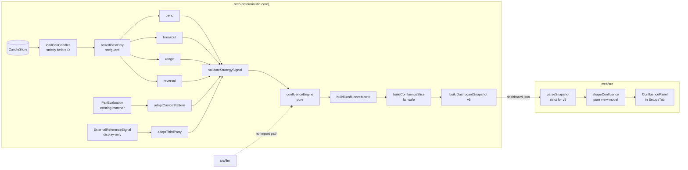

# Design Document

## Overview

This feature adds four deterministic classical strategies (Trend, Breakout, Range, Reversal), a shared `StrategySignal` contract, adapters that express the existing Pattern_Vector matcher and the display-only third-party reference in that contract, and a pure Confluence_Engine that aggregates a Pair's signals and enforces "Stay Flat on Conflict". The result is carried in a new `confluence` slice of `dashboard.json` (schema v5) and rendered by a keyboard-accessible `ConfluencePanel` in the SPA.

The design is additive and parallel. The existing firing / suppression decision, Earned_Confidence, Confidence_Threshold (0.55), the Trade_Ledger, and every pre-existing snapshot slice are untouched. The Confluence_Status is advisory only, and every score the panel shows is labelled `unvalidated`.

### Design drivers (from `LESSONS.md` and the requirements)

- AI never scores. Nothing in `src/strategies/` imports a model client or accepts an `LlmTagged` value. LLMs stay in `src/llm/` for news filtering and summaries.
- Pure and Look_Ahead_Safe. Every strategy is a pure function of `(candles, decisionDate, config)`. Candles pass through `assertPastOnly` before any maths.
- No hidden state. Configuration is passed explicitly and validated by factory functions. An invalid configuration returns an error and no strategy instance, so the previously active configuration cannot be altered (Requirements 2.11, 4.9, 5.10, 8.6, 9.7).
- Confluence over isolation. No single strategy is an execution trigger, and the engine's output is not wired into firing.
- Fail-safe publication. Any confluence failure degrades to an empty slice and never blocks the run or the other slices (Requirement 10.6), mirroring `buildEdgeSlices`.

### Research summary (codebase grounding)

| Area | Finding | Design consequence |
|---|---|---|
| `src/guard/lookAheadGuard.ts` | `assertPastOnly(candles, decisionDate)` returns `Result<Candle[], LookAheadViolation>` with `reason: "look_ahead_violation"`. It compares `date >= decisionDate` and returns a copy on success. | Every strategy calls it first and propagates the violation unchanged (Requirement 6.1, 6.2). |
| `src/guard/types.ts` | `Result`, `ok`, `err`, `Candle`, and `TradingDate` live here. | `src/strategies` reuses `Result` for every fallible function rather than throwing. |
| `src/confidence/atr.ts` | `computeAtr14(candles, lookback = 14)` returns the mean True Range of the last 14 candles, `0` for empty input, and a shorter mean when fewer than 14 candles exist. | Strategies reuse it. A result of `0` or a non-finite value means "ATR unavailable" (Requirements 2.8, 3.10, 5.8). |
| `src/baseline/baseline.ts` | This is the Weekly-Trend-Follow baseline (`predictBaseline`), not a moving average. | The "Baseline_MA" in Requirement 5 is a separate 20-period SMA of close computed inside the reversal module. `src/baseline` is not reused. |
| `src/scheduled-run/snapshot.ts` | `SNAPSHOT_SCHEMA_VERSION = 4`. `buildDashboardSnapshot(view, displayOnly, history, now, pairEvaluations, edge)` builds a flat envelope, and `serializeSnapshot` is `JSON.stringify(snapshot, null, 2)`. The wire types are an independent structural copy of `web/src/api/types.ts`. | Add one optional trailing parameter and one appended key, `confluence`, so existing keys keep their byte order (Requirement 11.8). The wire types are duplicated by hand in `web/`. |
| `src/scheduled-run/edgeSlices.ts` and `main.ts` `persistView` | The v4 slices are built after the DB rows are persisted. Each slice is wrapped in try/catch, degrades to an empty default, and logs with `logStartupWarning` / `console.warn`. `buildSupabaseStores(supabase).candleStore` is already in scope. | The confluence slice follows the same pattern in a new `confluenceSlice.ts`. |
| `src/scheduled-run/displayOnly.ts` | `DisplayOnlyWrite.comparisons[]` carries `reference: ExternalReferenceSignal \| null` per Pair. | The third-party input for each Pair is taken from this value. It is not re-fetched, so provider cost and failure modes stay in one place. |
| `src/external-signal/types.ts` | `ExternalReferenceSignal { direction: BUY\|SELL\|HOLD; score?: number; provider }`. The FCS provider's `score` is a percent change and has no fixed range. | The adapter needs a configurable score scale (see Data Models). |
| `src/llm/types.ts` and `scoringInputGuard.ts` | `isLlmTagged(value)` detects the unforgeable `PROVENANCE_BRAND` symbol. `Deterministic<T>` collapses `LlmTagged` to `never`. `importBoundary.smoke.test.ts` forbids raw SDK imports outside `src/llm/` and allows imports through the `llm` barrel. | Strategy and engine entry points use `isLlmTagged` at runtime and `Deterministic<T>` at compile time. Only `../llm/types.js` is imported, never a provider. |
| `web/src/api/snapshot.ts` | `parseSnapshot` is lenient: absent slices default to empty and a missing `schemaVersion` defaults to the current version. | Requirement 11.12 needs strict validation for v5 documents. A missing `schemaVersion` must be treated as legacy (version 0), otherwise old documents would be rejected. |
| `web/src/pure/*` and `purity.structural.test.ts` | Pure shapers must not use `fetch`, DOM globals, `Date.now()`, recharts, or imports from `src/`. The test enumerates files from disk, so new modules are scanned automatically. | `shapeConfluence.ts` and `confluenceNav.ts` live in `web/src/pure/` and must satisfy the scan. |
| `web/src/tabs/Setups/*` and `TabRouter.tsx` | Tabs are five fixed ids in `TAB_IDS`, and `routes.property.test.ts` depends on that list. Tabs load data through injected loaders that default to `getSnapshot`. | The panel is a section inside `SetupsTab`, not a sixth tab. This avoids touching the routing tests. It uses an injected `loadConfluence` loader. |
| `Makefile` and `package.json` | `make check` runs `npm run check` (lint, typecheck, vitest) for the root only. `web/` has its own `build` (`tsc --noEmit && vite build`) and `test`. CI runs web as a separate job. Root vitest includes `src/**/*.test.ts` only. Backend uses fast-check 4.10.0 and web uses 3.23.1. | `make check` is extended with a `check-web` step (Requirement 13.11). |

### Decisions and rationale

1. Factories instead of mutable "active config". Requirements say invalid config must "leave the previously active configuration unchanged". Pure factories (`createTrendStrategy(config)`) return `Result<Strategy, ConfigError>` and hold frozen config. The caller keeps the last good instance. This satisfies the requirement without global state.
2. One validator, many producers. All signals are built through `buildSignal`, and all external values are checked by `validateStrategySignal`. The engine re-validates its inputs. A producer bug therefore cannot reach the dashboard (Requirement 1.8).
3. Canonical ordering inside the engine. Floating-point addition is not associative. The engine sorts signals into the canonical `STRATEGY_IDS` order before summing, which makes permutation invariance exact (Requirement 8.8). Negating every signed term is exact in IEEE 754, so UP/DOWN symmetry is also exact (Requirement 9.8).
4. Zero is normalised. A computed score of `-0` is converted to `+0` so deep-equality and JSON round trips agree.
5. Confluence is computed from already-produced values. The engine consumes `PairEvaluation` (for `custom_pattern`) and the display-only reference. It never calls back into the pipeline, so Earned_Confidence and the firing decision are identical with or without it (Requirement 10.5).
6. Unavailable strategies are not zero-weight signals. A strategy that errors is excluded from the engine input and shown as an `unavailable` cell. The score is a weighted mean over the signals that exist (Requirement 8.1), so a missing input does not dilute the score.
7. The panel lives inside the Setups tab. The matrix is cross-pair and does not depend on the Pair_Selector.

## Architecture



### Module layout

```
src/strategies/
  types.ts              StrategySignal, StrategyId, SignalDirection, errors, guards, buildSignal
  candles.ts            prepareCandles(): look-ahead guard + empty + finite checks (shared)
  indicators.ts         ema, sma, populationStdDev, rsiWilder, donchian, roundTo (pure helpers)
  trend.ts              createTrendStrategy
  breakout.ts           createBreakoutStrategy
  range.ts              createRangeStrategy
  reversal.ts           createReversalStrategy
  adapters.ts           adaptCustomPattern, adaptThirdParty
  confluenceEngine.ts   createConfluenceEngine, DEFAULT_CONFLUENCE_CONFIG
  confluenceMatrix.ts   buildConfluenceMatrix (per-run orchestration, pure)
  config.ts             confluenceConfigFromEnv (env parsing, kept out of the engine)
  index.ts              barrel
src/scheduled-run/
  confluenceSlice.ts    I/O wrapper: load candles, call matrix, map to wire slice, fail-safe
  snapshot.ts           + SnapshotConfluenceSlice types, EMPTY_CONFLUENCE, schema v5, 7th param
  main.ts               + call buildConfluenceSlice inside persistView
web/src/
  api/types.ts          + Confluence wire types
  api/snapshot.ts       + confluence field, strict v5 parse, schema v5
  pure/shapeConfluence.ts   view-model shaper
  pure/confluenceNav.ts     grid keyboard navigation (pure)
  tabs/Setups/ConfluencePanel.tsx   component (rendered by SetupsTab)
```

### Daily-run flow

1. `persistView` persists DB rows, builds `displayOnly`, loads history, and builds the v4 edge slices as today.
2. A new fail-safe step `buildConfluenceSlice` runs. For each of the five Pairs it loads candles dated before the Decision_Date, runs the four strategies, adapts the matcher and third-party values, and calls the engine once. Any unexpected error is caught, logged without secrets, and replaced by the empty slice (Requirement 10.6).
3. `buildDashboardSnapshot(..., edge, confluence)` appends `confluence` as the last key.
4. `writeDashboardSnapshot` runs unchanged.

The confluence step reads only `cached.get()` evaluations and `displayOnly`. It writes nothing to the DB and returns nothing that firing reads.

## Components and Interfaces

### 1. Signal contract: `src/strategies/types.ts`

```ts
export const STRATEGY_IDS = [
  "trend", "breakout", "range", "reversal", "custom_pattern", "third_party",
] as const;
export type StrategyId = (typeof STRATEGY_IDS)[number];

export const SIGNAL_DIRECTIONS = ["UP", "DOWN", "FLAT"] as const;
export type SignalDirection = (typeof SIGNAL_DIRECTIONS)[number];

/** Exactly four fields, and no LLM-tagged member (Requirement 1.1, 1.7). */
export interface StrategySignal {
  readonly strategyId: StrategyId;
  readonly direction: SignalDirection;
  readonly strength: number;   // finite, [0,1]; 0 when FLAT
  readonly rationale: string;  // 1..500 chars, >=1 non-whitespace
}

export const RATIONALE_MAX_LENGTH = 500 as const;

export interface SignalViolation {
  readonly reason: "invalid_signal";
  readonly field: "strategyId" | "direction" | "strength" | "rationale" | "shape" | "llm_tagged";
  readonly message: string;
}

export function isStrategyId(v: unknown): v is StrategyId;
export function isSignalDirection(v: unknown): v is SignalDirection;

/** Runtime guard for any value that claims to be a StrategySignal. */
export function validateStrategySignal(v: unknown): Result<StrategySignal, SignalViolation>;

/**
 * The only constructor strategies use. Forces strength 0 for FLAT (Requirement 1.5)
 * and validates the rest. UP/DOWN with strength 0 is accepted unchanged (Requirement 1.9).
 */
export function buildSignal(
  strategyId: StrategyId, direction: SignalDirection, strength: number, rationale: string,
): Result<StrategySignal, SignalViolation>;
```

`validateStrategySignal` checks, in this order: LLM brand (`isLlmTagged`, field `llm_tagged`); plain object with exactly the four own keys (field `shape`); `strategyId` membership; `direction` membership; `strength` is a `number`, finite, within `[0,1]`, and exactly `0` when `FLAT`; `rationale` is a string of length 1 to 500 with a non-whitespace character. The first failure is returned with the offending field name (Requirement 1.8). The compile-time restrictions (Requirements 1.2, 1.3) come from the literal-union types.

Strategy-level errors share one union:

```ts
export type StrategyError =
  | LookAheadViolation                                   // reason: "look_ahead_violation"
  | { reason: "insufficient_data"; message: string }     // empty candle array
  | { reason: "invalid_candle"; field: "open"|"high"|"low"|"close"; date: string; message: string }
  | SignalViolation;                                     // defensive: producer bug caught by buildSignal

export type StrategyResult = Result<StrategySignal, StrategyError>;

export interface Strategy<C> {
  readonly id: StrategyId;
  readonly config: Readonly<C>;
  evaluate(candles: readonly Candle[], decisionDate: TradingDate): StrategyResult;
}
export interface ConfigError { readonly reason: "invalid_config"; readonly parameter: string; readonly message: string }
```

### 2. Shared candle preparation: `src/strategies/candles.ts`

```ts
export function prepareCandles(
  candles: readonly Candle[], decisionDate: TradingDate,
): Result<readonly Candle[], StrategyError>;
```

Order of checks is fixed so Requirement 6.9 holds:

1. `assertPastOnly(candles, decisionDate)`. A violation is returned as-is and wins over any other defect (Requirements 6.1, 6.2, 6.9).
2. Empty array returns `insufficient_data` (Requirement 6.8).
3. Every candle's `open/high/low/close` must be a finite `number`. The first bad field and the candle date are returned as `invalid_candle` (Requirement 6.7).
4. The result is a stably date-sorted copy. The caller's array and objects are never mutated (Requirement 6.6). `assertPastOnly` already returns a copy.

All four strategies start with `prepareCandles`, so look-ahead, emptiness, and finiteness behave identically.

### 3. Indicators: `src/strategies/indicators.ts`

Pure helpers over `readonly number[]`:

- `sma(values, n)`: mean of the last `n` values.
- `populationStdDev(values)`: standard Bollinger definition.
- `emaSeries(values, period)`: seeded with the SMA of the first `period` values, `alpha = 2 / (period + 1)`. Returns values aligned to the input index, defined from index `period - 1`.
- `rsiWilder(closes, period)`: Wilder smoothing seeded with the simple average of the first `period` changes. If average loss is `0` the RSI is `100`, or `50` when average gain is also `0`.
- `roundTo(x, dp)`: `Number(x.toFixed(dp))` with `-0` normalised, used only for rationale text.
- `clamp01(x)`: `Math.min(1, Math.max(0, x))`, and `0` for `NaN`.

ATR is not re-implemented. All strategies call `computeAtr14` from `src/confidence/atr.ts` on the full prepared array. `atrUsable(atr)` is `Number.isFinite(atr) && atr > 0`.

### 4. Strategies

Each module exports a config interface, defaults, and `createXStrategy(partial?: Partial<Config>): Result<Strategy<Config>, ConfigError>`. The factory validates before returning an instance, and the returned config is `Object.freeze`d.

#### Trend (`trend.ts`, Requirement 2)

Config: `fastPeriod = 20`, `slowPeriod = 50`, `slopeWindow = 5`. Valid when all three are integers of at least 1 and `fastPeriod < slowPeriod`. The offending parameter name is returned on failure (Requirement 2.11).

Algorithm on prepared closes `c[0..L]`:

1. If `n < slowPeriod + slopeWindow` return FLAT, `0`, rationale "insufficient history: need 55 candles, have n" (Requirement 2.9).
2. `fast = emaSeries(c, fastPeriod)`, `slow = emaSeries(c, slowPeriod)`. `slope = fast[L] - fast[L - slopeWindow]`. `diff = fast[L] - slow[L]`.
3. `atr = computeAtr14(candles)`. If not usable return FLAT, `0`, "ATR unavailable" (Requirement 2.8).
4. `diff > 0 && slope > 0` gives UP. `diff < 0 && slope < 0` gives DOWN. Any other case (`diff = 0`, `slope = 0`, or opposite signs) gives FLAT with strength `0` (Requirements 2.2 to 2.4, 2.6).
5. For UP and DOWN, `strength = clamp01(|diff| / atr)` (Requirement 2.5).
6. Rationale includes `fast`, `slow`, and `slope` rounded to 5 decimal places (Requirement 2.7), for example `trend: fastEMA(20)=1.08512 slowEMA(50)=1.08201 slope(5)=0.00033 -> UP`.

Check order matters: history is checked before ATR, so a short series reports "insufficient history".

#### Breakout (`breakout.ts`, Requirement 3)

Config: `channelPeriod = 20` (a positive integer).

1. If `n < N + 1` return FLAT, `0`, "insufficient history" (Requirement 3.8).
2. `last = candles[n-1]`. The channel window is `candles[n-1-N .. n-2]`, which excludes `last` (Requirements 3.1, 3.9). `high = max(window.high)`, `low = min(window.low)`.
3. `close > high` gives UP. `close < low` gives DOWN. Otherwise FLAT with strength `0` (Requirements 3.2 to 3.4, 3.6).
4. For UP and DOWN, `atr = computeAtr14(candles)` over all prepared candles, including `last`. If ATR is unusable, return the detected direction with strength `0` and "ATR unavailable" (Requirement 3.10, which also satisfies Requirement 1.9). Otherwise `strength = clamp01(distance / atr)` where `distance = close - high` for UP and `low - close` for DOWN (Requirement 3.5).
5. Rationale includes channel high, channel low, and close (Requirement 3.7).

In this module "the most recent completed Candle" is the last candle strictly before the Decision_Date. The Decision_Date's own candle is never available. This matches the user's brief ("excluding the decision candle").

#### Range (`range.ts`, Requirement 4)

Config: `bbPeriod = 20`, `bbK = 2`, `rsiPeriod = 14`, `oversold = 30`, `overbought = 70`. Valid when both periods are integers of at least 2, `bbK > 0`, and `0 <= oversold < overbought <= 100` (Requirement 4.9).

1. If `n < max(bbPeriod, rsiPeriod + 1)` return FLAT, `0`, "insufficient history" (Requirement 4.6).
2. Bands use the last `bbPeriod` closes including the latest: `mid = sma`, `sd = populationStdDev`, `lower = mid - K*sd`, `upper = mid + K*sd`. If `sd === 0` return FLAT, `0`, "zero volatility" (Requirement 4.7).
3. `rsi = rsiWilder(closes, rsiPeriod)`.
4. `close < lower && rsi < oversold` gives UP. `close > upper && rsi > overbought` gives DOWN. Otherwise FLAT, `0` (Requirements 4.1 to 4.3).
5. Strength is the mean of two clamped scores (Requirement 4.4):
   - UP: `penetration = (lower - close) / (upper - lower)`, `rsiScore = (oversold - rsi) / oversold`.
   - DOWN: `penetration = (close - upper) / (upper - lower)`, `rsiScore = (rsi - overbought) / (100 - overbought)`.
   - `strength = (clamp01(penetration) + clamp01(rsiScore)) / 2`.
   - With the defaults the RSI divisor is 30 for both sides, as the requirement states.
6. Rationale includes close, lower band, and upper band at 5 decimals, and RSI at 2 decimals (Requirement 4.5).

`bbPeriod >= 2` and `bbK > 0` make `upper - lower > 0` whenever `sd > 0`, so there is no division by zero.

#### Reversal (`reversal.ts`, Requirement 5)

Config: `extensionThreshold = 2.0`, `baselinePeriod = 20`, `momentumWindow = 3`. Valid when the threshold is finite and greater than 0 and both periods are positive integers. Validation happens before any candle is read (Requirement 5.10).

1. Minimum candles are `baselinePeriod + 2 * momentumWindow` (26 by default). If `n` is smaller, return FLAT, `0`, "insufficient candles" (Requirement 5.8). If ATR is unusable, return FLAT, `0`, "zero ATR". The two causes use different rationale text.
2. `baselineMA = sma(closes, baselinePeriod)`. `extension = (close - baselineMA) / atr`, unrounded (Requirement 5.1).
3. With `w = momentumWindow` and `L = n - 1`: `rocRecent = close[L] - close[L-w]` and `rocPrev = close[L-w] - close[L-2w]`.
4. Exhaustion is present when `|rocRecent| < |rocPrev|` and both ROCs have the same strict sign as `extension` (Requirement 5.5).
5. `extension > thr && exhaustion` gives DOWN. `extension < -thr && exhaustion` gives UP. Otherwise FLAT, `0` (Requirements 5.2 to 5.4).
6. For UP and DOWN, `strength = min(1, (|extension| - thr) / thr)`. This is `0` or more because `|extension| > thr`, and it is clamped to `[0,1]` (Requirement 5.6).
7. Rationale includes extension, ATR, `rocRecent`, and `rocPrev`, each rounded to 5 decimals (Requirement 5.7).

### 5. Adapters: `src/strategies/adapters.ts`

```ts
export type AdapterOutcome =
  | { readonly kind: "signal"; readonly signal: StrategySignal }
  | { readonly kind: "unavailable"; readonly reason: string };

export function adaptCustomPattern(
  evaluation: Pick<PairEvaluation, "direction" | "earnedConfidence">,
): AdapterOutcome;

export interface ThirdPartyScoreScale {
  /** |score| at or above this value maps to strength 1.0. Default 1.0 (FCS: 1% change). */
  readonly fullScaleAbs: number;
}
export const DEFAULT_THIRD_PARTY_SCALE: ThirdPartyScoreScale = { fullScaleAbs: 1.0 };

export function adaptThirdParty(
  reference: unknown,   // ExternalReferenceSignal | null | undefined, validated at runtime
  scale?: ThirdPartyScoreScale,
): AdapterOutcome;
```

- `adaptCustomPattern`: UP or DOWN maps to `strength = earnedConfidence` (already in `[0,1]`), FLAT maps to strength `0` whatever the confidence (Requirements 7.1, 7.2). The rationale is deterministic text such as `pattern matcher: UP, earned confidence 0.612`. The input evaluation is read-only and never copied back (Requirement 7.9).
- `adaptThirdParty`: `BUY` to UP, `SELL` to DOWN, `HOLD` to FLAT (Requirement 7.3). For UP and DOWN with a finite score, `strength = clamp01(|score| / fullScaleAbs)`. This is a linear, deterministic normalisation, and `fullScaleAbs` is documented as the provider's full-scale value (Requirement 7.4). With no score, UP and DOWN get `0.5` (Requirement 7.6). FLAT is always `0` (Requirement 7.5).
- `adaptThirdParty` returns `unavailable` when the reference is `null` or `undefined`, when it is LLM-tagged, when the direction is not one of `BUY`, `SELL`, `HOLD`, or when the score is `NaN` or infinite (Requirements 7.7, 7.8). The reason string is non-empty.
- The adapter is called from the matrix builder, outside the scoring path. It imports nothing from `confidence/` or `kill-gate/`, so Earned_Confidence and the Kill_Gate verdict cannot depend on it (Requirement 7.10).

### 6. Confluence engine: `src/strategies/confluenceEngine.ts`

```ts
export type ConfluenceStatus =
  "ALIGNED_UP" | "ALIGNED_DOWN" | "NEUTRAL" | "CONFLICT_FLAT" | "INSUFFICIENT_DATA";

export type ConfluenceWeights = Readonly<Record<StrategyId, number>>;

export interface ConfluenceConfig {
  readonly weights: ConfluenceWeights;
  readonly conflictThreshold: number;   // default 0.6
  readonly alignmentThreshold: number;  // default 0.4
}
export const DEFAULT_CONFLUENCE_CONFIG: ConfluenceConfig = {
  weights: { trend: 1, breakout: 1, range: 1, reversal: 1, custom_pattern: 1, third_party: 0 },
  conflictThreshold: 0.6,
  alignmentThreshold: 0.4,
};

export interface ConfluenceResult {
  readonly score: number;                           // [-1, 1], never -0
  readonly status: ConfluenceStatus;
  readonly opposingStrategyIds: readonly StrategyId[];  // non-empty only for CONFLICT_FLAT
  readonly signals: readonly StrategySignal[];      // canonical order
}

export type ConfluenceError =
  | { reason: "duplicate_strategy_id"; strategyId: StrategyId; message: string }
  | { reason: "invalid_signal"; index: number; violation: SignalViolation; message: string };

export interface ConfluenceEngine {
  readonly config: ConfluenceConfig;
  aggregate(signals: readonly Deterministic<StrategySignal>[]): Result<ConfluenceResult, ConfluenceError>;
}

export function createConfluenceEngine(
  partial?: { weights?: Partial<ConfluenceWeights>; conflictThreshold?: number; alignmentThreshold?: number },
): Result<ConfluenceEngine, ConfigError>;
```

`createConfluenceEngine` merges overrides over the defaults and validates them. A negative, `NaN`, or infinite weight returns a `ConfigError` naming the Strategy_Id (Requirement 8.6). A threshold that is non-finite or outside `[0,1]` returns a `ConfigError` naming the parameter (Requirement 9.7). No engine is created on failure.

`aggregate` is a pure function with these steps:

1. Validate every input with `validateStrategySignal`. Any failure, including an LLM-tagged value, returns `invalid_signal` and no score (Requirements 8.10, 13.8).
2. Reject duplicate `strategyId`s with the duplicate id named (Requirement 8.7).
3. Sort signals by `STRATEGY_IDS` order. Let `w_i = weights[id]`, `sgn(UP)=+1`, `sgn(DOWN)=-1`, `sgn(FLAT)=0`.
4. `W = Σ w_i`. If `W === 0` (including the empty list) return score `0`, status `INSUFFICIENT_DATA`, and empty opposing list (Requirement 8.3).
5. `score = clamp(Σ w_i · sgn_i · s_i / W, -1, 1)`, with `-0` normalised to `0`. The clamp absorbs rounding error and is symmetric, so bounds hold for all valid input (Requirements 8.1, 8.2).
6. Conflict: let `strongUp = {i : w_i > 0, UP, s_i >= conflictThreshold}` and `strongDown` likewise. If both are non-empty, the status is `CONFLICT_FLAT`, the score is left as computed, and `opposingStrategyIds` is the canonical-order union of both sets (Requirements 9.1, 9.2, 9.9, 11.4).
7. Otherwise let `contributing = {i : w_i > 0, direction ≠ FLAT}`.
   - `|contributing| = 1`: `NEUTRAL` (Requirement 9.10).
   - `|contributing| >= 2`: `NEUTRAL` if `score === 0` (no directional lean — see below), otherwise `ALIGNED_UP` if `score >= alignmentThreshold`, `ALIGNED_DOWN` if `score <= -alignmentThreshold`, else `NEUTRAL` (Requirements 9.3 to 9.5, 9.8).
   - `|contributing| = 0` (every positive-weight signal is FLAT, so `score = 0`): `NEUTRAL`. The requirements do not define this case; see "Resolved gaps" below.
8. `opposingStrategyIds` is `[]` unless the status is `CONFLICT_FLAT` (Requirement 11.3).

Zero-weight signals still appear in `signals` (and therefore in the matrix) but contribute to nothing. This gives the `third_party` neutrality property (Requirements 8.4, 13.6).

Symmetry follows because step 5 negates every term exactly when directions flip, the classification thresholds are symmetric, and the canonical ordering fixes the summation order. One degenerate point needs the explicit zero guard in step 7: criteria 9.3 (`score >= alignmentThreshold`) and 9.4 (`score <= -alignmentThreshold`) both admit `score = 0` when `alignmentThreshold = 0`, and resolving that overlap by evaluation order would classify a zero score as `ALIGNED_UP` on both the original and the flipped set, breaking the 9.8 symmetry invariant. Because a score of exactly 0 carries no directional lean, it is always `NEUTRAL` (consistent with 9.5 and the Score_Gauge being centred at 0); every non-zero score follows 9.3/9.4 unchanged.

### 7. Per-run orchestration: `src/strategies/confluenceMatrix.ts`

```ts
export interface PairConfluenceInput {
  readonly pair: Pair;
  readonly candles: readonly Candle[];                       // as loaded; strategies guard them
  readonly evaluation: Pick<PairEvaluation, "direction" | "earnedConfidence"> | undefined;
  readonly thirdParty: ExternalReferenceSignal | null | undefined;
}

export type CellOutcome =
  | { readonly available: true; readonly signal: StrategySignal }
  | { readonly available: false; readonly strategyId: StrategyId; readonly reason: string };

export interface PairConfluence {
  readonly pair: Pair;
  readonly cells: readonly CellOutcome[];      // exactly 6, STRATEGY_IDS order
  readonly result: ConfluenceResult;
}

export interface ConfluenceMatrix {
  readonly decisionDate: TradingDate;
  readonly config: ConfluenceConfig;
  readonly pairs: readonly PairConfluence[];   // PAIRS order
}

export function buildConfluenceMatrix(args: {
  readonly decisionDate: TradingDate;
  readonly inputs: readonly PairConfluenceInput[];
  readonly strategies: StrategyBundle;   // the four created strategies
  readonly engine: ConfluenceEngine;
  readonly thirdPartyScale?: ThirdPartyScoreScale;
}): ConfluenceMatrix;
```

Behaviour, per Pair:

- Each strategy runs inside its own `Result` handling. An error becomes an unavailable cell whose reason names the failure type: `look_ahead_violation`, `insufficient_data`, `invalid_candle:<field>@<date>`, or `invalid_signal:<field>` (Requirement 10.3). The other strategies still run.
- `custom_pattern` comes from `adaptCustomPattern`. If no evaluation exists for the Pair, the cell is unavailable with "no pattern evaluation".
- `third_party` comes from `adaptThirdParty`; an unavailable outcome is a cell with a reason, such as "no third-party reference".
- Available signals are passed to `engine.aggregate` exactly once per Pair (Requirement 10.2). If every strategy cell is unavailable the Pair is still aggregated, using whatever signals remain (`custom_pattern` and `third_party` may still exist), so the Pair is never omitted (Requirement 10.8).
- If the Pair has zero candles dated before the Decision_Date, the builder skips the engine and returns `{score: 0, status: INSUFFICIENT_DATA, opposingStrategyIds: [], signals: []}` with unavailable cells (Requirement 10.4). The remaining Pairs continue.
- `aggregate` returning an error (a producer bug) is converted to the same `INSUFFICIENT_DATA` shape with an `unavailable` reason on the offending cell. It does not throw.
- The function never mutates `inputs`, candles, or evaluations (Requirement 10.5). All Pairs share one `decisionDate` (Requirement 10.7).

### 8. Environment configuration: `src/strategies/config.ts`

`confluenceConfigFromEnv(env = process.env)` reads three optional variables:

- `CONFLUENCE_WEIGHTS`: JSON object of `StrategyId` to number, for example `{"third_party":0.5}`.
- `CONFLUENCE_CONFLICT_THRESHOLD`.
- `CONFLUENCE_ALIGNMENT_THRESHOLD`.

It returns `Result<Partial<…>, ConfigError>`. The caller passes the result to `createConfluenceEngine`. If either step fails, `main.ts` logs a secret-free warning and uses `DEFAULT_CONFLUENCE_CONFIG`. This keeps "reject and keep previous" semantics (defaults are the previous active configuration at process start) and keeps the engine itself free of environment access (Requirement 8.9). Unknown JSON keys are rejected with the key named.

### 9. Snapshot wiring: `src/scheduled-run/`

`confluenceSlice.ts`:

```ts
export interface ConfluenceSliceDeps {
  readonly decisionDate: string;
  readonly evaluations: readonly PairEvaluation[];
  readonly displayOnly: DisplayOnlyWrite | undefined;
  readonly candleStore: CandleStore;
  readonly env?: Readonly<Record<string, string | undefined>>;
  readonly warn?: (slice: string, err: unknown) => void;
}
export function toSnapshotConfluence(matrix: ConfluenceMatrix): SnapshotConfluenceSlice;  // pure
export async function buildConfluenceSlice(deps: ConfluenceSliceDeps): Promise<SnapshotConfluenceSlice>;
```

`buildConfluenceSlice` never throws. It resolves config, loads candles per Pair with `candleStore.getCandles(pair, windowStart, dayBefore(decisionDate))` where `dayBefore` is a calendar-day decrement (the store's `endDate` is inclusive, so passing the previous day keeps the load strictly before the Decision_Date; the strategies' own `assertPastOnly` still guards it), runs `buildConfluenceMatrix`, and maps with `toSnapshotConfluence`. A per-Pair candle load failure becomes that Pair's all-unavailable cells with reason `candles_unavailable`. A failure outside that handling logs a warning and returns `EMPTY_CONFLUENCE` (Requirement 10.6). The warning logs only the slice name and `err.message`; no config values, env values, or keys.

Third-party inputs are read from `displayOnly?.comparisons`, taking the `reference` for each `pair`. The history window reuses `HISTORY_WINDOW_DAYS` and `windowStartDate` from `snapshotHistory.ts`.

### 10. Web: parsing, view-model, and panel

**`web/src/api/snapshot.ts`.** `SNAPSHOT_SCHEMA_VERSION` becomes 5 and `DashboardSnapshot` gains `confluence: Confluence`. `EMPTY_CONFLUENCE` is the empty default. `parseSnapshot` computes `declared = typeof schemaVersion === "number" ? schemaVersion : 0` and then:

- `declared < 5`: `confluence = EMPTY_CONFLUENCE`, never an error, even if some `confluence` key exists (Requirement 11.11).
- `declared >= 5`: `parseConfluenceStrict(body.confluence)`. A missing key or any structural defect throws `SnapshotError("The dashboard snapshot has an invalid confluence slice.")` and no partial snapshot is returned (Requirement 11.12). `loadSnapshot` already surfaces `SnapshotError` to the existing error state.

`parseConfluenceStrict` verifies: `validationLabel` is a string equal to `"unvalidated"`; `weights` has finite non-negative numbers for exactly the six ids; both thresholds are finite and within `[0,1]`; `pairs` is an array whose entries have a known `pair`, a finite `score` in `[-1,1]`, a known `status`, `opposingStrategyIds` of known ids, and exactly one `cells` entry per id in order. Each cell is either `available: true` with a valid direction, a strength in `[0,1]` (`0` for FLAT), and a non-empty rationale, or `available: false` with a non-empty reason. A non-`CONFLICT_FLAT` status with a non-empty opposing list is rejected, as is a `CONFLICT_FLAT` status without at least one UP and one DOWN id among the opposing ids.

**`web/src/pure/shapeConfluence.ts`** is pure, free of DOM, clock, fetch, and `src/` imports, and returns identical output for identical input (Requirement 12.13).

```ts
export function shapeConfluence(slice: Confluence): ConfluenceViewModel;
export interface ConfluenceViewModel {
  readonly empty: boolean;
  readonly emptyText: string;          // "no confluence data for this run"
  readonly validationLabel: string;    // "Un-validated"
  readonly validated: boolean;         // false while slice.validationLabel === "unvalidated"
  readonly strengthNote: string;       // "Strength is not a probability"
  readonly summary: SummaryVM;         // Confluence_Summary counts (Requirement 12.17)
  readonly columns: readonly ColumnVM[];
  readonly rows: readonly RowVM[];
}
export interface SummaryVM {
  readonly aligned: number;    // ALIGNED_UP + ALIGNED_DOWN
  readonly conflict: number;   // CONFLICT_FLAT
  readonly neutral: number;    // NEUTRAL + INSUFFICIENT_DATA
  readonly text: string;       // e.g. "2 aligned, 1 conflict, 2 neutral"
}
export interface ColumnVM { strategyId: StrategyId; header: string; displayOnly: boolean }
export interface GaugeVM {
  readonly min: -1; readonly max: 1; readonly value: number;     // the (clamped) score
  readonly posThreshold: number; readonly negThreshold: number;  // ±alignmentThreshold
}
export interface RowVM {
  pair: Pair; scoreText: string; score: number; gauge: GaugeVM; status: ConfluenceStatus;
  statusLabel: string; marker: "green" | "red" | "neutral" | "conflict"; markerText: string;
  stayFlat: boolean; conflictSummary: string | null; cells: readonly CellVM[];
}
export interface CellVM {
  strategyId: StrategyId; available: boolean; directionLabel: string;   // "Up" | "Down" | "Flat" | "Unavailable"
  glyph: string; strengthText: string; strength: number | null;
  emphasis: "signal" | "muted";     // Requirement 12.18
  detailText: string;               // rationale, or the unavailable reason
  highlighted: boolean; highlightLabel: string | null; accessibleName: string;
}
```

Mappings: `ALIGNED_UP` gives marker `green` with text "Aligned up"; `ALIGNED_DOWN` gives `red` with "Aligned down"; `NEUTRAL` and `INSUFFICIENT_DATA` give `neutral` with "Neutral" / "Insufficient data"; `CONFLICT_FLAT` gives `conflict` with "Stay Flat" and `stayFlat = true` (Requirement 12.3). Directions are always words plus a glyph (`▲`, `▼`, `–`) so colour is never the only cue (Requirement 12.4). `highlighted` is true when the status is `CONFLICT_FLAT` and the strategy is in `opposingStrategyIds`, with `highlightLabel = "Conflicting"` (Requirement 12.7). `third_party` has `displayOnly = true` and header "Third party (display-only)" while `weights.third_party === 0` (Requirement 12.9). `accessibleName` is `"<PAIR>, <strategyId>, <Direction>, strength <0.00>"`, or `"<PAIR>, <strategyId>, unavailable: <reason>"` (Requirement 12.11). Rows follow the canonical `PAIRS` order and columns follow `STRATEGY_IDS`.

**New view-model fields (folded-in improvements).**

- `conflictSummary` (Requirement 12.14, 12.15): for a `CONFLICT_FLAT` row, a deterministic sentence built only from `opposingStrategyIds` and the row's cells, e.g. `"Stay flat: trend ▲ Up (0.72) opposes reversal ▼ Down (0.68)."`. It names at least one opposing UP and one opposing DOWN Strategy_Id. It is `null` for every non-`CONFLICT_FLAT` row. It introduces no value absent from the slice.
- `gauge` (Requirement 12.16): a `GaugeVM` over the fixed `[-1, 1]` interval with `value = score` and `posThreshold`/`negThreshold = ±slice.alignmentThreshold`. It is presentation metadata only; `scoreText` (the number) is always kept, so the gauge supplements rather than replaces it.
- `summary` (Requirement 12.17): the `SummaryVM` counts over the rendered rows, partitioning them into aligned / conflict / neutral so the three sum to `rows.length`. `text` is a stable human sentence.
- `cell.emphasis` (Requirement 12.18): `"signal"` when the cell is available, non-`FLAT`, and its Strategy_Id weight (from `slice.weights`) is `> 0`; `"muted"` otherwise. It is a pure presentation hint — every direction, strength, score, status, and required text label is unchanged whatever the emphasis. This lets the panel visually quiet FLAT / unavailable / zero-weight cells (notably the display-only `third_party` column) without hiding information.

**Colour-after-validation (Requirement 14, honest presentation).** `validated = (slice.validationLabel !== "unvalidated")`. The view-model always computes `marker` (so the data is testable), but the panel reads `validated` to decide whether to *apply* the green/red/neutral/conflict colour treatment (`validated === true`) or render every status in one neutral colour treatment (`validated === false`). While un-validated, colour cannot distinguish statuses, but the per-status `statusLabel`/`markerText` and the `CONFLICT_FLAT` "Stay Flat" marker still do (Requirements 14.1, 14.2). Because `validationLabel` is the literal `"unvalidated"` for this feature (Requirement 11.6), the panel ships in the colour-suppressed state; the colour treatment turns on only if a future measurement sets a different label. The decision is derived purely from the slice, so it is deterministic and DOM-free (Requirement 14.4).

**Out-of-scope dependency (recorded, not built here).** The only thing that may flip `validationLabel` away from `"unvalidated"` is an out-of-sample, net-of-cost measurement of the Confluence_Matrix. That measurement — e.g. "when these strategies aligned historically, the net outcome was X" tied to the `trader-edge-validation` Trade_Ledger — is a FUTURE spec, explicitly out of scope here (Requirement 14.5). This feature only renders the honest un-validated state and leaves the hook (`validated`) for that later capability.

**`web/src/pure/confluenceNav.ts`**: `nextCell(pos, key, rowCount, colCount): Pos | "dismiss" | null` maps ArrowUp / Down / Left / Right / Home / End to a clamped new position and Escape to `"dismiss"`. It is pure so the keyboard model is testable without a DOM (Requirement 12.10).

**`web/src/tabs/Setups/ConfluencePanel.tsx`.** Props: `{ viewModel: ConfluenceViewModel }`. It renders the `summary` line (Confluence_Summary counts, Requirement 12.17) above a `<table role="grid">` with a caption, `<th scope="col">` headers per strategy and `<th scope="row">` per Pair, plus the score text, the `gauge` (a diverging bar over [-1,1] with both alignment-threshold ticks, Requirement 12.16; the numeric `scoreText` stays beside it), and the status text in each row. A `CONFLICT_FLAT` row additionally renders its `conflictSummary` sentence (Requirement 12.14). Each cell carries its `emphasis` as a style hook (e.g. a `data-emphasis` attribute / muted class) so `muted` cells are visually quiet without losing any label (Requirement 12.18). The status marker's colour treatment is applied only when `viewModel.validated` is true; while un-validated (the shipping state) every marker uses one neutral treatment and relies on `markerText`/`statusLabel` for meaning (Requirement 14). Each cell contains one `<button type="button">` with `aria-label={accessibleName}` and roving `tabIndex` (one tab stop for the grid; arrow keys move focus using `nextCell`). Activating a button with click, Enter, or Space (native button behaviour) sets `selected = {row, col}`, and the detail region renders synchronously, well within 200 ms (Requirement 12.5). Arrow keys move focus without changing selection, so exploring the grid does not hide the pinned rationale. The detail region is `role="region"` with `aria-live="polite"`, contains the rationale as a React text child (no `dangerouslySetInnerHTML`), and has a "Dismiss" button. Escape also dismisses. All focusable elements get a visible `:focus-visible` outline. Unavailable cells show "Unavailable: reason" and remain selectable. Conflict rows show a "Stay Flat" badge and cells with a "Conflicting" text label. The validation label and "Strength is not a probability" appear in the panel header and again in the detail region, which are the two regions where strengths and scores appear (Requirement 12.8). The empty view model renders only the heading, the validation label, and "no confluence data for this run" (Requirement 12.12).

`SetupsTab` calls an injected `loadConfluence` (default: `getSnapshot` then `snapshot.confluence`), passes the result through `shapeConfluence`, and renders `<ConfluencePanel>` below `RunSummary`. A load failure renders the empty view model rather than an error, because the matrix is advisory.

### 11. Build tooling

`Makefile` gains a `check-web` target (`cd web && npm run build && npm test`), and `check` becomes `npm run check` followed by `check-web`. `make` stops at the first failing recipe and prints it, which gives a non-zero exit and names the failing step (Requirements 13.11, 13.12). CI already runs web as its own job and is unchanged.

## Data Models

### Wire format (`dashboard.json`, schema v5)

Backend types in `src/scheduled-run/snapshot.ts` and the web copies in `web/src/api/types.ts` are independent structural copies, as with the existing slices.

```ts
export type SnapshotConfluenceStrategyId =
  "trend" | "breakout" | "range" | "reversal" | "custom_pattern" | "third_party";
export type SnapshotConfluenceStatus =
  "ALIGNED_UP" | "ALIGNED_DOWN" | "NEUTRAL" | "CONFLICT_FLAT" | "INSUFFICIENT_DATA";

export type SnapshotConfluenceCell =
  | { readonly strategyId: SnapshotConfluenceStrategyId; readonly available: true;
      readonly direction: "UP" | "DOWN" | "FLAT"; readonly strength: number; readonly rationale: string }
  | { readonly strategyId: SnapshotConfluenceStrategyId; readonly available: false;
      readonly reason: string };

export interface SnapshotConfluencePair {
  readonly pair: string;
  readonly score: number;
  readonly status: SnapshotConfluenceStatus;
  readonly opposingStrategyIds: readonly SnapshotConfluenceStrategyId[];
  readonly cells: readonly SnapshotConfluenceCell[];      // exactly 6, canonical order
}

export interface SnapshotConfluenceSlice {
  readonly validationLabel: "unvalidated";
  readonly weights: Readonly<Record<SnapshotConfluenceStrategyId, number>>;
  readonly conflictThreshold: number;
  readonly alignmentThreshold: number;
  readonly pairs: readonly SnapshotConfluencePair[];
}

export const EMPTY_CONFLUENCE: SnapshotConfluenceSlice = {
  validationLabel: "unvalidated",
  weights: { trend: 1, breakout: 1, range: 1, reversal: 1, custom_pattern: 1, third_party: 0 },
  conflictThreshold: 0.6,
  alignmentThreshold: 0.4,
  pairs: [],
};
```

Example fragment:

```json
"confluence": {
  "validationLabel": "unvalidated",
  "weights": { "trend": 1, "breakout": 1, "range": 1, "reversal": 1, "custom_pattern": 1, "third_party": 0 },
  "conflictThreshold": 0.6,
  "alignmentThreshold": 0.4,
  "pairs": [{
    "pair": "EURUSD", "score": 0.4, "status": "ALIGNED_UP", "opposingStrategyIds": [],
    "cells": [
      { "strategyId": "trend", "available": true, "direction": "UP", "strength": 0.72, "rationale": "trend: ..." },
      { "strategyId": "third_party", "available": false, "reason": "no third-party reference" }
    ]
  }]
}
```

Rules that follow from the requirements:

- `pairs` has zero entries (empty default) or exactly the five Pairs in `PAIRS` order. The empty default is used when no evaluation was supplied or the step failed.
- `cells` always has six entries in `STRATEGY_IDS` order (Requirement 11.2). Zero-weight `third_party` appears with its signal when available.
- `weights`, `conflictThreshold`, and `alignmentThreshold` are the values the engine used, copied from `engine.config` (Requirement 11.5).
- `validationLabel` is the literal `"unvalidated"` (Requirement 11.6).
- The slice has no provenance or LLM fields (Requirement 11.10). The type does not admit them.
- `DashboardSnapshot.schemaVersion` is typed `5`. `confluence` is the last key assigned in `buildDashboardSnapshot`, so all earlier keys keep their order and bytes (Requirement 11.8). `JSON.stringify` of finite numbers and strings is stable, and the engine never emits `-0`, so serialize, parse, serialize is a fixed point (Requirement 11.9).
- `buildDashboardSnapshot` gains a seventh optional parameter `confluence: SnapshotConfluenceSlice = EMPTY_CONFLUENCE` (Requirement 11.7).

### Internal models

`StrategySignal`, `ConfluenceConfig`, `ConfluenceResult`, `PairConfluence`, and `ConfluenceMatrix` are defined in Components and Interfaces. They are plain readonly data with no classes, so they are structurally comparable and serialisable.

### Resolved gaps in the requirements

These points are not specified by the numbered requirements. The design resolves them as follows, and none of them contradicts a requirement.

1. All positive-weight signals FLAT. Requirements 9.3 to 9.5 need more than one non-FLAT contributor, and 9.10 covers exactly one. With zero contributors the score is `0` and the status is `NEUTRAL`.
2. Zero candles and the engine. Requirement 10.4 (zero candles gives `INSUFFICIENT_DATA`) and 10.2 (pass signals to the engine) overlap when `custom_pattern` exists but candles do not. The builder emits `INSUFFICIENT_DATA` for that Pair directly, without calling the engine.
3. Conflict highlight scope. Requirement 12.7 says "opposes another contributing strategy". The view-model highlights exactly the Strategy_Ids in `opposingStrategyIds` (the strong, positive-weight UP and DOWN signals), so the highlight matches the reason for the verdict.
4. FLAT with non-zero strength. Requirement 1.8 does not list this as a rejection reason, but Requirement 1.5 guarantees FLAT strength is `0`. `buildSignal` forces `0` for producers, and `validateStrategySignal` rejects externally supplied FLAT signals with non-zero strength.
5. Candle ordering. The requirements assume ascending order. `prepareCandles` sorts a copy by date so that ATR and EMA are not order-sensitive.
6. Selection versus focus. The brief mentions "click/focus"; Requirement 12.5 specifies click, Enter, or Space. Focus moves with arrow keys without selecting, and activation selects.

## Correctness Properties

*A property is a characteristic or behavior that should hold true across all valid executions of a system-essentially, a formal statement about what the system should do. Properties serve as the bridge between human-readable specifications and machine-verifiable correctness guarantees.*

**Reflection on redundancy**

The prework produced many per-criterion properties. They were consolidated as follows:

- Bounds on strength (1.4), FLAT-implies-zero (1.5, 2.6, 3.6), and rationale shape (1.6) share the same generators, so they form one property for all strategies (Property 1).
- Each strategy's direction, strength, and rationale criteria (2.2 to 2.7, 3.1 to 3.7, 4.1 to 4.5, 5.1 to 5.7) are compared against one independent oracle per strategy, so each strategy has one rule property (Properties 8 to 11). The oracle is a separate, naive re-implementation inside the test file.
- Insufficient-history criteria (2.9, 3.8, 4.6, 5.8) become one cross-strategy property (Property 7).
- Config validation (2.10, 2.11, 4.9, 5.10) becomes one property over the three configurable strategies (Property 12). Engine config (8.6, 9.7) and duplicate ids (8.7) are grouped with signal rejection (8.10) in Property 22, because they are all "invalid input to the engine is rejected".
- Score bounds (8.2) and the weighted-mean formula (8.1, 8.5) are kept separate: bounds must hold for any valid weights, including cases where float rounding could exceed 1.
- Conflict (9.1, 9.2, 9.9, 11.4) is one property. Non-conflict classification (9.3 to 9.5, 9.10, 11.3) is another. Symmetry (9.8) and permutation invariance (8.8) are distinct metamorphic relations and are kept separate.
- Slice invariants (11.2 to 11.6) and the round trip (11.9) are separate because they check different things (shape rules versus serialization stability).
- View-model criteria (12.1 to 12.4, 12.6, 12.7, 12.9, 12.11, 12.13) share a generator of arbitrary valid slices and are split into two properties: structure and labelling (Property 28) and determinism with purity (covered by the existing purity scan and the determinism clause of Property 28). The folded-in presentation criteria (12.14 to 12.18 — conflict summary, score gauge, confluence summary counts, cell emphasis) form one further property (Property 30) over the same generator, and the colour-suppression-until-validated criteria (14.1 to 14.4) form another (Property 31); both reuse `arbConfluenceSlice`.

Criteria classified as EXAMPLE, EDGE_CASE, SMOKE, or INTEGRATION are covered in the Testing Strategy, not as properties.

### Property 1: Strategy signals are always valid

*For any* candle series, Decision_Date, and valid configuration, every `StrategySignal` returned by the Trend, Breakout, Range, and Reversal strategies has a finite `strength` in `[0.0, 1.0]`, has `strength` exactly `0.0` whenever `direction` is `FLAT`, and has a `rationale` of 1 to 500 characters containing at least one non-whitespace character.

**Validates: Requirements 1.4, 1.5, 1.6, 2.6, 3.6**

### Property 2: Signal validation rejects exactly the invalid signals

*For any* value `v`, `validateStrategySignal(v)` returns success if and only if `v` is a plain object with exactly the four fields, a known `strategyId` and `direction`, a finite `strength` in `[0,1]` that is `0` when `FLAT`, and a valid `rationale`. When it fails, the error names the first violated field. A signal with direction `UP` or `DOWN` and `strength` `0` is accepted and returned deeply equal to the input.

**Validates: Requirements 1.1, 1.8, 1.9**

### Property 3: Look-ahead candles are rejected

*For any* candle series, Decision_Date `D`, and strategy, if at least one candle is dated on or after `D`, then the strategy returns a `look_ahead_violation` error and no signal, the input array is unchanged, and this holds even when the series also contains non-finite values.

**Validates: Requirements 6.1, 6.2, 6.9, 2.1**

### Property 4: Future candles never change a strategy's output

*For any* candle series `past` dated strictly before `D`, any set `future` of candles dated on or after `D`, and any strategy, evaluating the series obtained by removing candles dated on or after `D` from `past ++ future` gives a result deeply equal to evaluating `past` alone, and evaluating `past ++ future` directly is rejected rather than computed.

**Validates: Requirements 6.3, 13.4**

### Property 5: Strategies are deterministic and do not mutate inputs

*For any* candle series, Decision_Date, and strategy, two calls with deeply equal arguments return deeply equal results (signal or typed error), and the input array and every candle in it are deeply equal to a pre-call clone after the call.

**Validates: Requirements 6.4, 6.6, 13.3**

### Property 6: Invalid candles produce typed errors

*For any* candle series dated before `D` in which a candle has a missing, `NaN`, or infinite `open`, `high`, `low`, or `close`, every strategy returns an `invalid_candle` error that names the field and the candle date and returns no signal. *For any* empty series, every strategy returns an `insufficient_data` error.

**Validates: Requirements 6.7, 6.8**

### Property 7: Insufficient history yields FLAT without error

*For any* strategy and any candle series dated before `D` that is non-empty but shorter than that strategy's documented minimum (Trend 55, Breakout 21, Range 20, Reversal 26 with defaults, or the configured equivalent), the strategy returns a successful signal with direction `FLAT`, `strength` `0.0`, and a rationale that states the history is insufficient.

**Validates: Requirements 2.9, 3.8, 4.6, 5.8**

### Property 8: Trend follows the EMA relation

*For any* candle series of at least the minimum length with usable ATR and any valid Trend configuration, the Trend signal equals an independently computed oracle: `UP` when fast EMA is above slow EMA and the slope is positive, `DOWN` when both are negative, and `FLAT` with strength `0` otherwise. For `UP` and `DOWN`, `strength = clamp(|fast - slow| / ATR, 0, 1)`, and the rationale contains the fast EMA, slow EMA, and slope rounded to 5 decimals.

**Validates: Requirements 2.2, 2.3, 2.4, 2.5, 2.7**

### Property 9: Breakout compares the latest close with a channel that excludes it

*For any* candle series of at least `N + 1` candles and any positive integer `N`, the Breakout signal equals an oracle that builds the channel from the `N` candles immediately before the latest candle: `UP` when the close is above the channel high, `DOWN` when it is below the channel low, and `FLAT` with strength `0` otherwise. For `UP` and `DOWN` with usable ATR, `strength = clamp(distance / ATR, 0, 1)`. The rationale contains the channel high, channel low, and close. Replacing the latest candle's `high` and `low` with wider values (keeping its close and validity) leaves the direction and channel values unchanged.

**Validates: Requirements 3.1, 3.2, 3.3, 3.4, 3.5, 3.7, 3.9**

### Property 10: Range requires both band and RSI extremes

*For any* candle series of at least the minimum length with non-zero close deviation and any valid Range configuration, the Range signal equals an oracle: `UP` when the close is below the lower band and RSI is below the oversold threshold, `DOWN` when the close is above the upper band and RSI is above the overbought threshold, and `FLAT` with strength `0` otherwise. For `UP` and `DOWN`, `strength` is the mean of the clamped band-penetration and RSI-distance scores, and the rationale contains the close, both bands (5 decimals), and the RSI (2 decimals).

**Validates: Requirements 4.1, 4.2, 4.3, 4.4, 4.5**

### Property 11: Reversal needs extreme extension and fading momentum

*For any* candle series of at least the minimum length with usable ATR and any valid Reversal configuration, the Reversal signal equals an oracle: with `extension = (close - baselineMA) / ATR`, the result is `DOWN` when `extension > threshold` and momentum is exhausted, `UP` when `extension < -threshold` and momentum is exhausted, and `FLAT` with strength `0` otherwise. Momentum is exhausted when `|rocRecent| < |rocPrev|` and both rates of change have the sign of the extension. For `UP` and `DOWN`, `strength = min(1, (|extension| - threshold) / threshold)`, and the rationale contains the extension, ATR, and both rates of change.

**Validates: Requirements 5.1, 5.2, 5.3, 5.4, 5.5, 5.6, 5.7**

### Property 12: Strategy configuration validation

*For any* candidate configuration of the Trend, Range, or Reversal strategy, the factory returns a strategy if and only if the configuration satisfies that strategy's validity rules, and otherwise returns a `ConfigError` naming the invalid parameter and no strategy. A later valid factory call is unaffected by an earlier invalid one.

**Validates: Requirements 2.10, 2.11, 4.9, 5.10**

### Property 13: Custom-pattern adapter preserves direction and confidence

*For any* pattern evaluation with `direction` in `{UP, DOWN, FLAT}` and `earnedConfidence` in `[0,1]`, `adaptCustomPattern` returns exactly one signal with `strategyId` `custom_pattern`, the same direction, `strength` equal to the confidence for `UP` and `DOWN`, and `strength` `0` for `FLAT`. The evaluation object is unchanged afterwards.

**Validates: Requirements 7.1, 7.2, 7.9**

### Property 14: Third-party adapter maps and normalises deterministically

*For any* reference with direction `BUY`, `SELL`, or `HOLD` and an optional finite score, `adaptThirdParty` returns a `third_party` signal with direction `UP`, `DOWN`, or `FLAT` respectively. For `UP` and `DOWN`, `strength` is `clamp(|score| / fullScaleAbs, 0, 1)` when a score exists (non-decreasing in `|score|`) and `0.5` when it does not. For `FLAT`, `strength` is `0`. *For any* reference that is missing, has a direction outside the three values, or has a `NaN` or infinite score, the result is `unavailable` with a non-empty reason. The input is unchanged.

**Validates: Requirements 7.3, 7.4, 7.5, 7.6, 7.8, 7.9**

### Property 15: Confluence score is the bounded weighted mean

*For any* valid input (0 to 6 signals with at most one per Strategy_Id and finite non-negative weights summing to more than zero), the Confluence_Score equals `Σ(weight · sign · strength) / Σ(weight)` within floating-point tolerance, lies in `[-1.0, +1.0]`, and is never `-0`. A non-zero `third_party` weight includes that signal in the sum.

**Validates: Requirements 8.1, 8.2, 8.5**

### Property 16: Zero total weight means insufficient data

*For any* signal list, including the empty list, whose weights sum to zero, the engine returns score `0.0`, status `INSUFFICIENT_DATA`, and an empty opposing list. *For any* list whose weights sum to more than zero, the status is never `INSUFFICIENT_DATA`.

**Validates: Requirements 8.3**

### Property 17: Aggregation is order independent

*For any* valid signal set and any permutation of it, the engine returns an identical Confluence_Result (score, status, opposing ids, and signals in canonical order).

**Validates: Requirements 8.8, 8.9**

### Property 18: Strong opposition forces Stay Flat

*For any* signal set and configuration in which at least one `UP` signal and at least one `DOWN` signal each have `weight > 0` and `strength >= conflictThreshold`, the status is `CONFLICT_FLAT` for every score value, the reported score equals the score computed without conflict handling, and `opposingStrategyIds` is exactly the set of strong `UP` and `DOWN` positive-weight signals, containing at least one id from each direction.

**Validates: Requirements 9.1, 9.2, 9.9, 11.4**

### Property 19: Non-conflict classification follows the thresholds

*For any* signal set with no strong opposing pair: with exactly one positive-weight non-`FLAT` signal the status is `NEUTRAL`; with two or more, the status is `ALIGNED_UP` when `score >= alignmentThreshold`, `ALIGNED_DOWN` when `score <= -alignmentThreshold`, and `NEUTRAL` otherwise; with none the status is `NEUTRAL`. The opposing list is empty in every non-`CONFLICT_FLAT` case.

**Validates: Requirements 9.3, 9.4, 9.5, 9.10, 11.3**

### Property 20: UP/DOWN symmetry

*For any* signal set whose result is not `INSUFFICIENT_DATA`, flipping every `UP` to `DOWN` and every `DOWN` to `UP` negates the score exactly, swaps `ALIGNED_UP` with `ALIGNED_DOWN`, and leaves `CONFLICT_FLAT` and `NEUTRAL` unchanged. A set that is `INSUFFICIENT_DATA` stays `INSUFFICIENT_DATA` after flipping.

**Validates: Requirements 9.8**

### Property 21: A zero-weight third-party signal has no effect

*For any* signal set and configuration with `weights.third_party = 0`, adding, removing, or changing the `third_party` signal leaves the score, status, and opposing ids unchanged.

**Validates: Requirements 8.4, 13.6**

### Property 22: Invalid engine input or configuration is rejected

*For any* engine configuration with a negative, `NaN`, or infinite weight, or a threshold that is non-finite or outside `[0,1]`, `createConfluenceEngine` returns a `ConfigError` naming the offending Strategy_Id or parameter and no engine. *For any* signal list containing two signals with the same Strategy_Id, `aggregate` returns a `duplicate_strategy_id` error naming it and no score. *For any* list containing a value that is not a valid `StrategySignal`, `aggregate` returns an `invalid_signal` error and no score.

**Validates: Requirements 8.6, 8.7, 8.10, 9.7**

### Property 23: LLM-tagged values never enter strategies, adapters, or the engine

*For any* LLM-tagged value supplied as a signal to the engine or the validator, or as the third-party reference to `adaptThirdParty`, the call is rejected with an error (or an `unavailable` outcome for the adapter), and the outputs produced for the other, valid inputs are deeply equal to the outputs produced without the tagged value.

**Validates: Requirements 1.7, 8.10, 13.8**

### Property 24: Matrix construction is complete and isolates failures

*For any* set of Pair inputs and any subset of strategies forced to fail (by look-ahead candles, invalid candles, empty candles, or a missing evaluation or reference), `buildConfluenceMatrix` returns exactly one entry per input Pair in `PAIRS` order, each with exactly six cells in `STRATEGY_IDS` order. A failed strategy is an `unavailable` cell with a non-empty reason that identifies the failure type, the signals of the other strategies are retained and equal to what they would be without the failures, and the engine is called exactly once for each Pair that has candles. A Pair with zero candles has status `INSUFFICIENT_DATA`. A Pair whose four strategies all fail is still present.

**Validates: Requirements 7.7, 10.1, 10.2, 10.3, 10.4, 10.8**

### Property 25: Confluence evaluation does not change firing inputs

*For any* set of deeply frozen `PairEvaluation` values, candles, and references, building the matrix does not throw, does not mutate them, and leaves the Earned_Confidence, direction, and fired flag of every evaluation deeply equal to their values before the call, so the firing decision is identical with and without the Confluence evaluation.

**Validates: Requirements 10.5, 7.10**

### Property 26: Snapshot slice invariants and serialization round trip

*For any* confluence matrix, `toSnapshotConfluence` produces a slice with `validationLabel` `"unvalidated"`, weights and thresholds equal to those the engine used, either zero or exactly five Pair entries, six cells per Pair in canonical order (each a signal or an `unavailable` cell with a non-empty reason), and an empty opposing list unless the status is `CONFLICT_FLAT`. Serializing the slice, parsing it with `JSON.parse`, and serializing again yields an identical document, and parsing yields a value deeply equal to the original slice.

**Validates: Requirements 11.2, 11.3, 11.4, 11.5, 11.6, 11.9, 11.10**

### Property 27: Snapshot parsing is backward compatible and strict for v5

*For any* snapshot document with `schemaVersion` below 5, or without a `schemaVersion`, whether or not it carries a `confluence` key, `parseSnapshot` returns a snapshot whose `confluence` equals `EMPTY_CONFLUENCE` and does not throw. *For any* valid v5 document, `parseSnapshot` returns its `confluence` unchanged. *For any* v5 document whose `confluence` is missing or has a single structural defect (wrong label, unknown id, out-of-range strength, empty rationale or reason, wrong cell count, or an opposing list inconsistent with the status), `parseSnapshot` throws a `SnapshotError` and returns no snapshot.

**Validates: Requirements 11.11, 11.12**

### Property 28: View-model is complete, labelled, and deterministic

*For any* valid confluence slice with at least one Pair, `shapeConfluence` returns one row per Pair and one column per Strategy_Id. Every cell has a non-empty text direction label (or "Unavailable" with a non-empty reason) and a numeric strength for available cells. Every row has non-empty score and status text, and a marker that is `green` for `ALIGNED_UP`, `red` for `ALIGNED_DOWN`, `neutral` for `NEUTRAL` and `INSUFFICIENT_DATA`, and `conflict` with the text "Stay Flat" for `CONFLICT_FLAT`. In `CONFLICT_FLAT` rows exactly the cells whose ids are in `opposingStrategyIds` are highlighted with a text label. Every cell's accessible name contains the Pair, Strategy_Id, direction, and strength (or the unavailable reason). The `third_party` column is labelled "display-only" exactly when `weights.third_party` is `0`. An empty slice yields `empty = true` with no rows. Two calls with deeply equal input return deeply equal output.

**Validates: Requirements 12.1, 12.2, 12.3, 12.4, 12.6, 12.7, 12.9, 12.11, 12.12, 12.13**

### Property 30: Supplementary presentation is faithful to the slice

*For any* valid confluence slice with at least one Pair, `shapeConfluence` additionally guarantees: every `CONFLICT_FLAT` row has a non-empty `conflictSummary` naming at least one opposing UP and one opposing DOWN Strategy_Id drawn from `opposingStrategyIds`, and every non-`CONFLICT_FLAT` row has `conflictSummary === null` (Requirements 12.14, 12.15); every row's `gauge` has `min === -1`, `max === 1`, `value === row.score`, and `posThreshold`/`negThreshold === ±slice.alignmentThreshold`, while `scoreText` remains the numeric score (Requirement 12.16); `summary.aligned + summary.conflict + summary.neutral === rows.length` with each status counted in exactly one bucket (Requirement 12.17); each cell's `emphasis` is `"signal"` iff it is available, non-`FLAT`, and `slice.weights[strategyId] > 0`, else `"muted"`, and toggling emphasis never changes any direction, strength, score, status, or required label (Requirement 12.18); and `conflictSummary`, `gauge`, `summary`, and `emphasis` introduce no value not derivable from the slice. Two calls with deeply equal input return deeply equal output.

**Validates: Requirements 12.14, 12.15, 12.16, 12.17, 12.18**

### Property 31: Colour is suppressed until validated

*For any* valid confluence slice, `shapeConfluence` sets `validated === (slice.validationLabel !== "unvalidated")`, and always computes each row's `marker` and `markerText`/`statusLabel` from its status regardless of `validated`. *For any* slice whose `validationLabel` is `"unvalidated"`, the view-model still distinguishes every status via `markerText`/`statusLabel` and keeps the `CONFLICT_FLAT` "Stay Flat" marker, so meaning survives colour suppression. The output is a pure function of the slice, so the decision is deterministic and DOM-free.

**Validates: Requirements 14.1, 14.2, 14.3, 14.4**

### Property 29: Grid navigation stays inside the grid

*For any* grid size and starting position, applying any sequence of Arrow, Home, and End keys through `nextCell` always yields a position inside the grid, and Escape yields `"dismiss"`. Every cell is reachable from any other cell by arrow keys.

**Validates: Requirements 12.10**

## Error Handling

| Condition | Where handled | Outcome |
|---|---|---|
| Candle dated at or after Decision_Date | `prepareCandles` | `look_ahead_violation` result, no signal. In the matrix, an unavailable cell with reason `look_ahead_violation`. |
| Empty candle array | `prepareCandles` | `insufficient_data` error. In the matrix, an unavailable cell. |
| Non-finite or missing OHLC | `prepareCandles` | `invalid_candle` error naming field and date. |
| Too few candles for a strategy | Each strategy | Successful FLAT, strength 0, "insufficient history" rationale. Not an error. |
| ATR zero or non-finite | Each strategy | Trend and Reversal return FLAT with strength 0. Breakout keeps the detected direction with strength 0. Rationale says ATR is unavailable. |
| Zero volatility (Bollinger standard deviation 0) | Range | FLAT, strength 0, "zero volatility" rationale. |
| Invalid strategy or engine configuration | Factories | `ConfigError` naming the parameter or Strategy_Id. No instance is created, so the previous instance stays in force. |
| Invalid `CONFLUENCE_*` environment values | `confluenceConfigFromEnv` and `main.ts` | A secret-free warning is logged, then `DEFAULT_CONFLUENCE_CONFIG` is used. |
| A producer emits an invalid signal | `buildSignal`, engine re-validation | `invalid_signal` error naming the field. The signal never reaches the engine or the dashboard. |
| Duplicate Strategy_Id or non-signal input | Engine | Typed error, no score. |
| Third-party reference missing or invalid | `adaptThirdParty` | `unavailable` cell with reason. Other signals and Pairs continue. |
| Candle load fails for one Pair | `buildConfluenceSlice` | That Pair gets all-unavailable cells with reason `candles_unavailable` and status `INSUFFICIENT_DATA`. Other Pairs continue. |
| Unexpected error in the confluence step | `buildConfluenceSlice` | `console.warn` of a JSON line with the slice name and `err.message` only (no keys, env values, or config dumps). Returns `EMPTY_CONFLUENCE`. The run and other slices are unaffected. |
| Snapshot older than v5 | `parseSnapshot` | `confluence` set to the empty default, no error. |
| v5 snapshot with a missing or invalid `confluence` | `parseSnapshot` | `SnapshotError`, no partial snapshot. The existing shell shows its error state. |
| Confluence slice empty in the UI | `ConfluencePanel` | Shows "no confluence data for this run", no rows. |
| Panel data fails to load | `SetupsTab` | Renders the empty view model. The matrix is advisory, so the rest of the tab is unaffected. |

The strategies and the engine never throw for data-dependent conditions. Only programmer errors (such as an unreachable switch branch) can throw, and those are caught by the fail-safe wrapper in `buildConfluenceSlice`.

## Testing Strategy

### Approach

Unit tests cover concrete cases, boundaries, wiring, and DOM behaviour. Property-based tests cover the 31 properties above. Both are required: the unit tests pin the formulas with hand-checked numbers, and the property tests check them across the input space.

### Libraries and configuration

- Backend: `vitest` 5.0.1 with `fast-check` 4.10.0 (already installed). No custom property-testing code.
- Web: `vitest` 3.2.4, `fast-check` 3.23.1, `@testing-library/react`, and `jsdom` (already installed). The two `fast-check` majors differ, so web generators use only the stable API (`fc.property`, `fc.assert`, `fc.record`, `fc.array`, `fc.float`).
- Every property test runs at least 100 iterations (`{ numRuns: 100 }` or more) and carries a comment tag in the form `Feature: multi-strategy-confluence-engine, Property N: <title>`.
- Each property is implemented by a single property-based test.
- Floating-point comparisons against oracles use a relative tolerance of `1e-9`, except where the design states exactness (symmetry, permutation, determinism, round trip).

### Generators

- `arbCandleSeries({ min, max })` builds a chronologically ascending series of valid candles with `low <= open,close <= high`, random walks with random drift and volatility, and optional flat or constant segments. Dates are consecutive weekdays so `compareTradingDates` is meaningful.
- `arbDecisionDateAfter(series)` returns a date strictly after the last candle. `arbFutureCandles(D)` returns candles dated on or after `D`.
- `arbSignal`, `arbSignalSet` (unique ids, 0 to 6 signals, strengths including exactly `0`, `1`, and values around the conflict threshold), `arbWeights` (including all-zero and `third_party` non-zero), `arbThresholds`.
- `arbInvalidSignal` mutates one field of a valid signal to `NaN`, `Infinity`, `-0.01`, `1.01`, an empty or whitespace rationale, an unknown id, or an unknown direction.
- `arbLlmTagged` uses the existing `tagLlmOutput` helper from `src/llm/` (as `property4-aiFreeScoring.test.ts` does) so tests use the real brand.
- `arbConfluenceSlice` builds valid slices from generated matrices and `arbBrokenSlice` applies a single defect to a valid slice.

### Backend test files (`src/strategies/`)

| File | Contents |
|---|---|
| `types.test.ts` | Unit tests for `buildSignal`, type-level `@ts-expect-error` checks (Requirements 1.2, 1.3). Property 2. |
| `signalValidity.property.test.ts` | Property 1 across all four strategies. |
| `lookAhead.property.test.ts` | Properties 3 and 4. |
| `determinism.property.test.ts` | Properties 5 and 6. |
| `insufficientHistory.property.test.ts` | Property 7. |
| `trend.test.ts`, `trend.property.test.ts` | Unit tests for UP, DOWN, FLAT, insufficient history, and zero volatility. Property 8 with an in-file oracle. |
| `breakout.test.ts`, `breakout.property.test.ts` | Same pattern. Property 9. Unit test for the ATR-unavailable path (Requirement 3.10). |
| `range.test.ts`, `range.property.test.ts` | Same pattern. Property 10. Unit test for zero standard deviation. |
| `reversal.test.ts`, `reversal.property.test.ts` | Same pattern. Property 11. Unit test for zero ATR. |
| `config.property.test.ts` | Property 12, default-value unit tests (Requirements 4.8, 5.9, 8.4, 9.6), and env parsing. |
| `adapters.property.test.ts` | Properties 13 and 14. |
| `confluenceEngine.property.test.ts` | Properties 15 to 22. |
| `llmGuardrail.test.ts` | Property 23 plus a static scan: no non-test file in `src/strategies/` imports from `../llm/` except `../llm/types.js`, none imports a provider SDK, and none references `Date`, `Math.random`, `process.env`, `fetch`, or `fs` (Requirements 6.5, 8.9). |
| `confluenceMatrix.property.test.ts` | Properties 24 and 25, plus a unit test that wraps the engine to count calls (Requirement 10.2). |

The per-strategy unit tests use small hand-built series where the expected direction and strength are computed by hand. Each includes the five cases listed in Requirement 13.1: UP, DOWN, FLAT, insufficient history, and zero volatility (all candles with identical OHLC), asserting both direction and strength.

### Scheduled-run tests (`src/scheduled-run/`)

- `confluenceSlice.test.ts`: Property 26 (round trip and slice invariants) as a property test. Unit tests for the throwing candle store (empty slice, warning logged, no secret-like substrings from a store error carrying a fake key), the per-Pair candle-load failure, third-party extraction from `displayOnly`, and the single shared `decisionDate` (Requirement 10.7).
- `snapshot.test.ts` (existing, updated): schema version `5`, `confluence` defaults to `EMPTY_CONFLUENCE` when omitted (Requirement 11.7), and a regression test that serializing a snapshot built with and without a confluence slice differs only in the `schemaVersion` and `confluence` entries (Requirement 11.8). The existing golden assertions on version `4` change to `5` and nothing else.
- `main.test.ts` (existing): a test that the firing view, persisted rows, and `cards` passed to the persister are identical whether the confluence step succeeds or throws (Requirements 10.5, 10.6, 13.7). A separate test calls the real `earnedConfidence` selector with and without a third-party reference present (Requirement 7.10).

### Web tests (`web/src/`)

- `api/snapshot.test.ts` (existing, extended): Property 27, plus the explicit example that both a v4 document and a v5 document parse without error (Requirement 13.9). Existing tests with `schemaVersion` 1 to 4 continue to expect the empty default.
- `pure/shapeConfluence.test.ts` and `pure/shapeConfluence.property.test.ts`: Properties 28, 30, and 31, with unit cases for each of the five Confluence_Status values, an unavailable cell, and the empty state (Requirement 13.10), plus the folded-in cases (Requirement 13.10a): a `CONFLICT_FLAT` row yields a `conflictSummary` naming an opposing UP and DOWN id while non-conflict rows yield `null`; the `gauge` spans [-1,1] with both threshold ticks and `scoreText` is retained; the `summary` counts partition the rows and sum to `rows.length`; `cell.emphasis` is `signal` only for an available non-FLAT positive-weight cell; and `validated === false` with per-status text labels still present when `validationLabel === "unvalidated"`, flipping to per-status colour markers when it is not.
- `pure/confluenceNav.property.test.ts`: Property 29.
- `pure/purity.structural.test.ts` (existing, unchanged): automatically scans the two new pure modules from disk.
- `tabs/Setups/ConfluencePanel.dom.test.tsx`: Testing Library tests for DOM behaviour that is not a universal property. These cover click, Enter, and Space each showing the rationale synchronously and keeping it visible until another cell is chosen or Dismiss or Escape is used (Requirement 12.5); the validation label and "Strength is not a probability" appearing in the header and the detail region (Requirement 12.8); one tab stop for the grid with arrow-key focus movement and a focus indicator class (Requirement 12.10); the empty message (Requirement 12.12); the Confluence_Summary line and a per-row Score_Gauge rendering alongside the numeric score (Requirements 12.16, 12.17); a `CONFLICT_FLAT` row showing its conflict-summary sentence (Requirement 12.14); muted-emphasis cells carrying a style hook while keeping their labels (Requirement 12.18); and that while `validationLabel` is `"unvalidated"` the status markers render in one neutral colour treatment yet remain distinguishable by text (Requirement 14.1, 14.2). These use example-based tests because they check rendering and interaction, where property-based testing is not appropriate.

### Why property tests apply here

The strategies, adapters, engine, slice mapper, parser, and view-model are pure functions with large input spaces and clear invariants (bounds, determinism, symmetry, round trip). They are good fits for property-based testing. The I/O wrappers (candle loading, snapshot sink, DOM rendering) use example-based unit and integration tests with mocks instead.

### Verification gate

`make check` runs `npm run check` (ESLint with `no-deprecated`, `tsc --noEmit`, and the full backend `vitest run`) and then `check-web` (`tsc --noEmit && vite build` followed by the web `vitest run`). It exits non-zero at the first failing step and prints the failing step and test names (Requirements 13.11, 13.12). The one-time checks for these two requirements are a clean `make check` run and one deliberate-failure run recorded in the task notes.

### Un-validated labelling

No test or code path promotes a Confluence_Status to a firing input. The `validationLabel` is a literal type, the parser rejects any other value, and the panel always shows it. The edge is measured later, out-of-sample and net of costs, by the existing Trade_Ledger tooling. That is out of scope here.
