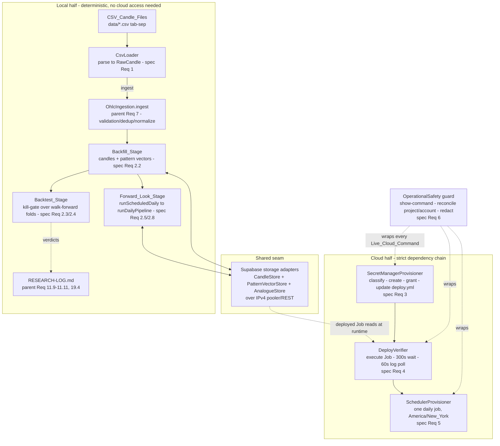
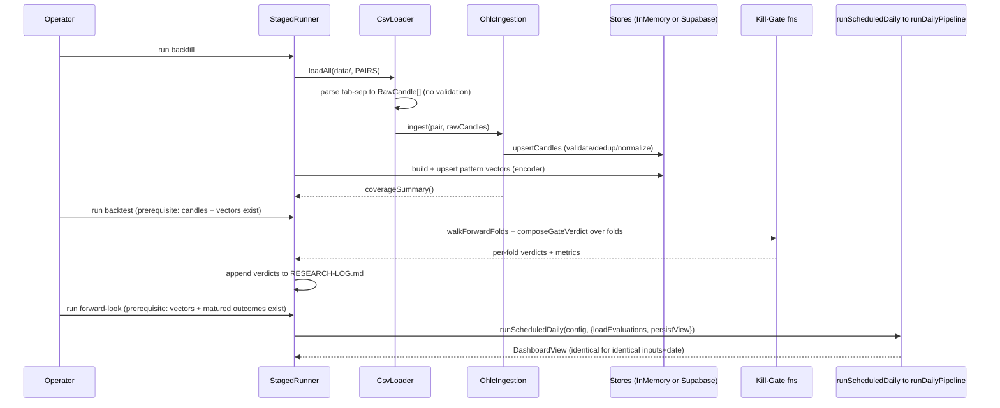
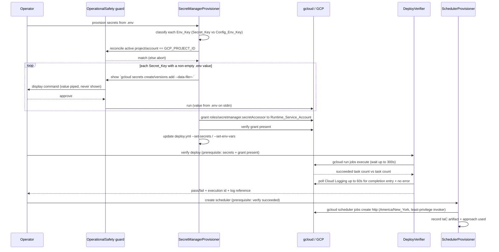

# Design Document

## Overview

This spec is **operational wiring only**. The FX Daily Pattern Assistant's deterministic core — ingestion/validation (parent Req 7), the pattern encoder (parent Req 8), retrieval + forward-outcome resolver (parent Req 9/10), the confidence/horizon selector (parent Req 10), the two-stage kill-gate (parent Req 11–13, 19), the end-to-end daily pipeline (`src/pipeline/dailyPipeline.ts`, parent Req 3.1/16.1), the scheduled-run entry point (`src/scheduled-run/main.ts`, parent Req 16.7), and the delivery workflow (`.github/workflows/deploy.yml`) — is complete and tested. This design adds the components that **feed, trigger, and provision infrastructure around** that core. It does **not** re-implement validation, scoring, kill-gate, or pipeline logic.

The governing principle is a single sentence: **every new component connects to an existing module by its real signature, and owns none of that module's responsibilities.** Concretely:

- The **CsvLoader** parses `data/*.csv` into `RawCandle[]` and calls `OhlcIngestion.ingest(...)`. Ingestion — not the loader — owns OHLC-validity rejection (parent Req 7.3), `(Asset, Date)` dedup/upsert (parent Req 7.4), session-boundary normalization (parent Req 7.7/7.8), and the coverage summary (parent Req 7.6).
- The **StagedRunner** composes three stages over the existing modules. Its Forward_Look_Stage calls `runScheduledDaily(...)` → `runDailyPipeline(...)`; it never forks the firing logic. Its Backtest_Stage invokes the existing kill-gate functions (`walkForwardFolds`, `composeGateVerdict`, …); it never re-derives gate math.
- The **Supabase storage adapters** are the concrete implementations of the three existing storage PORTs (`CandleStore`, `PatternVectorStore`, `AnalogueStore`). They are the seam that today throws inside `buildSupabaseStores(...)` in `src/scheduled-run/main.ts`; implementing them is what unblocks both backfill (writing candles + vectors) and forward-look (reading them + persisting the view).
- The **SecretManagerProvisioner**, **DeployVerifier**, and **SchedulerProvisioner** provision the cloud resources the deployed Job already assumes, in a strict dependency chain: secrets exist → deploy verifies → schedule is created.
- An **OperationalSafety** guard wraps every `Live_Cloud_Command`: show the exact command before running, reconcile active project/account against `GCP_PROJECT_ID`, source secret values from `.env`/Secret Manager (never as args, never echoed), and check Cloud Logging for feedback after each op.

### Design Goals

- **No re-implementation** (parent Req 3.1, spec Req 1.4/2.3/2.5): wiring calls existing public functions by their confirmed signatures.
- **Determinism preserved** (parent Req 3.1, 16.7): the local half's testable behavior (CSV import idempotence, forward-look determinism, stage ordering) is a pure function of stored inputs.
- **Secret confidentiality** (spec Req 3.3/6.2/6.3): no secret value is ever committed, echoed, logged, or passed as a command argument.
- **Operator control of cost** (spec Req 6.1/6.5): every create/deploy/execute/schedule command is shown and approved before it runs.
- **Compute/storage/serving separation preserved** (parent Req 17): the Supabase adapters implement the existing PORTs only; the deterministic core keeps depending on the port interfaces, and a future read-only serving layer can still be added without touching compute.
- **Toolchain unchanged** (parent Req 18, 3.3): TypeScript 5.9.3 / Node 22 / Vitest, exact pinned deps, no new prerelease dependencies. The one property-based dependency (`fast-check`) is already in the repo and pinned.

### Confirmed Existing Interfaces (design targets)

These signatures were verified against the current source; every new component below is designed to call *these*.

| Module | File | Signature the wiring depends on |
| --- | --- | --- |
| Ingestion | `src/ingestion/ohlcIngestion.ts` | `class OhlcIngestion { constructor(store?: CandleStore); ingest(pair, rawCandles: readonly RawCandle[], decisionDate?): Promise<IngestReport>; coverageSummary(): Promise<readonly PerPairCoverage[]>; getCandles(...) }` |
| Ingestion types | `src/ingestion/types.ts` | `RawCandle`, `IngestReport`, `PerPairCoverage`, `PAIRS`, `CandleStore` PORT, `InMemoryCandleStore` |
| Pipeline | `src/pipeline/dailyPipeline.ts` | `runDailyPipeline(decisionDate: TradingDate, deps: PipelineDeps): Promise<readonly PairEvaluation[]>` |
| Pipeline loader | `src/pipeline/index.ts` | `makePipelineLoader(stores: PipelineStores): PairEvaluationLoader` |
| Scheduled run | `src/scheduled-run/scheduledRun.ts` | `runScheduledDaily(config, deps): Promise<ScheduledRunResult>`; `PairEvaluationLoader`, `DashboardViewPersister` |
| Scheduled entry | `src/scheduled-run/main.ts` | `buildSupabaseStores(supabase): PipelineStores` **(throws — seam)**, `persistView` **(throws — seam)** |
| Config | `src/scheduled-run/config.ts` | `loadScheduledRunConfig(env?, now?): ScheduledRunConfig` |
| Storage config | `src/storage/supabaseConfig.ts` | `loadSupabaseConfig(env?)`, `SupabaseConfig { target, url, key }` |
| Storage PORTs | `ingestion/types.ts`, `encoder/types.ts`, `retrieval/types.ts` | `CandleStore`, `PatternVectorStore`, `AnalogueStore` (+ in-memory reference impls) |
| Kill-gate | `src/kill-gate/index.ts` | `walkForwardFolds(...)`, `persistWalkForwardFolds(...)`, `outOfSampleTestRanges(...)`, `composeGateVerdict(configId, folds)`, `evaluateAndRecordVerdict(...)` |
| Delivery | `.github/workflows/deploy.yml` | SHA-pinned Cloud Build → Cloud Run Job deploy via WIF (keyless OIDC); `--set-secrets` maps `supabase-url`, `supabase-key` (Scoped_Write_Credential), `supabase-publishable-key`, `supabase-pooler-url`, plus the provider API keys |

## Architecture

### Two Halves and Their Dependency Chain

The spec splits cleanly into a **local half** (data + deterministic compute, runnable with no cloud access) and a **cloud half** (a strict provisioning chain). The only coupling between them is that the Supabase adapters, once implemented, are shared by both.



The cloud chain is a hard ordering (spec Req 4.5, 5.3): the deployed Job pulls its `Secret_Key`s at runtime, so **secrets must exist and be accessor-granted before** deploy verification can succeed, and a run must **verify successfully before** a scheduler is created to fire it daily.

### Local Data Flow (Backfill → Backtest → Forward-Look)



### Cloud Provisioning Flow (secrets → verify → schedule)



## Components and Interfaces

All new code is TypeScript (parent Req 3.3), placed under `src/` alongside the modules it wires, with matching module conventions (a `types.ts`, a public `index.ts`, colocated `*.test.ts` / `*.property.test.ts`). The cloud components shell out to the already-installed `gcloud` SDK (572.0.0) through a single injectable command-runner so they are testable without live calls.

### 1. CsvLoader — `src/csv-loader/`

Parses a `CSV_Candle_File` and hands the batch to `OhlcIngestion.ingest`. It performs **parsing and mapping only** (spec Req 1.4): no OHLC validation, no dedup, no session normalization.

```typescript
// src/csv-loader/types.ts
export type DataSourceRole = "backfill" | "feed";

export interface CsvParseError {
  readonly file: string;              // by name (spec Req 1.5, 1.9)
  readonly reason: string;            // header mismatch | bad row | empty | unreadable
  readonly offendingRow?: number;     // 1-based data row index when applicable
}

export interface CsvLoadReport {
  readonly file: string;
  readonly pair: Pair;
  readonly parsed: number;            // rows mapped to RawCandle
  readonly ingest: IngestReport;      // returned verbatim from OhlcIngestion
}
```

```typescript
// src/csv-loader/csvLoader.ts
export const CSV_HEADER = ["Time", "Open", "High", "Low", "Close", "Volume"] as const;
export const CSV_DATA_COLUMNS = 7;   // 6 named + trailing tick-count (spec Req 1.1, 1.2)

/**
 * Parse one tab-separated CSV_Candle_File into RawCandle[]. Accepts CRLF and LF
 * (spec Req 1.1). Excludes the 7th column (spec Req 1.2). Passes the raw
 * `YYYY-MM-DD 00:00:00` Time string UNALTERED as RawCandle.timestamp so the
 * ingestion module normalizes it to the Session_Close boundary (spec Req 1.3;
 * parent Req 7.7/7.8). Returns a discriminated result — parsing NEVER partially
 * feeds a file that failed (spec Req 1.5, 1.9, 1.10).
 */
export function parseCsvCandles(
  file: string,
  contents: string,
  pair: Pair,
): { ok: true; candles: RawCandle[] } | { ok: false; error: CsvParseError };

export class CsvLoader {
  constructor(private readonly ingestion: OhlcIngestion) {}

  /** Load one file: parse then ingest. Aborts (no ingest) on any parse error. */
  loadFile(path: string, pair: Pair, role: DataSourceRole): Promise<CsvLoadReport | CsvParseError>;

  /** Load all five PAIRS from a directory, then emit coverageSummary() (spec Req 1.7). */
  loadAll(dir: string, role: DataSourceRole): Promise<{
    reports: readonly (CsvLoadReport | CsvParseError)[];
    coverage: readonly PerPairCoverage[];
  }>;
}
```

Mapping rule (one CSV data row → one `RawCandle`), spec Req 1.2/1.3:

```typescript
// tab-split row: [Time, Open, High, Low, Close, Volume, tickCount]
const raw: RawCandle = {
  pair,                              // the file's pair (EURUSD_D1.csv -> EURUSD)
  timestamp: cols[0],               // raw "YYYY-MM-DD 00:00:00" — UNALTERED (spec Req 1.3)
  open: Number(cols[1]),
  high: Number(cols[2]),
  low: Number(cols[3]),
  close: Number(cols[4]),
  source: "csv",
  // cols[5] (Volume) and cols[6] (tick count) are intentionally dropped (spec Req 1.2)
};
```

Error/abort semantics:
- Missing/unreadable file, or header not exactly the 6 expected columns in order → abort that file, report by name, feed nothing (spec Req 1.5).
- Any data row not exactly 7 tab columns, or any `Time/Open/High/Low/Close` unparsable → abort that file, report file + offending row, feed nothing (spec Req 1.9). Note this is a **structural/parse** failure distinct from OHLC-validity rejection, which remains the ingestion module's job (a structurally valid but `high < low` row is *accepted by the loader* and *rejected by ingestion*).
- Valid header, zero data rows → report empty, feed nothing (spec Req 1.10).

The `Data_Source_Role` (spec Req 1.8) is recorded in config (a `csv.role` entry in a committed operational config file); the loader runs once for `backfill` and on the recurring cadence only for `feed`.

### 2. StagedRunner — `src/staged-runner/`

Three independently-runnable stages that also compose in order (spec Req 2.1, 2.6). Each stage is a thin orchestration over existing modules with an explicit prerequisite check (spec Req 2.7).

```typescript
// src/staged-runner/types.ts
export type StageName = "backfill" | "backtest" | "forward-look";

export interface StageResult {
  readonly stage: StageName;
  readonly ok: boolean;
  readonly summary: string;          // e.g. coverage, fold count, firing-card count
  readonly missingPrerequisite?: string; // named prerequisite when aborted (spec Req 2.7)
}

export interface StagedRunnerDeps {
  readonly stores: PipelineStores;   // InMemory in tests, Supabase in prod
  readonly ingestion: OhlcIngestion;
  readonly csvLoader: CsvLoader;
}
```

```typescript
// src/staged-runner/stagedRunner.ts
export class StagedRunner {
  constructor(private readonly deps: StagedRunnerDeps) {}

  /** spec Req 2.2: CSV (+ API where role=feed) -> ingestion -> store candles;
   *  build + upsert Pattern_Vectors via the existing encoder. */
  backfill(role: DataSourceRole): Promise<StageResult>;

  /** spec Req 2.3/2.4: build walk-forward folds, invoke composeGateVerdict per
   *  fold over backfilled history, append per-fold verdicts to RESEARCH-LOG.md.
   *  Aborts if no candles/vectors exist (spec Req 2.7). NEVER re-implements gate math. */
  backtest(): Promise<StageResult>;

  /** spec Req 2.5/2.8: call runScheduledDaily(config, {loadEvaluations, persistView})
   *  which internally calls runDailyPipeline. Aborts if vectors/matured outcomes
   *  are missing (spec Req 2.7). Deterministic for identical inputs + Decision_Date. */
  forwardLook(decisionDate?: TradingDate): Promise<StageResult>;

  /** spec Req 2.6/2.9: run backfill -> backtest -> forward-look in order,
   *  stopping at the first failed stage (no subsequent stages run). */
  runAll(role: DataSourceRole, decisionDate?: TradingDate): Promise<readonly StageResult[]>;
}
```

Key wiring facts:
- **Backfill_Stage** stores candles through `ingestion.ingest(...)` (which upserts via the `CandleStore` PORT) and builds pattern vectors with the existing `encodePatternVector(...)`, upserting through the `PatternVectorStore` PORT. It does not resolve forward outcomes itself; matured `AnalogueStore` rows are populated by the existing resolver during backfill, exactly as the pipeline's docstring assumes.
- **Backtest_Stage** calls `walkForwardFolds(pair, history)` then `composeGateVerdict(configId, folds)` (or `evaluateAndRecordVerdict(...)`) from `src/kill-gate`. It appends verdicts to `RESEARCH-LOG.md` via the existing living-docs writer — no gate math is duplicated (spec Req 2.3).
- **Forward_Look_Stage** calls `runScheduledDaily(...)` from `src/scheduled-run`, which calls `runDailyPipeline(...)`. It reuses THE single deterministic path (parent Req 3.1, 16.7); the "same stored inputs + same Decision_Date ⇒ identical setups" guarantee is inherited, not re-established.
- **Prerequisite abort** (spec Req 2.7): before backtest/forward-look, the runner checks the relevant store is non-empty (`getCoverageSummary()` for candles; a vector/outcome probe for the later stages). On a missing prerequisite it returns `ok:false` with `missingPrerequisite` set, leaves stored data unchanged, and emits no fabricated result.

### 3. Supabase Storage Adapters — `src/storage/supabase/`

The concrete implementations of the three existing PORTs, bound to the IPv4-reachable pooler/REST endpoint (Cloud Run has no IPv6 egress). This is the seam that today throws inside `buildSupabaseStores(...)`; implementing it is what unblocks both halves of the runner and the deployed Job.

```typescript
// src/storage/supabase/index.ts
/**
 * Build the three PORT implementations from a resolved SupabaseConfig. This is
 * the exact shape `buildSupabaseStores(supabase): PipelineStores` in
 * src/scheduled-run/main.ts expects; wiring these adapters replaces ONLY that
 * throwing stub. The pipeline, scheduled runner, and dailyRun entry point are
 * unchanged (parent Req 17.1).
 */
export function buildSupabaseStores(supabase: SupabaseConfig): PipelineStores; // { candleStore, vectorStore, analogueStore }

export class SupabaseCandleStore implements CandleStore { /* upsertCandles / getCandles / getCoverageSummary */ }
export class SupabasePatternVectorStore implements PatternVectorStore { /* upsertVector / getVector / getVectorsByAsset / queryNearest (pgvector ANN) */ }
export class SupabaseAnalogueStore implements AnalogueStore { /* upsertOutcome / getMaturedOutcomes / getOutcomes */ }

/** The matching firing_setups writer for the persistView seam in main.ts. */
export function makeSupabaseViewPersister(supabase: SupabaseConfig): DashboardViewPersister;
```

- Each adapter implements the **same method signatures** as its in-memory reference (verified above), so `PipelineStores` and every downstream caller are untouched. The only substitution is the concrete backend (parent Req 17.1).
- `queryNearest` maps to a pgvector ANN query with the `weeklyTrendSign` metadata pre-filter and the same stable tie-break ordering the in-memory store documents (similarity, then date, then asset).
- Connection uses `SupabaseConfig.url` (overridden by `SUPABASE_POOLER_URL` at runtime via the existing `resolveSupabaseOverIpv4`) and `SupabaseConfig.key`; the key is a `Secret_Key`, never logged.
- `makeSupabaseViewPersister` implements the `persistView` seam, writing the `DashboardView` (firing cards + suppressions) to `firing_setups`.

### 4. SecretManagerProvisioner — `src/ops/secret-manager/`

Classifies every `Env_Key` in `.env`, creates/versions the `Secret_Key` secrets idempotently, grants the accessor role, verifies it, and updates `deploy.yml` — never echoing a value.

```typescript
// src/ops/secret-manager/classify.ts
export type EnvKeyClass = "secret" | "config";

/**
 * Classify one Env_Key by name only (spec Req 3.1, 6.3):
 *   secret  <- matches /_API_KEY$/, /_KEY$/, /_TOKEN$/, credential JSON, or a
 *              credential-bearing URL/connection string (e.g. SUPABASE_*_KEY,
 *              SUPABASE_POOLER_URL, *_HOSTED_URL when it embeds a credential).
 *   config  <- GCP_PROJECT_ID, GCP_REGION, GEMINI_MODEL, *_PROVIDER (names),
 *              *_ENABLED, GOOGLE_GENAI_USE_VERTEXAI, other boolean toggles.
 */
export function classifyEnvKey(name: string): EnvKeyClass;
```

```typescript
// src/ops/secret-manager/provisioner.ts
export interface SecretProvisionPlan {
  readonly secrets: readonly { envKey: string; secretName: string; hasValue: boolean }[];
  readonly configKeys: readonly string[];
  readonly missingValues: readonly string[]; // Secret_Keys with empty/absent value (spec Req 3.9)
}

export class SecretManagerProvisioner {
  constructor(private readonly runner: GcloudRunner, private readonly safety: OperationalSafety) {}

  /** Build the plan from .env WITHOUT reading any value into the plan (names only). */
  plan(env: EnvSource): SecretProvisionPlan;

  /**
   * For each Secret_Key with a non-empty value: create the secret if absent,
   * else add a new version (spec Req 3.8 idempotent). The value is piped via
   * `--data-file=-` on stdin from .env, never passed as an arg or echoed
   * (spec Req 3.3, 6.2, 6.3). Empty/absent values are reported, not versioned
   * (spec Req 3.9).
   */
  provision(env: EnvSource): Promise<SecretProvisionResult>;

  /** Grant roles/secretmanager.secretAccessor to Runtime_Service_Account on each
   *  secret, then read the IAM policy back to VERIFY the grant (spec Req 3.4). */
  grantAndVerifyAccessor(runtimeServiceAccount: string): Promise<GrantVerifyResult>;

  /** Rewrite deploy.yml: --set-secrets covers every required Secret_Key from its
   *  Secret Manager secret; --set-env-vars covers every Config_Env_Key. Places
   *  NO secret value in the file (spec Req 3.5, 3.6). */
  updateDeployWorkflow(plan: SecretProvisionPlan): Promise<void>;
}
```

Secrets to create (spec Req 3.2): the three already referenced by `deploy.yml` (`supabase-url`, `supabase-key`, `supabase-pooler-url`) plus every provider `Secret_Key` present with a value in `.env` (`OHLC_API_KEY`, `YIELD_API_KEY`, `NEWS_CALENDAR_API_KEY`, `EXTERNAL_SIGNAL_API_KEY`, and any of `TWELVE_DATA_API_KEY`, `MASSIVE_API_KEY`, `ALPHA_VANTAGE_API_KEY`, `FINNHUB_API_KEY`, `NEWS_API_KEY` that are set). Project reconciliation against `GCP_PROJECT_ID` runs before any create (spec Req 3.7) via the OperationalSafety guard.

### 5. DeployVerifier — `src/ops/deploy-verify/`

A real, live check against the actual project and deployed Job (spec Req 4.1) — not a mock or dry run.

```typescript
// src/ops/deploy-verify/verifier.ts
export interface DeployVerifyResult {
  readonly ok: boolean;
  readonly executionId: string | null;
  readonly succeededTaskCount: number | null;
  readonly taskCount: number | null;
  readonly logReference: string | null;   // Cloud Logging reference (spec Req 4.4, 4.6)
  readonly failureReason?: string;
}

export class DeployVerifier {
  constructor(private readonly runner: GcloudRunner, private readonly safety: OperationalSafety) {}

  /** Prerequisite check (spec Req 4.5): the required secrets exist AND the
   *  Runtime_Service_Account accessor grant is present. Surfaces the missing
   *  prerequisite explicitly rather than an ambiguous execution failure. */
  checkPrerequisites(runtimeServiceAccount: string): Promise<{ ok: boolean; missing?: string }>;

  /**
   * Execute the deployed Cloud_Run_Job once, wait up to 300s for completion,
   * treat success as succeeded-task-count == task-count (spec Req 4.2), then
   * poll Cloud Logging up to 60s for the structured completion entry and the
   * absence of an error-level entry for that execution (spec Req 4.3). On
   * failure/timeout/short count, report the execution id + log reference
   * (spec Req 4.4). Records outcome without any Secret_Key value (spec Req 4.6).
   */
  verify(): Promise<DeployVerifyResult>;
}
```

Underlying commands: `gcloud run jobs execute <job> --wait`, `gcloud run jobs executions describe <exec>` (task counts), `gcloud logging read` for the completion entry. Each is shown/approved via the OperationalSafety guard.

### 6. SchedulerProvisioner — `src/ops/scheduler/`

Creates exactly one daily Cloud Scheduler job, gated on a successful verify (spec Req 5.3).

```typescript
// src/ops/scheduler/provisioner.ts
export interface SchedulerPlan {
  readonly schedule: string;          // "0 17 * * *"
  readonly timeZone: "America/New_York"; // resolves 22:00 UTC (EST) / 21:00 UTC (EDT) (spec Req 5.2)
  readonly artifactApproach: "workflow-step" | "committed-config" | "documented-command"; // spec Req 5.4
  readonly invokerServiceAccount: string; // least-privilege (spec Req 5.7)
}

export class SchedulerProvisioner {
  constructor(private readonly runner: GcloudRunner, private readonly safety: OperationalSafety) {}

  /** spec Req 5.3: refuse to create the job unless DeployVerifier reported ok. */
  create(plan: SchedulerPlan, verify: DeployVerifyResult): Promise<SchedulerCreateResult>;

  /** Emit the committed, version-controlled IaC artifact recording the approach
   *  used and the exact provisioning command (spec Req 5.4). */
  writeArtifact(plan: SchedulerPlan): Promise<void>;
}
```

- One job, daily, `America/New_York` timezone so DST is handled automatically (spec Req 5.1, 5.2).
- The Scheduler invoker identity is granted **only** `roles/run.invoker` on the Job — no broader role (spec Req 5.7).
- Retry-on-trigger-failure up to 3 attempts is configured on the Scheduler job itself (`--max-retry-attempts=3`), satisfying spec Req 5.6.
- The equivalence guarantee (spec Req 5.5) is inherited: the triggered Job runs the same `src/scheduled-run/main.ts` → `runScheduledDaily` → `runDailyPipeline` path a local run uses (parent Req 16.7).

### 7. OperationalSafety guard — `src/ops/safety/`

A cross-cutting wrapper every `Live_Cloud_Command` passes through (spec Req 6). It is injected into all three cloud components as `GcloudRunner`.

```typescript
// src/ops/safety/operationalSafety.ts
export interface CommandPresentation {
  readonly displayCommand: string;   // redacted: secret values shown as <from .env: NAME>
  readonly destructive: boolean;      // create/deploy/execute/cost OR delete/overwrite/reduce-perms
  readonly affectedResource?: string; // named for destructive/overwriting ops (spec Req 6.5)
}

export interface OperationalSafety {
  /** Reconcile active gcloud project AND account against GCP_PROJECT_ID before
   *  any Live_Cloud_Command; abort + surface mismatch otherwise (spec Req 6.4, 6.6, 3.7). */
  reconcileTarget(expectedProject: string): Promise<{ ok: boolean; mismatch?: string }>;

  /** Present the exact command (with any secret value redacted) and, for a
   *  destructive/overwriting op, a distinguishable warning naming the affected
   *  resource; do not run until the operator approves (spec Req 6.1, 6.5). */
  confirm(presentation: CommandPresentation): Promise<boolean>;
}

/** The single choke point for shelling out to gcloud. Secret values are supplied
 *  on stdin (--data-file=-), never interpolated into the displayed/argv command. */
export interface GcloudRunner {
  run(argv: readonly string[], opts?: { stdin?: NodeJS.ReadableStream }): Promise<CommandOutput>;
}
```

Redaction rule: the command string shown to the operator and written to any log substitutes a `Secret_Key`'s value with a `<from .env: NAME>` placeholder (spec Req 6.2, 6.3). The actual value only ever travels on stdin into `gcloud`.

### 8. Hosted Backfill Execution — reuses `src/staged-runner/` + `src/storage/supabase/`

This introduces NO new module logic. Hosted_Candle_Seeding (spec Req 7) is the operational act of running the existing `StagedRunner.backfill("backfill")` with its `PipelineStores` bound to the Supabase adapters via `buildSupabaseStores(supabase)` (Component 3), so candles, pattern vectors, and matured outcomes land in the hosted backend. The only new code is a thin entry seam and a pure coverage-complete predicate:

```typescript
// seeding-complete predicate (pure) — spec Req 7.5
export function isBackfillComplete(coverage: readonly PerPairCoverage[]): boolean;
// true iff every one of the five PAIRS has a non-zero stored candle count
```

It runs under the same **Live Cloud Execution Protocol** as the other live operations: reconcile `SUPABASE_TARGET=hosted` + `GCP_PROJECT_ID` first (spec Req 7.1), confirm the required tables exist (spec Req 7.2), run the existing Backfill_Stage (spec Req 7.3, idempotent per spec Req 7.4), then verify coverage shows all five pairs non-zero (spec Req 7.5), recording only non-secret references (spec Req 7.6).

### 9. Least-Privilege Hosted Write Access — RLS + scoped write credential (spec Req 8)

The deployed Cloud_Run_Job writes `candles`, `pattern_vectors`, `analogue_outcomes`, `firing_setups`, and `realized_outcomes`. The motivating problem: the Job originally authenticated with `SUPABASE_HOSTED_KEY` holding the publishable (anon) key — RLS-restricted and unable to write under Supabase's default posture (the hosted backfill confirmed this). The fix is defense-in-depth, not a key swap. After this change `SUPABASE_HOSTED_KEY` holds the Scoped_Write_Credential (not the anon key):

- A new idempotent migration enables Row-Level Security on the five compute-written tables and defines a dedicated `pipeline_writer` Postgres role granted only `INSERT`/`UPDATE`/`SELECT` on exactly those tables, with policies scoped to that role (spec Req 8.1, 8.2). No `DELETE`, no other tables/schemas. The migration also grants `pipeline_writer` membership to the PostgREST `authenticator` role; without that membership PostgREST cannot `SET ROLE pipeline_writer` and rejects the credential with `42501 permission denied to set role` (spec Req 8.3).
- The Job presents a Scoped_Write_Credential: a signed JWT whose `role` claim is `pipeline_writer`. This hosted project uses Supabase's **new asymmetric (ES256) JWT key system**, so the credential is NOT an HS256 token signed with a shared project secret (Supabase does not expose the private half of its own generated keys). Instead an operator-controlled signing key is used: generate an EC P-256 keypair, import the **public** key as the project's active JWT signing key via the Supabase Management API (CLI 2.109.0 has no signing-keys subcommand) so it is published at the project JWKS endpoint, then sign the `pipeline_writer` JWT locally with the private key (header `kid` = the active key). PostgREST verifies the token against JWKS, resolves the role, and enforces RLS against it (spec Req 8.3).
- Header model (asymmetric keys): the Supabase API gateway admits a request by matching the `apikey` header against a recognized publishable/anon key BEFORE PostgREST resolves the Postgres role from the `Authorization: Bearer` JWT. A scoped `pipeline_writer` JWT is NOT a recognized gateway apikey, so `SupabaseRestClient` sends the publishable key as `apikey` and the Scoped_Write_Credential JWT as `Authorization: Bearer` (via `SupabaseConfig.apiKey`, resolved from `SUPABASE_PUBLISHABLE_KEY` on hosted). When no separate `apiKey` is configured it falls back to using `key` for both headers, so local/anon setups are unchanged (spec Req 8.5).
- The `supabase-key` Secret Manager secret is set to the Scoped_Write_Credential and injected as `SUPABASE_HOSTED_KEY` (the Bearer credential); the publishable key is injected separately as `SUPABASE_PUBLISHABLE_KEY` (from the `supabase-publishable-key` secret) to serve as the gateway `apikey` and the read-only credential for the future serving layer (spec Req 8.5, 8.6, parent Req 17.3). The service-role key is reserved for operator one-offs and never deployed (spec Req 8.4).

```sql
-- scoped write role + RLS (shape; see migration for the committed form)
alter table candles enable row level security;
create role pipeline_writer nologin;         -- reached via the JWT role claim
grant pipeline_writer to authenticator;      -- so PostgREST can SET ROLE into it
grant select, insert, update on candles to pipeline_writer;
create policy pipeline_writer_rw on candles for all to pipeline_writer using (true) with check (true);
-- ...repeated for pattern_vectors, analogue_outcomes, firing_setups, realized_outcomes
```

**Security note (deliberate residual risk):** the Scoped_Write_Credential is a long-lived bearer JWT (fixed `role` claim) signed with an operator-held ES256 private key whose public half is the project's active JWT signing key. The private key must stay confidential (it is kept outside the repo, not in `.env` as committed) and the credential must be rotated like any secret — rotation means minting a fresh JWT (and, if needed, rotating the signing key via the Management API, which supports in-use/standby/previously-used states for zero-downtime cutover). It is materially stronger than the service-role key — it is RLS-bound, cannot `DELETE`, and cannot touch tables outside the five — but it is not a short-lived token. The signing-key import, credential minting, secret set, and redeploy are operator steps under the Live Cloud Execution Protocol.

## Data Models

The wiring introduces almost no new persistent data — it feeds and reads the existing tables. New/updated shapes:

- **`RawCandle` (existing, unchanged)** — the CsvLoader's output; only `pair`, `timestamp` (raw string), `open/high/low/close`, `source` are populated (spec Req 1.2/1.3).
- **`CsvParseError` / `CsvLoadReport`** — in-memory reporting shapes for the loader (defined above); not persisted.
- **`DataSourceRole`** — `"backfill" | "feed"` (spec Req 1.8), recorded in a committed operational config file (e.g. `ops.config.json` `{ "csv": { "role": "backfill" } }`), never in `.env`.
- **`SecretProvisionPlan` / `SecretProvisionResult`** — name-only plans and outcomes; **no `Secret_Key` value is ever stored in any of these shapes** (spec Req 3.3, 6.2).
- **`DeployVerifyResult`** — recorded outcome (execution id + Cloud Logging reference), no secret value (spec Req 4.6).
- **`SchedulerPlan`** — persisted as the single committed IaC artifact (spec Req 5.4).

Existing persisted tables the wiring writes/reads (via the Supabase adapters, unchanged schema — parent Req 17): `candles` (Backfill_Stage via ingestion), `pattern_vectors` (Backfill_Stage via encoder), `analogue_outcomes` (matured outcomes, read by Forward_Look_Stage), `gate_verdicts` / walk-forward folds (Backtest_Stage), `firing_setups` (Forward_Look_Stage persistView), and `RESEARCH-LOG.md` (Backtest_Stage verdict append).

### Reserving the future serving layer (parent Req 17)

The Supabase adapters implement the compute-facing storage PORTs only. They add **no** read API, no HTTP surface, and no serving-layer coupling — compute still depends solely on the port interfaces. A future read-only serving layer (parent Req 17.3) can read the same `firing_setups` / schema without any change to these adapters or to the deterministic core.

## Correctness Properties

*A property is a characteristic or behavior that should hold true across all valid executions of a system — essentially, a formal statement about what the system should do. Properties serve as the bridge between human-readable specifications and machine-verifiable correctness guarantees.*

These properties cover the **deterministic/pure** parts of the wiring — CSV parsing, the local staged-runner behavior, and the pure decision logic inside the cloud components (classification, redaction, reconciliation, success/prerequisite predicates). They are implemented with `fast-check` (already a pinned repo dependency), minimum 100 iterations each, and run against the in-memory reference stores and a fake `GcloudRunner`.

The **live cloud effects** — actually creating secrets (3.2), granting/verifying IAM (3.4, 5.7), executing the real Job and reading Cloud Logging (4.1, 4.3), and end-to-end scheduler equivalence (5.1, 5.5) — are **not** property-tested. They vary by external service, not by input, and 100 iterations would add no bugs while incurring cost; they are verified by live checks and 1–3 integration assertions under the operator-approval protocol (see Testing Strategy).

### Property 1: CSV parsing is line-ending independent

*For any* set of valid candle rows rendered as a tab-separated `CSV_Candle_File` with the canonical 6-column header, parsing the CRLF-terminated form and the LF-terminated form yields the identical sequence of `RawCandle`s.

**Validates: Requirements 1.1**

### Property 2: CSV mapping excludes Volume and tick count

*For any* valid data row, the produced `RawCandle` carries only the `open`/`high`/`low`/`close` values from columns 2–5 and the verbatim `Time` timestamp, and no field is derived from column 6 (Volume) or column 7 (tick count), regardless of their values.

**Validates: Requirements 1.2**

### Property 3: CSV timestamp is passed through verbatim

*For any* valid `Time` cell of the form `YYYY-MM-DD 00:00:00`, the produced `RawCandle.timestamp` is byte-identical to the input cell — the loader performs no shift, alteration, or normalization (that is the ingestion module's responsibility).

**Validates: Requirements 1.3**

### Property 4: A malformed header aborts the file and feeds nothing

*For any* header line that is not exactly the six expected columns (`Time`, `Open`, `High`, `Low`, `Close`, `Volume`) in that order, parsing returns an error naming the file and produces zero candles for that file.

**Validates: Requirements 1.5**

### Property 5: CSV import is idempotent

*For any* fixed set of valid `CSV_Candle_File`s, loading them twice through the loader into a store produces identical stored candles and an identical per-pair coverage summary after the second run as after the first (no duplicates), relying on the ingestion module's `(Asset, Date)` upsert.

**Validates: Requirements 1.6**

### Property 6: A malformed row causes no partial ingest

*For any* otherwise-valid `CSV_Candle_File` with one row spliced in that does not have exactly 7 tab-separated columns or has an unparsable `Time`/`Open`/`High`/`Low`/`Close`, parsing aborts, reports the file name and the offending row, and feeds zero candles from that file to ingestion.

**Validates: Requirements 1.9**

### Property 7: Stored pattern vectors correspond to stored candles after backfill

*For any* generated candle history run through the Backfill_Stage against in-memory stores, every stored pattern vector is for a `(pair, date)` that also has stored candles, and every fed pair has non-empty coverage.

**Validates: Requirements 2.2**

### Property 8: The composed run always runs stages in dependency order

*For any* inputs, a composed `runAll` records its stage starts in exactly the order backfill → backtest → forward-look.

**Validates: Requirements 2.6**

### Property 9: A missing prerequisite aborts a stage without mutating stored data

*For any* store state that lacks a stage's prerequisite (e.g. no candles before backtest, or no vectors/matured outcomes before forward-look), invoking that stage returns `ok:false` with the missing prerequisite named, leaves the store byte-identical to before the call, and emits no fabricated or empty result.

**Validates: Requirements 2.7**

### Property 10: Forward-look is deterministic

*For any* stored inputs and any Decision_Date, invoking the Forward_Look_Stage twice produces deep-equal `DashboardView`s, consistent with the deterministic-computation and equivalent-unattended-run guarantees (parent Requirements 3.1, 16.7).

**Validates: Requirements 2.8, 5.5**

### Property 11: A failed stage stops the composed run

*For any* composed run in which stage *i* fails, no stage after *i* executes (none of their side effects or records occur).

**Validates: Requirements 2.9**

### Property 12: Env-key classification follows the naming convention

*For any* environment-variable name, `classifyEnvKey` returns `secret` when the name matches a credential pattern (`*_API_KEY`, `*_KEY`, `*_TOKEN`, a credential JSON, or a credential-bearing URL/connection string) and `config` for a project id, region, model id, provider *name*, or boolean toggle (`*_ENABLED`, `GOOGLE_GENAI_USE_VERTEXAI`).

**Validates: Requirements 3.1**

### Property 13: The rewritten deploy.yml covers every required key

*For any* provisioning plan, the rewritten `deploy.yml` contains a `--set-secrets` mapping for every `Secret_Key` in the plan and a `--set-env-vars` entry for every `Config_Env_Key` in the plan.

**Validates: Requirements 3.5**

### Property 14: The rewritten deploy.yml leaks no secret and misplaces no secret

*For any* provisioning plan and any secret values, the rewritten `deploy.yml` contains none of those secret values as a substring, and no `Secret_Key` appears under `--set-env-vars`.

**Validates: Requirements 3.6**

### Property 15: Provisioning chooses version-add over duplicate-create

*For any* Secret Manager state, provisioning a `Secret_Key` that already exists produces an "add new version" command and never a duplicate "create secret" command, so re-running provisioning over an unchanged state is idempotent.

**Validates: Requirements 3.8**

### Property 16: Empty or absent secret values are reported, never created

*For any* `.env` state, every `Secret_Key` whose value is empty or absent appears in the reported missing values and produces no create or version command.

**Validates: Requirements 3.9**

### Property 17: The deploy-verify success predicate

*For any* `(succeededTaskCount, taskCount, elapsedMs)` tuple, `verify` treats the execution as successful if and only if `succeededTaskCount === taskCount` and `elapsedMs <= 300_000`, and as a failure otherwise.

**Validates: Requirements 4.2**

### Property 18: A failed execution maps to a failing result carrying its identifiers

*For any* failure state (execution failure, 300-second timeout, or a succeeded count below the task count), the produced `DeployVerifyResult` has `ok:false` and carries the execution id and the Cloud Logging reference.

**Validates: Requirements 4.4**

### Property 19: A missing verify prerequisite is surfaced specifically

*For any* prerequisite state (secrets present/absent × accessor grant present/absent), `checkPrerequisites` blocks verification whenever either is absent and surfaces the specific missing item rather than an ambiguous execution failure.

**Validates: Requirements 4.5**

### Property 20: Scheduler creation is gated on a successful verify

*For any* `DeployVerifyResult`, the SchedulerProvisioner creates the scheduler job if and only if the result is a success, and otherwise refuses and surfaces the unmet Deploy_Verification prerequisite.

**Validates: Requirements 5.3**

### Property 21: No Live_Cloud_Command runs without operator approval

*For any* sequence of pending `Live_Cloud_Command`s with per-command approve/deny decisions, the underlying `GcloudRunner.run` is invoked for a command if and only if the operator approved it, and the exact command was presented before any invocation.

**Validates: Requirements 6.1**

### Property 22: Destructive commands require a distinguishable, named warning before approval

*For any* command classified as deleting, overwriting, or reducing the permissions of an existing resource, the operator is shown a distinguishable warning that names the affected resource and effect, and the command is not executed until the operator approves.

**Validates: Requirements 6.5**

### Property 23: No Secret_Key value ever appears on any output surface

*For any* `Secret_Key` value, that value never appears as a substring in a presented command, a log line, a recorded provisioning result, or a recorded Deploy_Verification outcome — every reference is by name only (rendered as `<from .env: NAME>`), and the value travels only on the command's stdin.

**Validates: Requirements 3.3, 4.6, 6.2, 6.3**

### Property 24: Active project and account are reconciled before every Live_Cloud_Command

*For any* `(activeProject, activeAccount, expectedProject)` combination, reconciliation permits the command to proceed if and only if the active project matches `expectedProject` (and the active account matches the expected account), and otherwise aborts the command and surfaces the mismatch rather than executing against an unintended target.

**Validates: Requirements 3.7, 6.4, 6.6**

### Property 25: Backfill coverage verification requires all pairs non-zero

*For any* per-pair coverage summary, the seeding-complete predicate `isBackfillComplete` returns true if and only if every one of the five PAIRS has a non-zero stored candle count; a zero count for any pair yields false.

**Validates: Requirements 7.5**

### Property 26: The write-credential selector never resolves to the service-role key for the Job

*For any* resolved Job storage configuration, the credential selected for the deployed Cloud_Run_Job's write path is the Scoped_Write_Credential and never the Service_Role_Key or the publishable (anon) key, and no secret value appears on any output surface.

**Validates: Requirements 8.3, 8.4, 8.5, 8.8**

## Error Handling

The wiring's error handling is uniformly **fail-loud, never fabricate** — mirroring the existing `src/scheduled-run/main.ts` stubs that throw rather than emit bogus data.

- **CSV parse failures (spec Req 1.5, 1.9, 1.10)** are returned as a `CsvParseError` discriminated result identifying the file by name and, for a bad row, the offending row index. Parsing is all-or-nothing per file: a file that fails validation feeds **zero** candles to ingestion. Missing/unreadable files and empty (header-only) files are reported and skipped, not treated as success.
- **OHLC-validity rejections** are *not* the loader's errors — they flow through as the ingestion module's `IngestReport.errors` (parent Req 7.3). The loader surfaces the report unchanged (spec Req 1.4).
- **Missing stage prerequisites (spec Req 2.7)** return a `StageResult` with `ok:false` and `missingPrerequisite` named; stored data is left unchanged. A failed stage in a composed run stops the run at that stage (spec Req 2.9); no later stage runs.
- **Missing secret values (spec Req 3.9)** are reported in `SecretProvisionPlan.missingValues`; the provisioner never creates or versions an empty secret.
- **Project/account mismatch (spec Req 3.7, 6.4, 6.6)** aborts the `Live_Cloud_Command` before any resource is touched and surfaces the exact mismatch (expected vs active).
- **Unmet cloud prerequisites** are surfaced specifically, never as ambiguous failures: DeployVerifier reports "secrets/accessor grant absent" (spec Req 4.5) rather than a bare execution error; SchedulerProvisioner reports "Deploy_Verification not successful" (spec Req 5.3).
- **Deploy verification failures (spec Req 4.4)** return `ok:false` with the execution id and Cloud Logging reference so the operator can inspect the run — without any secret value in the recorded outcome (spec Req 4.6).
- **Scheduler trigger failures (spec Req 5.6)** are handled by the Scheduler job's own `--max-retry-attempts=3`; exhausted retries are recorded against the failed trigger id.
- **Destructive commands (spec Req 6.5)** raise a distinguishable warning naming the affected resource and require explicit approval before running.

## Testing Strategy

The wiring is tested with a **dual approach**: `fast-check` property tests for the deterministic/pure logic, example/edge-case unit tests for wiring seams and config, and live + integration verification for the cloud effects under the operator-approval protocol. This is consistent with the parent project's determinism principle (parent Req 3.1) and toolchain (parent Req 18: TypeScript 5.9.3, Node 22, Vitest, exact pinned deps — no new prerelease dependency; `fast-check` is already present and pinned).

### Property-Based Tests (fast-check)

Each of the 24 correctness properties above is implemented as a **single** property-based test with a **minimum of 100 iterations**, tagged with a comment referencing the design property:

`// Feature: operational-wiring, Property {number}: {property_text}`

- **CsvLoader (Properties 1–6)** — generators produce random valid candle rows (respecting `high >= low` etc. only where the test needs structurally-valid rows), render tab-separated files with random CRLF/LF endings, and splice in malformed headers/rows. Run against an `InMemoryCandleStore` via a real `OhlcIngestion` so idempotence (Property 5) exercises the actual `(Asset, Date)` upsert.
- **StagedRunner (Properties 7–11)** — generators produce candle histories and store states; stages run against the in-memory `PipelineStores` reference implementations. Determinism (Property 10) runs `forwardLook` twice and deep-compares; ordering/stop-on-failure (Properties 8, 11) instrument stage-start recording with a fake stage that can be forced to fail.
- **Cloud pure logic (Properties 12–24)** — generators produce env-key names, provisioning plans, secret values, `(active, expected)` project/account tuples, task-count/elapsed tuples, verify results, and command sequences. These run entirely against a fake `GcloudRunner` and the `OperationalSafety` guard — no network, no gcloud. The secret-redaction property (Property 23) threads random secret values through every presentation/log/record path and asserts the raw value never appears.

### Unit / Example / Edge-Case Tests

- CsvLoader delegation to `OhlcIngestion.ingest` and pass-through of the coverage summary (spec Req 1.4, 1.7); header-only empty file (spec Req 1.10); `Data_Source_Role` recording and once-vs-recurring behavior (spec Req 1.8).
- StagedRunner delegation: backtest calls `walkForwardFolds`/`composeGateVerdict` (spec Req 2.3), appends verdicts to `RESEARCH-LOG.md` via a fake writer (spec Req 2.4); forward-look calls `runScheduledDaily` → `runDailyPipeline` with no forked logic (spec Req 2.5); each stage runs standalone and `runAll` composes them (spec Req 2.1).
- SchedulerProvisioner config: schedule `0 17 * * *`, timezone `America/New_York` (spec Req 5.2), committed artifact records exactly one of the three approaches (spec Req 5.4), retry attempts = 3 (spec Req 5.6).

### Supabase Storage Adapters — Integration Tests

The three adapters implement the existing PORTs, so they are verified against a **local Supabase instance** (`SUPABASE_TARGET=local`) with the shared schema (parent Req 17.2). Because they must be behaviorally interchangeable with the in-memory references, the integration suite runs the **same contract tests** the in-memory stores satisfy — round-trip `upsert`/`get`, coverage summary, and `queryNearest` ordering/pre-filter — against the real backend, plus a pgvector ANN sanity check. `makeSupabaseViewPersister` is verified by writing a `DashboardView` and reading `firing_setups` back. These use 1–3 representative fixtures, not property iterations, because the value here is confirming the wiring to Postgres/pgvector, not re-testing the port semantics.

### Cloud Components — Live Verification (Operator-Approval Protocol)

SecretManagerProvisioner, DeployVerifier, and SchedulerProvisioner are verified by **real** operations against the target project (`trade-assistant-508806`), each gated by the OperationalSafety guard. This is deliberately **not** property-based: the behavior is external-service behavior that does not vary with input, and repeated iterations would incur cost without finding bugs (spec Req 4.1 explicitly forbids a mock/dry-run for the deploy check).

**Live Cloud Execution Protocol** — every `Live_Cloud_Command` in this spec follows the same steps:

1. **Reconcile first.** Before any command, the guard confirms the active gcloud project **and** account match `GCP_PROJECT_ID` (spec Req 3.7, 6.4). A mismatch aborts and surfaces the discrepancy (spec Req 6.6) — no command runs against an unintended target.
2. **Show, then approve.** The exact command is presented to the operator with any secret value redacted as `<from .env: NAME>` (spec Req 6.1, 6.3). Destructive/overwriting commands carry a distinguishable warning naming the affected resource (spec Req 6.5). Nothing runs until the operator approves.
3. **Pipe secrets, never echo.** Secret values are supplied to `gcloud` on **stdin** via `--data-file=-`, sourced directly from `.env`; they are never passed as arguments, printed, logged, committed, or written to `RESEARCH-LOG.md` (spec Req 3.3, 6.2).
4. **Check the feedback.** After each cloud op, the operator/tooling reads Cloud Logging (and, for verify, the execution's task counts) to confirm the effect (spec Req 4.3), recording only non-secret references (spec Req 4.6).

The chain is ordered by construction: SecretManagerProvisioner must complete (secrets created + accessor grant verified) before DeployVerifier can pass, and DeployVerifier must pass before SchedulerProvisioner will create the daily job (spec Req 4.5, 5.3).

**Hosted_Candle_Seeding** (spec Req 7) is verified under this same protocol: it reconciles the resolved target against `SUPABASE_TARGET=hosted` + `GCP_PROJECT_ID` (spec Req 7.1), confirms the hosted `candles`/`pattern_vectors`/`analogue_outcomes` tables exist (spec Req 7.2), runs the existing `StagedRunner.backfill("backfill")` against the hosted stores (spec Req 7.3, idempotent per spec Req 7.4), and verifies the per-pair coverage shows all five pairs non-zero (spec Req 7.5) — recording only non-secret references, never the Supabase key (spec Req 7.6). It is not property-tested beyond the pure `isBackfillComplete` coverage predicate (Property 25); the seeding effect itself is a one-time live operation, not an input-varying computation.

The **least-privilege hosted write path** (spec Req 8) is verified the same way: the pure write-credential selector is property-tested (Property 26, validating 8.3/8.4/8.5/8.8 with a fake env/config and no network), while the live RLS enforcement — that under the Scoped_Write_Credential an `INSERT`/`UPDATE` on the five compute-written tables succeeds and a `DELETE` or out-of-scope write is denied (spec Req 8.7) — is confirmed by a live assertion under the operator-approval protocol, not a property test, consistent with how the other external-service effects (7.5, 8.5, 10.3) are handled.

### Security

- **Secret confidentiality** is enforced at the single `GcloudRunner`/`OperationalSafety` choke point (Property 23) and re-asserted on the rewritten `deploy.yml` (Property 14): no secret value crosses into a displayed command, a log, a recorded outcome, or a committed file.
- **Least privilege** is preserved: the Runtime_Service_Account gets only `roles/secretmanager.secretAccessor` on the created secrets (spec Req 3.4), and the Scheduler invoker gets only `roles/run.invoker` on the Job (spec Req 5.7) — the deploy SA remains separate from the runtime SA, as in the existing `deploy.yml`.
- **Keyless deploy** is unchanged: CI continues to authenticate via Workload Identity Federation (OIDC); this spec adds no long-lived key. The `--set-secrets` update extends the existing pattern rather than introducing a new auth path.

### Reserving the future serving layer (parent Req 17)

Nothing in this spec adds a serving API or couples compute to one. The Supabase adapters implement only the compute-facing storage PORTs, and the cloud components provision infrastructure around the existing Job. A future read-only serving layer (parent Req 17.3) can be added over the same schema and `firing_setups` table without touching any component defined here.
