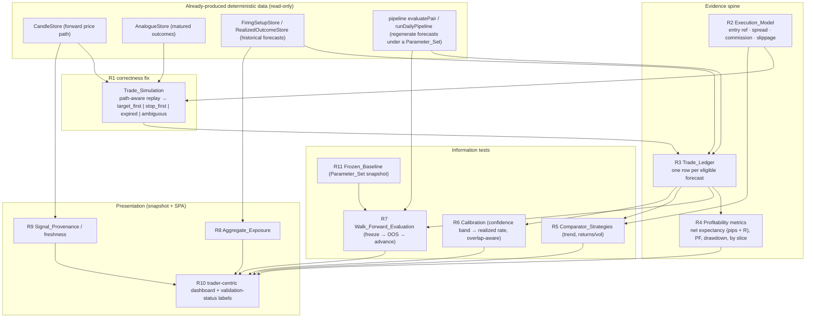

# Design Document

## Overview

This design turns the twelve requirements of `trader-edge-validation` into a
concrete plan. It adds an **evidence-and-honesty layer** on top of a
feature-complete system; it does not rebuild the pipeline, add trading features,
add AI, or add new tunable parameters. The spirit of the whole spec is the
project's first non-negotiable — *measure before believing* — applied to the
system itself: we build the machinery to decide whether the analogue engine has
a repeatable, cost-adjusted edge, and we stop presenting un-validated numbers as
if they were proven.

The work splits into four cohesive groups that share one dependency spine:

1. **The correctness fix (R1).** A new, path-aware **Trade_Simulation** that
   replays a proposed trade against the ACTUAL forward candle path and reports
   whether the stop or the target was hit first. This is a sibling of the
   existing forward-outcome resolver, which today computes MFE and MAE as two
   *independent* maxima and so cannot answer the order question.
2. **The evidence spine (R2, R3, R4).** An explicit **Execution_Model**, a
   deterministic **Trade_Ledger** built by running the Trade_Simulation over a
   date range, and the **profitability metrics** derived from that ledger.
3. **The information tests (R5, R6, R7, R11).** Comparator baselines, confidence
   calibration, and a walk-forward harness that freezes parameters — all run
   over the same ledger machinery, against a captured Frozen_Baseline.
4. **The presentation layer (R8, R9, R10).** Aggregate currency exposure, signal
   provenance / freshness, and a trader-centric dashboard re-organisation that
   labels un-validated numbers honestly.

R12 is a standing constraint woven through all of it: every new artifact is
deterministic and LLM-free, and the AI-never-scores guard stays provable.

### What this design deliberately does NOT do

- It adds **no new runtime dependency** (the core stays zero-dep; new modules use
  only Node built-ins and existing internal types).
- It adds **no automated execution, broker integration, new LLM feature, new
  third-party forecast provider, or new tunable fingerprint/threshold/risk
  parameter** (R12.2). The Execution_Model's costs are *measurement* inputs, not
  new signal knobs.
- It does **not change the live firing or scoring decision**. Every new module is
  a SEPARATE consumer of already-produced deterministic data, exactly like the
  existing `realizedOutcomeJournal` — recording or measuring leaves every v1
  computation byte-for-byte identical (R1.6, R6.5, R8.4, R10.7, R12.1).
- It does **not lower the Confidence_Threshold** to manufacture signal frequency;
  frequency becomes a reported metric, never an optimisation target (R12.3).

## Investigation findings that drive the design

Confirmed by reading the code; these resolve the design's hardest questions.

- **The forward-outcome resolver already walks the path we need — but discards
  order.** `src/retrieval/resolver.ts` `computeExcursions()` iterates the forward
  candles and takes `Math.max` of favorable and adverse moves independently, so
  `mfePips` and `maePips` are two separate maxima with no record of which came
  first. The stored `AnalogueRecord.mfePips/maePips` (and therefore the
  risk-boundary SL = 75th pct MAE / TP = median MFE) inherit this: **the data to
  answer "stop-first or target-first" exists in the forward candles but is thrown
  away at this step.** The Trade_Simulation is a sibling walker over the SAME
  forward candles that instead resolves per-candle touch order. We do NOT modify
  the resolver (its MFE/MAE feed existing scoring and must stay byte-identical);
  we add a parallel path-aware reader.
- **`toPips()` / JPY pip sizing already exists** in the resolver (`0.01` for JPY
  pairs, `0.0001` otherwise). The Trade_Simulation reuses the same pip convention
  so simulated pips are comparable to stored MFE/MAE pips. We lift the shared
  helper rather than re-deriving it.
- **The candle path is reachable through the existing `CandleStore` port.**
  `CandleStore.getCandles(asset, startDate?, endDate?)` returns the daily OHLC
  path; `getCoverageSummary()` gives per-pair `latestDate` for freshness (R9).
  No new storage shape is needed to read price history.
- **The storage-port + in-memory-reference pattern is the house convention.**
  `FiringSetupStore`, `AnalogueStore`, `RealizedOutcomeStore`,
  `EvaluationReportStore` each define a port interface plus an
  `InMemory…Store`, with a Supabase adapter in `src/storage`. New persisted
  artifacts (Trade_Ledger, Frozen_Baseline) follow this exactly.
- **The evaluation / RESEARCH-LOG path already exists and is verdict-free.**
  `src/kill-gate/verdict.ts` `composeEvaluationReport()` emits an
  `EvaluationReport` (metrics + Wald CI + non-binding annotations, NO
  PASS/CUT) persisted via `EvaluationReportStore` and appended to RESEARCH-LOG by
  the Living-Docs writer. The profitability / baseline / calibration / walk-forward
  outputs EXTEND this measured-report family; any PASS/CUT-style framing stays out
  of PROJECT-STATE.md and (where a verdict-like summary is produced) is routed to
  RESEARCH-LOG.md through the existing writer (R12.5).
- **The daily pipeline is a pure orchestration of module public APIs**
  (`src/pipeline/dailyPipeline.ts`), reading only through the three storage ports.
  The evaluation harness reuses `evaluatePair` / `runDailyPipeline` to regenerate
  historical forecasts under a given Parameter_Set rather than re-implementing the
  signal.
- **The SPA renders a static `dashboard.json` snapshot** (`src/scheduled-run/
  snapshot.ts`, schema v3) that the web reads once per load. New display slices
  (exposure, provenance, trade-ledger summaries, validation-status flags) are
  additive snapshot fields with a schema bump, mirroring how `pairEvaluations`
  (v2) and `dailyCommentary` (v3) were added — forward/backward tolerant, absent
  slice defaults to empty.

## Architecture

Two orderings and two invariants bound the whole design.

### Load-bearing invariants

- **Separate consumer, never a scoring input.** Every module here reads
  already-produced deterministic data and writes its own artifact. None feeds
  retrieval, Earned_Confidence, the firing decision, the risk boundaries, or the
  Measurement_Engine. This is enforced the same way the journal is: by
  construction (no import of these modules into the decision path) and by the
  `ScoringInputGuard` / `Deterministic<T>` guard for anything that touches a
  report metric (R12.1).
- **Deterministic and Look_Ahead_Safe.** Given stored inputs + a stated
  Parameter_Set + a stated Execution_Model, every artifact is reproducible
  byte-for-byte (R3.3). A Trade_Simulation uses only candles at or after entry and
  never information beyond the Horizon window to decide an earlier candle (R1.5).

### Load-bearing orderings

1. **Freeze before you measure (R11 → R5/R6/R7).** The current Parameter_Set is
   captured as a version-stamped Frozen_Baseline before any walk-forward or
   comparison, so a result is provably independent of later tuning (R7.2, R11.1).
2. **Ledger before metrics (R3 → R4/R5).** No summary metric is computed by a path
   that bypasses the Trade_Ledger; the ledger is the single source (R3.4).



### Module placement (new code)

All new backend modules live under `src/` beside their siblings and are reached
only through ports; nothing is added to the `web/`→core boundary.

- `src/trade-sim/` — Trade_Simulation (R1), Execution_Model (R2), pip helper.
- `src/trade-ledger/` — Trade_Ledger builder + store port + in-memory reference (R3).
- `src/performance/` — profitability metrics (R4), comparator strategies (R5),
  calibration (R6).
- `src/walk-forward/` — Parameter_Set / Frozen_Baseline capture (R11) and the
  walk-forward harness (R7).
- `src/exposure/` — Aggregate_Exposure computation (R8).
- `src/provenance/` — Signal_Provenance derivation (R9).
- `src/scheduled-run/snapshot.ts` — extended with additive display slices (R8–R10).
- `web/src/…` — new/renamed pure shapers + tab components for the re-org (R10).
- `src/ops/edge-eval/` — operator entrypoint to run the evaluation suite over a
  window (modelled on `src/ops/evaluation-run/main.ts`).

## Components and interfaces

### R1 — Trade_Simulation (path-aware)

A pure function that replays one proposed trade against the forward candle path.

```ts
// src/trade-sim/types.ts
export type TradeOutcomeKind = "target_first" | "stop_first" | "expired" | "ambiguous";

export interface TradeProposal {
  readonly pair: Pair;
  readonly decisionDate: TradingDate;
  readonly direction: Exclude<DirectionClass, "FLAT">; // only directional trades simulate
  readonly horizon: 1 | 2 | 3;
  readonly entryPrice: number;      // from the Execution_Model (R2)
  readonly entryDate: TradingDate;  // earliest realistic entry (R2.3)
  readonly stopLossPips: number;    // empirical SL (may be the current 75th-pct MAE)
  readonly takeProfitPips: number;  // empirical TP (may be the current median MFE)
}

export interface TradeOutcome {
  readonly kind: TradeOutcomeKind;
  readonly resolvedOnDate: TradingDate | null; // date SL/TP touched, null if expired/ambiguous
  readonly grossPips: number;                   // realized pips before costs (R2.2)
  readonly ambiguousCandleDate: TradingDate | null; // the same-candle collision, if any
}
```

```ts
// src/trade-sim/tradeSimulation.ts
export function simulateTrade(
  proposal: TradeProposal,
  forwardCandles: readonly Candle[], // candles with date in (entryDate, horizon expiry], chronological
): TradeOutcome;
```

Resolution rules (R1.1–R1.4):

- Convert `stopLossPips` / `takeProfitPips` to absolute price levels off
  `entryPrice`, using the shared pip helper lifted from the resolver (JPY vs
  non-JPY). For a long: `tp = entry + tpPips·pip`, `sl = entry − slPips·pip`;
  mirrored for a short.
- Walk candles in chronological order up to Horizon expiry. For each candle test
  whether its `[low, high]` range touches the stop level, the target level, both,
  or neither:
  - **neither** → continue to next candle.
  - **target only** → `target_first`, resolve here.
  - **stop only** → `stop_first`, resolve here.
  - **both in one candle** → the intra-candle order is unknown at D1 → classify
    `ambiguous`, record `ambiguousCandleDate`, do NOT assume the favourable fill
    (R1.2).
- If Horizon expiry is reached untouched → `expired`, with close-to-close realized
  pips recorded (R1.3).
- `grossPips`: `+takeProfitPips` for `target_first`, `−stopLossPips` for
  `stop_first`, signed close-to-close for `expired`, and `0` carried with the
  `ambiguous` kind (never silently a win or loss — R3.5).

Lower-timeframe disambiguation (R1.4) is an OPTIONAL seam: `simulateTrade` accepts
an optional `intraCandleResolver?(candleDate, pair) => "stop_first" | "target_first" | null`.
When absent (the D1-only default) a same-candle collision stays `ambiguous`. This
is the single place lower-timeframe data would plug in if later sourced; the open
question in the requirements is parked here and defaults to "report, don't guess".

Guarantees: pure (no I/O, no clock), deterministic, LLM-free (R1.6), and
Look_Ahead_Safe — it reads only `forwardCandles` the caller bounded to the Horizon
window (R1.5). It never writes to or reads from the scoring path; R1.7 is honored
at the presentation layer, which labels the current SL/TP un-validated until a
simulation establishes order (see R10 validation-status).

### R2 — Execution_Model

```ts
// src/trade-sim/executionModel.ts
export type EntryReference = "next_session_open"; // v1: the open after Signal_Provenance

export interface ExecutionCost {
  readonly spreadPips: number;
  readonly commissionPips: number; // round-trip, expressed in pips for comparability
  readonly slippagePips: number;
}

export interface ExecutionModel {
  readonly id: string;            // version-stamped name, reused by System AND comparators (R2.4)
  readonly entryReference: EntryReference;
  readonly perPairCost: Readonly<Record<Pair, ExecutionCost>>;
}

export function resolveEntry(                 // earliest realistic entry (R2.3)
  pair: Pair, decisionDate: TradingDate, candles: readonly Candle[],
): { entryPrice: number; entryDate: TradingDate } | null;

export function applyCosts(gross: TradeOutcome, model: ExecutionModel, pair: Pair): {
  readonly netPips: number;       // gross − spread − commission − slippage (R2.2, R4.5)
  readonly grossPips: number;     // retained for comparison
};
```

- The entry reference is the next session's open strictly AFTER the forecast is
  known (never the close the forecast was computed from — R2.3).
- A single named `ExecutionModel` is reused identically by the System and every
  Comparator_Strategy (R2.4). Sensitivity analysis (R2.5) is a thin loop that
  re-runs the ledger across a small set of `ExecutionModel` variants and reports
  how Net_Expectancy shifts.

### R3 — Trade_Ledger

```ts
// src/trade-ledger/types.ts
export interface TradeLedgerRow {
  readonly pair: Pair;
  readonly decisionDate: TradingDate;
  readonly strategyId: string;          // "system" or a comparator id (R5)
  readonly fired: boolean;              // false => a suppressed forecast included for selection eval (R3.2)
  readonly direction: DirectionClass;
  readonly horizon: 1 | 2 | 3;
  readonly earnedConfidence: number;
  readonly entryPrice: number;
  readonly entryDate: TradingDate;
  readonly stopLossPips: number | null;
  readonly takeProfitPips: number | null;
  readonly outcome: TradeOutcomeKind;   // includes "ambiguous" as a first-class value (R3.5)
  readonly grossPips: number;
  readonly costPips: number;
  readonly netPips: number;
  readonly rMultiple: number | null;    // net / risked distance; null when SL absent
}

export interface TradeLedgerStore {      // port + InMemory reference, Supabase adapter later
  appendRows(rows: readonly TradeLedgerRow[]): Promise<void>;
  getByWindow(from: TradingDate, to: TradingDate, strategyId?: string): Promise<readonly TradeLedgerRow[]>;
}
```

The builder (`buildTradeLedger`) takes a date window, a Parameter_Set (to
regenerate forecasts via `runDailyPipeline`), an Execution_Model, and the
`CandleStore`; for each eligible forecast it resolves entry (R2), simulates the
trade (R1), applies costs (R2), and emits one row. Suppressed forecasts are
emitted with `fired: false` so the selection rule itself can be evaluated (R3.2).
`ambiguous` rows are retained as their own category and never folded into
wins/losses (R3.5). The ledger is the sole source for every downstream metric
(R3.4).

### R4 — Profitability metrics

```ts
// src/performance/metrics.ts
export interface PerformanceSummary {
  readonly strategyId: string;
  readonly netExpectancyPips: number;
  readonly netExpectancyR: number;      // headline measure of edge (R4.6)
  readonly grossExpectancyPips: number; // for comparison (R4.5)
  readonly winRate: number;
  readonly avgWinPips: number;
  readonly avgLossPips: number;
  readonly profitFactor: number;
  readonly maxDrawdownPips: number;
  readonly longestLosingStreak: number;
  readonly tradeCount: number;
  readonly timeInMarketDays: number;
  readonly ambiguousShare: number;      // R4.4 — never hidden
  readonly expiredShare: number;
}

export function summarize(rows: readonly TradeLedgerRow[]): PerformanceSummary;
export function summarizeBySlice(                 // R4.3
  rows: readonly TradeLedgerRow[],
): { byPair; byHorizon; byDirection; byConfidenceBand };
```

Every figure is NET of costs with the gross retained (R4.5); directional accuracy
is reported but is explicitly NOT the headline — Net_Expectancy after costs is
(R4.6). `ambiguous` and `expired` shares are reported alongside wins/losses so the
headline cannot hide unresolved trades (R4.4).

### R5 — Comparator_Strategies

Each comparator implements a `ForecastSource` that produces the same
`{ direction, horizon, SL, TP }` shape the system does, so the SAME ledger builder,
Execution_Model, entry timing, and exit rules apply (R5.1, R5.3, R5.5):

- `trendContinuation` — direction = Weekly_Trend_Sign (reuse
  `src/baseline/baseline.ts`), fixed horizon.
- `returnsVolatility` — direction from recent return sign, risk from recent
  volatility (ATR_14, reusing `src/confidence/atr.ts`).
- optional `directionalCoinflip` — labelled directional-only reference (R5.2).

The comparison report places each strategy's `PerformanceSummary` side by side on
identical forecast timestamps. If the system does not beat the comparators net of
costs out-of-sample, the report states it plainly (R5.4, R12.6) — a negative
result is a valid outcome, surfaced, never grounds for adding complexity.

### R6 — Calibration

```ts
// src/performance/calibration.ts
export interface CalibrationBand {
  readonly lo: number; readonly hi: number;       // e.g. [0.55, 0.60)
  readonly forecastCount: number;
  readonly realizedCorrectRate: number;           // fraction resolving in predicted direction
  readonly effectiveSampleSize: number;           // overlap-adjusted (R6.4)
}
export interface CalibrationReport {
  readonly bands: readonly CalibrationBand[];
  readonly monotonic: boolean;                    // do higher bands resolve better? (R6.2)
  readonly wellCalibrated: boolean;               // |realized − midpoint| within tolerance per band
}
```

Calibration is measured out-of-sample from ledger rows (R6.1, R6.5). The
overlap adjustment (R6.4) discounts forecasts whose analogue neighborhoods share
windows / adjacent Decision_Dates, so a band's effective sample size is not
overstated — this is the quantification of the review's independence critique. The
`wellCalibrated` / `monotonic` split lets R10 decide whether confidence is shown as
a probability or only as a ranking (R6.3, R10.3).

### R7 — Walk_Forward_Evaluation and R11 — Frozen_Baseline

```ts
// src/walk-forward/parameterSet.ts
export interface ParameterSet {        // the full set of tunable choices (R7.3)
  readonly patternScales: readonly number[];       // [10,20,40]
  readonly similarityEpsilon: number;
  readonly analogueFloor: number;                  // 30
  readonly weeklyTrendFilter: boolean;
  readonly shrinkageWeight: number;                // k = 10
  readonly confidenceThreshold: number;            // 0.55
  readonly horizonSelection: "best_resolution" | "fixed"; // R7.4 — a fittable choice
  readonly stopLossPercentile: number;             // 75
  readonly takeProfitPercentile: number;           // 50
}
export interface FrozenBaseline {
  readonly id: string;                 // version stamp (R11.1)
  readonly capturedAt: string;
  readonly params: ParameterSet;
}
```

- R11: `captureFrozenBaseline()` reads the CURRENT live constants
  (`DEFAULT_PIPELINE_CONFIG`, `DEFAULT_CONFIDENCE_THRESHOLD`,
  `DEFAULT_STOP_LOSS_PERCENTILE`, etc.) into a version-stamped `FrozenBaseline`
  and persists it. Capture is read-only wrt the decision path (R11.3); it changes
  no live behaviour.
- R7: `walkForward(windows, baselineSelector)` selects the ParameterSet on an
  in-sample window, FREEZES it, builds the ledger + metrics ONLY on the next OOS
  window, records which FrozenBaseline produced each window's result (R7.2),
  advances, repeats. A final window is reservable and untouched until a
  ParameterSet is settled; each result records whether it used the reserved window
  (R7.5). A window already tuned against is flagged non-independent (R7.6). Horizon
  selection is part of the frozen ParameterSet so it cannot inflate OOS results
  (R7.4).

### R8 — Aggregate_Exposure

```ts
// src/exposure/aggregateExposure.ts
export interface CurrencyExposure { readonly currency: string; readonly net: number; }
export interface ExposureSummary {
  readonly perCurrency: readonly CurrencyExposure[];
  readonly concentrated: boolean;                 // one effective directional currency bet (R8.2)
  readonly strongestPair: Pair | null;            // distinguish strongest from alternatives (R8.3)
}
export function aggregateExposure(firing: readonly FiringSetupRow[]): ExposureSummary;
```

For each firing pair, decompose its direction into base/quote currency legs
(EURUSD long = +EUR, −USD) and sum per currency. `concentrated` flags when the
firing set collapses to effectively one currency bet (notably USD across the four
USD-legged pairs). Pure, deterministic, LLM-free, information-only — no sizing, no
re-entry into firing (R8.4, R8.5).

### R9 — Signal_Provenance / freshness

```ts
// src/provenance/signalProvenance.ts
export interface SignalProvenance {
  readonly pair: Pair;
  readonly lastCandleTimestamp: string;   // ISO + explicit tz (R9.1, R9.4)
  readonly computedAt: string;
  readonly earliestEntryRef: string;      // the R2 next-session-open reference
  readonly horizonStart: string;
  readonly horizonEnd: string;
  readonly dataComplete: boolean;         // false => mark unavailable (R9.2)
  readonly staleReason: "holiday" | "missing_candle" | "weekend_gap" | "stale" | null; // R9.3
}
```

Derived deterministically from `CandleStore` coverage + the run's clock at snapshot
time, carrying no LLM field (R9.5). A forecast whose inputs are incomplete/stale is
marked `dataComplete: false` and surfaced as unavailable rather than published as
normal (R9.2, R9.3). The daily-candle freshness spec already computes
`mostRecentCompletedTradingDay` and per-pair latest dates; provenance reuses those.

### R10 — Honest, trader-centric presentation

A snapshot schema bump (v3 → v4) adds additive slices — `tradeLedgerSummary`
(per-strategy `PerformanceSummary` + comparator rows), `calibration`, `exposure`,
and per-forecast `provenance` + a `validationStatus` flag (`validated` |
`unvalidated`) — each defaulting to empty/absent for forward/backward tolerance.
The SPA changes are presentation-only and never alter firing/scoring (R10.7):

- **Setups** stays the landing page, now grouping per firing pair: direction,
  entry assumption, SL, TP, horizon expiry, estimated Net_Expectancy, analogue
  count, historical agreement, with an explicit FORECAST-vs-TRADE label (R10.1).
- Any confidence / SL / TP / metric not yet validated OOS is rendered with an
  explicit **un-validated** marker (R10.3) — this is where R1.7 is honored: the
  current independently-derived SL/TP shows as un-validated until a
  Trade_Simulation establishes order.
- The evaluation view leads with OOS Net_Expectancy, drawdown, profit factor,
  trade count, after-cost results, the baseline under identical assumptions, and
  whether the sample is large enough / consistent across time (R10.2).
- Historical evidence (analogues + their path-resolved outcomes) is shown BEFORE
  and more prominently than AI commentary (R10.4). AI and Third-party move out of
  the primary workflow and stay advisory/non-scoring; the suppression list
  explains exclusions without out-prominencing opportunities (R10.5).
- Context-only fields with no demonstrated decision value (e.g.
  Choppiness_Metric) lose primary-screen prominence (R10.6).

## Data models

New persisted tables mirror the existing storage-port convention (port +
`InMemory…Store` reference + Supabase adapter):

- `trade_ledger` — one row per `TradeLedgerRow`, keyed `(strategy_id, pair,
  decision_date)`; append/upsert idempotent on that key.
- `frozen_baselines` — one row per `FrozenBaseline`, keyed by `id`; append-only.

Metrics, calibration, comparison, walk-forward results, exposure, and provenance
are DERIVED (computed from the ledger / stored forecasts on demand or at snapshot
time) and are not separate source-of-truth tables; they are serialised into
`dashboard.json` slices for the SPA. Evaluation-style summaries that warrant a
durable research record are routed through the existing `EvaluationReport` /
RESEARCH-LOG path, not PROJECT-STATE.md (R12.5).

## Error handling

- **Fail-safe, data-first (carried over).** A missing forward candle, an
  unreadable coverage summary, or an empty window degrades to an explicit empty
  result with a secret-free log; it never crashes the daily run or corrupts stored
  rows. The snapshot write is already fail-safe and swallows its own errors.
- **Ambiguity is data, not failure.** `ambiguous` outcomes are a reported
  category, counted and surfaced, never dropped or coerced (R1.2, R3.5, R4.4).
- **Insufficient sample is stated, not hidden.** Calibration bands and walk-forward
  windows below a usable sample size are reported as such rather than presented as
  conclusions (R6, R10.2).
- **No secret values** are logged or written to any artifact; credentials are
  referenced by name only.

## Testing strategy

Mirrors the project's Vitest + fast-check convention; `make check` and the web
build stay green at every step (R12).

- **R1 property tests:** (a) a stop placed inside the first forward candle's range
  with a far target always yields `stop_first`; (b) a candle whose range contains
  BOTH levels yields `ambiguous` and never a win; (c) determinism — identical
  inputs yield identical `TradeOutcome`; (d) Look_Ahead_Safety — candles beyond
  the Horizon window cannot change an earlier resolution.
- **R3/R4 tests:** the ledger is the sole metric source (a metric recomputed from
  rows equals the summary); `ambiguous`/`expired` never counted as win/loss;
  per-slice sums reconcile to the whole.
- **R5 fairness test:** system and comparators consume the identical
  `ExecutionModel` and entry timing; a differing cost model is a test failure.
- **R6 test:** a synthetic set with known resolution rates reproduces the expected
  band rates; the overlap adjustment lowers effective sample size when neighborhoods
  share windows.
- **R7 test:** a parameter chosen on the in-sample window is provably frozen before
  the OOS window is scored; a window flagged tuned-against is marked non-independent.
- **AI-never-scores guardrail (R12.1):** retarget the existing
  `evaluationReportAiFree` property style at the new report paths — an LLM-tagged
  value handed to any metric path is BLOCKED + RECORDED by `ScoringInputGuard`, and
  generating rationale leaves every new summary byte-identical.
- **Web tests:** the new pure shapers (exposure, provenance, validation-status,
  ledger summary) render loading / empty / content / un-validated states from a
  snapshot without a live network, matching the injected-loader pattern already in
  `SetupsTab`.

## Sequencing (maps to the requirements' P0/P1/P2)

1. **P0 correctness + honesty:** R1 Trade_Simulation + R2 Execution_Model; R9
   provenance; R10.3 un-validated labelling (so a trader stops reading the current
   SL/TP as proven immediately).
2. **P0 evidence spine:** R3 Trade_Ledger → R4 metrics.
3. **P1 information tests:** R11 Frozen_Baseline → R5 comparators, R6 calibration,
   R7 walk-forward.
4. **P1 portfolio honesty:** R8 Aggregate_Exposure.
5. **P2 presentation re-org:** remaining R10 criteria + the operator
   `src/ops/edge-eval/` entrypoint.

R12 is verified continuously as a standing guard across all of the above.
