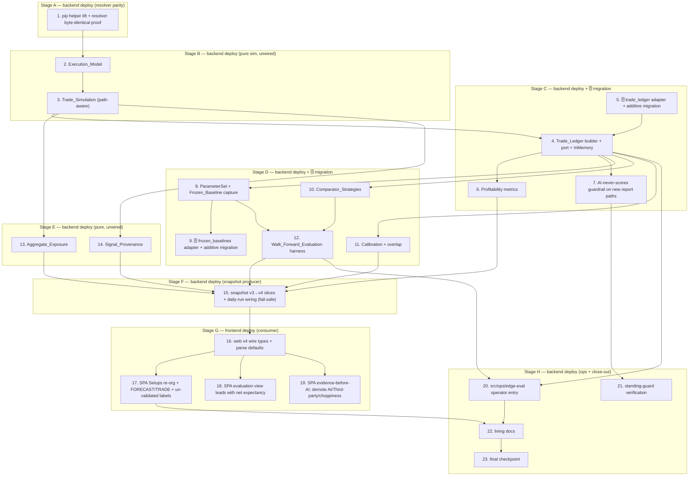

# Implementation Plan: Trader Edge Validation

## Overview

This plan turns the design into incremental, test-driven coding tasks, grouped
into **deployable stages**. It adds an **evidence-and-honesty layer** on top of a
feature-complete system; it does not rebuild the pipeline, add trading features,
add AI, add new providers, or add new tunable fingerprint/threshold/risk
parameters (R12.2).

### What "deployable stage" means here

The operator's delivery cadence is incremental: implement a stage, merge dev→main,
the two-target path-filtered pipeline deploys the **backend Cloud Run Job** and/or
the **frontend SPA**, verify, then the next stage. So the unit of work is not a
single file — it is **a self-contained increment that is safe to ship on its own**.
Every stage below satisfies all of these **deploy-safety invariants**:

- **Green at the stage boundary.** `make check` (lint + typecheck + vitest) and
  the web build pass at the end of the stage. Tests inject in-memory stores / stubs
  so **no live network** is touched (R12.1).
- **The live firing/scoring decision stays byte-identical.** Every module added
  here is a SEPARATE read-only consumer of already-produced deterministic data
  (like `realizedOutcomeJournal`); none feeds retrieval, confidence, firing, risk,
  or the Measurement_Engine. A stage that ships changes the daily Job's *output
  artifacts* at most, never its decision (R12.1, R12.4).
- **No half-exposed contract.** A stage never ships a reader of a table/snapshot
  field that a prior stage has not already created, and never ships a producer that
  a consumer in the same deploy depends on existing first. The explicit expand-only
  ordering below guarantees this.
- **The daily run never breaks.** New snapshot slices are additive and
  fail-safe: a slice that fails to compute degrades to empty with a secret-free log
  and the run still publishes `dashboard.json` (the snapshot write is already
  fail-safe and swallows its own errors).

### The three deploy-safety orderings that shape the stages

1. **Prove the shared helper byte-identical before building on it.** The pip-helper
   lift out of `src/retrieval/resolver.ts` must demonstrate the resolver's live
   MFE/MAE outputs are unchanged (they feed scoring) BEFORE any new module imports
   it. This is Stage A and ships alone.
2. **Expand the schema before the code that uses it (expand-only).** Each new table
   (`trade_ledger`, `frozen_baselines`) is created by an additive migration that
   drops nothing and touches no existing table, applied by the operator after a
   backup. A freshly-created empty additive table is inert, so the migration can
   ship in the same stage as the adapter+builder that writes it — but the migration
   is listed first and the adapter degrades gracefully if, in a torn deploy, the
   table is briefly absent (fail-safe read → empty).
3. **Producer before consumer across the backend/web split.** The backend v4
   snapshot producer ships (and the daily Job republishes `dashboard.json`) BEFORE
   the SPA that renders the new slices. This is safe in both directions by
   construction — the SPA defaults unknown slices to empty (as it did for the v2
   `pairEvaluations` and v3 `dailyCommentary` additions) and the backend tolerates
   an old SPA — but producer-first means the data is already present when the new UI
   deploys, so the first post-deploy render is populated, not empty.

### Stage map (each row is one mergeable, deploy-safe increment)

| Stage | Ships | Deploys | Live-decision impact | Requirements |
|-------|-------|---------|----------------------|--------------|
| **A** | Pip-helper lift + resolver parity proof | backend | none (resolver byte-identical) | R1.1, R12.1 |
| **B** | Trade_Simulation + Execution_Model (pure, unwired) | backend | none (not yet called in the daily run) | R1, R2 |
| **C** | Trade_Ledger + 🗄️ `trade_ledger` migration + metrics + AI-guard | backend | none (offline/ops read path only) | R3, R4, R12.1 |
| **D** | Frozen_Baseline + 🗄️ `frozen_baselines` migration + comparators + calibration + walk-forward | backend | none (offline/ops read path only) | R11, R5, R6, R7 |
| **E** | Aggregate_Exposure + Signal_Provenance (pure, unwired) | backend | none (not yet in snapshot) | R8, R9 |
| **F** | Snapshot v3→v4 producer (backend) + daily-run wiring | backend | output only: adds additive slices to `dashboard.json`; decision unchanged | R8.1, R9.1, R10.1–10.3 |
| **G** | Web v4 wire types + SPA re-org (consumer) | frontend | SPA presentation only | R10.1–10.7, R1.7 |
| **H** | `src/ops/edge-eval` operator entry + standing-guard verification + living docs + final checkpoint | backend | none (operator-run) | R12 |

Stages A→H are strictly ordered by the three orderings above. Within a stage,
tasks may be done in any order unless noted. ☁️ marks any operator-gated live
action; here the only live touches are the two additive 🗄️ migrations in Stages C
and D, applied on the normal deploy cadence after a backup.

## Task Dependency Graph

Each wave below is exactly one deployable stage (A–H); the `stage` label is carried
alongside so the mapping to the table above is explicit.

```json
{
  "waves": [
    { "id": 0, "stage": "A", "tasks": ["1"] },
    { "id": 1, "stage": "B", "tasks": ["2", "3"] },
    { "id": 2, "stage": "C", "tasks": ["4", "5", "6", "7"] },
    { "id": 3, "stage": "D", "tasks": ["8", "9", "10", "11", "12"] },
    { "id": 4, "stage": "E", "tasks": ["13", "14"] },
    { "id": 5, "stage": "F", "tasks": ["15"] },
    { "id": 6, "stage": "G", "tasks": ["16", "17", "18", "19"] },
    { "id": 7, "stage": "H", "tasks": ["20", "21", "22", "23"] }
  ]
}
```



> **🗄️ migration tasks** add two NEW tables (`trade_ledger`, `frozen_baselines`)
> via additive forward migrations applied on the operator's normal deploy cadence
> after a fresh backup; they drop nothing and touch no existing table. The adapters
> read fail-safe (absent table → empty), so a torn deploy (code live before the
> migration is applied, or vice versa) never breaks the daily run. No secret value
> appears in any migration, adapter, log, or this spec.

Test sub-tasks are marked optional with `*`. Core implementation and migration
tasks are never optional. Each `fast-check` property test runs ≥100 iterations, is
tagged `// Feature: trader-edge-validation, Property N: ...` (consistent with the
existing `*.property.test.ts` suites in `src/confidence`, `src/baseline`,
`src/csv-loader`), and carries a `**Validates: Requirements X.Y**` line matching
the design.

## Tasks

### Stage A — Pip-helper lift + resolver parity (backend deploy; design R1.1)

Ships alone so the byte-identical resolver proof lands before anything builds on
the shared helper. Deploy impact: none — the resolver's live MFE/MAE are proven
unchanged.

- [x] 1. Lift the shared pip helper out of the resolver, proving parity
  - Create `src/trade-sim/pip.ts` exporting `pipSize(pair)` (`0.01` for JPY pairs,
    `0.0001` otherwise), `toPips(priceDiff, pair)` and `fromPips(pips, pair)`,
    matching the exact convention currently inlined in `src/retrieval/resolver.ts`.
  - Replace the resolver's private pip copies with the shared functions and assert
    NO numeric change (the resolver's MFE/MAE feed live scoring and MUST stay
    byte-identical — this is the deploy-safety gate for the whole spec).
  - **Stage exit:** `make check` green; resolver output byte-identical on a fixed
    candle fixture.
  - _Requirements: 1.1, 12.1_

  - [x] 1.1 Property test — pip round-trip and resolver parity
    - `fromPips(toPips(d, pair), pair)` recovers `d` within fp tolerance for JPY
      and non-JPY pairs; the resolver's outputs are identical before vs. after the
      lift on a fixed fixture.
    - _Requirements: 1.1, 12.1_

### Stage B — Trade_Simulation + Execution_Model (backend deploy; design R1, R2)

Pure modules, not yet wired into the daily run, so deploying them changes no
behaviour. Ships as one increment because the simulation needs the model.

- [x] 2. Implement the Execution_Model (R2)
  - Create `src/trade-sim/executionModel.ts`: `ExecutionModel` (`id`,
    `entryReference: "next_session_open"`, `perPairCost` of `{ spreadPips,
    commissionPips, slippagePips }`), `resolveEntry(pair, decisionDate, candles)`
    returning the next session open STRICTLY after the forecast is known (never the
    close it was computed from — R2.3), and `applyCosts(outcome, model, pair)` →
    `{ netPips, grossPips }`. One version-stamped default model reused verbatim by
    the System and every comparator (R2.4). Costs are measurement inputs, not
    signal knobs (R12.2).
  - _Requirements: 2.1, 2.2, 2.3, 2.4_

  - [x] 2.1 Unit + property tests for the Execution_Model
    - `resolveEntry` never returns a date ≤ the decision date and never the
      forecast's own close (R2.3); `applyCosts` reduces gross by exactly
      spread+commission+slippage and retains gross; `netPips ≤ grossPips` for a win.
    - _Requirements: 2.2, 2.3, 2.5_

- [x] 3. Implement the path-aware Trade_Simulation (R1 — the defect fix)
  - Create `src/trade-sim/types.ts` (`TradeOutcomeKind`, `TradeProposal`,
    `TradeOutcome`) and `src/trade-sim/tradeSimulation.ts`
    `simulateTrade(proposal, forwardCandles, intraCandleResolver?)`: convert SL/TP
    pips to absolute levels off `entryPrice`; walk forward candles chronologically
    to Horizon expiry; per candle resolve `target_first` / `stop_first` / `expired`,
    and classify `ambiguous` when a SINGLE candle's `[low, high]` touches BOTH
    levels and no resolver disambiguates (never assume the favourable fill — R1.2).
  - `grossPips`: `+takeProfitPips` (`target_first`), `−stopLossPips` (`stop_first`),
    signed close-to-close (`expired`), `0` carried with `ambiguous`. Pure,
    deterministic, Look_Ahead_Safe, LLM-free (R1.5, R1.6). The optional
    `intraCandleResolver` is the SINGLE seam for lower-timeframe data; absent = the
    D1 default "report, don't guess" (R1.4). Do NOT source lower-timeframe data in
    this spec.
  - **Stage exit:** `make check` green; nothing in the daily run calls the new
    module yet, so live output is unchanged.
  - _Requirements: 1.1, 1.2, 1.3, 1.4, 1.5, 1.6_

  - [x] 3.1 Property tests for Trade_Simulation
    - (a) stop inside the first forward candle with a far target ⇒ `stop_first`;
      (b) a candle containing BOTH levels ⇒ `ambiguous`, never a win/loss (R1.2);
      (c) determinism; (d) Look_Ahead_Safety — candles beyond the Horizon window
      cannot change an earlier resolution (R1.5).
    - _Requirements: 1.1, 1.2, 1.3, 1.5_

### Stage C — Trade_Ledger + metrics + AI guard (backend deploy + 🗄️ migration; design R3, R4)

Introduces the first new table. The migration is additive (empty table is inert);
the adapter reads fail-safe so a torn deploy never breaks the Job. The ledger is an
offline/ops read path — the daily run does not build it, so live behaviour is
unchanged.

- [x] 4. Trade_Ledger builder, port, and in-memory reference (R3)
  - Create `src/trade-ledger/types.ts` (`TradeLedgerRow`, `TradeLedgerStore` port)
    and `InMemoryTradeLedgerStore` (idempotent upsert on `(strategyId, pair,
    decisionDate)`, `getByWindow`), mirroring `FiringSetupStore` /
    `RealizedOutcomeStore`.
  - Create `src/trade-ledger/buildTradeLedger.ts`: over a date window, per eligible
    forecast resolve entry (R2) → `simulateTrade` (R1) → `applyCosts` (R2) → one
    row; include SUPPRESSED forecasts with `fired: false` (R3.2); carry `ambiguous`
    as a first-class value never folded into win/loss (R3.5); deterministic and
    reproducible from stored inputs + a stated Parameter_Set + Execution_Model
    (R3.3).
  - _Requirements: 3.1, 3.2, 3.3, 3.5_

  - [x] 4.1 Property tests for the ledger builder
    - One row per eligible forecast; suppressed present with `fired: false`;
      `ambiguous`/`expired` kept as own categories; identical inputs ⇒ identical
      ledger (R3.3).
    - _Requirements: 3.1, 3.2, 3.3, 3.5_

- [x] 5. 🗄️ Supabase `trade_ledger` adapter + additive migration
  - Add `supabase/migrations/…_trade_ledger.sql` creating `trade_ledger` keyed
    `(strategy_id, pair, decision_date)` (additive; drops nothing; touches no
    existing table). Implement `SupabaseTradeLedgerStore` in `src/storage` via the
    existing `SupabaseRestClient`, `fx_writer`-writable, reading **fail-safe**
    (absent table / error → empty, secret-free log) so a torn deploy is harmless.
  - **Deploy note:** operator applies the migration after a backup on the normal
    cadence; order within the deploy does not matter because the table is additive
    and the adapter degrades gracefully.
  - _Requirements: 3.1, 3.4_

- [x] 6. Profitability metrics (R4)
  - Create `src/performance/metrics.ts`: `summarize(rows)` → `PerformanceSummary`
    (net expectancy in pips AND R, gross retained, win rate, avg win, avg loss,
    profit factor, max drawdown, longest losing streak, trade count, time in
    market, `ambiguousShare`, `expiredShare`) and `summarizeBySlice(rows)` (by
    pair / horizon / direction / confidence band). Net-of-cost expectancy is the
    headline, not directional accuracy (R4.6); every figure NET with gross retained
    (R4.5); all metrics derive SOLELY from ledger rows (R3.4).
  - _Requirements: 4.1, 4.2, 4.3, 4.4, 4.5, 4.6_

  - [x] 6.1 Property tests for metrics
    - A metric recomputed from rows equals the summary (R3.4); per-slice sums
      reconcile to the whole (R4.3); `ambiguous`/`expired` never counted as
      win/loss (R4.4).
    - _Requirements: 4.3, 4.4_

- [x] 7. AI-never-scores guardrail on the new report paths (R12.1)
  - Add a property suite (retargeting the `evaluationReportAiFree` style) proving
    an LLM-tagged value handed to any new ledger / metric path is BLOCKED +
    RECORDED by `ScoringInputGuard`, and that generating rationale leaves every new
    summary BYTE-IDENTICAL.
  - **Stage exit:** `make check` green; metrics derive solely from the ledger;
    migration additive-only; adapter fail-safe; no scoring path touched.
  - _Requirements: 12.1_

### Stage D — Frozen_Baseline + comparators + calibration + walk-forward (backend deploy + 🗄️ migration; design R11, R5, R6, R7)

Introduces the second new table (same additive/fail-safe rules) and the full
information-test suite. All offline/ops read paths; the daily run is untouched.
Freeze-before-measure is honored: the baseline capture (task 8) precedes the
walk-forward (task 12).

- [x] 8. Capture the current Parameter_Set as a Frozen_Baseline (R11)
  - Create `src/walk-forward/parameterSet.ts` (`ParameterSet`, `FrozenBaseline`)
    and `captureFrozenBaseline()` reading the CURRENT live constants verbatim
    (`DEFAULT_PIPELINE_CONFIG` scales/epsilon/windowSize,
    `DEFAULT_CONFIDENCE_THRESHOLD`=0.55, `RISK_BOUNDARY_FLOOR`=30,
    `DEFAULT_STOP_LOSS_PERCENTILE`=75, `DEFAULT_TAKE_PROFIT_PERCENTILE`=50,
    shrinkage `k`=10, horizon-selection rule) into a version-stamped
    `FrozenBaseline`. Capture is READ-ONLY wrt the live decision path (R11.3).
  - _Requirements: 11.1, 11.2, 11.3, 7.3_

  - [x] 8.1 Unit test — capture is faithful and read-only
    - The captured `ParameterSet` equals the live defaults field-for-field;
      capturing changes no live constant.
    - _Requirements: 11.1, 11.3_

- [x] 9. 🗄️ Supabase `frozen_baselines` adapter + additive migration
  - Add `supabase/migrations/…_frozen_baselines.sql` creating `frozen_baselines`
    keyed by `id` (append-only; additive) and `SupabaseFrozenBaselineStore`,
    `fx_writer`-writable, reading fail-safe (absent table → empty).
  - _Requirements: 11.1, 11.2_

- [x] 10. Comparator_Strategies (R5)
  - Create `src/performance/comparators.ts`: a `ForecastSource` producing the same
    `{ direction, horizon, SL, TP }` shape as the system, with `trendContinuation`
    (reuse `predictBaseline`/`weeklyTrendSign` from `src/baseline`),
    `returnsVolatility` (reuse `atr14` from `src/confidence/atr.ts`), and an
    optional labelled `directionalCoinflip` (R5.2). Each runs through the SAME
    `buildTradeLedger` + `ExecutionModel` + entry/exit rules (R5.1, R5.3, R5.5).
    `compareStrategies()` places each `PerformanceSummary` side by side on
    identical timestamps and states plainly when the system does NOT beat the
    comparators net of costs OOS (R5.4, R12.6).
  - _Requirements: 5.1, 5.2, 5.3, 5.4, 5.5_

  - [x] 10.1 Fairness property test
    - System and comparators consume the IDENTICAL `ExecutionModel` and entry
      timing on the same timestamps; a differing model is a test failure (R5.5).
    - _Requirements: 5.3, 5.5_

- [x] 11. Calibration with the overlap adjustment (R6)
  - Create `src/performance/calibration.ts`: bucket OOS forecasts by
    Earned_Confidence band; per band report `realizedCorrectRate`, `forecastCount`,
    and an `effectiveSampleSize` discounted for analogue OVERLAP (shared windows /
    adjacent Decision_Dates — R6.4); report `monotonic` (R6.2) and `wellCalibrated`
    (R6.1) separately. Deterministic, OOS, LLM-free (R6.5).
  - _Requirements: 6.1, 6.2, 6.3, 6.4, 6.5_

  - [x] 11.1 Property test for calibration
    - A synthetic set with known resolution rates reproduces the expected band
      rates; the overlap adjustment LOWERS effective sample size when neighborhoods
      share windows (R6.4).
    - _Requirements: 6.1, 6.4_

- [x] 12. Walk_Forward_Evaluation harness (R7)
  - Create `src/walk-forward/walkForward.ts`: select the `ParameterSet` on an
    in-sample window, FREEZE it, build the ledger + metrics ONLY on the next OOS
    window (reusing `runDailyPipeline`/`evaluatePair` to regenerate forecasts under
    the frozen set — never re-implementing the signal), record which
    `FrozenBaseline` produced each window's result (R7.2), advance, repeat. Horizon
    selection is part of the frozen set (R7.4). Support a reservable untouched final
    window and record whether a result used it (R7.5); flag a tuned-against window
    as non-independent (R7.6).
  - **Stage exit:** `make check` green; the freeze is provable; both migrations
    additive-only; adapters fail-safe; a negative "system does not beat baselines"
    result renders plainly, not hidden.
  - _Requirements: 7.1, 7.2, 7.3, 7.4, 7.5, 7.6_

  - [x] 12.1 Property test for the freeze
    - A parameter chosen on the in-sample window is provably frozen before the OOS
      window is scored; a tuned-against window is marked non-independent (R7.6).
    - _Requirements: 7.1, 7.2, 7.6_

### Stage E — Aggregate_Exposure + Signal_Provenance (backend deploy; design R8, R9)

Two pure modules, not yet wired into the snapshot, so deploying them changes
nothing live. Grouped because both are small inputs the Stage F snapshot needs.

- [ ] 13. Aggregate_Exposure (R8)
  - Create `src/exposure/aggregateExposure.ts`: decompose each firing pair's
    direction into base/quote currency legs, sum per currency, flag `concentrated`
    when the firing set collapses to effectively one currency bet (notably USD
    across the four USD-legged pairs), and surface `strongestPair` distinct from
    the alternatives (R8.3). Pure, deterministic, LLM-free, information-only — no
    sizing, no re-entry into firing/scoring (R8.4, R8.5).
  - _Requirements: 8.1, 8.2, 8.3, 8.4, 8.5_

  - [ ] 13.1 Unit test for exposure
    - Three long-USD firings ⇒ `concentrated: true`, net USD = −3 legs; independent
      pairs ⇒ `concentrated: false` (R8.1, R8.2).
    - _Requirements: 8.1, 8.2_

- [ ] 14. Signal_Provenance (R9)
  - Create `src/provenance/signalProvenance.ts`: derive `SignalProvenance`
    (`lastCandleTimestamp` with explicit tz, `computedAt`, `earliestEntryRef`,
    `horizonStart`/`horizonEnd`, `dataComplete`, `staleReason`) deterministically
    from `CandleStore` coverage + the run clock, carrying no LLM field (R9.5). Mark
    `dataComplete: false` with a `staleReason` for holiday / missing candle /
    weekend gap / stale (R9.2, R9.3). Reuse `mostRecentCompletedTradingDay` from the
    daily-candle freshness module (R9.4).
  - **Stage exit:** `make check` green; neither module is referenced by the daily
    run or snapshot yet.
  - _Requirements: 9.1, 9.2, 9.3, 9.4, 9.5_

  - [ ] 14.1 Unit test for provenance
    - A stale pair ⇒ `dataComplete: false` + the right `staleReason`; a fresh pair ⇒
      complete provenance with `earliestEntryRef` strictly after the last candle.
    - _Requirements: 9.2, 9.3_

### Stage F — Snapshot v3→v4 producer + daily-run wiring (backend deploy; design R10)

The producer side of the backend/web split. Ships BEFORE the web consumer so the
new slices exist in `dashboard.json` when the UI deploys. Backward/forward safe:
the current SPA ignores unknown slices.

- [ ] 15. Extend the snapshot to v4 and wire the daily run (fail-safe)
  - In `src/scheduled-run/snapshot.ts` bump `SNAPSHOT_SCHEMA_VERSION` 3→4 and add
    additive, forward/backward-tolerant slices: `tradeLedgerSummary` (per-strategy
    `PerformanceSummary` + comparator rows), `calibration`, `exposure`, and
    per-forecast `provenance` + a `validationStatus` (`validated` | `unvalidated`)
    flag. Each defaults to empty/absent (mirrors the v2 `pairEvaluations` / v3
    `dailyCommentary` additions).
  - Wire `main.ts` `persistView` to populate the slices from the deterministic
    artifacts; a slice that fails to compute degrades to empty with a secret-free
    log so the run still publishes `dashboard.json` (fail-safe).
  - **Stage exit:** `make check` green; after the operator deploys the backend and
    the Job re-runs, the live `dashboard.json` is v4 with the new slices, and the
    still-current SPA renders unchanged (defaults the unknown slices). The firing
    decision is byte-identical — only the output artifact grew.
  - _Requirements: 10.1, 10.2, 10.3, 8.1, 9.1_

### Stage G — Web v4 consumer + SPA re-org (frontend deploy; design R10)

The consumer side. Deploys the SPA only; presentation-only, no decision impact.
Safe against both a v3 and a v4 snapshot.

- [ ] 16. Mirror the v4 slices in the web wire types + parser
  - In `web/src/api/types.ts` + `snapshot.ts` add the mirrored slice types and
    `parseSnapshot` defaults (empty array / absent object), structurally
    independent of the core (the SPA never imports from the core). This lands first
    in the stage so the re-org tasks can consume it.
  - _Requirements: 10.1, 10.2, 10.3_

- [ ] 17. SPA — Setups re-org, FORECAST/TRADE distinction, un-validated labels
  - Re-shape the Setups landing tab to group, per firing pair: direction, entry
    assumption, SL, TP, horizon expiry, estimated Net_Expectancy, analogue count,
    historical agreement, with an explicit FORECAST-vs-TRADE label (R10.1). Render
    any confidence / SL / TP / metric not yet validated OOS with an explicit
    **un-validated** marker (R10.3) — honoring R1.7: the current
    independently-derived SL/TP shows un-validated until a Trade_Simulation
    establishes order. New pure shapers tested from a snapshot with no network.
  - _Requirements: 10.1, 10.3, 1.7_

  - [ ] 17.1 Web tests for the Setups re-org
    - Loading / empty / content / un-validated states render from an injected
      snapshot; an un-validated SL/TP shows the marker.
    - _Requirements: 10.1, 10.3_

- [ ] 18. SPA — evaluation view leads with net-of-cost results
  - Re-shape the evaluation (Gate) tab to lead with OOS Net_Expectancy, drawdown,
    profit factor, trade count, after-cost results, the baseline under identical
    assumptions, and whether the sample is large enough / consistent across time
    (R10.2).
  - _Requirements: 10.2_

- [ ] 19. SPA — evidence before AI; demote AI, Third-party, and choppiness
  - Show the historical evidence (analogues + their path-resolved outcomes) before
    and more prominently than any AI commentary (R10.4); move AI and Third-party out
    of the primary workflow, kept advisory/non-scoring; keep the suppression list
    explanatory without out-prominencing opportunities (R10.5); remove primary-screen
    prominence from context-only fields with no demonstrated decision value, e.g.
    Choppiness_Metric (R10.6).
  - **Stage exit:** web build + `npm run test` green; the SPA renders the new
    trader-centric layout against the live v4 snapshot and still degrades cleanly
    against a v3 one.
  - _Requirements: 10.4, 10.5, 10.6, 10.7_

### Stage H — Operator entry + close-out (backend deploy; design R12)

- [ ] 20. Operator entry: `src/ops/edge-eval/main.ts`
  - A run-to-completion operator entry (modelled on `src/ops/evaluation-run/main.ts`,
    injectable deps, `invokedDirectly()` guard) that runs the evaluation suite over
    a window: capture/choose a Frozen_Baseline, build the ledger, compute metrics +
    comparators + calibration + walk-forward, emit a secret-free summary. Any
    verdict-like summary routes to RESEARCH-LOG.md via the existing
    EvaluationReport / Living-Docs path — never PROJECT-STATE.md (R12.5).
  - _Requirements: 12.1, 12.5_

- [ ] 21. Standing-guard verification (R12 scope discipline)
  - A test/assertion suite confirming the spec added NO automated execution, broker
    integration, new LLM feature, new third-party forecast provider, or new tunable
    fingerprint/threshold/risk parameter (R12.2), and that the Confidence_Threshold
    constant is unchanged (frequency is a reported metric, never lowered to
    manufacture signals — R12.3). Confirm every new artifact is deterministic +
    LLM-free and the live decision path is byte-identical (R12.1, R12.4).
  - _Requirements: 12.1, 12.2, 12.3, 12.4_

- [ ] 22. Living docs
  - Update PROJECT-STATE.md prose (code map: the new `src/trade-sim/`,
    `src/trade-ledger/`, `src/performance/`, `src/walk-forward/`, `src/exposure/`,
    `src/provenance/`, `src/ops/edge-eval/` modules; the two new tables; the v4
    snapshot) and this spec's status. Record any measured edge finding in
    RESEARCH-LOG.md via the Living-Docs path, NOT PROJECT-STATE.md (R12.5).
  - _Requirements: 12.5_

- [ ] 23. Final checkpoint
  - Full `make check` + web build green; all requirements' acceptance criteria met
    or explicitly deferred with a reason; the live firing/scoring decision verified
    byte-identical to pre-spec; a negative edge result (if that is what the
    measurement shows) is surfaced plainly and accepted as valid (R12.6).
  - _Requirements: 1.1, 3.4, 4.6, 7.1, 10.3, 12.1, 12.6_

## Notes

### Why these stage boundaries are safe to deploy

- **One deploy target per stage boundary.** Stages A–F and H touch the backend
  (Cloud Run Job) only; Stage G touches the frontend (SPA) only. No stage requires
  a coordinated same-instant backend+frontend deploy, so the path-filtered pipeline
  can ship each independently.
- **The live decision never changes.** Through Stage F the daily run's firing /
  scoring decision is byte-identical to pre-spec; Stage F only grows the *output*
  (`dashboard.json` gains additive slices) and Stage G only re-presents it. The
  final checkpoint (task 23) re-verifies this.
- **Expand-only schema.** Both new tables are additive (drop nothing, touch no
  existing table) and their adapters read fail-safe, so neither migration can break
  the Job even if the code and the migration land in a torn deploy. The operator
  applies each migration after a backup on the normal cadence.
- **Producer-before-consumer.** The v4 snapshot producer (Stage F) ships before
  the v4 SPA consumer (Stage G). Both directions are safe (the SPA defaults unknown
  slices; the backend tolerates an old SPA), but this order means the first
  post-deploy render of the new UI is already populated.
- **Rollback.** Any stage is revertible by rolling back its single deploy target.
  A rolled-back backend simply publishes a v3 snapshot again (the SPA tolerates it);
  a rolled-back SPA renders the v4 snapshot with the prior layout. The additive
  tables can be left in place harmlessly on a code rollback.

### Operator decisions still pending before Stage C/D/F start

- **Two new tables + v3→v4 snapshot bump** — approve the additive `trade_ledger`
  (Stage C, task 5) and `frozen_baselines` (Stage D, task 9) migrations and the
  snapshot schema bump (Stage F, task 15).
- **D1-ambiguity default** — tasks 3 and 17 implement "report, don't guess" via the
  `intraCandleResolver` seam and task 3 explicitly does NOT source lower-timeframe
  data. If lower-timeframe disambiguation is wanted, add it to scope before Stage B.

### Conventions

Test sub-tasks are optional (`*`); core implementation and migration tasks are not.
`fast-check` properties run ≥100 iterations and are tagged
`// Feature: trader-edge-validation, Property N: ...`. Verdict-like summaries are
appended to RESEARCH-LOG.md via the Living-Docs path, never PROJECT-STATE.md
(R12.5). No secret value appears in any migration, adapter, log, or this spec.
