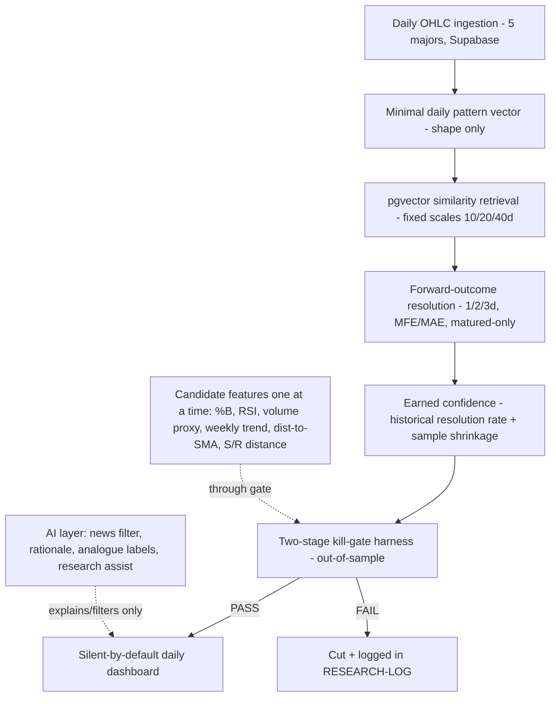

# FX Daily Pattern Trading Assistant — Project Plan

> **Historical document - partly superseded (banner added 2026-11-08).** This is the original
> greenfield plan. It is kept because its rationale (and `LESSONS.md`) still stand, but parts of
> the *design* no longer describe the system. For the system **as built** read
> [`PROJECT-STATE.md`](PROJECT-STATE.md). Specifically superseded:
>
> - **PASS/CUT kill-gate verdict** as the rule that lets a signal surface (Section 2 "Kill-gate", Task 6, Task 9). The live
>   firing rule is a single predicate (`fires()`: direction not FLAT and confidence >= 0.55) and the
>   two-stage measurement is now a human-read evaluation report with no verdict (PROJECT-STATE 5.7-5.8).
> - **The news / economic-calendar no-trade filter** (Section 4, Task 8). It was de-scoped and its code
>   (`src/news-filter/`) was removed. News is not an input to anything.
> - **Task 7, feature discovery through the gate.** Not pursued; the model is shape-only.
> - **Multi-horizon selection** (Section 2 "Horizon"). In practice the system is horizon-1 only (PROJECT-STATE 5.4).
> - **"Local-first" delivery.** The system runs as a Cloud Run Job publishing a static `dashboard.json`
>   to a public bucket, read by a Firebase-hosted SPA.
> - **Per-trade stop-loss / take-profit** as a displayed output. Removed from every UI surface because
>   daily bars cannot say which level is hit first.

> Self-contained plan for a greenfield personal trading assistant. Written to be dropped into a fresh Kiro project with no prior context. It restates its own rationale, defines every term concretely, specifies the stack, and designs the AI role in from the start.

## 0. Context & Hard-Won Lessons (read first — this replaces any prior-project knowledge)

This is a greenfield personal trading assistant for 5 major FX pairs. It is the successor to a prior FX forecasting system that failed in instructive ways. The following lessons are *constraints*, not suggestions — every task below exists to honor one of them:

- **A point-in-time "fingerprint" cannot predict short-horizon direction.** The prior system encoded market state as a 62-dimensional snapshot vector and tried to predict the next 4-hour candle. It reached ~52.15% directional accuracy — statistically a coin flip. Two compounding errors: a *static snapshot* (no path/sequence information) and the *4-hour horizon* (noisiest, most microstructure-driven timeframe).
- **High dimensionality diluted the signal.** 62 dimensions in one distance metric caused distance concentration (curse of dimensionality) — everything looked equidistant. Lesson: **ruthless dimensional minimalism.** Start at 1 feature; each new one must *earn* inclusion. Hard ceiling ~12.
- **The most promising idea was never measured.** A candle-*trajectory* representation (sequence of shape/%B/RSI) was built but never wired into a live measurement — it stayed a hopeful intuition. Lesson: **measure before believing. Nothing drives a displayed signal until it beats a baseline out-of-sample.**
- **News is a filter, not a signal.** Attempts to predict *from* news failed. The only robust finding: don't trade into elevated event risk. Lesson: **event risk suppresses signals; it never generates them.**
- **The engineering discipline was the real success.** Strict code quality, pure/deterministic computation, look-ahead guards, spec-driven development, and living documentation are carried forward as non-negotiable.
- **AI division of labor (hard rule):** **AI explains and filters; deterministic code decides and scores.** An LLM may read news, write plain-language rationale, describe analogues qualitatively, and help interpret results. An LLM must **never** compute the directional probability or the kill-gate verdict — those must be pure, reproducible, backtestable math, or the system becomes unfalsifiable (the exact trap that sank the prior project).

## 1. Problem Statement

Build a personal, local-first assistant for EURUSD, GBPUSD, USDJPY, USDCHF, USDCAD that surfaces a *small* number of high-conviction, forward-looking daily directional setups ("a pattern is emerging; over the next 1-3 days, direction X, with earned confidence C%") and stays silent otherwise. Every feature and pattern class must beat a defined baseline out-of-sample before it can drive a displayed signal. No public API/website in v1 (possible later phase). Sole consumer: a local daily-decision dashboard.

## 2. Concrete Definitions (no ambiguity permitted)

- **Horizon:** the model evaluates forward windows of **1, 2, and 3 trading days** and selects the horizon with the strongest historical resolution for the matched pattern neighborhood. The dashboard states the chosen horizon explicitly.
- **Direction classes:** UP / DOWN / FLAT, where FLAT is a move within an ATR-scaled dead-band (defined in Task 5), not a fixed pip count.
- **Baseline (the thing to beat):** **weekly-trend-follow** — predicted direction = sign of the weekly trend (e.g., sign of the change in a rolling weekly close or a weekly EMA slope) at the decision date. This is the null hypothesis: "you could have just followed the weekly trend."
- **Data split:** chronological, no shuffling. Train/dev on the earliest ~70%, held-out **out-of-sample test** on the most recent ~30%. All gate verdicts are computed on the out-of-sample test period only. (Exact dates fixed in Task 6 and recorded.)
- **Kill-gate (two sequential gates, both on out-of-sample test):**
  - **Gate 1 — Directional:** pattern-model directional accuracy must beat the weekly-trend-follow baseline by **≥ 3 percentage points**.
  - **Gate 2 — Risk-adjusted:** using MFE/MAE (maximum favorable / adverse excursion) over the selected horizon, the pattern-model's excursion-weighted hit metric must be **≥ the baseline's** (margin ≥ 0). Direction being right isn't enough; the path must be tradeable.
  - **Sample-size floor:** a pattern neighborhood must contain **≥ 30 historical analogues** before any confidence is displayed; below that, confidence shrinks toward neutral (Task 5) and typically won't cross the dashboard threshold.
  - **Verdict:** fail *either* gate → the feature/pattern is cut and the failure is logged in the research log.
- **Look-ahead-safe:** no candle dated at/after a decision date may contribute to that date's features or retrieval; only *matured* forward outcomes (whose full 1-3 day window has closed) count in evaluation. Enforced by an explicit guard function and tested.

## 3. Stack & Infrastructure (mirrors proven prior stack; local-first, cloud-ready)

- **Language:** TypeScript for the pipeline/orchestration and dashboard; Python only where genuinely needed (statistical/backtest tooling). Keep computation pure and deterministic.
- **Storage:** Supabase Postgres + **pgvector** for pattern-vector retrieval (ANN over fixed-dim pattern vectors). Local-first for research/backtesting; the same schema runs against the hosted Supabase project.
- **Cloud (GCP):** used for *scheduled unattended daily runs* once the model is validated — not required for the research phase. Structured so a website could be added later without rearchitecting (clean separation between compute/storage and any future serving layer).
- **AI provider:** an LLM accessed behind a thin, swappable interface, used only in the four sanctioned roles (Task 8), never in scoring.
- **New-project setup** (new Kiro + new GCP project + new Supabase project) is Task 1.

## 4. AI-in-the-Loop Design (all four roles, under the hard rule)

- **News/event no-trade filter:** AI reads the daily economic calendar + headlines → emits a *structured* risk flag (level + reason). Deterministic code decides suppression.
- **Signal rationale:** AI turns deterministic signal inputs (pattern, trend context, S/R distance, horizon, confidence) into a plain-language "why this setup" note on the dashboard card. It describes; it does not compute.
- **Pattern description:** AI qualitatively labels matched historical analogues ("consolidation breakout after a pullback to the 20-day").
- **Research assistant:** AI helps interpret backtest output and *propose* next feature hypotheses — always human-gated, never auto-accepted.
- **Guardrail (tested):** the probability and the gate verdict are produced only by deterministic code paths; a test asserts no AI output feeds those paths.

## 5. Architecture

## 6. Task Breakdown

### Task 1: New-project bootstrap + quality/documentation harness.
Create the Kiro project, new GCP project, and new Supabase project. Stand up lint + type-check + test runner in CI. Author `PROJECT-STATE.md` (living state) and `RESEARCH-LOG.md` (every experiment + gate verdict), and a `LESSONS.md` capturing Section 0 so the "why" survives context resets. Define pure-function + look-ahead-guard conventions. Establish Supabase connection (local + hosted) with env-based config.
- Tests: CI green on lint/type-check/empty suite; a templated research-log entry validates; Supabase connectivity smoke test.
- Demo: `make check` clean; three docs exist with first entries; a round-trip write/read to Supabase.

### Task 2: Daily OHLC ingestion for the 5 majors (deterministic, look-ahead-safe).
Ingest + normalize daily candles into Supabase, keyed by (asset, date). Enforce OHLC validity; implement and test the zero-look-ahead guard.
- Tests: idempotent ingestion; OHLC-invariant violations rejected; look-ahead guard proves no future candle leaks into a historical window.
- Demo: clean daily history for all 5 pairs + per-pair coverage summary.

### Task 3: Minimal daily pattern vector (shape only) with fixed multi-scale windows.
Encode *only* the daily candle-pattern shape over fixed scales (10/20/40 trading days), per-scale normalized so absolute price level doesn't dominate. No other features yet (pure discovery). Store as pgvector.
- Tests: deterministic, scale-normalized; identical windows → identical vectors; degenerate windows handled.
- Demo: for a date+pair, print the shape vector at each scale and its stored pgvector row.

### Task 4: pgvector similarity retrieval + forward-outcome resolution.
Retrieve nearest historical patterns; resolve each analogue's forward outcome at 1/2/3-day horizons, capturing terminal direction AND MFE/MAE. Strictly look-ahead-safe (analogues before query date; matured outcomes only; self-excluded).
- Tests: retrieval deterministic + self-excluding; outcomes use only forward candles; matured-only enforced.
- Demo: top-N analogues for a query date with how each resolved (direction + excursion) per horizon.

### Task 5: Earned confidence + ATR-scaled FLAT band.
Confidence = historical resolution rate of the analogue neighborhood, with **sample-size shrinkage** (thin neighborhoods → toward neutral). Define FLAT via an ATR-scaled dead-band. Select the horizon (1/2/3d) with the strongest resolution.
- Tests: confidence ∈ [0,1], deterministic; <30-analogue neighborhoods shrink; calibration check (predicted vs realized frequency) on a fixture.
- Demo: a historically ~80%-up neighborhood reports ~80% (minus shrinkage); a thin/ambiguous one reports near-neutral.

### Task 6: Two-stage kill-gate backtest harness (the centerpiece — comes before feature discovery).
Implement the weekly-trend-follow baseline and the out-of-sample harness with the fixed chronological split. Score any configuration: Gate 1 (≥3 pts directional over baseline) and Gate 2 (≥0 risk-adjusted via MFE/MAE). Emit a verdict + metrics, auto-appended to `RESEARCH-LOG.md`. Fix and record the exact test-period dates.
- Tests: reproduces known metrics on a fixture; baseline computed correctly; a deliberately-null feature FAILS both gates; split has no leakage.
- Demo: run on the Task 3-5 shape-only model → verdict table (accuracy vs baseline, risk-adjusted vs baseline, PASS/FAIL). This immediately tells you whether the core premise holds.

### Task 7: Feature discovery through the gate (one feature at a time, ≤12 ceiling).
Add candidates individually and re-run Task 6: %B, RSI, volume proxy (explicitly labeled tick/broker proxy, used as *regime* not magnitude), weekly-trend context, distance-to-SMA, and an **S/R-distance** feature (S/R detected separately via swing-high/low + level clustering, expressed as distance-to-nearest-level + strength). Each must pass both gates to stay; failures cut + logged.
- Tests: each feature toggled independently; equal-config reproduces prior verdict; per-feature verdict recorded.
- Demo: research log showing which features earned inclusion vs were cut, with metric deltas.

### Task 8: AI layer (four sanctioned roles, behind the hard rule).
Thin swappable LLM interface. Implement: (a) news/event no-trade risk flag (structured output), (b) signal rationale text from deterministic inputs, (c) qualitative analogue labels, (d) human-gated research-assist summaries. Assert via test that no AI output reaches the probability or gate-verdict paths.
- Tests: news flag produces structured suppression input; rationale is generated from (not generative of) the numeric signal; guardrail test proves scoring paths are AI-free.
- Demo: a setup card with an AI rationale + a would-be setup suppressed on a high-impact news day with a stated reason.

### Task 9: Silent-by-default daily decision dashboard (wires it all together).
Local dashboard running the *validated* model daily across the 5 pairs. Surfaces a pair ONLY when a gate-passing pattern crosses a configurable confidence threshold AND the news filter permits. Empty most days by design. When it fires: pair, direction, selected horizon, earned confidence, excursion profile (expected favorable vs adverse), and AI rationale. GCP scheduled daily refresh once validated.
- Tests: shows nothing when nothing crosses threshold; renders a firing setup correctly; never displays a feature/pattern that hasn't passed the gate; respects news suppression.
- Demo: a no-setup day (empty, correct) and a firing day (single high-conviction card with rationale); scheduled run produces the same result unattended.

### Task 10 (later phase, designed-for): optional public serving layer / website.
Reserved. The compute/storage separation from Task 1 means a read-only serving layer can be added without rearchitecting. Not built in v1.

## 7. Build-Order Discipline

**Task 6 (the kill-gate) lands before feature discovery (Task 7)**, so the first thing the project learns is whether shape-only daily pattern matching even beats following the weekly trend. If it doesn't, you know after ~6 tasks — and everything after is added *through* the gate, never around it. This is the entire lesson of the prior project encoded into build order.

## 8. Tunable Defaults (set now or leave configurable)

- **Confidence threshold** for the dashboard to fire — left configurable; tune against the Task 6 backtest.
- **Train/test split dates** — left configurable; fixed and recorded in Task 6.
